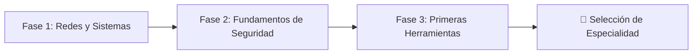

# 🗺️ Roadmap: Tu Camino en Ciberseguridad

> [!abstract] Resumen de la Guía
> Un punto de partida común y **siete caminos posibles de especialización**. Esta guía detalla la base formativa requerida, la progresión temporal de cada perfil y los trabajos prácticos a realizar en un caso de empresa real.

---

## 🌱 Tronco Común: Fundamentos Básicos (Primeros 2–3 meses)

Antes de bifurcarte hacia una rama, todo profesional de ciberseguridad debe asentar esta base indispensable:

1. **Fase 1 · Redes y Sistemas:**
   * Protocolos fundamentales (TCP/IP, UDP, DNS, DHCP, HTTP/S).
   * Subnetting y direccionamiento IP.
   * Administración básica por línea de comandos en **Windows (PowerShell/CMD)** y **Linux (Bash)**.
2. **Fase 2 · Fundamentos de Seguridad:**
   * La tríada **CIA** (Confidencialidad, Integridad y Disponibilidad).
   * Tipos de amenazas, vectores de ataque y conceptos de vulnerabilidad/exploit.
   * Vocabulario técnico esencial y modelos de defensa en profundidad.
3. **Fase 3 · Primeras Herramientas:**
   * Scripting básico en **Bash** y **Python**.
   * Uso fluido de terminal, editores y utilidades de red (`curl`, `nmap`, `netcat`, `tcpdump`).
   * Primeros pasos prácticos en plataformas guiadas como [TryHackMe](https://tryhackme.com/).

---

## 🔀 Selección de Especializaciones

| Especialidad | Icono | Salario Estimado (España) | Nivel de Demanda | Referencia Rápida |
| :--- | :---: | :---: | :---: | :--- |
| **GRC / Compliance** | ⚖️ | 28.000 – 65.000 €/año | 📈 Estable y creciente | [[#1. GRC / Compliance]] |
| **Analista SOC / Blue Team** | 🔵 | 25.000 – 55.000 €/año | 🔥 Alta demanda | [[#2. Analista SOC / Blue Team]] |
| **Técnico en Seguridad** | 🖥️ | 24.000 – 50.000 €/año | 🔥 Alta demanda | [[#3. Técnico en Seguridad Informática]] |
| **Pentester de Sistemas** | 🔴 | 30.000 – 70.000 €/año | 🔥 Alta demanda | [[#4. Pentester de Sistemas]] |
| **Pentester Web** | 🌐 | 30.000 – 70.000 €/año | 🔥 Alta demanda | [[#5. Pentester Web]] |
| **Analista de Malware** | 🦠 | 32.000 – 65.000 €/año | 📈 Demanda creciente | [[#6. Analista de Malware]] |
| **Forense Digital (DFIR)** | 🔍 | 28.000 – 60.000 €/año | 📈 Demanda creciente | [[#7. Forense Digital]] |

---

### 1. GRC / Compliance
> [!info] Perfil
> **Área:** Gobierno, Riesgo y Cumplimiento Normativo.  
> **Salario:** 28.000 – 65.000 €/año | **Demanda:** Estable y creciente.  
> **Nota ampliada:** Ver [[EXTRA/Ciberseguridad · Guía de Especialidades#1. GRC / Compliance|Detalles de GRC en la Guía de Especialidades]].

* **Fase 1 (0–3 meses) · Fundamentos normativos:**
  * Estudiar la norma [[MODULO/Controles ISO 27002 — Seguridad de la Información|ISO/IEC 27001 e ISO 27002]], el **Esquema Nacional de Seguridad (ENS)** y el **RGPD**.
  * Cursos gratuitos en la plataforma del `CCN-CERT`.
* **Fase 2 (3–6 meses) · Gestión de riesgos y auditoría:**
  * Metodología [[MODULO/MAGERIT - Gestión de Riesgos|MAGERIT v3]] y herramienta PILAR.
  * Planificación y ejecución de auditorías según ISO 19011. Recursos: *ENS Navegable*, *ISO27000.es*.
* **Fase 3 (6–12 meses) · Certificación y primeras prácticas:**
  * Preparar certificación AENOR / ISACA (`CISA`, `CRISC`). Prácticas en consultoría o auditoría interna.

---

### 2. Analista SOC / Blue Team
> [!info] Perfil
> **Área:** Monitorización continua, detección de intrusiones y respuesta a incidentes.  
> **Salario:** 25.000 – 55.000 €/año | **Demanda:** 🔥 Muy Alta.  
> **Nota ampliada:** Ver [[EXTRA/Ciberseguridad · Guía de Especialidades#2. Analista SOC / Blue Team|Detalles de SOC en la Guía de Especialidades]].

* **Fase 1 (0–3 meses) · Fundamentos SOC:**
  * Análisis de logs del sistema (Windows Event Viewer, Syslog).
  * Arquitectura de un SIEM y triaje de alertas.
  * Ruta recomendada: `TryHackMe – SOC Level 1`.
* **Fase 2 (3–6 meses) · Alertas reales y herramientas:**
  * Prácticas con simuladores: [LetsDefend](https://letsdefend.io/) y [Hackviser](https://hackviser.com/).
  * Dominio de plataformas SIEM/EDR: `Splunk`, `Wazuh`, `Elastic SIEM`.
* **Fase 3 (6–12 meses) · Certificación y primer empleo:**
  * Certificaciones sugeridas: `CSOA (Hackviser)`, `HTB CJCA` (Certified Junior Cybersecurity Analyst).
  * Aplicación a puestos de Analista SOC Tier 1.

---

### 3. Técnico en Seguridad Informática
> [!info] Perfil
> **Área:** Administración de seguridad, bastionado (hardening) y gestión de vulnerabilidades.  
> **Salario:** 24.000 – 50.000 €/año | **Demanda:** 🔥 Muy Alta.  
> **Nota ampliada:** Ver [[EXTRA/Ciberseguridad · Guía de Especialidades#3. Técnico en Seguridad Informática|Detalles de Técnico de Seguridad en la Guía de Especialidades]].

* **Fase 1 (0–3 meses) · Sistemas y Hardening básico:**
  * Configuración segura de servidores Windows Server y Linux.
  * Guías de bastionado con estándares `CIS Benchmarks`.
* **Fase 2 (3–6 meses) · Gestión de vulnerabilidades:**
  * Escaneo y análisis de vulnerabilidades con `Nessus`, `OpenVAS` / `Greenbone`.
  * Laboratorios en Hackviser, Hack The Box y TryHackMe.
* **Fase 3 (6–12 meses) · Certificación y especialización:**
  * Certificaciones: `CompTIA Security+`, `CAPT (Hackviser)`, `HTB CJCA`.
  * Formación oficial en herramientas enterprise: `Tenable.io`, `Qualys`.

---

### 4. Pentester de Sistemas
> [!info] Perfil
> **Área:** Simulación de ataques ofensivos (Red Team) contra redes, servidores e infraestructuras.  
> **Salario:** 30.000 – 70.000 €/año | **Demanda:** 🔥 Muy Alta.  
> **Nota ampliada:** Ver [[EXTRA/Ciberseguridad · Guía de Especialidades#4. Pentester / Red Team|Detalles de Pentester en la Guía de Especialidades]].

* **Fase 1 (0–3 meses) · Reconocimiento y explotación básica:**
  * Mapeo y escaneo con `Nmap`.
  * Frameworks de explotación como `Metasploit`.
  * Máquinas iniciales en `Hack The Box – Starting Point` y `DockerLabs`.
* **Fase 2 (3–9 meses) · Active Directory y Post-explotación:**
  * Ataques a entornos de Directorio Activo (Kerberoasting, AS-REP Roasting, Pass-the-Hash) con `BloodHound` e `Impacket`.
  * Escalada de privilegios en Linux y Windows. Prácticas en [[MODULO/🧪 Pruebas de Concepto|PoCs]].
* **Fase 3 (9–18 meses) · Certificaciones avanzadas:**
  * Progresión recomendada: `eJPT` → `CAPT` → `HTB CPTS` → `OSCP (OffSec)`.
  * Nivel experto: `HTB CAPE` (Active Directory) y `HTB CWPE` (Wi-Fi).

---

### 5. Pentester Web
> [!info] Perfil
> **Área:** Identificación y explotación de vulnerabilidades en aplicaciones web, APIs y microservicios.  
> **Salario:** 30.000 – 70.000 €/año | **Demanda:** 🔥 Muy Alta.  
> **Nota ampliada:** Ver [[EXTRA/Ciberseguridad · Guía de Especialidades#5. Pentester Web|Detalles de Pentester Web en la Guía de Especialidades]].

* **Fase 1 (0–3 meses) · Fundamentos de seguridad web:**
  * Dominar el **OWASP Top 10** en profundidad.
  * Formación completa en [PortSwigger Web Security Academy](https://portswigger.net/web-security) (100% gratuita y con laboratorios interactivos).
* **Fase 2 (3–9 meses) · Práctica con Burp Suite y APIs:**
  * Proxy avanzado e interceptación con `Burp Suite Pro`.
  * Fuzzing con `ffuf`, inyecciones automáticas con `sqlmap`.
  * Práctica de [[EXTRA/🐛 Recursos Bug Bounty|payloads y bypasses]].
* **Fase 3 (9–18 meses) · Certificación y especialización:**
  * Certificaciones: `eWPT`, `Burp Suite Certified Practitioner (BSCP)`, `HTB CWES`.
  * Especialización experta: `HTB CWEE` (Certified Web Exploitation Expert).

---

### 6. Analista de Malware
> [!info] Perfil
> **Área:** Ingeniería inversa, análisis estático/dinámico de artefactos maliciosos y desensamblado.  
> **Salario:** 32.000 – 65.000 €/año | **Demanda:** 📈 Creciente.  
> **Nota ampliada:** Ver [[EXTRA/Ciberseguridad · Guía de Especialidades#6. Analista de Malware|Detalles de Malware en la Guía de Especialidades]].

* **Fase 1 (0–3 meses) · Ensamblador y fundamentos:**
  * Arquitectura x86/x64, registros, pila (*stack*) y llamadas a sistema (API de Windows).
  * Cursos de ensamblador e ingeniería inversa básica.
* **Fase 2 (3–9 meses) · Reversing práctico:**
  * Análisis con desensambladores/debuggers: `Ghidra`, `x64dbg`, `IDA Pro`.
  * Extracción y detonación de muestras en sandboxes controlados (`MalwareBazaar`, `Any.Run`).
* **Fase 3 (9–18 meses) · Certificación y técnicas avanzadas:**
  * Certificación de referencia: `GIAC GREM` (Reverse Engineering Malware).
  * Formación especializada en desobfuscación y evasión de EDR.

---

### 7. Forense Digital (DFIR)
> [!info] Perfil
> **Área:** Investigación pericial, respuesta a incidentes y preservación de cadena de custodia.  
> **Salario:** 28.000 – 60.000 €/año | **Demanda:** 📈 Creciente.  
> **Nota ampliada:** Ver [[EXTRA/Ciberseguridad · Guía de Especialidades#7. Forense Digital|Detalles de Forense en la Guía de Especialidades]].

* **Fase 1 (0–3 meses) · Fundamentos de adquisición:**
  * Procedimientos de adquisición forense y cadena de custodia (copias bit a bit con `dd`, `FTK Imager`).
  * Análisis de discos y sistemas de archivos con `Autopsy`.
* **Fase 2 (3–9 meses) · Análisis de incidentes y memoria:**
  * Extracción y análisis de memoria RAM con `Volatility 3`.
  * Retos forenses en [CyberDefenders](https://cyberdefenders.org/) y [Blue Team Labs Online](https://blueteamlabs.online/). Ver [[EXTRA/Retos de Seguridad Informática|Retos CTF de Forense]].
* **Fase 3 (9–18 meses) · Certificación especializada:**
  * Certificaciones estándar: `GCFE` (GIAC Certified Forensic Examiner) y `GCFA` (GIAC Certified Forensic Analyst).

---

## 🛠️ Trabajos para Realizar en las Prácticas (Caso Real de Empresa)

Este plan de 13 ejercicios simula la auditoría y adecuación de seguridad completa para una pyme (ej. clínica dental o asesoría) conforme a la directiva **NIS2**:

- [ ] **1. OSINT y Reconocimiento:** Investigar la huella digital pública de la empresa (dominios, correos filtrados, empleados expuestos en LinkedIn, metadatos). Ver [[MODULO/Google Dorks - Generador OSINT|Dorks OSINT]].
- [ ] **2. Inventario de Activos:** Registrar servidores, PCs, periféricos, routers, software, bases de datos y cuentas conforme a [[MODULO/MAGERIT - Gestión de Riesgos|categorías MAGERIT]].
- [ ] **3. Análisis de Riesgos:** Identificar amenazas sobre los activos, calcular impacto/probabilidad y determinar el riesgo intrínseco y residual.
- [ ] **4. Auditoría de Accesos:** Revisar cuentas activas, privilegios administrativos y aplicar el principio de mínimo privilegio.
- [ ] **5. Revisión de Autenticación y Contraseñas:** Evaluar robustez de contraseñas, políticas de expiración y desplegar MFA/2FA.
- [ ] **6. Auditoría de Red:** Mapear la topología de red, escanear puertos abiertos (`nmap`), separar VLANs (empleados vs visitas) y revisar reglas de firewall.
- [ ] **7. Revisión de Backups:** Verificar política de copias de seguridad 3-2-1, pruebas periódicas de restauración y aislamiento contra ransomware.
- [ ] **8. Cumplimiento RGPD:** Revisar el Registro de Actividades de Tratamiento (RAT), contratos de encargado de tratamiento y procedimiento de notificación de brechas ante la AEPD en 72h.
- [ ] **9. Plan de Respuesta a Incidentes:** Documentar protocolo de actuación ante incidentes comunes (ransomware, compromiso de correo corporativo, fuga de información).
- [ ] **10. Política General de Seguridad:** Redactar documento normativo para empleados (uso aceptable de equipos, dispositivos móviles, teletrabajo).
- [ ] **11. Plan de Concienciación:** Diseñar y ejecutar sesión formativa para empleados contra phishing, ingeniería social y hábitos seguros.
- [ ] **12. Gestión de Terceros y Proveedores:** Auditar contratos con soporte técnico, hosting web y proveedores SaaS que traten datos de la organización.
- [ ] **13. Informe Final de Adecuación a NIS2:** Elaborar informe ejecutivo para dirección con brechas detectadas y matriz de recomendaciones priorizadas.

---

> [!tip] Recursos Adicionales
> * Portal interactivo de referencia internacional: [roadmap.sh/cyber-security](https://roadmap.sh/cyber-security)
