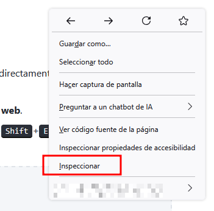
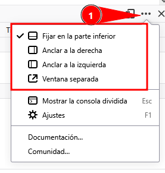
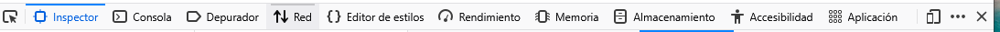

DevTools Lab

    
      [← Portada]([[02 - MODULOS/Prácticas (PoCs)/Conceptos Fundamentales/03 - Auditoría Web con Firefox DevTools|Índice de DevTools]])
      [Módulo 1 →]([[02 - MODULOS/Prácticas (PoCs)/Conceptos Fundamentales/03b - DevTools - Módulo 1 - Inspector HTML|03b - DevTools - Módulo 1 - Inspector HTML]])
    
  

  

    
Módulo 0

    

# Introducción a las DevTools de Firefox

    
Este módulo es teórico: presenta la herramienta antes de entrar en cada panel por separado.

  

  

    

## 0.1. ¿Qué son las herramientas de desarrollador?

    

      Las **DevTools** (herramientas de desarrollador) son un conjunto de utilidades
      integradas en el propio navegador que permiten examinar, depurar y modificar una página web
      mientras se está ejecutando: su estructura HTML, sus estilos CSS, su comportamiento en
      JavaScript, las peticiones de red que realiza y los datos que almacena en el dispositivo del
      usuario.
    

    

      No son un programa aparte que haya que instalar: forman parte de Firefox (y del resto de
      navegadores modernos) y están disponibles en cualquier página que visites, incluidas las que
      no son tuyas. Esto las convierte en una herramienta tan útil para desarrollar como para
      entender cómo está construida cualquier web que encuentres en internet.
    

    

      **Importante.** Los cambios que hagas desde las DevTools (editar un texto,
      cambiar un color, borrar un elemento) sólo existen en tu navegador y desaparecen al recargar
      la página. No modifican el servidor ni afectan a otros visitantes. Esto es justo lo que las
      hace seguras para practicar: puedes "romper" la página de práctica todo lo que quieras.
    

    

## 0.2. Cómo abrir las DevTools en Firefox

    

Existen varias formas de acceder a ellas; conviene conocer más de una:

    
      
* Tecla F12.
      
* Atajo Ctrl + Shift + I (abre el último panel usado).
      
* Clic derecho sobre cualquier elemento de la página → **Inspeccionar** (abre directamente el Inspector, con ese elemento ya seleccionado).
      
* Menú de Firefox (≡) → **Más herramientas** → **Herramientas de desarrollo web**.
      
* Atajos directos a paneles concretos: Ctrl+Shift+K (Consola), Ctrl+Shift+E (Red), Ctrl+Shift+M (Diseño adaptable).
    

    

      📸
           

    

    

## 0.3. Anatomía de la ventana de DevTools

    

      Al abrirse, las DevTools ocupan por defecto una parte de la ventana del navegador (modo
      **acoplado**), pero se pueden reorganizar:
    

    
      
* **Acopladas abajo**: ocupan la parte inferior de la ventana (opción por defecto).
      
* **Acopladas a un lado**: se sitúan a la derecha o izquierda, útil en pantallas anchas.
      
* **Ventana separada**: se desprenden en su propia ventana, independiente de la del navegador.
    
    

      El icono para cambiar entre estos modos está en la esquina superior derecha del propio panel
      de DevTools, junto al botón de cerrar (✕).
    

    

      📸
			

    

    

## 0.4. Tour rápido por los paneles

    

      En la parte superior de la ventana de DevTools hay una barra de pestañas, una por panel. A lo
      largo del curso trabajaremos cada uno en detalle; por ahora, basta con identificarlos:
    

    

      

        

#### Inspector

        

Estructura HTML y estilos CSS aplicados a cada elemento. Módulos 1 y 2.

      

      

        

#### Consola

        

Mensajes de la página (logs, avisos, errores) y ejecución de JavaScript en vivo. Módulo 3.

      

      

        

#### Depurador

        

Código fuente JavaScript, puntos de interrupción y ejecución paso a paso. Módulo 4.

      

      

        

#### Red

        

Todas las peticiones que realiza la página: HTML, CSS, imágenes, peticiones a APIs. Módulo 5.

      

      

        

#### Almacenamiento

        

localStorage, sessionStorage, cookies y otros datos guardados en el navegador. Módulo 6.

      

      

        

#### Diseño adaptable

        

Simulación de distintos tamaños de pantalla y dispositivos. Módulo 7.

      

      

        

#### Accesibilidad

        

Árbol de accesibilidad, contraste y roles ARIA. Módulo 8 (opcional).

      

      

        

#### Rendimiento

        

Grabación del comportamiento de la página para detectar cuellos de botella. Módulo 9 (opcional).

      

    

    

      📸
				

		
    

    

## 0.5. Una advertencia necesaria: el "self-XSS"

    

      Es habitual que, al buscar ayuda por internet, algún resultado indique "copia y pega este
      código en la consola" para activar una función oculta o un truco. Nunca debe hacerse con
      código de origen desconocido: pegado en la consola, ese código se ejecuta con los mismos
      permisos que la propia página, incluida una sesión iniciada (redes sociales, correo, banca).
      Es una de las técnicas de fraude más comunes y se conoce como *self-XSS*, porque es la
      propia víctima quien ejecuta el ataque sin saberlo.
    

    

      A lo largo del curso ejecutaremos código en la consola de forma habitual, pero siempre código
      que hayamos escrito nosotros o que entendamos completamente.
    

    

      

## Ejercicios prácticos

      

        
Ejercicio 01

        Sobre esta misma página:
        
          
* Abre las DevTools usando la tecla `F12` y ciérralas.
          
* Ábrelas de nuevo con el atajo `Ctrl`+`Shift`+`I`.
          
* Ábrelas una tercera vez haciendo clic derecho sobre este mismo párrafo y seleccionando **Inspeccionar**. Observa en qué panel se abren y qué elemento aparece ya seleccionado.
        
      

      

        
Ejercicio 02

        Con las DevTools abiertas:
        
          
* Cambia el modo de acoplado a "ventana separada" y comprueba cómo cambia la disposición.
          
* Vuelve a acoplarlas, esta vez a un lateral (derecha o izquierda) en lugar de abajo.
          
* Deja las DevTools en el modo de acoplado con el que te sientas más cómodo para trabajar durante el resto del curso.
        
      

      

        
Ejercicio 03

        Recorre la barra de pestañas de las DevTools y, sin entrar todavía en el contenido de cada
        panel, anota en un documento aparte el nombre exacto de cada pestaña que veas en tu barra
        (pueden variar ligeramente según la versión de Firefox). Lo usaremos como referencia en los
        próximos módulos.
      

    

  

  
    

DevTools Lab — Módulo 0: Introducción a las DevTools de Firefox.
