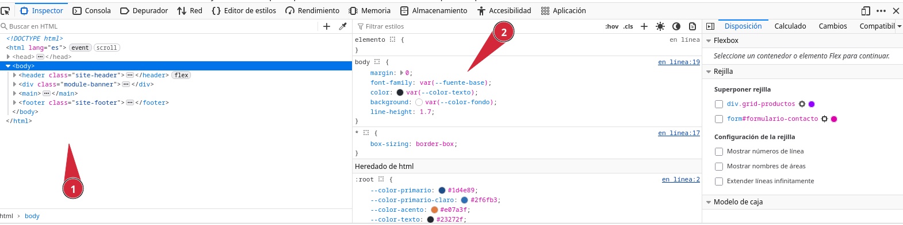
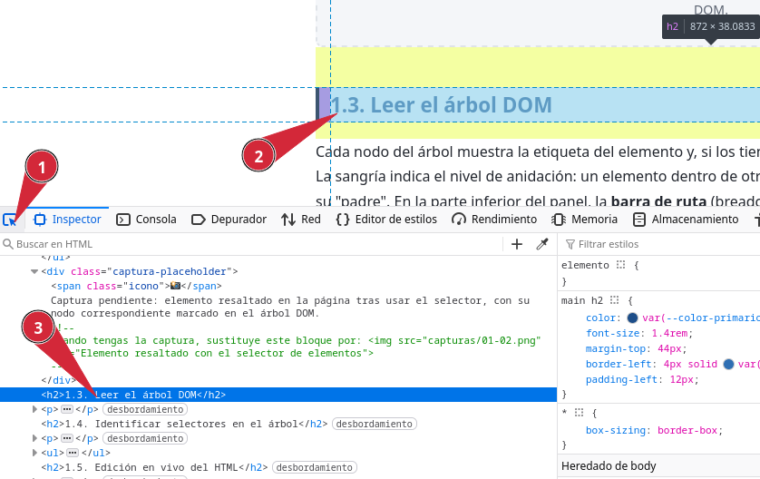
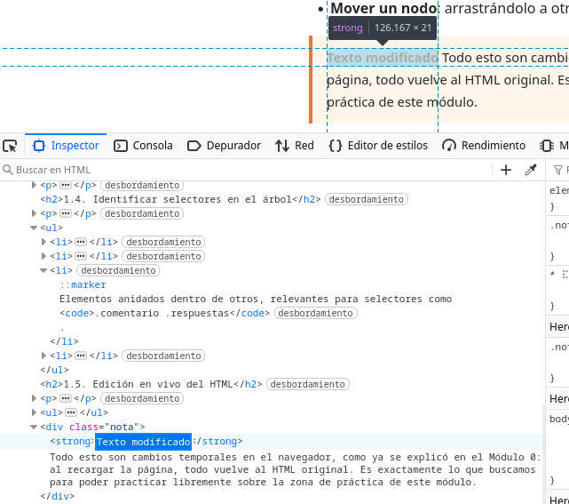
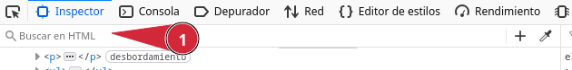

DevTools Lab

    
      [← Portada]([[02 - MODULOS/Prácticas (PoCs)/Conceptos Fundamentales/03 - Auditoría Web con Firefox DevTools|Índice de DevTools]])
      [← Módulo 0]([[02 - MODULOS/Prácticas (PoCs)/Conceptos Fundamentales/03a - DevTools - Módulo 0 - Introducción|03a - DevTools - Módulo 0 - Introducción]])
      [Módulo 2 →]([[02 - MODULOS/Prácticas (PoCs)/Conceptos Fundamentales/03c - DevTools - Módulo 2 - Inspector CSS|03c - DevTools - Módulo 2 - Inspector CSS]])
    
  

  

    
Módulo 1

    

# Inspector — Estructura HTML

    
Panel de las DevTools que se trabaja en este módulo: **Inspector**.

  

  

    

## 1.1. El panel Inspector

    

      El **Inspector** muestra el árbol de elementos HTML de la página (el DOM) tal y
      como lo interpreta el navegador en cada momento, y no necesariamente tal y como está escrito
      en el archivo original. Junto al árbol, un panel lateral muestra las reglas CSS aplicadas al
      elemento seleccionado; de ese panel lateral nos ocuparemos en el Módulo 2. En este módulo nos
      centramos exclusivamente en la parte del árbol de elementos.
    

    

      📸
      

    

    

## 1.2. Seleccionar elementos

    

Hay dos formas principales de seleccionar un elemento para inspeccionarlo:

    
      
* **Selector de elementos (picker)**: el icono con forma de cursor y recuadro, en la esquina superior izquierda de las DevTools. Al activarlo, cualquier elemento sobre el que pases el ratón en la página se resalta, y al hacer clic queda seleccionado en el árbol.
      
* **Clic derecho → Inspeccionar**, sobre cualquier elemento de la página, como ya vimos en el Módulo 0.
      
* Navegando manualmente por el árbol del Inspector, expandiendo nodos con la flecha o la tecla →.
    

    

      📸
      

    

    

## 1.3. Leer el árbol DOM

    

      Cada nodo del árbol muestra la etiqueta del elemento y, si los tiene, sus atributos
      (`id`, `class`, etc.) entre comillas. La sangría indica el nivel de
      anidación: un elemento dentro de otro aparece desplazado hacia la derecha respecto a su
      "padre". En la parte inferior del panel, la **barra de ruta** (breadcrumbs)
      muestra la cadena completa de ancestros del elemento seleccionado, de `html` hasta
      el propio elemento; hacer clic en cualquier eslabón de esa ruta selecciona ese ancestro.
    

    

## 1.4. Identificar selectores en el árbol

    

      Antes de escribir CSS o JavaScript que apunte a un elemento concreto, hay que saber
      identificarlo. En el árbol del Inspector puedes distinguir:
    

    
      
* Elementos con `id` único: `
`.
      
* Elementos con una o varias clases: `class="producto"` frente a `class="producto agotado"`.
      
* Elementos anidados dentro de otros, relevantes para selectores como `.comentario .respuestas`.
      
* Atributos personalizados `data-*`, útiles como "ganchos" para JavaScript sin depender de clases de estilo.
    

    

## 1.5. Edición en vivo del HTML

    

El Inspector no es de solo lectura. Directamente sobre el árbol puedes:

    
      
* **Editar texto**: doble clic sobre el contenido de texto de un nodo.
      
* **Editar atributos**: doble clic sobre un atributo existente, o clic en el espacio junto a la etiqueta para añadir uno nuevo.
      
* **Editar como HTML**: clic derecho sobre un nodo → "Editar como HTML", que abre ese fragmento como texto editable, útil para cambios más grandes o para duplicar estructuras.
      
* **Eliminar un nodo**: seleccionarlo y pulsar Supr, o clic derecho → "Eliminar nodo".
      
* **Mover un nodo**: arrastrándolo a otra posición del árbol.
    

    

      **Recuerda.** Todo esto son cambios temporales en el navegador, como ya se explicó
      en el Módulo 0: al recargar la página, todo vuelve al HTML original. Es exactamente lo que
      buscamos para poder practicar libremente sobre la zona de práctica de este módulo.
    

    

      📸
      

    

    

## 1.6. Buscar elementos

    

      Dentro del propio Inspector, Ctrl+F abre un buscador que permite
      localizar elementos por etiqueta, clase, id o incluso por fragmentos de su contenido de
      texto, sin necesidad de recorrer el árbol manualmente. Es especialmente útil en páginas con
      mucho contenido.
    

    

      📸
      

    

    

      

## Zona de práctica y ejercicios

      

        A partir de aquí, cada bloque de práctica va seguido de su ejercicio correspondiente, para
        que no tengas que subir y bajar entre la zona de práctica y el enunciado.
      

      

        

### Tarjeta de perfil

        

          Práctica
          

            
AR

            

              

### Ana Ruiz

              

Desarrolladora frontend, en proceso de aprender las DevTools de Firefox.

              
                
* HTML
                
* CSS
                
* Aprendiendo DevTools
              
              Seguir
            

          

        

        

          
Ejercicio 01

          Activa el selector de elementos (picker) y usa la barra de ruta (breadcrumbs) para responder,
          sin mirar el código fuente:
          
            
* ¿Qué elemento contiene directamente al botón "Seguir"?
            
* ¿Cuántos ancestros hay entre el botón "Seguir" y la etiqueta ``?
          
        

        

          
Ejercicio 02

          Edición en vivo sobre esta misma tarjeta:
          
            
* Cambia el texto de la biografía por uno inventado por ti.
            
* Cambia el texto del botón "Seguir" por "Siguiendo".
          
        

      

      

        

### Cuadrícula de productos

        

          Práctica
          

            

              
Teclado mecánico

              
59,90 €

            

            

              
Ratón inalámbrico

              
24,50 €

            

            

              
Monitor 27"

              
210,00 €

            

            

              
Soporte para portátil

              
18,00 €

            

          

        

        

          
Ejercicio 03

          Usando únicamente el árbol del Inspector (sin el buscador todavía), localiza el elemento
          que tiene la clase `agotado` y anota su clase completa (con todas las clases
          que tenga, no solo esa).
        

        

          
Ejercicio 04

          Edición en vivo: cambia el precio del "Ratón inalámbrico" a `29,90 €`.
        

      

      

        

### Formulario de contacto

        

          Práctica
          
            Nombre
            

            Correo electrónico
            

            Asunto
            
              Consulta general
              Soporte técnico
              Otro
            

            Mensaje
            
          
        

        

          
Ejercicio 05

          Abre el buscador del Inspector con `Ctrl`+`F` y localiza el elemento
          con `id="campo-mensaje"`. Comprueba a qué etiqueta HTML corresponde.
        

      

      

        

### Comentarios anidados

        

          Práctica
          

            
Marcos

            

¿Alguien sabe si esto funciona igual en modo oscuro?

            

              

                
Ana Ruiz

                

Sí, el comportamiento no cambia con el tema.

                

                  

                    
Marcos

                    

Genial, gracias por confirmarlo.

                  

                

              

            

          

          

            
Laura

            

Yo tuve un problema parecido la semana pasada.

          

        

        

          
Ejercicio 06

          Indica cuántos niveles de anidación hay como máximo y qué comentario es "hijo" directo de
          cuál. Después, selecciona el `
` exterior del
          primer comentario (el de Marcos) y añádele, usando el Inspector, una nueva clase llamada `destacado`, sin tocar
          el código fuente. Comprueba que el comentario completo cambia de aspecto al añadir la
          clase.
        

      

      

        

### Navegación de ejemplo (breadcrumbs)

        

          Práctica
          
            
              
* [Tienda](#)
              
* [Periféricos](#)
              
* [Teclados](#)
              
* Teclado mecánico
            
          
        

        

          
Ejercicio 07

          Usa el buscador del Inspector (`Ctrl`+`F`) con el selector
          `.breadcrumbs-ejemplo li` para saber, sin contar nodos a mano, cuántos
          elementos `` tiene esta lista de navegación: el propio buscador
          muestra el total de coincidencias encontradas. Después, edita en vivo el texto del
          último `` para que diga "Teclado mecánico RGB".
        

      

      

        

### Tabla de inventario

        

          Práctica
          

| Referencia | Producto | Stock |
| --- | --- | --- |
| REF-001 | Teclado mecánico | 14 |
| REF-002 | Ratón inalámbrico | 32 |
| REF-003 | Monitor 27" | 0 |
| REF-004 | Soporte para portátil | 9 |

        

        

          
Ejercicio 08

          Usa "Editar como HTML" en una fila (``) para duplicarla, y cambia los
          datos de la copia para que represente un producto nuevo ("Alfombrilla XL", referencia
          "REF-005", stock 20). La tabla debe quedarte con cinco filas de datos en lugar de cuatro.
        

      

    

  

  
    

DevTools Lab — Módulo 1: Inspector (HTML).
