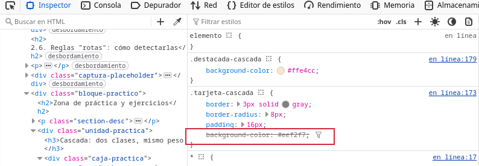
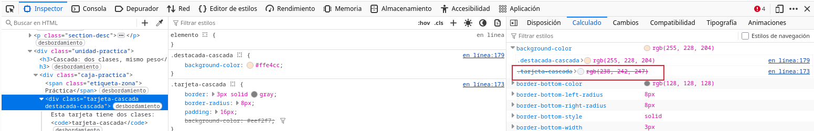
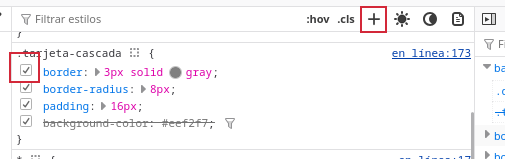
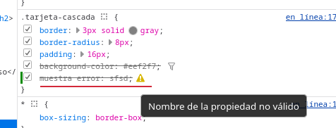

DevTools Lab

    
      [← Portada]([[02 - MODULOS/Prácticas (PoCs)/Conceptos Fundamentales/03 - Auditoría Web con Firefox DevTools|Índice de DevTools]])
      [← Módulo 1]([[02 - MODULOS/Prácticas (PoCs)/Conceptos Fundamentales/03b - DevTools - Módulo 1 - Inspector HTML|03b - DevTools - Módulo 1 - Inspector HTML]])
      [Módulo 3 →]([[02 - MODULOS/Prácticas (PoCs)/Conceptos Fundamentales/03d - DevTools - Módulo 3 - Consola|03d - DevTools - Módulo 3 - Consola]])
    
  

  

    
Módulo 2

    

# Inspector — Reglas CSS

    
Panel de las DevTools que se trabaja en este módulo: **Inspector** (panel de reglas CSS y pestaña "Calculado").

  

  

    

## 2.1. El panel de reglas CSS

    

      Al seleccionar un elemento en el Inspector, el panel lateral muestra todas las reglas CSS que
      lo afectan, agrupadas por selector, en el mismo orden en que el navegador las aplica. Cuando
      una propiedad ha sido sobrescrita por otra regla con más peso, aparece **tachada**,
      de forma que se puede ver de un vistazo qué está realmente en efecto y qué ha sido descartado.
    

    

      📸
      

    

    

## 2.2. La cascada

    

      Cuando dos reglas con el **mismo nivel de especificidad** afectan a la misma
      propiedad del mismo elemento, gana la que aparece **más abajo en la hoja de estilos**,
      independientemente del orden en que las clases estén escritas en el atributo `class`
      del HTML. Este orden es uno de los tres factores de la cascada, junto con el origen de la
      regla (navegador, autor, `!important`) y la especificidad, que veremos a
      continuación.
    

    

## 2.3. Especificidad

    

      La especificidad determina qué regla gana cuando varias apuntan al mismo elemento con
      distinto "peso". De menor a mayor peso, de forma simplificada:
    

    
      
* Selectores de etiqueta (`p`, `div`...) y pseudoelementos.
      
* Selectores de clase (`.producto`), atributo (`[type="text"]`) y pseudoclase (`:hover`).
      
* Selectores de `id` (`#tarjeta-perfil`).
      
* Estilos en línea (atributo `style` del HTML).
      
* `!important`, que salta por encima de todo lo anterior (y que conviene usar con mucha moderación).
    
    

      Ante un empate de especificidad, se aplica la regla de la cascada del punto anterior (gana la
      última declarada).
    

    

      📸
      

    

    

## 2.4. Herencia

    

      Algunas propiedades CSS se transmiten de forma automática de un elemento a sus descendientes
      si estos no las sobrescriben: es el caso, por ejemplo, de `color` o
      `font-family`. Otras, como `border`, `margin` o
      `padding`, **no se heredan nunca**: hay que declararlas explícitamente
      en cada elemento que las necesite. En la pestaña "Calculado" del Inspector se puede ver el
      valor final de cualquier propiedad, venga de una regla propia o heredada.
    

    

## 2.5. Edición en vivo de CSS

    

Desde el panel de reglas del Inspector puedes, sobre cualquier regla existente:

    
      
* **Activar o desactivar** una propiedad con la casilla que aparece a su izquierda, sin borrarla.
      
* **Modificar su valor** haciendo clic sobre él (y ajustarlo con las flechas del teclado en propiedades numéricas).
      
* **Añadir una propiedad nueva** a una regla existente, haciendo clic en el espacio en blanco tras la última declaración.
      
* **Crear una regla nueva** para el elemento seleccionado, con el icono "+" de la parte superior del panel.
    

    

      📸
      

    

    

## 2.6. Reglas "rotas": cómo detectarlas

    

      No todo el CSS que se escribe llega a aplicarse. Un nombre de propiedad mal escrito, un valor
      no válido o una unidad incorrecta hacen que el navegador descarte esa línea sin avisar en
      pantalla. El Inspector sí lo señala: la declaración inválida aparece tachada y con un icono de
      advertencia (⚠) junto a ella, con un mensaje explicando el motivo si pasas el ratón por encima.
    

    

      📸
      

    

    

      

## Zona de práctica y ejercicios

      

        Cada bloque de práctica va seguido de su ejercicio correspondiente.
      

      

        

### Cascada: dos clases, mismo peso

        

          Práctica
          

            Esta tarjeta tiene dos clases: `tarjeta-cascada` y
            `destacada-cascada`, cada una con su propia regla de `background-color`.
          

        

        

          
Ejercicio 01

          Selecciona esta tarjeta en el Inspector y observa el panel de reglas: ¿qué color de fondo
          gana y por qué? Desactiva temporalmente esa declaración con la casilla del Inspector y
          comprueba que entonces se aplica la otra regla.
        

      

      

        

### Especificidad: id contra clase

        

          Práctica
          

            Este párrafo tiene la clase `parrafo-base` (color gris) y también el
            `id="parrafo-vip"` (color azul y negrita).
          

        

        

          
Ejercicio 02

          En el panel de reglas, identifica las dos reglas que compiten por la propiedad
          `color` de este párrafo. Indica cuál gana y por qué, en términos de
          especificidad (no de orden en la hoja de estilos).
        

      

      

        

### Herencia de propiedades

        

          Práctica
          

            Este contenedor define `color` y `font-family` propios.
            

              Esta cita no tiene ni `color` ni `font-family` propios.
              pero esta marca sí tiene su propio borde y tipografía
            

          

        

        

          
Ejercicio 03

          Selecciona la cita interior (`.cita-interior`) y, en la pestaña "Calculado",
          comprueba de dónde vienen sus valores de `color` y `font-family`.
          Después, selecciona la marca interior (`.marca-interior`) y explica por qué
          tiene un borde propio pero, en cambio, no ha heredado ese borde ninguno de sus elementos
          hijos hipotéticos (piensa en por qué `border` nunca se hereda).
        

      

      

        

### Botón con una propiedad mal escrita

        

          Práctica
          Comprar ahora
        

        

          
Ejercicio 04

          El texto de este botón debería verse en blanco y no se ve. Localiza en el panel de reglas
          la declaración tachada con el icono de advertencia, identifica cuál es el error y
          corrígelo en vivo desde el Inspector hasta que el texto se muestre en blanco.
        

      

      

        

### Un aviso que no debería estar oculto

        

          Práctica
          

Estado del pedido: en preparación.

          
⚠ Aviso: quedan pocas unidades en stock.

          

            Leer más sobre el envío
          

          
Los envíos a península tardan entre 24 y 48 horas laborables.

        

        

          
Ejercicio 05

          En esta zona hay dos elementos ocultos con `display: none`: el aviso de stock
          y el contenido ampliado del envío. Uno de los dos está oculto **a propósito**
          (se revela al pulsar el botón) y el otro está oculto **por error** y debería
          verse siempre. Localiza ambos en el árbol del Inspector, identifica cuál es el error y
          corrígelo desactivando la propiedad `display: none` de esa regla concreta,
          sin tocar la del otro elemento.
        

      

      

        

### Una caja descuadrada

        

          Práctica
          

            

            

            

          

        

        

          
Ejercicio 06

          Las tres cajas deberían estar alineadas verticalmente entre sí. Selecciona la caja que
          está descuadrada, localiza en el panel de reglas la propiedad responsable del
          desplazamiento y corrígela en vivo hasta que las tres queden alineadas.
        

      

      

        

### Añadir una regla nueva desde cero

        

          Práctica
          

            Esta tarjeta reutiliza `tarjeta-cascada`, pero no tiene ninguna sombra.
          

        

        

          
Ejercicio 07

          Selecciona esta tarjeta y, con el icono "+" del panel de reglas, crea una regla nueva
          para el selector `#tarjeta-sin-sombra` que le añada
          `box-shadow: 0 4px 10px rgba(0,0,0,0.15);`. Ten en cuenta que, por tratarse de
          un `id`, esta nueva regla tendrá más especificidad que la de la clase.
        

      

      

        

### Cuando ni la especificidad basta: `!important`

        

          Práctica
          

            Este párrafo tiene un color gris definido con un estilo en línea
            (`style="color: gray;"`), que normalmente tendría más peso que cualquier
            clase o id externos.
          

        

        

          
Ejercicio 08

          Crea, desde el Inspector, una regla nueva para `#parrafo-important` que
          establezca `color: var(--color-acento) !important;`. Comprueba que, a
          diferencia del ejercicio anterior, esta vez la nueva regla gana incluso al estilo en
          línea, y explica por qué.
        

      

    

  

  
    

DevTools Lab — Módulo 2: Inspector (CSS).
