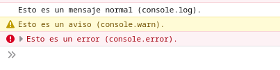
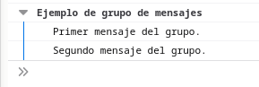

DevTools Lab

    
      [← Portada]([[02 - MODULOS/Prácticas (PoCs)/Conceptos Fundamentales/03 - Auditoría Web con Firefox DevTools|Índice de DevTools]])
      [← Módulo 2]([[02 - MODULOS/Prácticas (PoCs)/Conceptos Fundamentales/03c - DevTools - Módulo 2 - Inspector CSS|03c - DevTools - Módulo 2 - Inspector CSS]])
      [Módulo 4 →]([[02 - MODULOS/Prácticas (PoCs)/Conceptos Fundamentales/03e - DevTools - Módulo 4 - Depurador|03e - DevTools - Módulo 4 - Depurador]])
    
  

  

    
Módulo 3

    

# Consola

    
Panel de las DevTools que se trabaja en este módulo: **Consola**.

  

  

    

## 3.1. El panel Consola

    

      La Consola cumple dos funciones a la vez: por un lado, muestra los mensajes que el propio
      código JavaScript de la página va generando (con `console.log` y funciones
      similares) y los errores que se producen durante su ejecución; por otro, es un intérprete de
      JavaScript en el que se puede escribir y ejecutar código directamente contra la página que
      tienes abierta.
    

    

## 3.2. Tipos de mensajes

    

Existen varios métodos para registrar mensajes, cada uno con su propio icono y color:

    
      
* `console.log(...)`: mensaje informativo genérico, el más habitual.
      
* `console.info(...)`: informativo, visualmente muy similar a `log`.
      
* `console.warn(...)`: aviso (icono ⚠, fondo amarillento); algo que no es un error pero conviene revisar.
      
* `console.error(...)`: error (icono ✕, fondo rojizo); algo ha fallado.
    
    

      Los errores no capturados por el propio código (excepciones) aparecen también en rojo,
      exactamente igual que si se hubiera llamado a `console.error`, junto con una
      **pila de llamadas** (stack trace) que indica en qué archivo y línea se originó
      el problema; haciendo clic en esa referencia, las DevTools te llevan directamente a esa línea.
    

    

      Probar los tres tipos de mensaje
    

    

      📸
      



    

    

## 3.3. Ejecutar JavaScript en la consola

    

      Justo debajo de los mensajes hay una línea de entrada en la que se puede escribir cualquier
      expresión JavaScript válida y ejecutarla con Enter: desde operaciones simples
      (`2 + 2`) hasta declarar variables, llamar a funciones ya definidas en la página, o
      interactuar con el propio documento.
    

    

## 3.4. Interactuar con la página desde la consola

    

      Al ejecutarse en el contexto de la página, la consola tiene acceso directo a
      `document` y a todo lo que esté definido en el JavaScript de esa página. Algunos
      atajos útiles:
    

    
      
* `document.querySelector('selector')`: obtiene el primer elemento que coincida con ese selector CSS, para leer o modificar sus propiedades.
      
* `$0`: hace referencia al elemento actualmente seleccionado en el Inspector, sin necesidad de volver a buscarlo con `querySelector`.
    

    

## 3.5. console.table

    

      Cuando el dato a inspeccionar es una lista de objetos con la misma forma (por ejemplo, varios
      productos con nombre, precio y stock), `console.table(...)` los muestra como una
      tabla con una columna por propiedad, mucho más legible que un array anidado en formato de
      texto.
    

    

## 3.6. Agrupar mensajes

    

      `console.group('título')` agrupa todos los mensajes que se registren hasta la
      siguiente llamada a `console.groupEnd()` bajo un bloque plegable, útil para separar
      visualmente los mensajes de distintas partes de un proceso.
    

    

      Probar console.group
    

    

      📸
      



    

    

## 3.7. Inspeccionar objetos y arrays

    

      Cuando se registra un objeto o un array con `console.log`, la consola no imprime
      solo su texto: muestra una representación interactiva y plegable, con una flecha para expandir
      cada nivel y ver sus propiedades o elementos uno a uno.
    

    

## 3.8. Filtrar y limpiar mensajes

    

      La barra superior de la Consola permite filtrar por tipo de mensaje (errores, avisos, info,
      logs) y por texto. El icono con forma de prohibido (🚫), o la función `clear()`
      escrita directamente en la consola, borran todo el historial de mensajes acumulado hasta ese
      momento.
    

    

      **Nota.** Los mensajes se acumulan mientras navegas por distintas páginas del
      curso, salvo que la opción "conservar registro" esté desactivada (que es lo habitual por
      defecto): al recargar la página, la consola se limpia automáticamente.
    

    

      

## Zona de práctica y ejercicios

      

        Abre la Consola (Ctrl+Shift+K) antes de empezar esta
        sección: todos los botones de aquí en adelante generan mensajes que solo verás ahí.
      

      

        

### Mensajes básicos y tipos de datos

        

          Práctica
          

Este botón registra un texto, un número, un objeto y un array.

          

```bash
console.log('Este es un mensaje de texto simple.');
console.log(42);
console.log({ nombre: 'Ana', rol: 'admin', activo: true });
console.log(['teclado', 'ratón', 'monitor']);
```

          Generar mensajes básicos
        

        

          
Ejercicio 01

          Pulsa el botón y observa los cuatro mensajes en la consola. Despliega el objeto y el array
          haciendo clic en la flecha que aparece junto a ellos, y anota qué propiedades tiene el
          objeto y cuántos elementos tiene el array.
        

      

      

        

### Un aviso de función obsoleta

        

          Práctica
          

Simula un caso habitual: una función antigua que sigue funcionando, pero que ya no debería usarse.

          

```bash
function calcularDescuentoAntiguo(precio) {
  console.warn('calcularDescuentoAntiguo() está obsoleta; usa calcularDescuento() en su lugar.');
  return precio * 0.9;
}
```

          Calcular descuento (función antigua)
        

        

          
Ejercicio 02

          Pulsa el botón y localiza el mensaje de tipo aviso (⚠) en la consola. ¿Qué función
          recomienda usar en su lugar?
        

      

      

        

### Inventario en formato tabla

        

          Práctica
          

Muestra una lista de productos con `console.table`.

          

```bash
const productos = [
  { referencia: 'REF-001', nombre: 'Teclado mecánico', stock: 14 },
  { referencia: 'REF-002', nombre: 'Ratón inalámbrico', stock: 32 },
  { referencia: 'REF-003', nombre: 'Monitor 27"', stock: 3 },
  { referencia: 'REF-004', nombre: 'Soporte para portátil', stock: 9 }
];
console.table(productos);
```

          Ver inventario en tabla
        

        

          
Ejercicio 03

          Pulsa el botón y, a partir de la tabla que aparece en la consola, indica cuál es el
          producto con menos unidades en stock.
        

      

      

        

### Mensajes agrupados

        

          Práctica
          

Simula los pasos de un proceso de pedido, agrupados con `console.group`.

          

```bash
console.group('Procesando pedido #1234');
console.log('Comprobando stock disponible...');
console.log('Calculando gastos de envío...');
console.log('Pedido confirmado.');
console.groupEnd();
```

          Simular proceso de pedido
        

        

          
Ejercicio 04

          Pulsa el botón dos o tres veces seguidas y comprueba que cada pulsación genera su propio
          grupo plegable independiente. Pliega uno de los grupos haciendo clic en su flecha y
          comprueba que sus mensajes internos desaparecen de la vista sin borrarse.
        

      

      

        

### Un contador para manipular desde la consola

        

          Práctica
          

            Contador:
            0
          

        

        

          
Ejercicio 05

          Sin pulsar ningún botón, escribe directamente en la consola:
          

```bash
document.querySelector('#contador-consola').textContent = 42;
```

          Comprueba que el número de esta página cambia a `42` al momento.
        

      

      

        

### Trabajar con el elemento seleccionado (`$0`)

        

          Práctica
          

            

#### Plan Profesional

            

Selecciona esta tarjeta con el picker del Inspector y luego trabaja con ella desde la consola.

          

        

        

          
Ejercicio 06

          Selecciona esta tarjeta con el selector de elementos del Inspector (para que quede
          "activa" también en la consola) y, sin usar `querySelector`, escribe en la
          consola:
          

```bash
$0.style.backgroundColor = 'yellow';
```

          Comprueba que la tarjeta cambia de color al momento.
        

      

      

        

### Un error real al cargar datos

        

          Práctica
          

Este botón intenta cargar los datos de un usuario que no existe en el sistema.

          

```bash
const usuariosRegistrados = {
  1: { nombre: 'ana', apellido: 'Ruiz' }
};

function cargarUsuario(id) {
  const usuario = usuariosRegistrados[id]; // undefined si el id no existe
  console.log('Usuario cargado: ' + usuario.nombre.toUpperCase());
}
```

          Cargar datos de usuario 99
        

        

          
Ejercicio 07

          Pulsa el botón y observa el error en rojo que aparece en la consola. Identifica de qué
          tipo de error se trata (aparece al principio del mensaje) y, desplegando la pila de
          llamadas, localiza en qué línea del código se ha producido.
        

        

          
Ejercicio 08

          El error ocurre porque el usuario con id `99` no existe en los datos internos
          de la página (solo existe el usuario con id `1`). Sin tocar el botón, invoca
          directamente desde la consola:
          

```bash
cargarUsuario(1);
```

          Comprueba que esta vez el mensaje se registra correctamente, sin ningún error.
        

      

    

  

  
    

DevTools Lab — Módulo 3: Consola.
