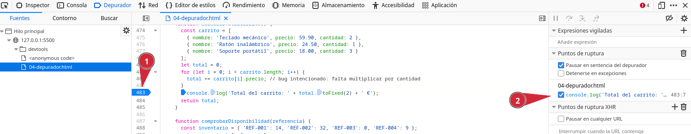
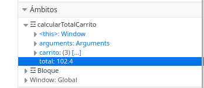
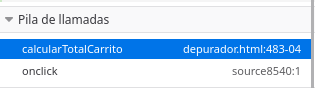
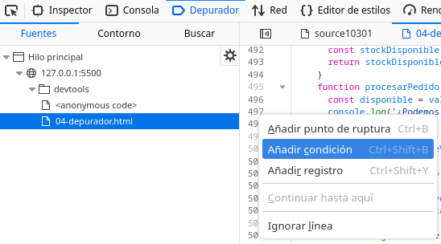

DevTools Lab

    
      [← Portada]([[02 - MODULOS/Prácticas (PoCs)/Conceptos Fundamentales/03 - Auditoría Web con Firefox DevTools|Índice de DevTools]])
      [← Módulo 3]([[02 - MODULOS/Prácticas (PoCs)/Conceptos Fundamentales/03d - DevTools - Módulo 3 - Consola|03d - DevTools - Módulo 3 - Consola]])
      [Módulo 5 →]([[02 - MODULOS/Prácticas (PoCs)/Conceptos Fundamentales/03f - DevTools - Módulo 5 - Red|03f - DevTools - Módulo 5 - Red]])
    
  

  

    
Módulo 4

    

# Depurador

    
Panel de las DevTools que se trabaja en este módulo: **Depurador**.

  

  

    

## 4.1. El panel Depurador

    

      El Depurador muestra el código fuente JavaScript de la página, organizado por archivo en un
      panel lateral, y permite **pausar su ejecución** en cualquier línea para examinar
      con detalle qué está ocurriendo en ese instante: qué valor tiene cada variable, en qué orden
      se han ido llamando las funciones y qué pasará en el siguiente paso.
    

    

      En esta web de práctica, el código JavaScript de cada módulo está en un único bloque
      `` dentro del propio archivo HTML, así que en el panel de archivos
      del Depurador lo encontrarás listado como el propio nombre del archivo de la página (por
      ejemplo, `04-depurador.html`).
    

    

## 4.2. Puntos de interrupción (breakpoints)

    

      Un **breakpoint** marca una línea en la que la ejecución se detendrá en cuanto el
      código llegue hasta ahí. Se coloca haciendo clic directamente sobre el número de línea, en el
      margen izquierdo del editor de código; aparece como un marcador azul, y esa línea queda
      resaltada cuando la ejecución se pausa en ella. Se quita volviendo a hacer clic sobre el mismo
      número de línea.
    

    

      📸
      



    

    

## 4.3. Ejecutar paso a paso

    

Con la ejecución pausada en un breakpoint, la barra de controles del Depurador permite:

    
      
* **Continuar** (▶): reanuda la ejecución hasta el siguiente breakpoint o hasta el final.
      
* **Pasar a la siguiente línea** (step over): ejecuta la línea actual sin entrar en el detalle de las funciones que llame.
      
* **Entrar en la función** (step into): si la línea actual llama a una función, se mete dentro de ella para depurarla también.
      
* **Salir de la función** (step out): termina de ejecutar la función actual de golpe y vuelve a donde fue llamada.
    

    

## 4.4. Inspeccionar variables: el panel "Ámbito"

    

      Mientras la ejecución está pausada, el panel "Ámbito" (Scopes) muestra todas las variables
      accesibles en ese punto exacto, agrupadas por nivel: las variables locales de la función
      actual, las del cierre (closure) si las hay, y las globales. Los valores se actualizan en
      tiempo real a medida que avanzas paso a paso.
    

    

      📸
      



    

    

## 4.5. La pila de llamadas (Call Stack)

    

      Si la función en la que estás pausado fue llamada desde otra función, y esa desde otra, el
      panel "Pila de llamadas" muestra toda esa cadena, de la más reciente (arriba) a la más
      antigua (abajo). Haciendo clic en cualquier nivel de la pila, el Depurador te lleva al código
      y a las variables de esa llamada concreta, sin perder el punto de pausa original.
    

    

      📸
      



    

    

## 4.6. Expresiones de vigilancia (watch expressions)

    

      El panel "Expresiones de vigilancia" permite escribir cualquier expresión JavaScript (por
      ejemplo, el nombre de una variable, o algo más elaborado como `lista.length`) para
      verla evaluada y actualizada automáticamente cada vez que la ejecución avanza, sin tener que
      buscarla manualmente en el panel Ámbito.
    

    

## 4.7. Breakpoints condicionales

    

      Cuando una línea se ejecuta muchas veces (por ejemplo, dentro de un bucle) y solo interesa
      detenerse en un caso concreto, un breakpoint normal obligaría a pulsar "continuar" una y otra
      vez. Un **breakpoint condicional** resuelve esto: se crea con clic derecho sobre
      el número de línea → "Añadir punto de interrupción condicional", y solo pausa la ejecución
      cuando la condición escrita se cumple.
    

    

      📸
      



    

    

## 4.8. La instrucción `debugger;`

    

      Además de marcar breakpoints desde la interfaz, se puede forzar una pausa escribiendo la
      palabra clave `debugger;` directamente en el código. Si las DevTools están
      abiertas, la ejecución se detiene ahí exactamente igual que en un breakpoint manual; si están
      cerradas, esa línea no tiene ningún efecto.
    

    

      

## Zona de práctica y ejercicios

      

        Antes de pulsar cualquier botón de esta sección, abre el Depurador y localiza el archivo de
        esta página en el panel de archivos, para tener el código a la vista.
      

      

        

### Un total de carrito que no cuadra

        

          Práctica
          

Calcula el total de un carrito con varios artículos, cada uno con su cantidad.

          

```bash
function calcularTotalCarrito() {
  const carrito = [
    { nombre: 'Teclado mecánico', precio: 59.90, cantidad: 2 },
    { nombre: 'Ratón inalámbrico', precio: 24.50, cantidad: 1 },
    { nombre: 'Soporte portátil', precio: 18.00, cantidad: 3 }
  ];
  let total = 0;
  for (let i = 0; i < carrito.length; i++) {
<span class="linea-clave">    total += carrito[i].precio;</span>
  }
  console.log('Total del carrito: ' + total.toFixed(2) + ' €');
  return total;
}
```

          Calcular total del carrito
        

        

          
Ejercicio 01

          Coloca un breakpoint en la línea `total += carrito[i].precio;` (resaltada en el
          bloque de código) y pulsa el botón. Usa "pasar a la siguiente línea" para avanzar
          iteración a iteración, y en cada una consulta en el panel Ámbito el valor de
          `carrito[i]` y de `total`.
        

        

          
Ejercicio 02

          El total que se calcula no es el correcto. Compáralo con el que saldría multiplicando
          cada precio por su cantidad, e identifica exactamente qué le falta a la línea marcada
          para que el cálculo sea correcto.
        

      

      

        

### Una cadena de funciones

        

          Práctica
          

Procesa un pedido llamando, en cadena, a otras dos funciones.

          

```bash
function procesarPedido() {
  const disponible = validarStock('REF-003', 2);
  console.log('¿Podemos procesar el pedido?', disponible);
}
function validarStock(referencia, cantidadSolicitada) {
  const stockDisponible = comprobarDisponibilidad(referencia);
  return stockDisponible >= cantidadSolicitada;
}
function comprobarDisponibilidad(referencia) {
  const inventario = { 'REF-001': 14, 'REF-002': 32, 'REF-003': 0, 'REF-004': 9 };
<span class="linea-clave">  return inventario[referencia];</span>
}
```

          Procesar pedido
        

        

          
Ejercicio 03

          Coloca un breakpoint en la línea marcada, dentro de `comprobarDisponibilidad`,
          y pulsa el botón. Con la ejecución pausada, abre el panel "Pila de llamadas" y anota, de
          arriba a abajo, las tres funciones que aparecen. Haz clic en `validarStock`
          dentro de la pila y comprueba el valor de `cantidadSolicitada` en ese nivel.
        

      

      

        

### Una pausa automática con `debugger;`

        

          Práctica
          

Genera un informe de ventas; el código incluye una pausa automática.

          

```bash
function generarInformeVentas() {
  let totalVentas = 0;
  const ventasDiarias = [120, 95, 200, 150, 80];
<span class="linea-clave">  debugger;</span>
  for (const venta of ventasDiarias) {
    totalVentas += venta;
  }
  console.log('Total de ventas: ' + totalVentas);
}
```

          Generar informe de ventas
        

        

          
Ejercicio 04

          Con el Depurador abierto (no hace falta que coloques ningún breakpoint tú mismo), pulsa el
          botón: la ejecución se detendrá sola en la línea `debugger;`. Comprueba en el
          panel Ámbito los valores iniciales de `totalVentas` y `ventasDiarias`,
          y después usa "pasar a la siguiente línea" repetidamente para ver cómo
          `totalVentas` va acumulando cada venta del array.
        

      

      

        

### Un bucle largo: breakpoint condicional

        

          Práctica
          

Recorre veinte números y registra su cuadrado.

          

```bash
function generarNumerosAleatorios() {
  for (let i = 0; i < 20; i++) {
    const valor = i * i;
<span class="linea-clave">    console.log('Iteración ' + i + ': ' + valor);</span>
  }
}
```

          Generar veinte valores
        

        

          
Ejercicio 05

          En lugar de colocar un breakpoint normal en la línea marcada y pulsar "continuar" quince
          veces, crea un **breakpoint condicional** con la condición `i === 15`.
          Pulsa el botón y comprueba que la ejecución se detiene una única vez, exactamente en esa
          iteración.
        

      

      

        

### Un contador que recuerda su valor

        

          Práctica
          

Cada clic incrementa un contador que "recuerda" su valor entre llamadas.

          

```bash
function crearContador() {
  let cuenta = 0;
  return function incrementar() {
<span class="linea-clave">    cuenta++;</span>
    return cuenta;
  };
}
const contadorA = crearContador();
```

          Incrementar contador
          

Valor actual: **0**

        

        

          
Ejercicio 06

          
            
* Sin tocar el Depurador todavía, pulsa el botón "Incrementar contador" tres o cuatro veces. Fíjate en el número que va mostrando la página y quédate con el último valor.
            
* Abre el Depurador y coloca un breakpoint en la línea `cuenta++;` (marcada en el bloque de código).
            
* En el panel "Expresiones de vigilancia", añade la expresión `cuenta`.
            
* Vuelve a pulsar el botón una vez más: la ejecución se detendrá justo *antes* de ejecutar esa línea.
            
* Mira el valor que muestra la expresión de vigilancia: no es `0`, sino el último valor que ya tenías anotado en el paso 1 (el incremento de este clic aún no se ha aplicado).
            
* Busca ahora esa misma variable `cuenta` en el panel Ámbito: no está en el grupo "Local" (la función `incrementar` no declara ninguna variable propia), sino en un grupo distinto llamado "Closure (crearContador)", porque `cuenta` pertenece a la función que envuelve a `incrementar`, no a `incrementar` misma. Eso es lo que le permite "recordar" su valor entre clic y clic.
          
        

      

    

  

  
    

DevTools Lab — Módulo 4: Depurador.
