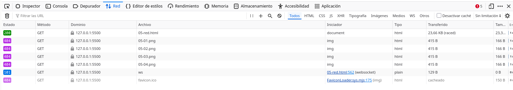
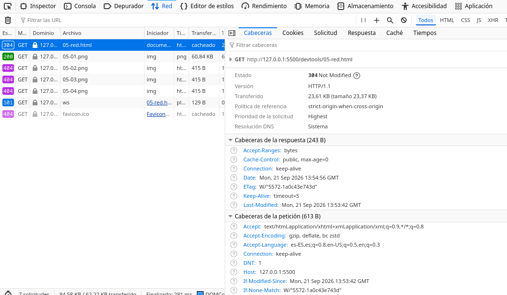
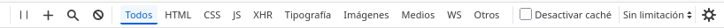
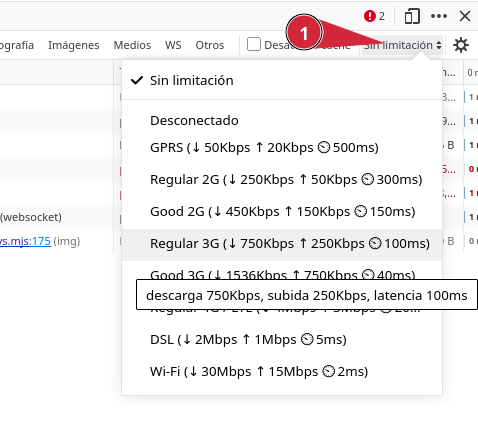
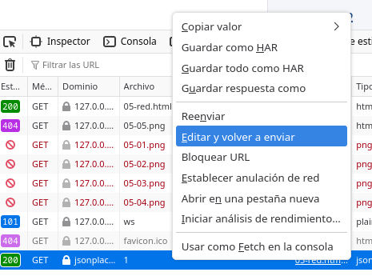

DevTools Lab

    
      [← Portada]([[02 - MODULOS/Prácticas (PoCs)/Conceptos Fundamentales/03 - Auditoría Web con Firefox DevTools|Índice de DevTools]])
      [← Módulo 4]([[02 - MODULOS/Prácticas (PoCs)/Conceptos Fundamentales/03e - DevTools - Módulo 4 - Depurador|03e - DevTools - Módulo 4 - Depurador]])
      [Módulo 6 →]([[02 - MODULOS/Prácticas (PoCs)/Conceptos Fundamentales/03g - DevTools - Módulo 6 - Almacenamiento|03g - DevTools - Módulo 6 - Almacenamiento]])
    
  

  

    
Módulo 5

    

# Red

    
Panel de las DevTools que se trabaja en este módulo: **Red**.

  

  

    

## 5.1. El panel Red

    

      El panel Red registra todas las peticiones que realiza la página mientras las DevTools
      permanecen abiertas: el propio documento HTML, las hojas de estilo, los scripts, las
      imágenes, las fuentes y también las peticiones que el propio código JavaScript lance de forma
      explícita con `fetch()` (o con la API más antigua `XMLHttpRequest`).
    

    

      Si abres el panel después de que la página ya haya cargado, no verás las peticiones
      anteriores: solo registra lo que ocurre a partir de que el panel está abierto (o desde que se
      recargue la página con el panel ya abierto).
    

    

      📸
      



    

    

## 5.2. Columnas principales

    

| Columna | Qué indica |
| --- | --- |
| Método | Verbo HTTP de la petición: `GET`, `POST`, etc. |
| Archivo / Dominio | Recurso solicitado y servidor al que se pide. |
| Tipo | Naturaleza del recurso: documento, hoja de estilo, script, imagen, XHR/fetch... |
| Estado | Código de respuesta HTTP (ver punto 5.4). |
| Tamaño | Peso transferido (y, entre paréntesis, el peso ya descomprimido en algunos casos). |
| Tiempo | Cuánto ha tardado la petición completa. |

    

## 5.3. Inspeccionar una petición

    

Al hacer clic sobre una petición de la lista, se abre un panel de detalle con varias pestañas:

    
      
* **Cabeceras** (Headers): cabeceras enviadas por el navegador y devueltas por el servidor, la URL completa, el método y los parámetros de la petición, si los hay.
      
* **Respuesta** (Response): el cuerpo de la respuesta tal cual, útil para peticiones de texto o JSON.
      
* **Previsualización** (Preview): una versión formateada y navegable de la respuesta (por ejemplo, un JSON con sus llaves plegables).
      
* **Cronología** (Timing): el desglose de tiempo de la petición (espera de conexión, envío, espera de respuesta, descarga).
    

    

      📸
      



    

    

## 5.4. Códigos de estado HTTP más comunes

    

| Código | Significado |
| --- | --- |
| `200` | OK: la petición se ha completado correctamente. |
| `301` / `302` | Redirección permanente / temporal a otra URL. |
| `304` | Sin cambios: el navegador puede usar la versión en caché. |
| `404` | No encontrado: el recurso solicitado no existe en esa URL. |
| `500` | Error interno del servidor. |

    

## 5.5. Filtrar peticiones

    

      La barra superior del panel Red permite filtrar por tipo de recurso (`HTML`,
      `CSS`, `JS`, `XHR`, `Img`, `Fuentes`,
      `Media`, `WS`, `Otro`) y también por texto, para localizar
      una petición concreta en páginas con muchas peticiones simultáneas.
    

    

      **¿Qué es XHR?** Son las siglas de `XMLHttpRequest`, el objeto
      JavaScript con el que originalmente se hacían peticiones al servidor sin recargar la página
      (lo que en su día se llamó "AJAX"), antes de que existiera `fetch()`. Aunque hoy
      casi todo el código nuevo usa `fetch()`, las DevTools siguen usando "XHR" como
      categoría general para las peticiones hechas desde JavaScript, sea con una técnica o con la
      otra.
    

    

      📸
      



    

    

## 5.6. Simular condiciones de red

    

      El desplegable de limitación de velocidad (junto al icono de conexión, normalmente con el
      texto "Sin limitación") permite simular redes lentas (3G, 2G) para comprobar cómo se comporta
      la página en condiciones desfavorables. La casilla "Desactivar caché" fuerza a que cada
      recarga vuelva a pedir todos los recursos al servidor, ignorando lo que el navegador tuviera
      ya guardado, algo muy útil mientras se está desarrollando.
    

    

      📸
      



    

    

## 5.7. Peticiones desde JavaScript con fetch()

    

      `fetch(url)` es la forma moderna de pedir datos a un servidor desde JavaScript, sin
      recargar la página. Devuelve una *promesa* que se resuelve con la respuesta; lo habitual
      es encadenar `.then()` para leer el cuerpo (por ejemplo, con
      `.json()` si la respuesta es JSON) y `.catch()` para capturar errores de
      red. Cada llamada a `fetch()` aparece como una petición más en el panel Red,
      normalmente bajo el tipo `fetch` o `XHR`.
    

    

## 5.8. Editar y reenviar una petición

    

      Sobre cualquier petición ya registrada en la lista, el clic derecho ofrece la opción
      **"Editar y reenviar"** (Edit and Resend), que abre un formulario editable con el
      método, la URL, los parámetros, las cabeceras y el cuerpo de esa petición concreta. Se puede
      modificar cualquiera de esos valores y volver a enviarla, sin tocar el código de la página ni
      escribir una sola línea de JavaScript. Es muy útil para probar variaciones rápidas de una
      petición que ya existe: otro valor de parámetro, otro identificador, otro método...
    

    

      📸
      



    

    

      

## Zona de práctica y ejercicios

      

        Abre el panel Red antes de pulsar cualquier botón de esta sección: como se explicó en 5.1,
        solo registra lo que ocurre mientras está abierto.
      

      

        

### Petición a una API pública

        

          Práctica
          

Pide los datos de un usuario a una API pública real.

          

```bash
fetch('https://jsonplaceholder.typicode.com/users/1')
  .then(function (respuesta) { return respuesta.json(); })
  .then(function (usuario) {
    console.log(usuario);
  })
  .catch(function (error) {
    console.error('Error al pedir el usuario:', error);
  });
```

          Cargar usuario desde la API
          
Aún no se ha pedido ningún dato.

        

        

          
Ejercicio 01

          Pulsa el botón y localiza en el panel Red la petición a
          `jsonplaceholder.typicode.com`. Comprueba, en sus distintas pestañas: el
          método (Cabeceras), el código de estado, el cuerpo de la respuesta en formato JSON
          (Respuesta o Previsualización) y cuánto ha tardado en completarse (Cronología).
        

        

          
Ejercicio 02

          Usa el filtro por tipo del panel Red para mostrar únicamente las peticiones
          `XHR` (donde suelen agruparse también las de `fetch`). Comprueba que
          la petición del ejercicio anterior sigue visible y que el resto de peticiones de la
          página (si las hay) quedan ocultas.
        

      

      

        

### Petición a un archivo JSON local

        

          Práctica
          

Pide un listado de productos a un archivo JSON propio, en lugar de a una API externa.

          

```bash
fetch('datos-productos.json')
  .then(function (respuesta) { return respuesta.json(); })
  .then(function (productos) {
    console.log(productos);
  })
  .catch(function (error) {
    console.error('Error al pedir el archivo local:', error);
  });
```

          Cargar productos (JSON local)
          
Aún no se ha pedido ningún dato.

        

        

          
Ejercicio 03

          Pulsa el botón y localiza esta nueva petición en el panel Red. Compárala con la del
          ejercicio 01: fíjate en el dominio (aquí no hay ningún servidor externo, solo la ruta del
          propio archivo) y en el tamaño transferido.
        

      

      

        

### Una petición con parámetros

        

          Práctica
          

Pide únicamente las publicaciones de un usuario concreto, usando un parámetro en la URL.

          

```bash
fetch('https://jsonplaceholder.typicode.com/posts?userId=1')
  .then(function (respuesta) { return respuesta.json(); })
  .then(function (publicaciones) {
    console.log(publicaciones);
  });
```

          Cargar publicaciones del usuario 1
          
Aún no se ha pedido ningún dato.

        

        

          
Ejercicio 04

          Pulsa el botón y, en la pestaña Cabeceras de esta petición, localiza la sección de
          parámetros de la URL (Query string / Parámetros) y comprueba que aparece
          `userId` con el valor `1`. En la Respuesta, cuenta cuántas
          publicaciones ha devuelto la API.
        

      

      

        

### Una petición que falla a propósito

        

          Práctica
          

Pide un archivo que no existe en el servidor.

          

```bash
fetch('no-existe.json')
  .then(function (respuesta) { return respuesta.json(); })
  .then(function (datos) { console.log(datos); })
  .catch(function (error) { console.error('Error al pedir el archivo:', error); });
```

          Pedir archivo inexistente
          
Aún no se ha pedido ningún dato.

        

        

          
Ejercicio 05

          Pulsa el botón y localiza esta petición en el panel Red: debería aparecer marcada en rojo.
          Comprueba su código de estado y compáralo con la tabla del punto 5.4. Abre también la
          Consola y observa el mensaje de error registrado por el bloque `catch`.
        

      

      

        

### Simular una red lenta

        

          Práctica
          

Misma petición que en el primer ejercicio, con su propio botón aquí para no tener que subir a buscarlo.

          

```bash
fetch('https://jsonplaceholder.typicode.com/users/1')
  .then(function (respuesta) { return respuesta.json(); })
  .then(function (usuario) {
    console.log(usuario);
  });
```

          Cargar usuario desde la API
          
Aún no se ha pedido ningún dato.

        

        

          
Ejercicio 06

          En el desplegable de limitación de velocidad del panel Red, elige una opción de conexión
          lenta (por ejemplo, "Slow 3G"). Pulsa el botón de aquí arriba y compara, en la columna Tiempo, cuánto tarda ahora frente a lo que
          tardó sin limitación. Cuando termines, vuelve a dejar la limitación en "Sin limitación".
        

      

      

        

### Una petición POST con distintos usuarios

        

          Práctica
          

            A diferencia de los ejercicios anteriores, esta petición es de tipo `POST`: en
            lugar de ir en la URL, el `userId` viaja en el cuerpo de la petición. La
            respuesta la genera `usuario.php`, un pequeño script en el servidor que
            devuelve datos distintos según el usuario recibido (y "usuario desconocido" para
            cualquier otro).
          

          

```bash
fetch('usuario.php', {
  method: 'POST',
  headers: { 'Content-Type': 'application/json' },
  body: JSON.stringify({ userId: 1 })
})
  .then(function (respuesta) { return respuesta.json(); })
  .then(function (datos) {
    console.log(datos);
  });
```

          Consultar usuario 1
          Consultar usuario 2
          Consultar usuario 99
          
Aún no se ha pedido ningún dato.

        

        

          
Ejercicio 07

          Pulsa los tres botones, uno detrás de otro, y localiza las tres peticiones a
          `usuario.php` en el panel Red. Para cada una:
          
            
* En Cabeceras, comprueba que el método es `POST` (no `GET`) y localiza, en la sección de la petición enviada, el cuerpo con el `userId` correspondiente.
            
* En Respuesta, comprueba que el usuario 1 y el usuario 2 devuelven datos distintos entre sí.
            
* Comprueba que la petición con `userId` 99 devuelve un código de estado `404` y un mensaje de "usuario desconocido", en lugar de datos de un usuario.
            
* Utiliza ahora `Editar y Reenviar` para mandar diversas peticiones modificando el `userId`. Trata de encontrar los datos del usuario Administrador.
          
        

      

    

  

  
    

DevTools Lab — Módulo 5: Red.
