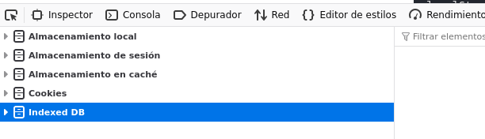
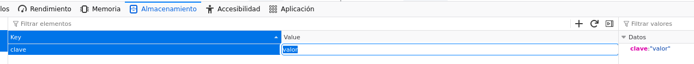
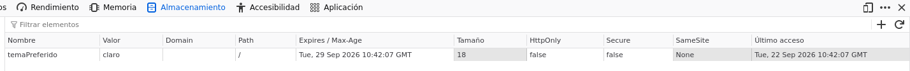
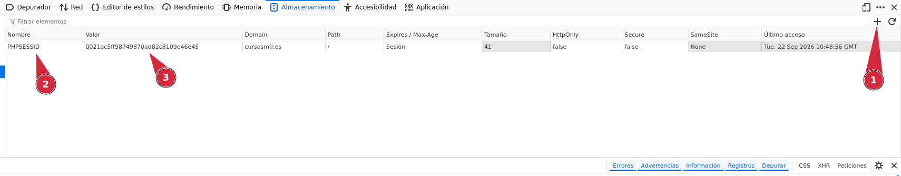
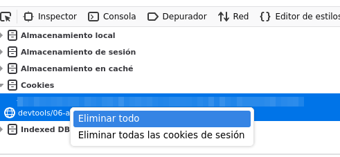

DevTools Lab

    
      [← Portada]([[02 - MODULOS/Prácticas (PoCs)/Conceptos Fundamentales/03 - Auditoría Web con Firefox DevTools|Índice de DevTools]])
      [← Módulo 5]([[02 - MODULOS/Prácticas (PoCs)/Conceptos Fundamentales/03f - DevTools - Módulo 5 - Red|03f - DevTools - Módulo 5 - Red]])
      [Módulo 7 →]([[02 - MODULOS/Prácticas (PoCs)/Conceptos Fundamentales/03h - DevTools - Módulo 7 - Diseño Adaptable|03h - DevTools - Módulo 7 - Diseño Adaptable]])
    
  

  

    
Módulo 6

    

# Almacenamiento

    
Panel de las DevTools que se trabaja en este módulo: **Almacenamiento**.

  

  

    

## 6.1. El panel Almacenamiento

    

      Además de las peticiones al servidor, una página web puede guardar datos directamente en el
      navegador del usuario, sin necesidad de ningún servidor. El panel Almacenamiento muestra,
      organizados por tipo, todos los datos que la página actual tiene guardados: almacenamiento
      local (`localStorage`), almacenamiento de sesión (`sessionStorage`) y
      cookies, entre otros. En este módulo nos centramos en estos tres, que son los más habituales.
    

    

      📸
      



    

    

## 6.2. localStorage

    

      `localStorage` guarda pares de clave-valor (siempre como texto) de forma
      permanente: los datos siguen ahí después de cerrar la pestaña, cerrar el navegador o incluso
      reiniciar el ordenador, hasta que algo los borre explícitamente (el propio código, el usuario
      desde el navegador, o el panel Almacenamiento). Desde JavaScript se maneja con:
    

    

```bash
localStorage.setItem('clave', 'valor');   // Guardar
localStorage.getItem('clave');            // Leer (devuelve null si no existe)
localStorage.removeItem('clave');         // Borrar una clave
localStorage.clear();                     // Borrar todo el localStorage de esta página
```

    

## 6.3. sessionStorage

    

      `sessionStorage` funciona exactamente igual que `localStorage` en
      cuanto a su API (`setItem`, `getItem`, `removeItem`,
      `clear`), pero con una diferencia clave: sus datos desaparecen en cuanto se cierra
      la pestaña. Recargar la página (F5) no borra el `sessionStorage`, pero
      abrir la misma URL en una pestaña nueva sí empieza con uno completamente vacío, porque cada
      pestaña tiene el suyo propio.
    

    

## 6.4. Ver y editar desde el panel

    

      Tanto en `localStorage` como en `sessionStorage`, el panel muestra una
      tabla con cada clave y su valor. Haciendo doble clic sobre un valor se puede editar
      directamente desde ahí, sin escribir ni una línea de código, y el cambio se aplica al
      instante. Un clic derecho sobre una fila permite eliminarla; un icono en la parte superior del
      panel permite añadir una entrada nueva.
    

    

      📸
      



    

    

## 6.5. Cookies

    

      Las cookies también son pares de clave-valor, pero se diferencian de `localStorage`
      y `sessionStorage` en algo importante: **se envían automáticamente al
      servidor en cada petición** a ese dominio, lo que las hace útiles para cosas como
      mantener una sesión iniciada. Además, cada cookie puede tener su propia fecha de caducidad, y
      atributos de seguridad como `Secure` (solo se envía por HTTPS),
      `HttpOnly` (no accesible desde JavaScript) o `SameSite` (restringe su
      envío entre sitios distintos). Desde JavaScript se leen y escriben a través de
      `document.cookie`, con una sintaxis algo más incómoda que la de
      `localStorage`.
    

    

      📸
      



    

    

## 6.6. Añadir una cookie manualmente desde el panel

    

      No hace falta escribir código para crear una cookie de prueba. En la tabla de Cookies del
      panel hay una fila vacía (o un botón "+") en la que se puede escribir directamente un nombre
      y un valor nuevos; al confirmar, la cookie queda creada exactamente como si la hubiera
      generado el propio código de la página, con las columnas de dominio, ruta y caducidad también
      editables desde ahí. Es muy útil para probar cómo reacciona una página ante una cookie
      concreta (por ejemplo, simular que ya existe una sesión iniciada) sin tener que modificar ni
      una línea de JavaScript.
    

    

      📸
      



    

    

## 6.7. Borrar todo de golpe

    

      Cada tabla del panel (localStorage, sessionStorage, cookies...) tiene su propio icono de
      papelera o su opción "Eliminar todo" en el clic derecho, para vaciar por completo esa
      categoría de datos de un solo paso, sin tener que borrar entrada por entrada.
    

    

      📸
      



    

    

|  | localStorage | sessionStorage | Cookie |
| --- | --- | --- | --- |
| ¿Cuánto dura? | Hasta que se borre | Hasta cerrar la pestaña | Hasta su fecha de caducidad |
| ¿Se comparte entre pestañas? | Sí | No, cada pestaña la suya | Sí |
| ¿Se envía al servidor? | No | No | Sí, en cada petición |

    

      

## Zona de práctica y ejercicios

      

        Abre el panel Almacenamiento antes de empezar y localiza esta página en el árbol lateral
        (bajo "Local Storage", "Session Storage" y "Cookies").
      

      

        

### Un contador que recuerda su valor entre recargas

        

          Práctica
          

```bash
function incrementarContadorPersistente() {
  let valor = parseInt(localStorage.getItem('contadorPersistente')) || 0;
  valor++;
  localStorage.setItem('contadorPersistente', valor);
  document.querySelector('#valor-contador-persistente').textContent = valor;
}
```

          

            Contador:
            0
          

          Incrementar
          Reiniciar
        

        

          
Ejercicio 01

          Pulsa "Incrementar" varias veces y localiza la clave `contadorPersistente` en
          la tabla de Local Storage del panel. Recarga la página completa (F5): el
          contador debería seguir mostrando el mismo valor, en lugar de volver a `0`.
        

        

          
Ejercicio 02

          Pulsa "Reiniciar" y comprueba en el panel que la clave `contadorPersistente`
          desaparece por completo de la tabla (no se queda con el valor `0`: deja de
          existir).
        

      

      

        

### Editar un valor directamente desde el panel

        

          Práctica
          

Reutiliza el contador de la zona anterior, esta vez editado a mano desde las DevTools.

        

        

          
Ejercicio 03

          Con el contador anterior en cualquier valor, ve al panel Almacenamiento, localiza la
          clave `contadorPersistente` y haz doble clic sobre su valor para cambiarlo a
          mano por `100`. Recarga la página: el contador de la web debería mostrar
          `100`, aunque nunca hayas pulsado el botón "Incrementar" hasta llegar ahí. Esto
          demuestra que la página simplemente lee lo que haya en `localStorage`, venga de
          donde venga.
        

      

      

        

### Un borrador que sobrevive a la recarga (pero no al cierre de pestaña)

        

          Práctica
          

```bash
function guardarBorrador() {
  sessionStorage.setItem('borradorComentario', document.querySelector('#campo-borrador').value);
}
```

          
        

        

          
Ejercicio 04

          Escribe una frase cualquiera en el cuadro de texto y localiza la clave
          `borradorComentario` en la tabla de Session Storage del panel. Recarga la
          página con F5: el texto debería seguir ahí. Después, abre esta misma URL en una
          **pestaña nueva** (no recargada, sino abierta de cero) y comprueba que ahí el
          cuadro aparece vacío: cada pestaña tiene su propio `sessionStorage`.
        

      

      

        

### Una preferencia guardada en una cookie

        

          Práctica
          

```bash
function guardarPreferenciaTema(tema) {
  const fechaExpiracion = new Date();
  fechaExpiracion.setDate(fechaExpiracion.getDate() + 7);
  document.cookie = 'temaPreferido=' + tema + '; expires=' + fechaExpiracion.toUTCString() + '; path=/';
  document.querySelector('#tema-actual').textContent = tema;
}
```

          Tema claro
          Tema oscuro
          
Ningún tema guardado todavía.

        

        

          
Ejercicio 05

          Pulsa uno de los dos botones y localiza la cookie `temaPreferido` en la tabla
          de Cookies del panel. Comprueba su valor y su fecha de caducidad (columna "Expires /
          Max-Age"): debería estar fijada aproximadamente 7 días a partir de hoy. Recarga la
          página y confirma que la cookie sigue ahí, a diferencia de lo que pasaría con
          `sessionStorage` si cerraras la pestaña.
        

      

      

        

### Borrar todo de una vez

        

          Práctica
          

No hace falta ningún botón nuevo: esta zona reutiliza todo lo ya creado en el resto del módulo.

        

        

          
Ejercicio 06

          En el panel Almacenamiento, usa la opción para eliminar todas las entradas (icono de
          papelera o clic derecho → "Eliminar todo") sobre la tabla de Local Storage, y repite la
          misma operación sobre Session Storage y sobre Cookies. Recarga la página al terminar y
          comprueba que el contador vuelve a `0`, el borrador aparece vacío y ningún
          botón de tema muestra ya nada seleccionado.
        

      

    

  

  
    

DevTools Lab — Módulo 6: Almacenamiento.
