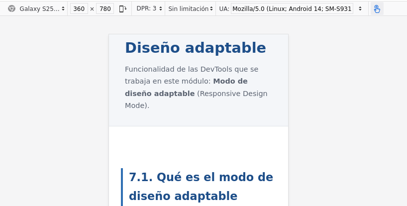
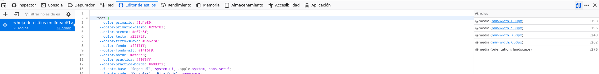

DevTools Lab

    
      [← Portada]([[02 - MODULOS/Prácticas (PoCs)/Conceptos Fundamentales/03 - Auditoría Web con Firefox DevTools|Índice de DevTools]])
      [← Módulo 6]([[02 - MODULOS/Prácticas (PoCs)/Conceptos Fundamentales/03g - DevTools - Módulo 6 - Almacenamiento|03g - DevTools - Módulo 6 - Almacenamiento]])
      [Módulo 8 →]([[02 - MODULOS/Prácticas (PoCs)/Conceptos Fundamentales/03i - DevTools - Módulo 8 - Accesibilidad|03i - DevTools - Módulo 8 - Accesibilidad]])
    
  

  

    
Módulo 7

    

# Diseño adaptable

    
Funcionalidad de las DevTools que se trabaja en este módulo: **Modo de diseño adaptable** (Responsive Design Mode).

  

  

    

## 7.1. Qué es el modo de diseño adaptable

    

      El modo de diseño adaptable simula, dentro de la propia ventana del navegador, cómo se vería
      la página en pantallas de distinto tamaño (móvil, tablet, distintos anchos de escritorio) sin
      necesidad de tener esos dispositivos a mano. Se activa con el icono correspondiente en la
      barra de las DevTools o con el atajo Ctrl+Shift+M.
    

    

      📸
      



    

    

## 7.2. Elegir tamaño y orientación

    

      En la barra superior del modo adaptable se puede elegir un dispositivo predefinido de una
      lista desplegable (con su ancho y alto ya configurados), escribir un tamaño personalizado a
      mano, o alternar la orientación entre vertical y horizontal con el icono de rotación. También
      se puede arrastrar directamente el borde del lienzo simulado para cambiar el tamaño de forma
      libre.
    

    

      Esa misma barra incluye un desplegable de **DPR** (Device Pixel Ratio, "ratio de
      píxeles del dispositivo"): en una pantalla normal, 1 píxel CSS equivale a 1 píxel físico
      (DPR 1); en pantallas de alta densidad, como las Retina, un mismo píxel CSS puede
      corresponder a 2 o 3 píxeles físicos reales (DPR 2 o DPR 3). Cambiar este valor permite
      comprobar, por ejemplo, si una imagen con varias versiones de resolución (`srcset`)
      está cargando la versión correcta para cada densidad de pantalla.
    

    

## 7.3. Media queries

    

      El comportamiento responsive de una página se define en CSS mediante **media
      queries**: bloques de reglas que solo se aplican cuando se cumple una condición sobre
      el tamaño de la ventana (u otras características, como la orientación). La condición más
      habitual es un ancho mínimo o máximo:
    

    

```bash
/* Se aplica solo si la ventana mide 600px de ancho o más */
@media (min-width: 600px) {
  .grid-productos-responsive {
    grid-template-columns: repeat(2, 1fr);
  }
}
```

    

      El valor de ancho a partir del cual cambia el diseño (`600px` en el ejemplo) se
      conoce como **breakpoint**. Una página puede tener varios breakpoints distintos
      para ir adaptando el diseño progresivamente a medida que crece el ancho disponible.
    

    

## 7.4. Ver qué media query está activa

    

      Con el modo adaptable abierto, el Inspector sigue funcionando con normalidad, pero para ver
      con claridad qué bloque `@media` afecta a un elemento y si está activo o no al
      tamaño actual, suele resultar más cómodo mirar en el panel **Editor de estilos**
      (Style Editor), accesible desde su propia pestaña en las DevTools: muestra el código CSS
      completo de la página tal y como está escrito, incluidos los bloques `@media`
      enteros, sin tener que ir buscando regla por regla como en el panel de reglas del Inspector.
    

    

      📸
      



    

    

## 7.5. Combinarlo con otras DevTools

    

      El modo adaptable no sustituye a los paneles ya vistos, se combina con ellos: se puede seguir
      usando el Inspector para editar CSS en vivo mientras se prueba un tamaño concreto, o el panel
      Red con limitación de velocidad (Módulo 5) para simular a la vez una pantalla pequeña y una
      conexión lenta, como sería habitual en un móvil real con poca cobertura.
    

    

## 7.6. Capturar una imagen de la vista simulada

    

      El icono de cámara de la barra del modo adaptable permite guardar una captura de pantalla
      exactamente de lo que se ve en el lienzo simulado, al tamaño elegido, sin capturar el resto de
      la interfaz del navegador ni de las DevTools.
    

    

## 7.7. Limitaciones del modo simulado

    

      El modo adaptable emula el tamaño de pantalla, y en cierta medida el user agent y los eventos
      táctiles, pero no dejan de ser una simulación dentro del mismo motor de renderizado de
      escritorio: el rendimiento real, ciertos comportamientos táctiles específicos o pequeñas
      diferencias de renderizado entre navegadores reales de cada dispositivo no quedan
      completamente representados. Es una herramienta excelente para el desarrollo del día a día,
      pero no sustituye una prueba final en dispositivos reales antes de publicar algo importante.
    

    

      **Nota sobre esta zona de práctica.** Las zonas de este módulo están construidas
      con breakpoints reales, en la propia hoja de estilos de esta página: `600px` y
      `900px` para la cuadrícula de productos, `600px` para el bloque
      destacado y `700px` para el menú. Ábrelos y ciérralos con el modo adaptable para
      verlos en acción.
    

    

      

## Zona de práctica y ejercicios

      

        Activa el modo de diseño adaptable (Ctrl+Shift+M) antes de
        empezar esta sección.
      

      

        

### Cuadrícula de productos con dos breakpoints

        

          Práctica
          

            
Teclado mecánico

            
Ratón inalámbrico

            
Monitor 27"

            
Soporte portátil

            
Alfombrilla XL

            
Hub USB-C

          

        

        

          
Ejercicio 01

          Con un ancho personalizado, prueba estos tres valores y anota cuántas columnas muestra la
          cuadrícula en cada uno: `400px`, `700px` y `1000px`.
        

        

          
Ejercicio 02

          Sin mirar el código fuente, ve arrastrando el borde del lienzo (o cambiando el ancho poco
          a poco) para encontrar el ancho exacto en el que la cuadrícula pasa de 1 a 2 columnas, y
          después el ancho exacto en el que pasa de 2 a 3. Confirma después esos dos valores
          abriendo el Editor de estilos y localizando los bloques `@media` que afectan a
          `.grid-productos-responsive`.
        

      

      

        

### Un menú que se colapsa en pantallas estrechas

        

          Práctica
          
            

              DevTools Lab
              ☰ Menú
            

            

              [Inicio](#)
              [Módulos](#)
              [Contacto](#)
            

          
        

        

          
Ejercicio 03

          Con un ancho por debajo de `700px`, comprueba que los enlaces están ocultos y
          solo se ve el botón "☰ Menú"; púlsalo y comprueba que los enlaces aparecen debajo. Ahora
          amplía el ancho por encima de `700px` y comprueba que el botón desaparece y los
          enlaces se muestran siempre, en horizontal.
        

      

      

        

### Un bloque destacado con tipografía variable

        

          Práctica
          

            Este texto y el espacio a su alrededor cambian de tamaño según el ancho de la ventana.
          

        

        

          
Ejercicio 04

          Reduce el ancho por debajo de `600px` y luego auméntalo por encima. Describe
          con tus propias palabras qué dos propiedades cambian exactamente en ese punto, y
          confírmalo localizando el bloque `@media` correspondiente en el Editor de
          estilos.
        

      

      

        

### Dispositivos predefinidos

        

          Práctica
          

Reutiliza la cuadrícula de productos y el menú de las zonas anteriores.

        

        

          
Ejercicio 05

          En el desplegable de dispositivos, elige un móvil (por ejemplo, "iPhone SE", unos
          375px de ancho) y comprueba que la cuadrícula muestra 1 columna y el menú aparece
          colapsado. Después elige una tablet (por ejemplo, "iPad", unos 768px) y comprueba que la
          cuadrícula pasa a 2 columnas y el menú ya se muestra en horizontal, sin necesidad de
          pulsar nada.
        

      

      

        

### Un aviso que solo aparece en horizontal

        

          Práctica
          
📱 Estás viendo esta página en orientación horizontal.

          

Si no ves el aviso de arriba, es que ahora mismo estás en orientación vertical: es lo esperado.

        

        

          
Ejercicio 06

          Con el modo adaptable en un tamaño de móvil, usa el icono de rotación para pasar de
          orientación vertical a horizontal y comprueba que el aviso aparece. Vuelve a rotar a
          vertical y comprueba que desaparece.
        

      

      

        

### Guardar una captura de la vista simulada

        

          Práctica
          

No hace falta ningún elemento nuevo: esta zona reutiliza toda la página tal y como está.

        

        

          
Ejercicio 07

          Con un tamaño de móvil seleccionado, usa el icono de cámara de la barra del modo
          adaptable para guardar una captura de esta página tal y como se ve en ese tamaño.
        

      

    

  

  
    

DevTools Lab — Módulo 7: Diseño adaptable.
