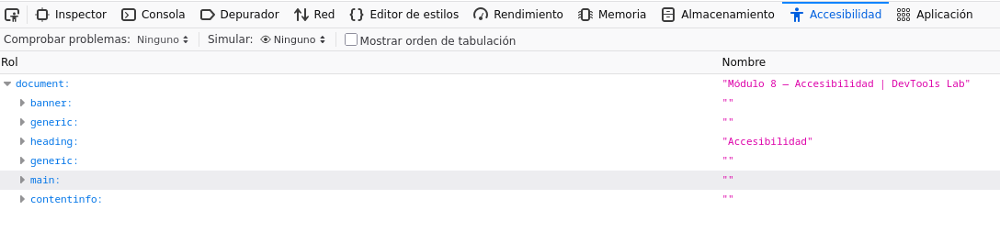
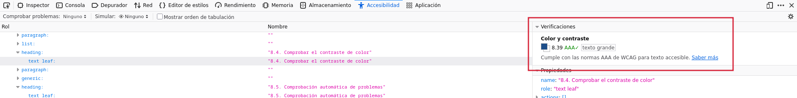
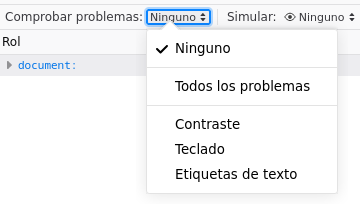
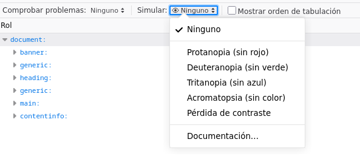

DevTools Lab

    
      [← Portada]([[02 - MODULOS/Prácticas (PoCs)/Conceptos Fundamentales/03 - Auditoría Web con Firefox DevTools|Índice de DevTools]])
      [← Módulo 7]([[02 - MODULOS/Prácticas (PoCs)/Conceptos Fundamentales/03h - DevTools - Módulo 7 - Diseño Adaptable|03h - DevTools - Módulo 7 - Diseño Adaptable]])
      [Módulo 9 →]([[02 - MODULOS/Prácticas (PoCs)/Conceptos Fundamentales/03j - DevTools - Módulo 9 - Rendimiento|03j - DevTools - Módulo 9 - Rendimiento]])
    
  

  

    
Módulo 8 (opcional)

    

# Accesibilidad

    
Panel de las DevTools que se trabaja en este módulo: **Accesibilidad**.

  

  

    

## 8.1. El panel Accesibilidad

    

      El panel Accesibilidad muestra cómo "ve" la página una tecnología de asistencia (como un
      lector de pantalla), en lugar de cómo se ve visualmente. La primera vez que se abre en una
      pestaña, puede pedir que se active explícitamente con un botón, ya que generar este árbol
      tiene un coste de rendimiento que Firefox evita mientras no se necesita.
    

    

      📸
      



    

    

## 8.2. El árbol de accesibilidad

    

      De forma parecida al árbol del Inspector, el árbol de accesibilidad también organiza la
      página de forma jerárquica, pero no elemento a elemento: agrupa y simplifica el HTML en los
      **nombres** y **roles** que un lector de pantalla anunciaría en voz
      alta. Un `
` puramente decorativo, sin texto ni función, puede no
      aparecer en absoluto en este árbol, mientras que un botón sí aparece con su rol
      ("botón") y su nombre accesible (el texto que se leería en voz alta).
    

    

## 8.3. Propiedades de cada nodo

    

Al seleccionar un nodo del árbol de accesibilidad, el panel lateral muestra:

    
      
* **Nombre**: el texto que anunciaría un lector de pantalla para identificar ese elemento.
      
* **Rol**: qué tipo de control o contenido es (botón, enlace, encabezado, región...).
      
* **Estados y propiedades**: por ejemplo, si un checkbox está marcado, si un menú está expandido o si un campo es obligatorio.
    

    

## 8.4. Comprobar el contraste de color

    

      Al seleccionar un nodo de texto, el panel muestra su ratio de contraste respecto al fondo y si
      cumple los niveles mínimos recomendados por las pautas de accesibilidad (WCAG): un contraste
      insuficiente dificulta la lectura a personas con baja visión, y también en condiciones
      normales como una pantalla con reflejos.
    

    

      📸
      



    

    

## 8.5. Comprobación automática de problemas

    

      En la propia barra superior del panel, junto a "Simular" (punto 8.6) y "Mostrar orden de
      tabulación", hay un desplegable llamado **"Comprobar problemas"** (Check for
      Issues). Al abrirlo, ofrece varias casillas — Contraste, Teclado, Etiquetas de texto, o todas
      a la vez — y al marcar una, el árbol de accesibilidad se filtra para mostrar solo los
      elementos con ese problema concreto, sin tener que revisar nodo por nodo a mano. El panel de
      la derecha añade además una breve explicación de cada problema encontrado.
    

    

      📸
      



    

    

## 8.6. Simular deficiencias visuales

    

      Un menú del propio panel permite simular distintos tipos de daltonismo (protanopia,
      deuteranopia, tritanopia...) sobre la página completa, para comprobar si la información que
      transmites solo mediante el color (por ejemplo, "verde significa correcto, rojo significa
      error") sigue siendo distinguible para alguien que no percibe esos colores igual.
    

    

      📸
      



    

    

## 8.7. Navegación por teclado

    

      Una parte importante de la accesibilidad no depende de ningún panel: se comprueba navegando
      la página solo con el teclado, usando Tab para moverte entre elementos
      interactivos y Enter o Espacio para activarlos. Todo control con el que
      se pueda interactuar debe poder alcanzarse y activarse así, sin usar el ratón en ningún
      momento, y debe quedar claro visualmente cuál tiene el foco en cada momento.
    

    

      

## Zona de práctica y ejercicios

      

        Abre el panel Accesibilidad antes de empezar esta sección (actívalo si te lo pide la
        primera vez).
      

      

        

### Dos textos con distinto contraste

        

          Práctica
          

Este texto tiene un contraste muy bajo respecto al fondo.

          

Este otro texto tiene un contraste adecuado.

        

        

          
Ejercicio 01

          Selecciona cada uno de los dos párrafos en el árbol de accesibilidad y compara su ratio
          de contraste. Anota los dos valores y cuál de los dos cumple el mínimo recomendado y
          cuál no.
        

      

      

        

### Una imagen sin texto alternativo

        

          Práctica
          


          

(Un simple rectángulo azul, a modo de imagen de producto de ejemplo.)

        

        

          
Ejercicio 02

          Selecciona esta imagen en el árbol de accesibilidad y comprueba que no tiene ningún
          nombre accesible. Después, en el Inspector (Módulo 1), añade a la etiqueta
          `` un atributo `alt` con una descripción breve, y
          comprueba que ahora sí aparece como nombre accesible en el panel de Accesibilidad.
        

      

      

        

### Un botón falso frente a un botón real

        

          Práctica
          Comprar (div)
          Comprar (button)
        

        

          
Ejercicio 03

          Haz clic en algún punto vacío de la página y después pulsa Tab varias veces
          seguidas: comprueba que el foco pasa por "Comprar (button)" pero nunca se detiene en
          "Comprar (div)", aunque visualmente los dos parezcan botones. Confirma la diferencia
          seleccionando ambos en el árbol de accesibilidad y comparando su rol: uno aparece como
          "botón" y el otro no tiene ningún rol interactivo.
        

      

      

        

### Un formulario sin etiquetas

        

          Práctica
          

            
            
          

        

        

          
Ejercicio 04

          Selecciona cada campo en el árbol de accesibilidad: aunque visualmente se entienden
          gracias al texto de ejemplo (placeholder), comprueba que su nombre accesible está vacío
          o es poco fiable, y que "Comprobar problemas" → Etiquetas de texto los señala. En el
          Inspector, usa "Editar como HTML" para añadir, justo antes de cada ``,
          una etiqueta visible asociada mediante `for`/`id`:
          

```bash
<label for="campo-nombre-a11y">Nombre</label>
<label for="campo-email-a11y">Correo electrónico</label>
```

          Comprueba que el aviso desaparece del panel de Accesibilidad. A diferencia de
          `aria-label` (que solo leería un lector de pantalla), este texto es también
          visible en la página para cualquier persona.
        

      

      

        

### Colores de estado y daltonismo

        

          Práctica
          

            Completado
            Rechazado
          

        

        

          
Ejercicio 05

          Activa la simulación de un tipo de daltonismo (por ejemplo, deuteranopia) desde el panel
          Accesibilidad y observa estos dos indicadores. Aunque cada uno lleva también una palabra
          distinta ("Completado" / "Rechazado") y no dependen solo del color, reflexiona: ¿qué
          pasaría si solo llevaran un icono de color sin ningún texto? Desactiva la simulación al
          terminar.
        

      

    

  

  
    

DevTools Lab — Módulo 8: Accesibilidad.
