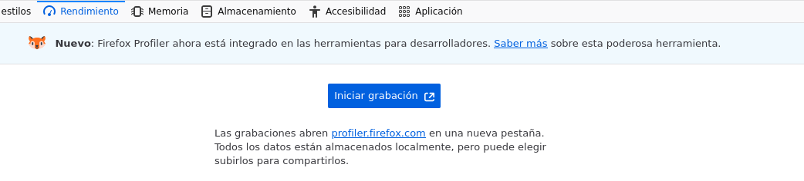
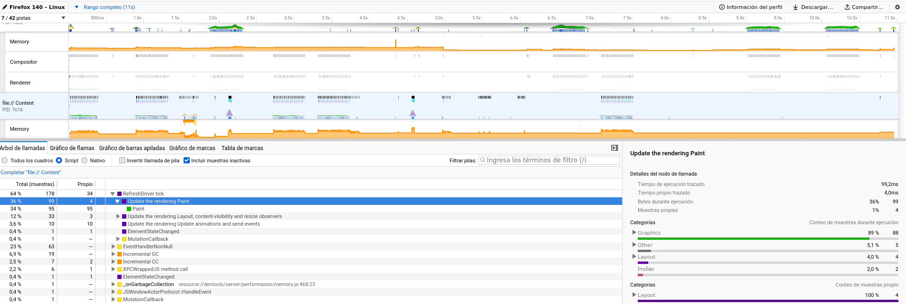

DevTools Lab

    
      [← Portada]([[02 - MODULOS/Prácticas (PoCs)/Conceptos Fundamentales/03 - Auditoría Web con Firefox DevTools|Índice de DevTools]])
      [← Módulo 8]([[02 - MODULOS/Prácticas (PoCs)/Conceptos Fundamentales/03i - DevTools - Módulo 8 - Accesibilidad|03i - DevTools - Módulo 8 - Accesibilidad]])
    
  

  

    
Módulo 9 (opcional)

    

# Rendimiento

    
Panel de las DevTools que se trabaja en este módulo: **Rendimiento**.

  

  

    

## 9.1. El panel Rendimiento

    

      El panel Rendimiento graba, durante un periodo de tiempo elegido por ti, todo lo que hace el
      navegador para mostrar la página: ejecución de JavaScript, cálculo de estilos, cálculo del
      diseño (layout) y pintado en pantalla. El resultado es un perfil detallado que permite
      localizar exactamente qué parte del código o del proceso de renderizado está haciendo que la
      página vaya lenta.
    

    

## 9.2. Grabar un perfil

    

      El botón de grabar, en la parte superior del panel, empieza a registrar la actividad del
      navegador; el mismo botón, ahora con forma de "detener", finaliza la grabación y genera el
      informe. Conviene grabar solo el tramo concreto que se quiere analizar (por ejemplo, el
      momento en que se pulsa un botón lento), y no la página entera desde que se abre, para que el
      informe sea más fácil de leer.
    

    

      📸
      



    

    

## 9.3. Leer el resumen

    

      Terminada la grabación, aparece una línea de tiempo con la actividad coloreada por categoría
      (JavaScript, Diseño, Pintado...) y, en la parte superior, un gráfico de fotogramas por
      segundo (FPS). Un tramo alto y sostenido de un color indica que el navegador ha estado
      ocupado en esa categoría durante ese tiempo; una caída brusca en el gráfico de FPS indica un
      fotograma que ha tardado demasiado en generarse.
    

    

      📸
      



    

    

      

## Zona de práctica y ejercicios

      

        Abre el panel Rendimiento antes de empezar. Pulsa "Grabar", después el botón de la zona,
        espera unos segundos y pulsa "Detener" para generar el informe.
      

      

        

### Una animación en marcha

        

          Práctica
          

```bash
function frame() {
  if (!animando) return;
  posicion = (posicion + 2) % 300;
  let suma = 0;
  for (let i = 0; i < 200000; i++) { suma += i; }
  caja.style.transform = 'translateX(' + posicion + 'px)';
  requestAnimationFrame(frame);
}
```

          

            

          

          Iniciar animación
          Detener animación
        

        

          
Ejercicio 01

          Pulsa "Grabar" en el panel Rendimiento, después "Iniciar animación", espera unos tres
          segundos con la caja moviéndose, pulsa "Detener animación" y por vuelve al 
          panel para generar el informe.
        

      

    

  

  
    

DevTools Lab — Módulo 9: Rendimiento.
