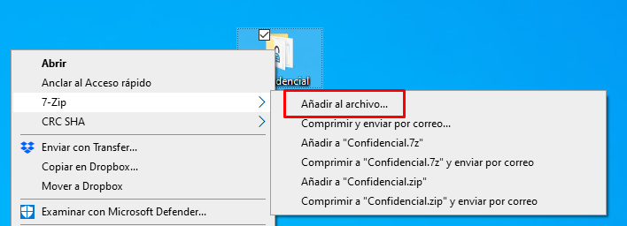
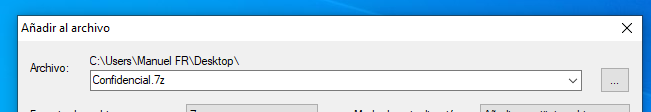
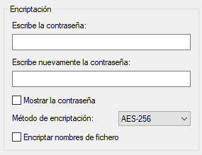
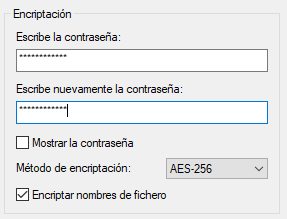
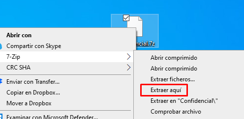

# 🗜️ Encriptado con 7z

## 📖 Descripción

Otra forma de realizar encriptación de archivos, es recurrir a programas de compresión de archivos, los cuales tienen opciones para encriptar archivos.

Vemos el caso de **7z**, que lo puedes descargar desde [aquí](https://www.7-zip.org/).

## 🚀 Prueba de Concepto (PoC)

Vamos a partir de una carpeta que deseamos comprimir y encriptar.

### 📦 Paso 1: Comprimir y Encriptar

Una vez instalado en nuestro sistema el programa 7z, pulsamos al botón derecho sobre esa carpeta. Y en el menú **7-Zip** elegimos la opción **Añadir al archivo...**

### 📝 Paso 2: Configurar Nombre y Ubicación

Elegimos el nombre del archivo y dónde se va a crear.

### 🔐 Paso 3: Opciones de Encriptación

Y por otro lado rellenamos las opciones de encriptación.

#### 🔑 Configuración de Contraseña:

* Escribimos la contraseña (es una contraseña simétrica)

* Cualquiera que la posea podrá desencriptar el archivo

* Siempre compleja pero fácil de recordar

* Recomendación: Marcar "Encriptar nombres de fichero"

Marcar la opción de **encriptar nombres de fichero** es conveniente, ya que esto oculta el nombre de los archivos que hay dentro de nuestro documento encriptado.

### ✅ Paso 4: Crear el Archivo

Pulsamos **Aceptar** y obtendremos el fichero comprimido y encriptado.

### 🔓 Desencriptar el Archivo

Cuando necesitemos desencriptarlo, pulsamos con el botón derecho encima, menú **7-Zip** y **Extraer aquí**.

Nos pedirá la contraseña para poder descomprimirlo.

## 📚 Conclusiones

### ✅ Ventajas de usar 7z:

* ✅ Fácil de usar e integrado en Windows

* ✅ Comprime y encripta en un solo paso

* ✅ Cifrado AES-256 (muy seguro)

* ✅ Oculta nombres de archivos internos

* ✅ Gratuito y de código abierto

### ⚠️ Limitaciones:

* ⚠️ Cifrado simétrico (una sola contraseña para todos)

* ⚠️ Si se olvida la contraseña, NO hay recuperación

* ⚠️ Hay que descomprimir para acceder a los archivos
