# 📁 Encriptado con ENCFS

## 📖 Descripción

El primer encriptado lo vamos a realizar con **EncFS** ya que se integra muy bien con nubes como Dropbox, MEGA, etc.

Descargamos de su sitio web [https://encfs.win/](https://encfs.win/) y lo instalamos.

## 📥 Instalación de EncFS

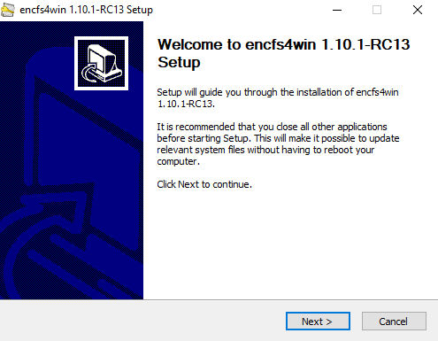

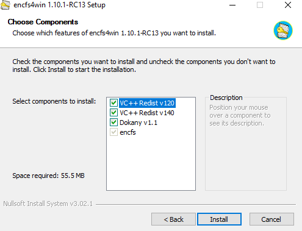

Esperamos que termine de instalar todo.

### 🚀 Iniciar EncFS

Una vez instalado lo abrimos desde el menú inicio.

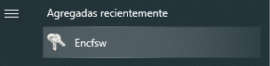

Lo que nos aparece en la barra de estado del ordenador una llave:

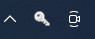

## 🔧 Configuración de EncFS

### 📂 Paso 1: Crear Carpeta para Contenido Encriptado

A continuación vamos a crear la carpeta donde se nos va a generar el contenido encriptado. Por ejemplo, podemos ir a Dropbox y crear una carpeta que se llame **cifrada**.

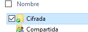

### ⚙️ Paso 2: Configurar EncFS

A continuación, pulsamos en la llave que nos ha aparecido en la barra del ordenador y **Open/Create**.

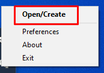

Seleccionamos la carpeta donde el contenido va a estar encriptado, es preferible que esté vacía. Es decir, en mi caso la carpeta **cifrada** de Dropbox y pulso aceptar.

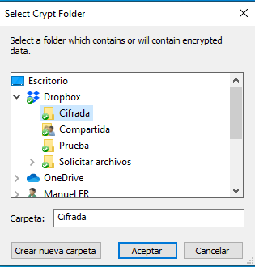

### 🔐 Paso 3: Configuración de Parámetros

La siguiente pantalla muestra lo siguiente:

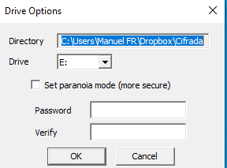

#### 📋 Explicación de Parámetros:

**Directory:** Es la carpeta cuyo contenido vamos a encriptar.

**Drive:** Esto es muy importante, ya que lo que creará el programa es una unidad en nuestro ordenador, de tal forma que al trabajar nosotros trabajamos de forma normal como si de una unidad del equipo fuera, y simultáneamente se va encriptando en la carpeta que hemos elegido. Voy a elegir la unidad **Q:**

**Set Paranoiamode:** Genera un cifrado mucho más seguro que el generado si no se marca. También va en detrimento de la velocidad de encriptado. Yo la voy a marcar.

Y finalmente ponemos una clave y verificamos la clave. Evidentemente si perdemos esa clave no tendremos opción de recuperar los archivos sin encriptar. Es importante que las claves sean seguras pero fáciles de recordar. Y que no se apunten en lugares visibles.

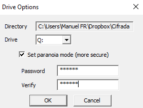

### ✅ Paso 4: Montar la Unidad

Una vez relleno los campos pulsamos **OK**. El proceso continúa y lo primero que nos pide es la clave, ya que va a montar la unidad Q:

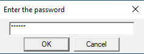

El proceso concluye con la creación de la unidad Dokan Q:

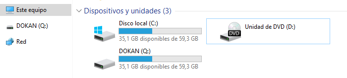

## 💼 Funcionamiento de EncFS

### 🔄 Cómo Funciona

Realmente el funcionamiento es el siguiente:

Nosotros trabajaremos en claro sobre esa unidad Q podremos crear, copiar o modificar archivos, podremos crear carpetas. Es decir, nosotros trabajamos sobre esa unidad como si de un pendrive se tratase.

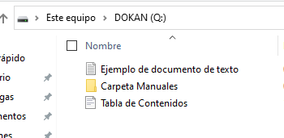

Pero si miramos la carpeta cifrada, lo que realmente está ocurriendo es que simultáneamente se va encriptando todo el trabajo que vamos realizando.

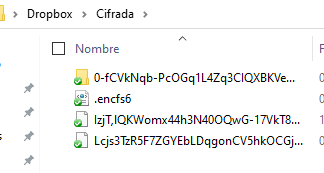

Y realmente lo que se está subiendo a Dropbox es ese contenido encriptado.

### 🔒 Desmontar la Unidad

En caso de que no vayamos a trabajar sobre esa unidad, podemos desmontarla para que el contenido permanezca encriptado y la unidad Dokan no sea accesible.

Pulsando sobre la llave tenemos la opción de desmontarla.

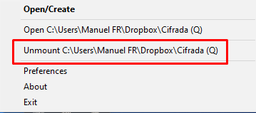

Esta opción hace que desaparezca la unidad Dokan y por lo tanto el contenido desencriptado no es accesible.

Otra opción es reiniciar el ordenador y este contenido también desaparece.

Sin embargo, la carpeta cifrada que es donde realmente se trabaja sigue estando ahí.

### 🔓 Volver a Montar la Unidad

Finalmente, cuando volvamos a necesitar trabajar sobre esa carpeta la volvemos a montar.

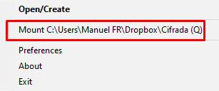

Y evidentemente nos pedirá la clave.

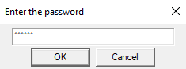

Tendríamos acceso así nuevamente a nuestra unidad dokan.

## 📚 Conclusiones

### ✅ Ventajas de EncFS:

* ✅ Perfecto para sincronización con nubes (Dropbox, MEGA, etc.)

* ✅ Trabajo transparente (trabajas en claro, se encripta automáticamente)

* ✅ No hay que descomprimir para trabajar

* ✅ Modo Paranoia para máxima seguridad

* ✅ Fácil de montar y desmontar

### ⚠️ Consideraciones:

* ⚠️ Requiere instalar software adicional (Dokan)

* ⚠️ La unidad virtual desaparece al reiniciar

* ⚠️ Perder la contraseña = perder los datos
