# 🔐 Encriptado con BitLocker

## 📖 Descripción

**BitLocker** es una herramienta de encriptación de disco completo desarrollada por Microsoft para sistemas operativos Windows. Su objetivo principal es proteger los datos almacenados en unidades de disco mediante la encriptación, lo que garantiza que, si alguien obtiene acceso físico a la unidad, no podrá acceder a los datos sin la clave adecuada.

> [!warning] ⚠️ Importante:  BitLocker está disponible en las ediciones Pro, Enterprise y Education de Windows. NO está disponible en Windows Home.

## 🚀 Prueba de Concepto (PoC)

### 🔧 Paso 1: Acceder a BitLocker

Para encriptar una unidad debemos acceder a BitLocker, desde el menú inicio escribimos **administrar bitlocker**.

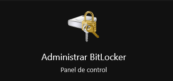

Nos saldrán todas las unidades disponibles tanto internas como externas.

### 📀 Paso 2: Seleccionar Unidad

Elegimos la unidad que queramos encriptar y pulsamos en **Activar BitLocker**

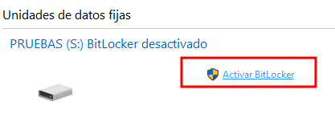

#### 📋 Importante:

La unidad puede contener datos, los datos **NO se borrarán**, sino que se encriptarán en la unidad.

### 🔑 Paso 3: Configurar Contraseña

En el siguiente paso marcamos **Usar contraseña** y rellenamos la contraseña con la que queremos que se encripte la unidad.

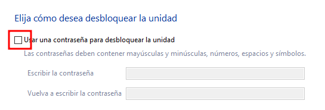

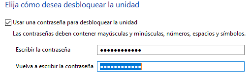

Pulsamos en **Siguiente**.

### 💾 Paso 4: Guardar Clave de Recuperación

El siguiente paso nos pregunta la opción de guardar un archivo para recuperar la unidad en caso de que se olvide la clave.

Pulsamos en **Guardar en un archivo** y lo guardamos en nuestro equipo.

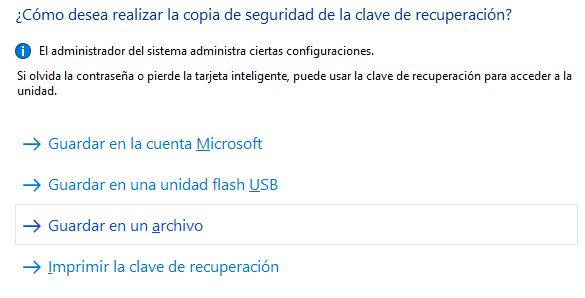

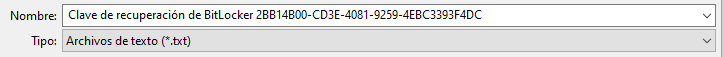

> [!warning] ⚠️ Seguridad:  Esta clave recuperaría los datos por lo que lo importante es  NO olvidar la contraseña . Es recomendable este archivo hacer un borrado seguro de él, así quitamos la posibilidad de acceder a los archivos si no tenemos la clave.

Pulsamos en **Siguiente** ahora que nos lo permite.

### 📊 Paso 5: Elegir Método de Cifrado

En el siguiente paso vamos a elegir la opción de **Cifrar la unidad entera**.

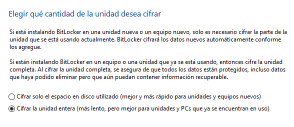

Pulsamos en **Siguiente**.

### 🔧 Paso 6: Modo de Cifrado

El siguiente paso va a depender del uso que le demos a la unidad:

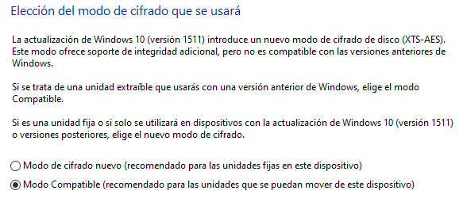

#### 🎯 ¿Qué modo elegir?

**Modo compatible (recomendado para unidades extraíbles):**

* ✅ Para pendrives, discos duros externos

* ✅ Compatible con versiones antiguas de Windows

* ✅ Podrás usar la unidad en otros equipos

**Modo de cifrado nuevo (para unidades fijas):**

* ✅ Para discos internos del equipo

* ✅ Mejor rendimiento

* ✅ Más seguro

Como podemos ver si tenemos una unidad extraíble como un pendrive es conveniente usar el modo compatible para que pueda ser accesible desde versiones más antiguas de Windows. Si es una unidad interna o no lo vamos a cambiar de equipo podemos elegir el modo de cifrado nuevo.

Una vez realizada la selección pulsamos en **Siguiente**.

### 🚀 Paso 7: Iniciar Cifrado

Y finalmente pulsamos en **Iniciar cifrado**.

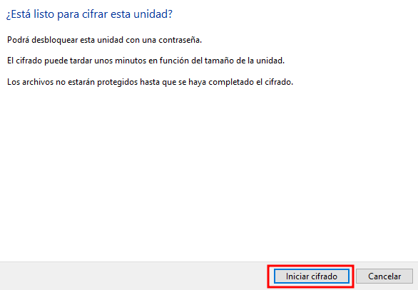

El proceso de cifrado puede tardar dependiendo del tamaño de la unidad y la cantidad de datos.

## 💼 Uso de BitLocker

### 🔓 Estado de la Unidad

Una vez termine veremos el icono de un candado abierto o cerrado en la unidad.

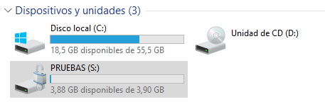

### ⚙️ Opciones de Administración

Y ahora desde el **administrador de BitLocker** podemos acceder a diferentes opciones sobre la unidad encriptada.

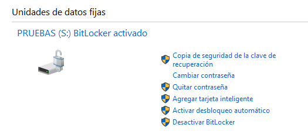

#### 🔧 Opciones disponibles:

* 🔑 Cambiar contraseña

* 💾 Hacer copia de seguridad de clave de recuperación

* 🔓 Desactivar BitLocker

* ⚙️ Cambiar configuración de desbloqueo

### 🔐 Acceso a la Unidad

Ahora cada vez que iniciemos el sistema, para acceder al contenido de esta unidad deberemos introducir la contraseña.

## 📚 Conclusiones

### ✅ Ventajas de BitLocker:

* ✅ Integrado nativamente en Windows (Pro/Enterprise)

* ✅ Cifrado de disco completo muy seguro

* ✅ Transparente para el usuario (trabaja normalmente)

* ✅ Clave de recuperación disponible

* ✅ Ideal para proteger portátiles y discos externos

* ✅ Integración con TPM para mayor seguridad

### ⚠️ Limitaciones:

* ⚠️ Solo disponible en Windows Pro/Enterprise/Education

* ⚠️ NO compatible con otros sistemas operativos

* ⚠️ Perder contraseña y clave de recuperación = perder datos

* ⚠️ Puede impactar ligeramente en el rendimiento

### 🎯 Casos de Uso Ideales:

* 💼 Portátiles empresariales

* 💾 Discos duros externos con datos sensibles

* 🔒 Pendrives con información confidencial

* 🏢 Cumplimiento normativo (RGPD, ISO 27001)
