# 🛡️ Encriptado con VeraCrypt

## 📖 Descripción

**VeraCrypt** es una herramienta de encriptación de disco de código abierto que se utiliza para proporcionar seguridad y privacidad a los datos almacenados en unidades de disco y dispositivos de almacenamiento externos. Es una bifurcación del popular programa TrueCrypt, que dejó de desarrollarse en 2014. VeraCrypt se ha convertido en una opción popular para aquellos que buscan encriptar sus datos de manera segura.

### 🌟 Características Clave de VeraCrypt

* Encriptación de disco completo: Al igual que BitLocker, VeraCrypt permite encriptar toda la unidad, incluido el sistema operativo, los archivos y los datos del usuario. Esto proporciona una capa de seguridad sólida en caso de pérdida o robo del dispositivo.

* Métodos de encriptación: VeraCrypt ofrece una variedad de algoritmos de encriptación, incluidos AES, Serpent y Twofish. También permite la creación de volúmenes ocultos, donde puedes tener dos contraseñas diferentes para acceder a diferentes conjuntos de datos en el mismo dispositivo.

* Cifrado en tiempo real: VeraCrypt puede utilizarse para crear unidades encriptadas en tiempo real, lo que significa que los datos se cifran y descifran automáticamente mientras se accede a ellos. Esto es útil para proteger archivos sensibles sin la necesidad de copiarlos y pegarlos constantemente entre unidades seguras y no seguras.

* Plataformas compatibles: VeraCrypt es compatible con una variedad de sistemas operativos, incluidos Windows, macOS y Linux. Esto lo hace útil para usuarios que utilizan diferentes sistemas operativos en diferentes dispositivos.

* Capacidad de ocultación: Además de los volúmenes ocultos mencionados anteriormente, VeraCrypt permite crear volúmenes ocultos dentro de volúmenes ocultos. Esto proporciona un nivel adicional de seguridad al mantener datos aún más sensibles ocultos incluso en situaciones de coerción.

* Claves y contraseñas: VeraCrypt ofrece varias opciones de autenticación, como contraseñas, archivos de clave y combinaciones de ambas. Esto permite un enfoque personalizado para la seguridad y el acceso a los datos encriptados.

* Auditoría de seguridad: Dado que VeraCrypt es de código abierto, su código fuente está disponible para que cualquiera lo examine y audite. Esto contribuye a la transparencia y confiabilidad del software.

* Cifrado de particiones y archivos: VeraCrypt no solo encripta unidades completas, sino que también puede crear archivos cifrados y particiones en dispositivos existentes.

## 📥 Instalación de VeraCrypt

En este caso vamos a crear un contenedor de archivos encriptados. Pero antes de nada debemos instalar el software. Se puede descargar de [https://www.veracrypt.fr/en/Downloads.html](https://www.veracrypt.fr/en/Downloads.html)

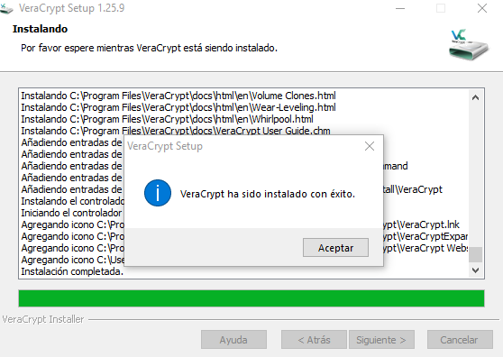

El proceso de instalación es sencillo y de pulsar siguiente...

## 🚀 Prueba de Concepto (PoC)

### 🔧 Paso 1: Abrir VeraCrypt

Una vez instalado abrimos el programa:

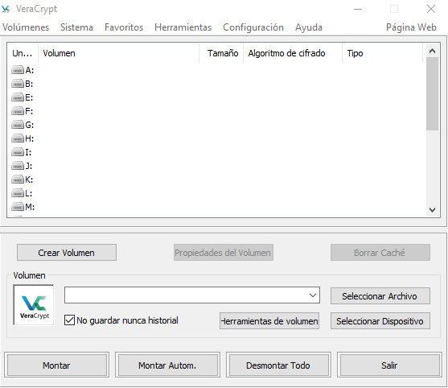

### 📦 Paso 2: Crear Volumen

Debemos crear el volumen que va a contener los archivos cifrados, por lo que el primer paso debemos pulsar en **Crear volumen**:

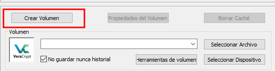

El siguiente paso nos pregunta el volumen que vamos a crear, en nuestro caso vamos a hacer un **contenedor**.

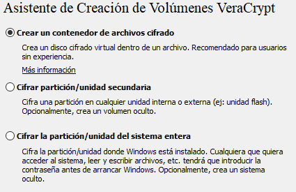

Pulsamos en **Siguiente**.

### 🎭 Paso 3: Volumen Estándar u Oculto

El siguiente paso es una característica de VeraCrypt que permite crear un volumen oculto. Ese volumen oculto contiene información sin relevancia, si alguien se encuentra en una situación como por ejemplo de extorsión, en vez de escribir la clave real del volumen cifrado, puede escribir una segunda clave que daría acceso a ese volumen oculto que contendría información no relevante.

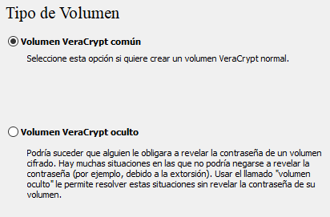

#### 🎯 ¿Qué es un Volumen Oculto?

Un volumen oculto es una característica de seguridad avanzada donde puedes tener:

* 🔑 Contraseña principal: Accede a tus datos reales importantes

* 🔑 Contraseña señuelo: Accede a datos falsos sin importancia

En situaciones de coerción, puedes dar la contraseña señuelo sin comprometer tus datos reales.

En nuestro caso vamos a realizar un **volumen común sin contenido oculto**.

Pulsamos nuevamente en **Siguiente**.

### 📂 Paso 4: Ubicación del Volumen

La siguiente pantalla elegimos dónde queremos que se cree el contenedor de archivos.

En mi caso lo he puesto en una unidad S:

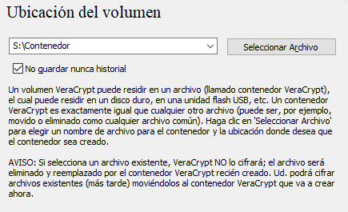

Una vez elegido el destino del contenedor pulsamos en **Siguiente**.

### 🔐 Paso 5: Opciones de Cifrado

A continuación, elegimos las opciones de cifrado, yo dejo las que vienen por defecto:

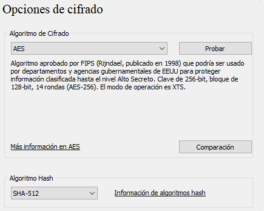

Y pulsamos **Siguiente**.

### 💾 Paso 6: Tamaño del Volumen

En la siguiente pantalla elegimos el tamaño del contenedor, en mi caso lo estoy guardando en una partición de 4 GB y el contenedor tendrá un tamaño de 2 GB.

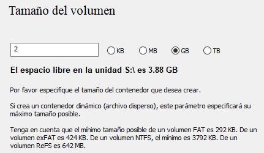

Pulsamos en **Siguiente**.

### 🔑 Paso 7: Contraseña del Volumen

La siguiente pantalla escribimos la clave que cifrará el volumen. Podemos generar un archivo llave, lo que hará más complicado el descifrado ya que es un archivo que se necesita también para descifrar el disco. Y además podemos usar un PIM.

#### 📋 Opciones de Autenticación:

**Contraseña:** Clave principal para cifrar el volumen

**Archivo llave (keyfile):** Un archivo adicional necesario para descifrar. Sin este archivo, aunque tengas la contraseña, no podrás acceder.

**PIM (Personal Iterations Multiplier):** Indica la cantidad de veces que una contraseña es hasheada antes de usarse para descifrar el volumen. Aumenta la seguridad pero también el tiempo de descifrado.

En nuestro caso sólo vamos a poner contraseña.

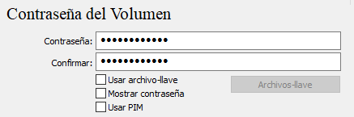

Pulsamos en **Siguiente**.

### 🎲 Paso 8: Formatear el Volumen

La siguiente pantalla, elegimos sistema de **NTFS** y debemos mover el ratón hasta que la barra de la parte inferior llegue al final.

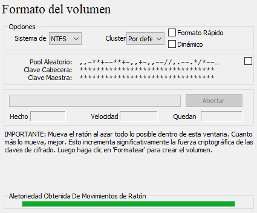

> [!warning] ⚠️ Movimiento del ratón:  El movimiento aleatorio del ratón genera entropía que se usa para crear claves criptográficas más seguras.

Ahora ya pulsamos en **Formatear**, iniciará un proceso que puede tardar mucho. Una alternativa es elegir la opción **Formato rápido** si la unidad es nueva o se ha realizado un borrado seguro o estamos en una unidad que ya ha sido encriptada.

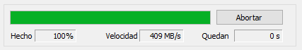

### ✅ Volumen Creado

Si todo va bien obtendremos el volumen creado.

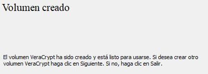

Pulsamos en **SALIR**.

> [!warning] 📝 Nota:  Si da error al formatear en NTFS podemos formatear en FAT y una vez creado el volumen luego podemos formatearlo en NTFS.

## 💼 Montar y Usar el Volumen

### 🔓 Montar el Contenedor

Una vez creado el volumen, tenemos que montarlo para acceder a él y poder guardar archivos encriptados en el interior del contenedor. Para ello volvemos a abrir el programa VeraCrypt.

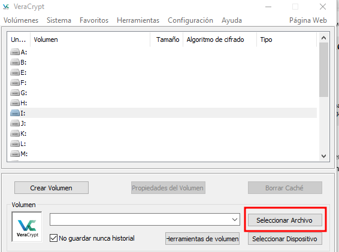

Elegimos la letra donde queremos montar el contenedor y pulsamos **Seleccionar archivo**.

Navegamos donde tenemos el contenedor y lo seleccionamos. Posteriormente pulsamos en **Montar**.

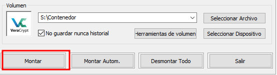

Nos pedirá la clave para montar el contenedor, así como el archivo clave o el PIM si los hubiéramos creado.

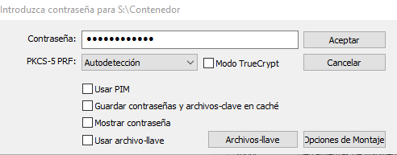

Pulsamos **Aceptar**.

### ✅ Volumen Montado

Montará el contenedor y tendremos acceso a una nueva unidad, en esta unidad al grabar datos dentro es donde se irán cifrando directamente dentro del contenedor.

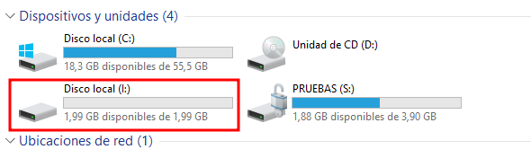

## 📚 Conclusiones

### ✅ Ventajas de VeraCrypt:

* ✅ Código abierto y gratuito

* ✅ Multiplataforma (Windows, Linux, macOS)

* ✅ Volúmenes ocultos (negación plausible)

* ✅ Múltiples algoritmos de cifrado

* ✅ No requiere privilegios de administrador para montar

* ✅ Archivos keyfile para mayor seguridad

* ✅ PIM personalizable

* ✅ Contenedores portátiles

### ⚠️ Consideraciones:

* ⚠️ Interfaz menos intuitiva que BitLocker

* ⚠️ Proceso de creación más complejo

* ⚠️ Perder contraseña/keyfile = perder datos

* ⚠️ Puede ser más lento que BitLocker en algunos casos

### 🎯 Casos de Uso Ideales:

* 🔒 Usuarios que necesitan máxima privacidad

* 💼 Trabajo con datos ultra sensibles

* 🌍 Uso multiplataforma

* 🎭 Situaciones que requieren negación plausible

* 🆓 Alternativa gratuita a BitLocker (Windows Home)
