# 🔐 Encriptado con GPG4Win

## 📖 Descripción

El cifrado usado anteriormente es un cifrado **simétrico**, donde aquellos que conozcan la clave podrían desencriptar los archivos.

Ahora vamos a utilizar un cifrado **asimétrico** que está compuesto por dos claves. Y lo vamos a ver como un proceso en el que el emisor va a enviar un documento o un texto cifrado a un receptor.

### 🔑 ¿Cómo Funciona el Cifrado Asimétrico?

Antes de nada, vamos a entender cómo funciona este tipo de cifrado.

En una comunicación hay un **receptor** y un **emisor**. Nosotros somos el emisor que va a enviar un mensaje a un receptor.

#### 💡 Funcionamiento del Cifrado Asimétrico:

* El receptor tiene dos claves:

            🔒 Clave privada: Solo él la conoce (como la contraseña de su correo)

* 🔓 Clave pública: Un archivo que el receptor envía a todo aquel que le vaya a enviar información cifrada

* El emisor (nosotros):

            Cogemos la clave pública del receptor

* Con ella ciframos el mensaje que vamos a enviar

* Se lo enviamos al receptor

* El receptor:

            Recibe el mensaje cifrado con su clave pública

* Utiliza su clave privada para descifrarlo

* Así tiene acceso a la información

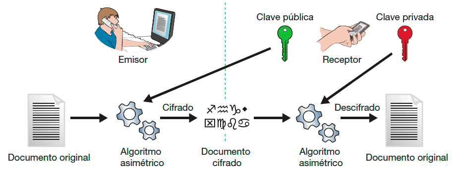

> [!warning] 📝 Importante:  Si el receptor son varios, un mismo mensaje se puede cifrar con todas las claves públicas de cada receptor y luego cada uno de ellos descifra el mensaje con su clave privada.

## 📥 Instalación del Programa GPG4Win

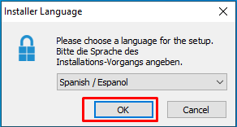

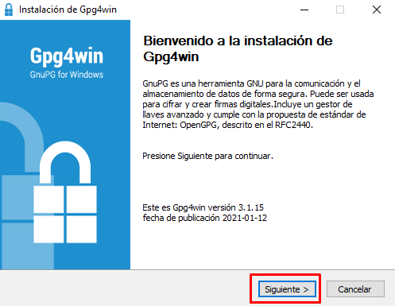

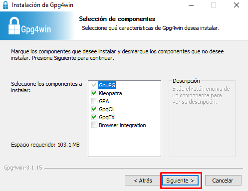

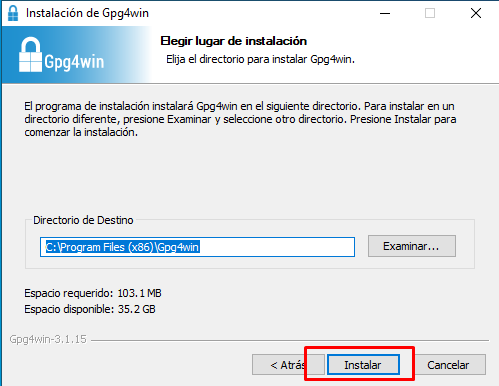

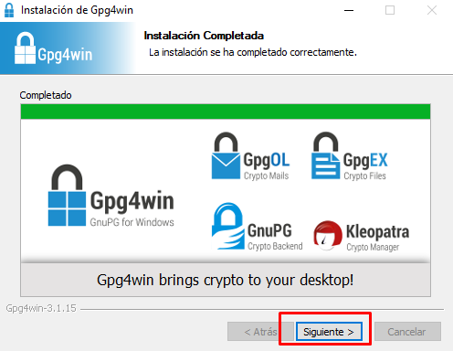

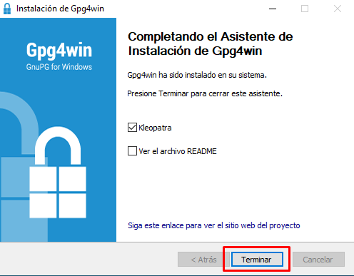

## 🔧 Configuración Inicial - Kleopatra

Se abrirá el programa **Kleopatra** con la siguiente interfaz.

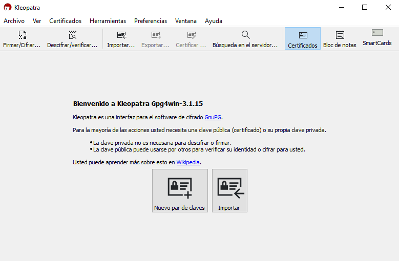

### 🆕 Generar Nuevo Par de Claves

Lo primero que vamos a hacer es generarnos un nuevo par de claves, salvo que ya las tengamos, en cuyo caso tendríamos que importarlas.

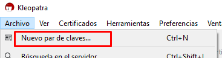

En la siguiente pantalla:

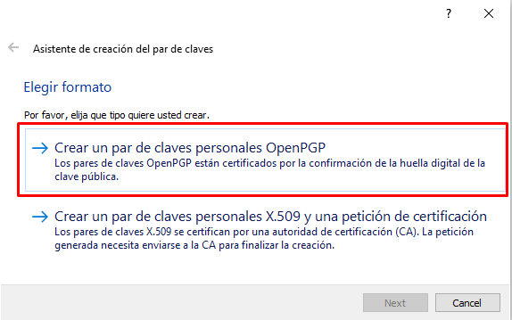

#### 🎯 ¿Qué opción elegir?

**Opción 1 - Crear un par de claves personales OpenPGP:**

* ✅ Para uso personal

* ✅ Auto-firmado

* ✅ No requiere autoridad de certificación

**Opción 2 - Crear certificado X.509:**

* 📜 Similar a certificado digital

* 🏛️ Requiere autoridad de certificación

* 💼 Para uso corporativo/legal

Elegimos la opción de arriba, ya que la segunda es una certificación similar a la de un certificado digital y hay que presentarse ante una autoridad de certificación para que se genere y nos lo expidan.

### 📝 Datos Personales

Rellenamos nuestros datos en la siguiente imagen, con nombre y apellidos y correo electrónico.

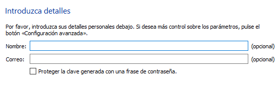

Marcamos **Proteger la clave generada con una contraseña**.

Pulsamos **Crear** y si todo ha ido bien se genera nuestras claves. Nos pedirá la clave privada en el proceso.

### ✅ Claves Generadas

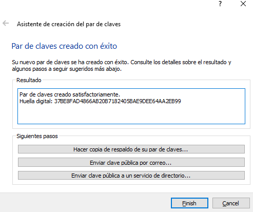

Se ha generado la huella digital de nuestra clave.

#### 📋 Opciones Disponibles:

* 💾 Hacer una copia de respaldo: Para poder importarlo en otros equipos

* 📧 Enviar clave pública por correo: Compartir con quien nos vaya a enviar mensajes

* 🌐 Enviar a un servicio de directorio: Permite a cualquiera acceder a esa clave pública con solo buscarnos

A continuación, deberíamos hacer una copia de respaldo, para poder importarlo en otros equipos.

Podemos enviar la clave pública por correo, o enviarla a un servicio de directorio, lo que permite a cualquiera acceder a esa clave pública con solo buscarnos. Como posteriormente veremos. De momento no hacemos ninguna de estas acciones, salvo la copia del par de claves.

## 📤 Exportar Clave Pública

Vamos a exportar ahora nuestra clave pública, que podremos enviar por correo a quien nos vaya a emitir un mensaje o enviar un archivo cifrado.

En el entorno de Kleopatra, sobre nuestro certificado pulsamos al botón derecho y **Exportar**, o con él seleccionado pulsamos en **Exportar** en la barra superior.

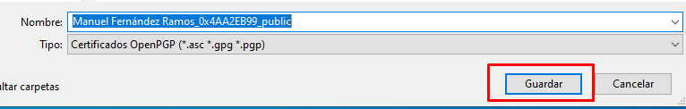

Esto nos permite exportar nuestra clave pública que podremos enviar por correo.

## 📥 Importar Clave Pública

Partimos de una clave que hemos recibido por correo y vamos a importarla.

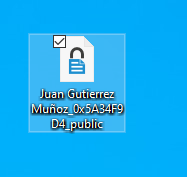

Desde Kleopatra pulsamos en **Importar** y seleccionamos el archivo.

### ✍️ Certificar la Clave

Lo vamos a certificar como válido. Al contrario que en certificados que utilizan una autoridad de certificación, en este caso los usuarios que lo utilizan pueden certificar si un certificado es realmente de quien dice ser.

Es posible que para certificarlo nos pida nuestra clave privada.

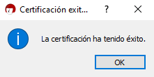

Una vez finalizada la importación, nos aparecerá en la zona de certificados.

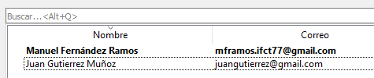

## 🌐 Importar Clave desde Servidor

Podemos también importar un certificado desde un servidor, pero antes el creador del certificado lo debe haber publicado en un servidor.

### 📜 Paso 1: Generar Certificado de Revocación

Primero vamos a generar un certificado de revocación.

Vamos a la zona de certificados y pulsamos doble clic sobre nuestro certificado, y posteriormente en **Generar certificado de revocación**.

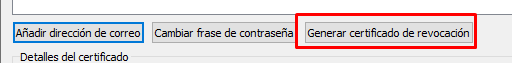

Y lo guardamos en un lugar seguro. Cerramos esa ventana.

### 🌐 Paso 2: Publicar en Servidor

Ahora pulsamos botón derecho en nuestro certificado y **Publicar en servidor**.

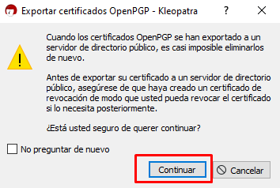

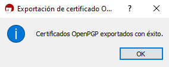

### 🔍 Paso 3: Buscar y Descargar Claves

Esto permite ahora que no necesitemos enviar nuestra clave pública, sino que desde el propio Kleopatra, cualquiera puede darle a **Búsqueda en el servidor** y descargar nuestra clave, bien conociendo nuestro correo o mediante la huella digital.

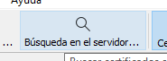

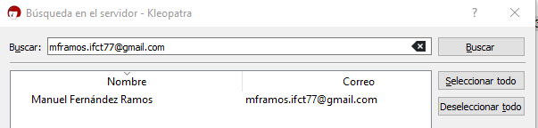

Solo tiene que seleccionarlo y pulsar en **Importar**.

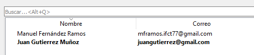

## ✉️ Encriptado de Texto

Una vez hemos importado la clave pública del receptor, ya podemos encriptar mensajes para ese receptor.

Desde el mismo Kleopatra lo podemos hacer desde el **Bloc de notas**.

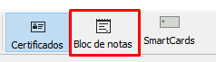

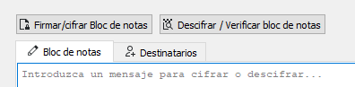

### 👥 Paso 1: Seleccionar Destinatarios

Dentro del bloc de notas, dentro de la pestaña **Destinatarios**, elegimos los destinatarios de nuestro mensaje, podemos cifrar para nosotros mismos, podemos firmar ese cifrado para darle autenticidad al texto, y luego podemos añadir más destinatarios de ese cifrado.

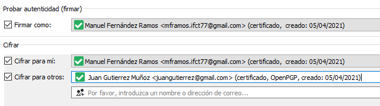

#### 📋 Opciones:

* ✍️ Firmar: Añade tu firma digital (autenticidad)

* 🔐 Cifrar para mí: También podrás leer el mensaje tú

* 👤 Destinatarios: Personas que podrán descifrar el mensaje

### ✏️ Paso 2: Escribir el Mensaje

Volvemos a la Pestaña **Bloc de notas** y escribimos el mensaje.

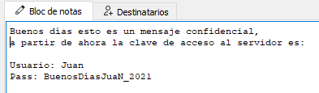

Y pulsamos en el botón **Firmar y cifrar bloc de notas**.

### 🔐 Paso 3: Mensaje Cifrado

Nos cifrará el mensaje en una estructura similar a lo siguiente:

```bash
-----BEGIN PGP MESSAGE-----

hQGMA2PVDPIWmjNZAQwAqNbRQiOP8daCfSES8Xx0qB9bj7TkNVZ5hBb6iQk4tVGt
Q1sFzriZTaNxu7N1EKsjh9qns2MCpF4JzWxSIpf8W6AGuM8WGQWoA1+sgY0t3the
XAsHWHz1ZiD0I59x+9j3FYV29ArKBxBYgZlB13+7zTBIopAAxGPunDvA2/BcQqIU
VJwchqRu9mC8WYjb8rTJW+sRfgFXeyhLVcBnPR1fZ2SnpooAL2gFMwzh/61h7XU2
nN+EEW33BpOVpC7crJihysj8hSoT4zvh4OLmPP/MKEOgxRoQ4qtV9xq/uU6EwDIP
t2O3+cYhw4NSzcCKf28u4riB4G68bWBjjCsOaHinvMJvfuhExfXcB8VXrGWZG/ed
2vlte6Dw8YEeAe3aT3t92g6j0qOWiarnbmKksgm9ib9XOJ9+QSP58Es43pNbGOjV
pnkmrXewwuwTcmnJwEfI1EqQqw8TlF1z1aAur1Z7/3G6qCmlLII6Ko10pKPhcwah
6g7tMBLW8zzVqnm1FXMThQGMA//GQo2Y5+eGAQv8DDipv0xy9Yi76ZC4VJZWqJQC
82PWptVfFvuVj4wh62RBOVGrQ3Ysbk01CTXl0UDAQtYTrJ1QjwozxaWiXQaGOXln
xPsaaa10WK5k7WmG8a5pWZGFPincdLa9E2EjQVWYID2rxUz0TcbHKOQ4lvsWHF0P
9xorBqMVZzvyAoGLBqvHq6C4SQyOvbDLsVwKZjvi6pBpNSawze/poPtlqMBb/86G
uk3EB9oSdlfWEMgBeED2ykjdF+CzqV3ddZMKI2t7kgGt9flsPfA5+UUkR/1x0TY6
bi+bSIXUFla1jIs+lCf2NR0iI8l6B5CrxWXrddbaIijs7Xw33ZyoOvfaGU72d84i
i7hmmtqD9tfkRqoy61h0xrx910Td4/eQoEO9AMygJjX3QjOubxkpIl+0jmGcJIkd
AsGyp8rg8KLerb3RcOlTbGK/o7oX9kxg7Xp51585giJw8MIkbwdlJ8B7mZHK0x8Q
tkwYuDgb8QTQSjS660b+PpjsaSnvMDSxeslEq0V70ukBa0M/JAzSf5dXFMEuPLKK
W9ydha6GM80kVJJUaQMKOpIubhuKJUug6LhBT/1xrvGjgzshRm3Eb5ad0zZ4y6LD
PReoaID9KWmkrM1KP5C9pxyzZ6cP8BwL2DLLgholrEskwXoGPKIjLIaejn+L26j9
GTrrcx8T0xXbuTrFkNTL7+1a467vtvgB4abvvFNUDuHo14nQ/2idfVvbmtOwfRJW
GS6dudJXuaxuuvdDPAkWwwnz66R6dph/eIMurJLfWNIkq60uT8/UEG3rcL1AvQrt
LT7hRhQwJq9doBqDAnLmbZGJjxM6GEeCNE+LNrmosn9BQYQ6s/VV7aiceZbxpvPc
/oua4Pen4n8Q73Xd/7nutOP7dX7ScjbB5+U51S2DYTgEy2C50QUVVQW4E3vC/tcZ
YC9OZC1K55iUG+L/8KVCHOCjqe0ChF44CtoYIfSC8KcHFbPu5RGeLFrAOUspLkdK
xIXucWngv4005kObL94Kwhd5ShiNaeJ9Yl2fEVev6r7e3drmCdiyjxLzjxFkl1Zd
n8+kfsIbAmlQI/YUrQT7sopa4pSf7I1yxHvc6MTV25pjpBX0TPqReydqVBk0QUxr
wJpvtZXt96Ma6fyxTCkc5YtPBNWxJipLoT+ew1vEsXUGtz5s8KWObD3MmUG6r3Q7
GvH10H/bBUXNhdEN99S9F4lwLWbMSwPoUE7Jldr2GN3VBL/zSrWn9zCOF3thLPGn
tWopmpLExOt4yEXWIK9rVQPi18SU/E/iJ/EBDBaSz5VGJeYiEk1QY8svN8CZDtVn
6LZeGgF/hCLFOTZHo/Kql3ns7eP3okKYn11bVHmD04MnOFB3NtOzd9DbqjgC8KUS
e56ql2AYhVdCpA==
=77IJ
-----END PGP MESSAGE-----
```

Este mensaje tal cual lo podemos enviar por correo a Juan que es nuestro receptor que en su momento nos envió su clave pública.

### 🔓 Descifrar el Mensaje (Receptor)

Juan una vez recibido el mensaje lo copia y lo pega en el bloc de notas de su Kleopatra.

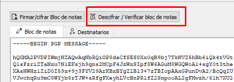

Pulsaría en **Descifrar bloc de notas**, el programa le pedirá su clave secreta, y gracias a ella obtendría el texto en claro descifrado.

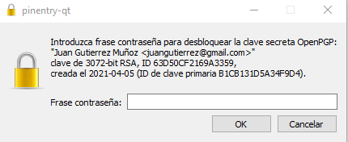

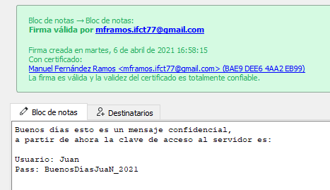

## 📁 Encriptado de Archivos

En ocasiones en vez de texto, lo que necesitamos es encriptar archivos enteros, bien porque sean documentos que contengan datos sensibles o datos confidenciales, y necesitamos encriptarlos ya sea porque los vamos a enviar por correo, o porque necesitamos guardarlos encriptados en el ordenador.

### 🔐 Paso 1: Firmar/Cifrar Archivo

Desde el programa Kleopatra, pulsaríamos en el botón **Firmar/Cifrar**.

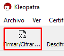

Elegimos el documento que queramos firmar y cifrar.

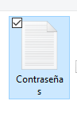

### 👥 Paso 2: Configurar Destinatarios

Se nos abrirá una pantalla similar a la que usamos para encriptar texto, donde seleccionamos si queremos firmar el documento para darle autenticidad. Y para quién queremos cifrarlo.

Es posible que sólo queramos cifrarlo para nosotros. En este caso lo vamos a cifrar también para Juan.

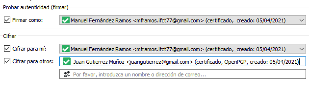

### ⚙️ Opciones Adicionales

Antes de cifrar, tenemos dos opciones que comentar.

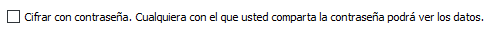

> [!warning] ⚠️ No recomendable:  Esta opción no es muy recomendable, al final sería como poner una clave simétrica al documento. Cualquiera podría descifrar el documento aunque no apareciese en la lista de claves públicas para los que se ha cifrado el archivo.

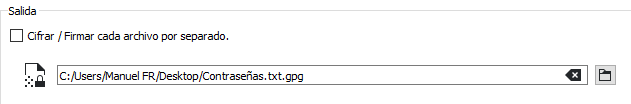

#### 📋 Esta opción permite:

* 📂 Elegir la carpeta de destino del nuevo documento

* 📄 En caso de haber elegido varios documentos, que se genere cada uno por separado

**Comportamiento por defecto:** Si elegimos varios documentos, el programa los comprime y encripta en un solo documento, salvo que seleccionemos esta opción.

### ✅ Paso 3: Archivo Cifrado

Una vez elegidas las opciones pulsamos en **Firmar/Cifrar**, y obtendremos nuestro documento cifrado.

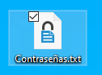

Podemos ahora por ejemplo enviárselo a Juan que para descifrarlo sólo tiene que desde Kleopatra pulsar en el botón **Descifrar**.

### 🔓 Descifrar Archivo (Receptor)

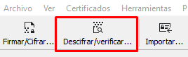

Seleccionamos el archivo cifrado y después de poner nuestra clave secreta, en la misma carpeta donde tenemos el archivo cifrado, nos aparecerá el descifrado.

## 🪟 Integración con Windows

Otra opción de manejo de este tipo de encriptado, es gracias a la integración que GPG4Win realiza con el sistema operativo Windows.

Si pulsamos al botón derecho del ratón sobre algún elemento de Windows como archivo o carpeta, nos aparece un menú desde el que podemos manejar las opciones que hemos visto anteriormente, lo que hace más rápido si cabe el proceso de firma/encriptado o desencriptado/verificación de archivos.

### 📋 Opciones del Menú Contextual

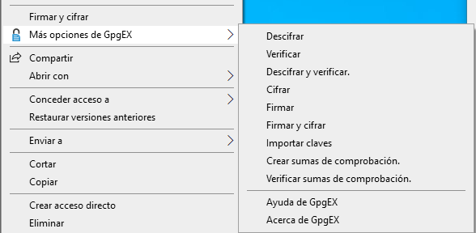

#### 🔧 Opciones Disponibles:

* 🔐 Firmar y cifrar: Cifra el archivo con claves públicas

* 🔓 Descifrar y verificar: Descifra archivos cifrados

* ✍️ Firmar: Solo firma (sin cifrar)

* ✅ Verificar: Verifica la firma digital

* 🔢 Crear sumas de comprobación: Verifica integridad de archivos

Entre una de las opciones interesantes que añade GPG4Win es la posibilidad de crear **sumas de comprobación de archivos**, para verificar la integridad de los archivos.

## 📚 Conclusiones

### ✅ Ventajas de GPG4Win:

* ✅ Cifrado asimétrico (más seguro que simétrico)

* ✅ No necesitas compartir contraseñas

* ✅ Un mensaje para múltiples destinatarios

* ✅ Firma digital (autenticidad y no repudio)

* ✅ Estándar OpenPGP (compatible con otros sistemas)

* ✅ Integración con Windows (menú contextual)

* ✅ Publicación de claves en servidores públicos

* ✅ Gratuito y de código abierto

* ✅ Verificación de integridad de archivos

### ⚠️ Consideraciones:

* ⚠️ Curva de aprendizaje más alta que cifrado simétrico

* ⚠️ Requiere gestión de claves (pública y privada)

* ⚠️ Perder clave privada = no poder descifrar mensajes recibidos

* ⚠️ Necesitas la clave pública de cada destinatario

### 🎯 Casos de Uso Ideales:

* 📧 Correo electrónico cifrado

* 📄 Compartir documentos confidenciales

* 🔐 Comunicaciones entre empresas

* 👥 Múltiples destinatarios sin compartir contraseñas

* ✍️ Firmar documentos digitalmente

* 🌐 Comunicaciones seguras en internet

### 🔑 Conceptos Clave:

| Concepto | Descripción |
| --- | --- |
| Clave Pública | Se comparte con todos. Sirve para CIFRAR mensajes para ti. |
| Clave Privada | Solo tú la conoces. Sirve para DESCIFRAR mensajes cifrados con tu clave pública. |
| Firma Digital | Garantiza que el mensaje viene de quien dice ser (autenticidad). |
| Certificación | Los usuarios validan que una clave pública pertenece realmente a quien dice. |
| Huella Digital | Identificador único de una clave pública (como un DNI). |
