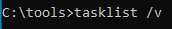
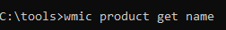
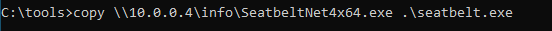
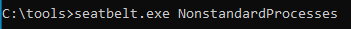

> [[02 - MODULOS/05 - Prácticas (PoCs)|← Volver a Prácticas (PoCs)]] | [[02 - MODULOS/Prácticas (PoCs)/Escalada de Privilegios en Windows/00 - Índice del Módulo Escalada de Privilegios en Windows|Índice del Módulo]]

---
# Explotación de Aplicaciones Instaladas

# 📦 Aplicaciones Instaladas

 
 

## 📖 ENUNCIADO (DESCRIPCIÓN)

 

### 🔓 Escalado de Privilegios a través de Aplicaciones Instaladas

 

Las aplicaciones instaladas en un sistema Windows pueden intentar realizar la elevación de privilegios de varias maneras:

 

> [!warning]
> 
 
> #### ⚠️ Vectores de Ataque a través de Aplicaciones:
> 

> 

> 
> * 
> **Vulnerabilidades conocidas:** Las aplicaciones pueden aprovechar vulnerabilidades conocidas en el sistema operativo o en otras aplicaciones instaladas para elevar sus privilegios. Estas vulnerabilidades pueden permitir que una aplicación ejecute código malicioso con privilegios elevados.
> 
 
> * 
> **Uso indebido de configuraciones:** Algunas aplicaciones pueden aprovechar configuraciones débiles o mal implementadas para elevar sus privilegios. Esto podría implicar la modificación de archivos de configuración, explotar la configuración de permisos incorrectos en archivos o directorios, o utilizar configuraciones predeterminadas débiles.
> 
 
> * 
> **Suplantación de identidad:** Algunas aplicaciones pueden intentar suplantar la identidad de un usuario con privilegios elevados para obtener acceso a recursos o realizar acciones restringidas. Esto podría implicar el uso de técnicas de ingeniería social o aprovechar la falta de autenticación adecuada en el sistema.
> 

> 

 

### 🛡️ Medidas de Protección

 

Para protegerse contra la elevación de privilegios no autorizada a través de aplicaciones instaladas, se recomienda seguir estas prácticas de seguridad:

 

> [!tip]
> 
 
> #### ✅ Buenas Prácticas de Seguridad:
> 
 

> 
> * Mantén el sistema operativo y las aplicaciones actualizados aplicando los parches y actualizaciones de seguridad más recientes. Las actualizaciones a menudo corrigen vulnerabilidades conocidas que podrían ser explotadas por aplicaciones maliciosas.
> 
> * Utiliza una solución antivirus y antimalware confiable y mantén su base de datos de definiciones actualizada. Esto ayudará a detectar y bloquear aplicaciones maliciosas conocidas.
> 
> * Limita los privilegios de las cuentas de usuario estándar. Utiliza una cuenta de usuario estándar para las tareas diarias y solo cambia a una cuenta de administrador cuando sea necesario realizar acciones que requieran privilegios elevados.
> 
> * Sé cauteloso al instalar aplicaciones de fuentes desconocidas. Descarga aplicaciones solo de fuentes confiables, como los sitios web oficiales de los desarrolladores o tiendas de aplicaciones verificadas.
> 
> * Considera utilizar herramientas de seguridad adicionales, como soluciones de prevención de ejecución de código no autorizado (como Microsoft's Enhanced Mitigation Experience Toolkit) o herramientas de control de aplicaciones, para monitorear y prevenir comportamientos sospechosos o maliciosos por parte de las aplicaciones instaladas.
> 

> 

 

 
 

## 🔍 Enumerando Aplicaciones Instaladas

 

> [!note]
> 
 
> #### 💡 ¿Por qué Enumerar Aplicaciones?
> 
 
> Enumerar las aplicaciones instaladas y en ejecución nos permite:
> 

> 
> * Identificar software vulnerable con exploits públicos conocidos
> 
> * Detectar aplicaciones obsoletas sin parches de seguridad
> 
> * Encontrar aplicaciones con configuraciones débiles
> 
> * Descubrir servicios que se ejecutan con privilegios elevados
> 
> * Identificar versiones específicas de software para buscar CVEs
> 

> 
> Una vez identificadas, podemos buscar en bases de datos de vulnerabilidades (CVE, Exploit-DB) si existen exploits públicos para esas versiones específicas.
> 

 

Mediante algunos comandos del sistema podemos obtener información sobre los programas instalados.

 

### 📋 Paso 1: Listar Programas en Ejecución

 

Programas en ejecución:

 



 

```cmd
C:\tools> tasklist /v
```

 

> [!tip]
> 
 
> #### 🔧 Comando tasklist:
> 
 
> 
> 
> 
> 
> 
> 
> 
> 
> `tasklist`
> 
> 
> 
> `tasklist /v`
> 
> 
> 
> `tasklist /svc`
> 
> 
> 
> 
> | Comando | Descripción |
> | --- | --- |
> | | Lista todos los procesos en ejecución |
> | | Modo verbose - información detallada (usuario, memoria, título) |
> | | Muestra servicios asociados a cada proceso |
> 
 
> **Información útil de tasklist /v:**
> 

> 
> * Nombre del proceso y PID
> 
> * Usuario que ejecuta el proceso
> 
> * Uso de memoria
> 
> * Estado del proceso
> 

> 

 

### 📦 Paso 2: Listar Programas Instalados

 

Programas instalados:

 



 

```cmd
C:\tools> wmic product get name
```

 

> [!tip]
> 
 
> #### 🔧 Comando wmic product:
> 
 
> 
> 
> 
> 
> 
> 
> 
> 
> `wmic product get name`
> 
> 
> 
> `wmic product get name,version`
> 
> 
> 
> `wmic product get name,version,vendor`
> 
> 
> 
> 
> | Comando | Descripción |
> | --- | --- |
> | | Lista solo los nombres de productos instalados |
> | | Lista nombres y versiones de productos |
> | | Incluye fabricante del software |
> 
 
> **Nota:** `wmic product` solo muestra aplicaciones instaladas mediante Windows Installer (MSI). No muestra todas las aplicaciones del sistema.
> 

 

### 🛠️ Paso 3: Usar Seatbelt para Enumeración Avanzada

 

Una opción es usar la herramienta **Seatbelt**:

 

 
* https://github.com/GhostPack/Seatbelt
 

 

Podemos descargar paquetes precompilados de:

 

 
* https://github.com/carlospolop/winPE/tree/master/binaries/seatbelt
 

 

En concreto descargamos **SeatbeltNet4x64.exe**, lo pasamos a nuestra máquina de Windows y lo ejecutamos de la siguiente forma:

 



 

```cmd
C:\tools> SeatbeltNet4x64.exe NonstandardProcesses
```

 



 

> [!note]
> 
 
> #### 🔍 ¿Qué es Seatbelt?
> 
 
> **Seatbelt** es una herramienta de enumeración de C# desarrollada por GhostPack que recopila información de seguridad del sistema.
> 
> **Características principales:**
> 

> 
> * Enumera procesos no estándar (aplicaciones de terceros)
> 
> * Identifica software vulnerable o desactualizado
> 
> * Recopila información de configuración del sistema
> 
> * Detecta credenciales almacenadas
> 
> * Identifica configuraciones de seguridad débiles
> 

> 
> **Comando NonstandardProcesses:**
> 
> Este comando muestra una lista de procesos en ejecución que **no son comunes del sistema Windows**, es decir, aplicaciones de terceros que podrían tener vulnerabilidades conocidas.
> 

 

> [!warning]
> 
 
> **💡 Siguiente Paso:**
> 
> Una vez tenemos la lista de esos programas podríamos buscar si alguno de ellos tiene vulnerabilidades conocidas que permitan la elevación de privilegios o algún otro tipo de explotación.
> 
> **Recursos para buscar vulnerabilidades:**
> 

> 
> * **Exploit-DB:** https://www.exploit-db.com/
> 
> * **CVE Details:** https://www.cvedetails.com/
> 
> * **NVD (National Vulnerability Database):** https://nvd.nist.gov/
> 
> * **SearchSploit (Kali):** `searchsploit nombre_programa versión`
> 

> 

 

 
 

## 📚 Resumen

 

> [!tip]
> 
 
> ### 🎓 Lo que hemos aprendido:
> 
 

> 
> * ✅ Las aplicaciones instaladas pueden tener vulnerabilidades explotables
> 
> * ✅ `tasklist /v` muestra procesos en ejecución con detalles
> 
> * ✅ `wmic product` enumera aplicaciones instaladas (solo MSI)
> 
> * ✅ Seatbelt identifica procesos no estándar (terceros)
> 
> * ✅ Debemos buscar versiones específicas en bases de datos de CVEs
> 
> * ✅ Software desactualizado es un vector común de escalada de privilegios
> 

> 
 
> ### 🔄 Flujo del Ataque:
> 
 

> [!note]
> 
 
> 
 **Enumerar aplicaciones** → 
> **Identificar versiones** → 
> **Buscar CVEs/exploits** → 
> **Descargar exploit público** → 
> **Ejecutar exploit** → 
> **Escalada de privilegios**
> 
> 

> 
 
> ### 🔑 Conceptos Clave:
> 
 
> 
> 
> 
> 
> 
> 
> 
> 
> **tasklist**
> 
> 
> 
> **wmic product**
> 
> 
> 
> **Seatbelt**
> 
> 
> 
> **NonstandardProcesses**
> 
> 
> 
> **CVE**
> 
> 
> 
> 
> | Concepto | Descripción |
> | --- | --- |
> | | Comando para listar procesos en ejecución |
> | | Comando para listar aplicaciones instaladas (MSI) |
> | | Herramienta de enumeración de seguridad de GhostPack |
> | | Procesos de terceros (no nativos de Windows) |
> | | Common Vulnerabilities and Exposures - base de datos de vulnerabilidades |
> 

> 
> ### 🔍 Comandos de Enumeración:
> 
 

> [!note]
> 
 
> ```cmd
> # Listar procesos en ejecución
> tasklist /v
> tasklist /svc
> 
# Listar aplicaciones instaladas
> wmic product get name
> wmic product get name,version
> wmic product get name,version,vendor
> 
# Usar Seatbelt
> C:\tools> SeatbeltNet4x64.exe NonstandardProcesses
> C:\tools> SeatbeltNet4x64.exe -group=all
> 
# Buscar exploits en Kali
> searchsploit nombre_programa
> searchsploit nombre_programa version
> ```
> 
 

> 
 
> ### 🎯 Navegación:
> 
 
> ← Práctica 05-04: Contraseñas - SAM
> 
> → Práctica 07: Tareas Programadas
>

---

> [[02 - MODULOS/05 - Prácticas (PoCs)|← Volver a Prácticas (PoCs)]] | [[02 - MODULOS/Prácticas (PoCs)/Escalada de Privilegios en Windows/00 - Índice del Módulo Escalada de Privilegios en Windows|Índice del Módulo]]
