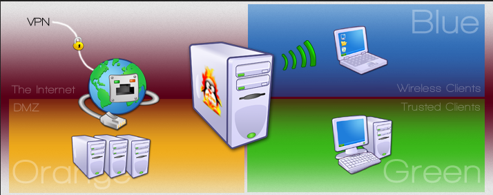
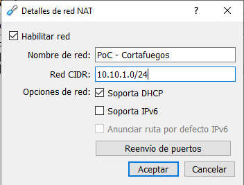
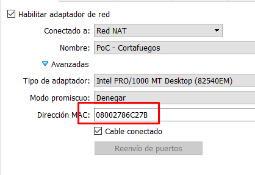
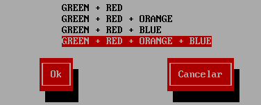
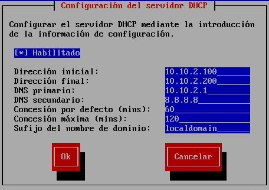
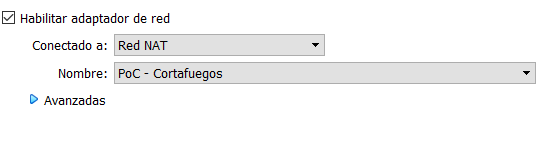
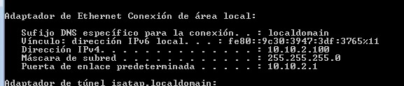
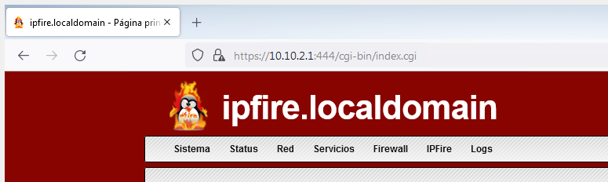
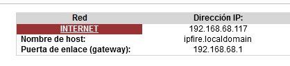

# 💿 Instalación de IPFire

## 📖 ENUNCIADO (DESCRIPCIÓN)

Vamos a crear un entorno en VirtualBox con un cortafuegos.

### 🖥️ Características de la VM

| Componente | Valor |
| --- | --- |
| Sistema | Debian 64 bits |
| RAM | 512 MB |
| CPU | 1 Core |
| Disco | 12 GB HDD |

### 🗺️ Topología IPFire



#### 🌐 Zonas de Red en IPFire:

| Zona | Color | Descripción | IP |
| --- | --- | --- | --- |
| WAN | 🔴 RED | Red exterior / Internet | DHCP / 10.10.1.10 |
| LAN | 🟢 GREEN | Red interna de confianza | 10.10.2.1 |
| WiFi | 🔵 BLUE | Red inalámbrica | 10.10.3.1 |
| DMZ | 🟠 ORANGE | Zona desmilitarizada (servidores) | 10.10.4.1 |

## 🚀 Prueba de Concepto (PoC)

### 🔧 Paso 1: Preparar el Entorno en VirtualBox

Comenzamos preparando el entorno del VirtualBox, para lo que vamos a crear una red NAT exclusiva para nuestro entorno, por lo que vamos a **Archivo > Preferencias** y en **RED** añadimos una nueva red NAT con las siguientes características:



#### ✅ Nombre de la Red NAT:

**PoC – Cortafuegos**

Esta red NAT será exclusiva para nuestro entorno de laboratorio.

### 💻 Paso 2: Crear la Máquina Virtual de IPFire

A continuación, creamos nuestra máquina de IPFire con las características antes descritas, seleccionando la ISO de IPFire descargada.

Se añaden **4 adaptadores de red**, todas en la misma red **PoC – Cortafuegos** generada antes. Es importante conocer si son adaptadores físicos la MAC que corresponde a cada uno de ellos.

> [!warning] ⚠️ Importante:  Anotamos la MAC del  Adaptador 1  que es el que asignaremos a la red WAN o RED.



### ⚙️ Paso 3: Instalación Inicial de IPFire

Iniciamos la máquina y realizamos la primera instalación, configurando las siguientes opciones:

#### 📋 Configuración de Instalación:

| Parámetro | Valor |
| --- | --- |
| Teclado | es |
| Nombre máquina | ipfire |
| Dominio | localdomain |
| Usuario root | root / `SegInf` |
| Usuario web | admin / `SegInf.Web` |

### 🌐 Paso 4: Seleccionar Topología de Red

Ahora en tipo de configuración vamos a elegir la **topología con las 4 redes**:



### 🔌 Paso 5: Asignación de Controladores y Tarjetas

Asignar una tarjeta a cada zona y seleccionar **Hecho**.

> [!warning] ⚠️ Importante:  Añadir a  RED  la MAC de la tarjeta del  Adaptador 1 . En físico hay que conocer las MACs de cada tarjeta.

### 📡 Paso 6: Configuración de Direcciones IP

Generamos las siguientes opciones de red:

#### 🌐 Configuración por Zona:

| Zona | Modo | IP | Máscara | Gateway |
| --- | --- | --- | --- | --- |
| 🔴 RED (WAN) | DHCP (recomendado) o Estático | 10.10.1.10 | 255.255.255.0 | 10.10.1.1 |
| 🟢 GREEN (LAN) | Estático | 10.10.2.1 | 255.255.255.0 | — |
| 🔵 BLUE (WiFi) | Estático | 10.10.3.1 | 255.255.255.0 | — |
| 🟠 ORANGE (DMZ) | Estático | 10.10.4.1 | 255.255.255.0 | — |

> [!warning] 📝 Nota:  Salvo que se comente otra opción, la zona  RED  la vamos a configurar como  DHCP .

### 🔄 Paso 7: Configuración del Servidor DHCP

Finalmente habilitamos el **DHCP** y definimos el rango de direcciones:



#### ⚙️ Configuración DHCP (Zona GREEN):

* IP inicial: 10.10.2.100

* IP final: 10.10.2.200

* DNS secundario: Añadir un DNS secundario

### ✅ Paso 8: Verificar Conectividad

Una vez iniciada la VM iniciamos con las credenciales antes creadas `root/SegInf` y probamos que tenga conexión con internet haciendo un ping:

```bash
ping www.google.es
```

### 🪟 Paso 9: Configurar Máquina Cliente Windows 7

En una máquina con Windows 7 configuramos la red, ponemos la RAM en **2048 MB** e iniciamos la VM.



Si todo funciona correctamente tendremos red que ya pasa por nuestro firewall.



#### ✅ Verificaciones desde Windows 7:

* Comprobar que haya internet en la VM de Windows 7

* Realizar un `tracert` para ver por dónde va pasando el tráfico

```bash
tracert www.google.es
```

### 🌐 Acceder al Entorno Web de IPFire

Y podremos acceder al entorno Web del IPFire desde el navegador de Windows 7:

```bash
https://10.10.2.1:444
```



### 📦 Paso 10: Instalar Paquetes en IPFire

Vamos a instalar algunos paquetes para comprobar que tiene internet y funciona perfectamente. Vamos al menú **IPFire > Pakfire**.

Damos a **Refrescar lista** y si hay alguna actualización pendiente la realizamos.

Instalamos los siguientes paquetes, seleccionando cada paquete y pulsando el signo **+**:

#### 📦 Paquetes a Instalar:

* 📦 tcpdump – Herramienta de captura de tráfico de red

* 📦 nano – Editor de texto en línea de comandos

### 🔌 Paso 11: Prueba con Adaptador en Modo Puente

Como prueba final ponemos el **Adaptador 1 en modo puente** y probamos que sigue funcionando todo.

#### 🔍 Observaciones con Modo Puente:

* Realizando un `tracert` desde Windows 7 ahora sale directamente sin pasar por el router de VirtualBox

* En el entorno Web de IPFire aparece la nueva IP y puerta de enlace real



## 📚 Conclusiones

### 🎓 Lo que hemos aprendido:

* ✅ Crear una red NAT dedicada en VirtualBox

* ✅ Instalar IPFire con topología de 4 zonas

* ✅ Configurar las zonas RED, GREEN, BLUE y ORANGE

* ✅ Habilitar DHCP en la zona GREEN

* ✅ Verificar conectividad desde cliente Windows 7

* ✅ Acceder a la interfaz web de administración

* ✅ Instalar paquetes adicionales con Pakfire

* ✅ Diferencia entre modo NAT y modo Puente

### 🎯 Próximos Pasos:

Con IPFire instalado y funcionando, en la siguiente práctica aprenderemos a crear **reglas de firewall** para controlar el tráfico entre las diferentes zonas.

→ [Ir a Práctica 02: Reglas de Firewall]([[02 - MODULOS/Prácticas (PoCs)/Firewall/02 - Reglas Perimetrales y Políticas en IPFire|02 - Reglas Perimetrales y Políticas en IPFire]])
