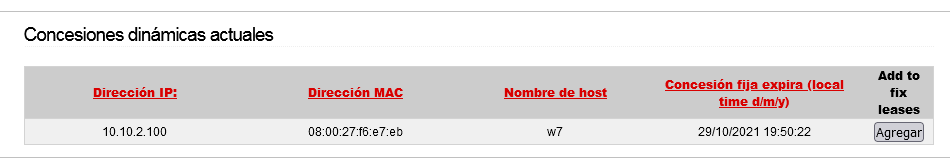
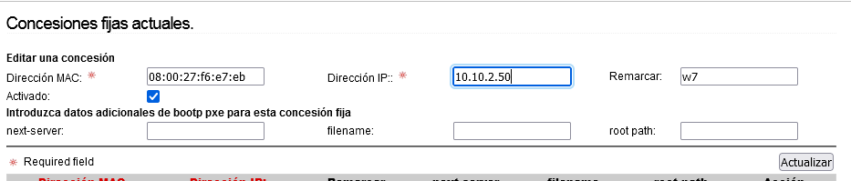
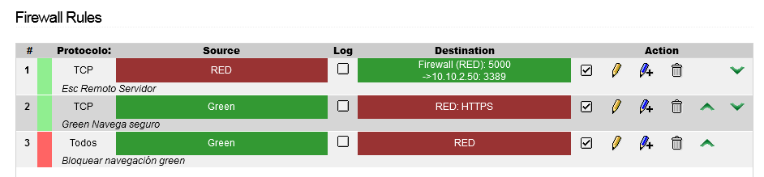
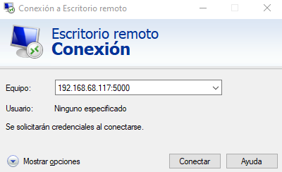

# 📋 Reglas de Firewall en IPFire

## 📖 ENUNCIADO (DESCRIPCIÓN)

En esta práctica vamos a aprender a crear y gestionar **reglas de firewall** en IPFire, controlando el tráfico entre las diferentes zonas de red.

#### 🎯 Objetivos de la Práctica:

* ✅ Crear reglas de bloqueo y permiso de tráfico

* ✅ Entender la prioridad de las reglas

* ✅ Configurar asignación DHCP estática

* ✅ Crear reglas NAT para acceso remoto

* ✅ Revisar logs y conexiones activas

## 🚀 Prueba de Concepto (PoC)

### 🔌 Paso 1: Preparar el Entorno

Ponemos el **Adaptador 1 en modo Bridge**, encendemos la máquina de Windows 7 y accedemos al entorno web del IPFire.

#### 🌐 Acceso al Entorno Web:

```bash
https://10.10.2.1:444
```

Usuario: `admin` / Contraseña: `SegInf.Web`

## 🛡️ Creación de Reglas de Firewall

### 📋 Regla 1: Bloquear Toda la Navegación desde GREEN hacia el Exterior

#### 🚫 Regla de Bloqueo:

| Campo | Valor |
| --- | --- |
| Origen | GREEN |
| Destino | RED |
| Acción | DROP (Bloquear) |
| Descripción | Bloquear navegación |

```bash
FROM GREEN to RED → Drop – Bloquear navegación
```

### 📋 Regla 2: Permitir Tráfico HTTPS

#### ✅ Regla de Permiso HTTPS:

| Campo | Valor |
| --- | --- |
| Origen | GREEN |
| Destino | RED |
| Protocolo | Preestablecido HTTPS |
| Acción | ACCEPT |

```bash
FROM GREEN to RED → Protocol Preestablecido HTTPS → Accept
```

### 🧪 Paso 3: Comprobar Funcionamiento

Comprobar navegando a [https://www.marca.com](https://www.marca.com)

> [!warning] ⚠️ Resultado esperado:  Con estas dos reglas, el acceso HTTP está bloqueado pero HTTPS funciona.

### 🔼 Paso 4: Subir la Regla de Bloqueo

Las reglas en IPFire se aplican **en orden de arriba a abajo**. Subimos la regla de bloqueo para que tenga prioridad.

#### 💡 Orden de Reglas (Importante):

* 🔴 DROP - Bloquear toda navegación GREEN → RED

* 🟢 ACCEPT - Permitir HTTPS GREEN → RED

Al subir el DROP arriba, **toda navegación queda bloqueada** incluso HTTPS.

### 🧪 Paso 5: Comprobar con HTTP y Ping

Comprobar ahora el funcionamiento:

#### 💻 Desde Windows 7:

* Entra en http://www.google.es (HTTP sin S)

* Prueba a hacer un ping:

```bash
ping www.google.es
```

Ambos deberían estar **bloqueados** por la regla DROP que está arriba.

### 🧪 Paso 6: Comprobar Bloqueo de Web HTTP

Buscar en Google la web de **Tablas de Daimiel** y entrar en ella a ver si bloquea el acceso.

> [!warning] 🎯 Observación:  Las webs HTTP quedan bloqueadas. Solo las webs HTTPS son accesibles cuando la regla ACCEPT HTTPS está por encima del DROP.

## 🖥️ Configuración de IP Estática por DHCP

### ⚙️ Paso 7: Asignar IP Fija a Windows 7

Activar en la máquina de Windows 7 el **Escritorio Remoto**. A continuación, vamos a añadir en nuestro firewall que ese equipo siempre obtenga automáticamente la misma IP que va a ser la **10.10.2.50**.

Vamos al menú **Red > Servidor DHCP** y abajo saldrá nuestro equipo con Windows 7:



Pulsamos en **Agregar**, luego pulsamos en **Editar** y lo cambiamos por `10.10.2.50` y pulsamos **Actualizar**.



#### ✅ Resultado:

Con esto nuestra máquina a partir de ahora recibirá siempre la IP **10.10.2.50**. Es posible que con solo configurar el firewall recibas la nueva IP.

## 🔀 Regla NAT para Escritorio Remoto

### ⚙️ Paso 8: Configurar Redirección de Puerto (Port Forwarding)

Ahora vamos a configurar una regla que permita acceder remotamente a ese equipo **desde fuera de la red de IPFire**. Para ello vamos al entorno web en **Reglas de Firewall**.

Redirigiremos la entrada a nuestro IPFire por el **puerto 5000** para que lo redirija al **puerto 3389** del equipo **10.10.2.50**.

#### 📋 Configuración de la Regla NAT:

| Campo | Valor |
| --- | --- |
| a) Source | RED (Internet) |
| b) NAT | ✅ Marcado |
| c) Firewall Interface | RED (ver IP RED) |
| d) Destino | 10.10.2.50 (Windows 7) |
| e) Protocolo | TCP |
| Destination Port | 3389 (RDP) |
| External Port | 5000 |

#### 🔄 Flujo de la Conexión NAT:

**Cliente externo** → conecta a **IP RED:5000** → IPFire redirige a **10.10.2.50:3389**

### 🔼 Paso 9: Colocar la Regla Arriba

Ponemos la regla arriba. Queda finalmente algo similar a lo siguiente:



### 🧪 Paso 10: Probar Escritorio Remoto desde el Exterior

Ahora desde cualquier equipo probamos el **Escritorio Remoto** a esa IP de RED que hemos visto antes.

#### 💻 Conexión RDP:

```bash
mstsc
Equipo: [IP_RED_IPFIRE]:5000
```

O desde **Conexión a Escritorio Remoto** introducimos `[IP_RED]:5000`



## 📊 Paso 11: Revisar Registros y Conexiones

Revisar los registros de conexiones en:

#### 📋 Ubicación de los Logs:

* 📊 Status > Conexiones → Ver conexiones activas en tiempo real

* 📋 Logs > Firewall Logs → Ver historial de conexiones permitidas y bloqueadas

#### 🔍 ¿Qué observar en los Logs?

* 🔴 Conexiones bloqueadas por las reglas DROP

* 🟢 Conexiones permitidas por las reglas ACCEPT

* 🔀 Redirecciones NAT activas (puerto 5000 → 3389)

* 🌐 IPs de origen de las conexiones

* 🕐 Timestamps de cada conexión

## 📚 Resumen de Reglas Creadas

| # | Origen | Destino | Protocolo | Puerto | Acción |
| --- | --- | --- | --- | --- | --- |
| 1 | 🟢 GREEN | 🔴 RED | Cualquiera | Cualquiera | 🚫 DROP |
| 2 | 🟢 GREEN | 🔴 RED | HTTPS | 443 | ✅ ACCEPT |
| 3 | 🔴 RED | 10.10.2.50 | TCP (NAT) | 5000 → 3389 | 🔀 FORWARD |

### 🎓 Lo que hemos aprendido:

* ✅ Crear reglas DROP y ACCEPT en IPFire

* ✅ El orden de las reglas es fundamental

* ✅ Configurar asignación DHCP estática por MAC

* ✅ Crear reglas NAT para redirección de puertos

* ✅ Acceder remotamente a equipos internos desde el exterior

* ✅ Revisar logs y conexiones activas

### 🎯 Navegación:

← [Práctica 01: Instalación de IPFire]([[02 - MODULOS/Prácticas (PoCs)/Firewall/01 - Instalación y Topología de Red con IPFire|01 - Instalación y Topología de Red con IPFire]])

→ [Práctica 03: VPN con IPFire]([[02 - MODULOS/Prácticas (PoCs)/Firewall/03 - Redes Privadas Virtuales (VPN) con IPFire|03 - Redes Privadas Virtuales (VPN) con IPFire]])
