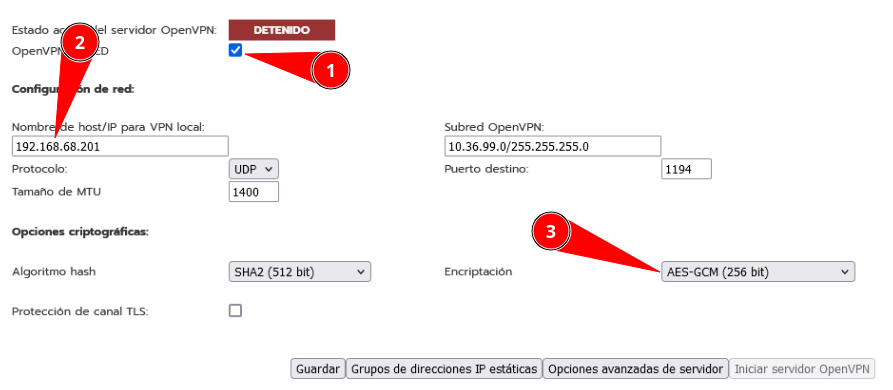
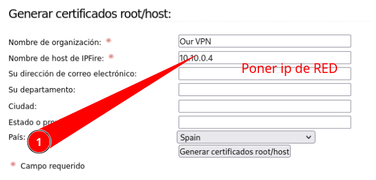
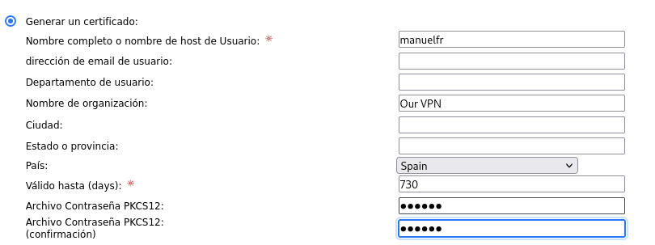
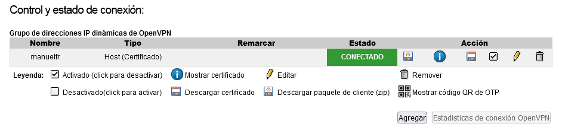
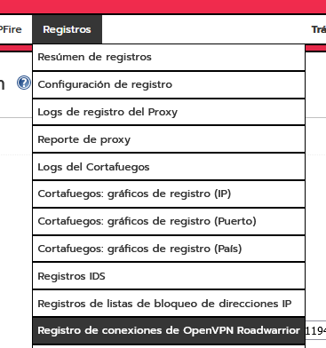

# 🔐 VPN con IPFire

## 📖 ENUNCIADO (DESCRIPCIÓN)

Antes de realizar la configuración de nuestra propia VPN, vamos a instalar y conectarnos a varios tipos de VPN para familiarizarnos con el concepto.

#### 🎯 Objetivos de la Práctica:

* ✅ Conectarse a una VPN pública (OpenVPN y WireGuard)

* ✅ Configurar servidor OpenVPN en IPFire

* ✅ Generar certificados SSL para la VPN

* ✅ Conectar un cliente externo a nuestra red interna

* ✅ Verificar conectividad a través del túnel VPN

## 🌐 Parte 1: Conectarse a VPNs Externas

### 📥 Paso 1: Instalar Cliente OpenVPN

> [!warning] ⚠️ Importante:  Instalar el cliente  OpenVPN Community , NO el OpenVPN Connect.

#### 🔗 Descarga del Cliente OpenVPN:

[https://openvpn.net/community-downloads/](https://openvpn.net/community-downloads/)

### 📥 Paso 2: Descargar Configuraciones de VPN Gratuitas

#### 🔗 Servidores OpenVPN Gratuitos:

* https://www.freeopenvpn.org

* https://www.vpnbook.com/freevpn

#### 🔗 WireGuard:

* https://kretvpn.com/es/signup

#### 🔗 Proveedores VPN de Pago (Referencia):

* https://mullvad.net/es

## 🔧 Parte 2: Prueba de Concepto (PoC) - Servidor VPN en IPFire

Vamos a configurar una VPN de acceso a nuestro entorno.

> [!warning] ⚠️ Requisito previo:  Actualizar IPFire a mínimo la  versión 284  antes de continuar. Versiones anteriores tienen problemas de compatibilidad con certificados SSL.

### ⚙️ Paso 1: Acceder a la Configuración OpenVPN

Nos vamos a **Servicios > OpenVPN** en el entorno web de IPFire.

### 🌐 Paso 2: Configurar el Servidor OpenVPN

Marcamos **OpenVPN en RED**, ponemos la IP que nos ha asignado de cara a internet, cambiamos la encriptación a **AES-GCM (256 bit)** y pulsamos **Guardar**.



#### ⚙️ Parámetros de Configuración:

| Parámetro | Valor |
| --- | --- |
| Interface | RED (WAN) |
| IP Pública | IP asignada por el ISP |
| Encriptación | AES-GCM (256 bit) |

### 📜 Paso 3: Generar Certificado Root/Host

Generamos el **certificado root/host** para el servidor VPN:

* Rellenamos los datos del certificado



Y generamos el certificado pulsando el botón correspondiente.

### 👤 Paso 4: Agregar Usuarios VPN

En **Control y Status** agregamos los usuarios:

* Seleccionamos Host a Red y pulsamos Agregar

* Introducimos Nombre de Usuario / Contraseña

* Pulsamos Guardar



### 🚀 Paso 5: Iniciar el Servidor OpenVPN

Iniciamos el servidor OpenVPN desde el panel de control.

### 📦 Paso 6: Descargar el Paquete de Configuración del Cliente

Descargamos el **paquete ZIP** con la configuración del cliente desde el panel de IPFire.

## 💻 Parte 3: Configuración del Cliente OpenVPN

### 📥 Paso 7: Instalar el Cliente OpenVPN

> [!warning] ⚠️ Recuerda:  Instalar el cliente  OpenVPN Community , NO el OpenVPN Connect.

[https://openvpn.net/community-downloads/](https://openvpn.net/community-downloads/)

### 📂 Paso 8: Descomprimir y Configurar

Descomprimimos el contenido del ZIP en:

```bash
C:\users\usuario\OpenVPN\Config
```

#### ⚠️ Corrección de Encriptación (Si usaste AES-256-CBC por error):

Modificar el archivo `.ovpn` y **eliminar** la siguiente línea:

```bash
cipher AES-256-CBC
```

**Y añadir en su lugar:**

```bash
data-ciphers 'AES-256-CBC'
data-ciphers-fallback 'AES-256-CBC'
```

### 🔌 Paso 9: Conectar al Servidor VPN

Hacemos clic derecho en el icono de OpenVPN en la bandeja del sistema y seleccionamos **Conectar**. Nos pedirá la clave del usuario creado anteriormente.

Tu usuario aparecerá como **conectado**:



## 🧪 Parte 4: Verificación de la Conexión VPN

### ✅ Paso 10: Comprobar IP asignada por la VPN

```cmd
ipconfig
```

Deberías ver un nuevo adaptador de red con una IP del rango de la VPN.

### ✅ Paso 11: Comprobar Conectividad con la Red GREEN

```bash
ping 10.10.2.1
```

#### ✅ Resultado esperado:

El ping a la IP del GREEN (10.10.2.1) debe responder correctamente, lo que confirma que el túnel VPN está activo.

### ✅ Paso 12: Comprobar Acceso al Entorno Web de IPFire

Acceder desde el navegador al panel de IPFire a través del túnel VPN:

```bash
https://10.10.2.1:444
```

### 📋 Ver Registro de Conexiones VPN

Cuando nos conectamos podemos ver el registro de conexiones en el menú **Registros**:



## 🛠️ Solución de Problemas

#### ⚠️ Problema: Error con Certificado PKCS12 en Versiones Anteriores a 284

Existe un problema con el uso por parte de IPFire de SSL que produce un error con el certificado pkcs12.

**Solución (en máquina con OpenSSL 3.0.5):**

1. Desencriptar el archivo p12:

```bash
openssl pkcs12 -info -in openvpn_OpenVPN_Server_Zertifikat.p12 -legacy
```

2. Guardar los certificados:

* Certificados → `cert.pem`

* Clave privada → `key.pem`

3. Generar nuevo archivo p12 con algoritmo actualizado:

```bash
pkcs12 -export -out good.p12 -inkey key.pem -in cert.pem
```

4. Actualizar el archivo `.ovpn` con las nuevas rutas de certificados.

## 📚 Conclusiones

### 🎓 Lo que hemos aprendido:

* ✅ Diferencia entre OpenVPN Community y OpenVPN Connect

* ✅ Configurar un servidor OpenVPN en IPFire

* ✅ Generar certificados SSL para VPN

* ✅ Crear usuarios de acceso VPN

* ✅ Instalar y configurar el cliente OpenVPN

* ✅ Verificar conectividad a través del túnel VPN

* ✅ Revisar logs de conexiones VPN

* ✅ Resolver problemas de compatibilidad de certificados

### 🎯 Navegación:

← [Práctica 02: Reglas de Firewall]([[02 - MODULOS/Prácticas (PoCs)/Firewall/02 - Reglas Perimetrales y Políticas en IPFire|02 - Reglas Perimetrales y Políticas en IPFire]])

→ [Práctica 04: IDS con IPFire]([[02 - MODULOS/Prácticas (PoCs)/Firewall/04 - Sistema de Detección de Intrusos (IDS) en IPFire|04 - Sistema de Detección de Intrusos (IDS) en IPFire]])
