# 🚨 IDS/IPS con IPFire

## 📖 ENUNCIADO (DESCRIPCIÓN)

Vamos a activar el **IDS/IPS** en nuestro firewall y aplicar diferentes reglas para detectar y bloquear intrusiones.

#### 🎯 Objetivos de la Práctica:

* ✅ Activar y configurar el IDS/IPS en IPFire

* ✅ Aplicar reglas de detección de escaneos e ICMP

* ✅ Realizar un escaneo Nmap y verificar los registros

* ✅ Instalar y configurar Guardian para bloqueo activo

* ✅ Simular un ataque de fuerza bruta con ncrack

* ✅ Verificar el bloqueo automático de IPs atacantes

#### 💡 Diferencia entre IDS e IPS:

| Sistema | Nombre | Acción |
| --- | --- | --- |
| IDS | Intrusion Detection System | Solo detecta y registra (no bloquea) |
| IPS | Intrusion Prevention System | Detecta, registra y bloquea |

## 🔍 Parte 1: Configuración del IDS/IPS

### ⚙️ Paso 1: Agregar Proveedor de Reglas

Primero vamos al menú **Firewall > Detección de Intrusiones**.

Seleccionamos **Agregar proveedor** y vamos a seleccionar las **Reglas de la Comunidad**, marcamos **Monitorizar sólo el tráfico** y pulsamos **Agregar**.

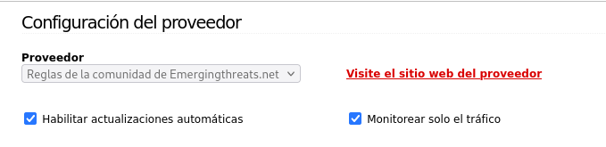

> [!warning] ⚠️ Opción "Monitorear sólo tráfico" (Importante):
>
>          ✅  Marcada (IDS):  Solo monitoriza el tráfico. Los paquetes son registrados pero  NO bloqueados .
>          🚫  Desmarcada (IPS):  El sistema realiza acciones activas y  bloquea los paquetes  que coincidan con las reglas.

### 🟢 Paso 2: Activar Enable IPS y Monitorizar Interfaces

Activamos **Enable IPS** y monitorizamos en **RED** y **GREEN**:

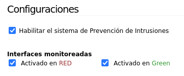

Pulsamos **Guardar** y el servicio de detección de intrusiones debería aparecer ejecutándose:

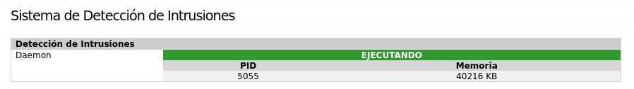

### 📋 Paso 3: Personalizar el Conjunto de Reglas

Pulsamos en **Personalizar conjunto de reglas** y activamos las siguientes reglas. Pulsamos **Apply** para aplicarlas:

#### 🛡️ Reglas a Activar:

* 🔍 emerging-scan.rules → Detecta escaneos de puertos y reconocimiento de red

* 📡 emerging-icmp.rules → Detecta tráfico ICMP sospechoso (ping floods, etc.)

## 🧪 Parte 2: Pruebas de Detección

### 🔎 Paso 4: Realizar Escaneo Nmap

Realizamos un escaneo Nmap contra la IP de nuestro firewall desde una máquina externa:

```bash
nmap -v -A [IP_FIREWALL]
```

Obtendremos cierta información de ese escaneo:

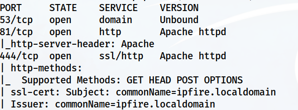

### 📋 Paso 5: Revisar el Registro IDS

Revisa el registro en **Registros > Registros IDS** para verificar si el escaneo ha sido detectado:

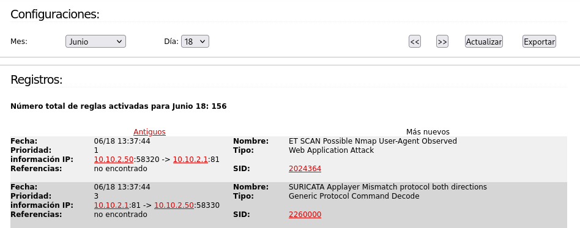

#### ✅ Resultado Esperado:

El escaneo Nmap debe aparecer registrado en los logs del IDS con las alertas generadas por la regla `emerging-scan.rules`.

## 🛡️ Parte 3: Configuración de Guardian (IPS Activo)

A continuación, vamos a configurar **Guardian** para bloquear activamente ataques contra el IPFire.

### 📦 Paso 1: Instalar Guardian

Instalar Guardian desde el menú **IPFire > Pakfire**:

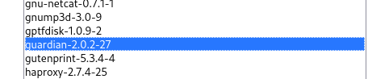

### ⚙️ Paso 2: Configurar Guardian

Ir a **Servicios > Guardian** y configurar con los siguientes parámetros:

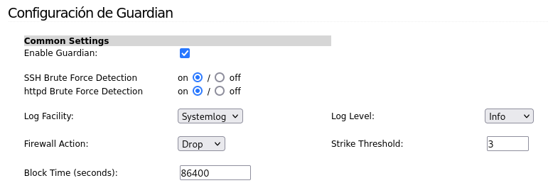

#### ⚙️ Parámetros de Guardian:

| Parámetro | Valor |
| --- | --- |
| Enable | ✅ Activado |
| Firewall action | Drop |
| Log facility | System log |
| Log Level | Info |

Pulsamos **Guardar**.

### 🔑 Paso 3: Habilitar Acceso SSH

En **Sistema > Acceso SSH** habilitamos el acceso por SSH para poder recibir el ataque de prueba:

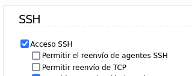

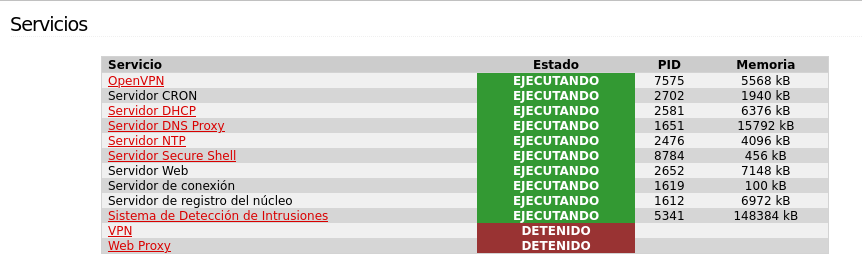

## 💥 Parte 4: Simulación de Ataque y Verificación

### 🔓 Paso 4: Ataque de Fuerza Bruta con ncrack

Intentamos un ataque con **ncrack** contra la IP de nuestro firewall:

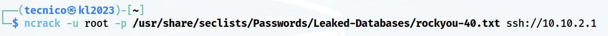

```bash
ncrack -p ssh [IP_FIREWALL]
```

> [!warning] ⚠️ Solo en entorno de laboratorio:  Este ataque debe realizarse únicamente contra máquinas propias en entorno controlado.

### 📋 Paso 5: Ver Registros en System Logs

Ver registros en **Logs > System Logs** sección **Guardian**:

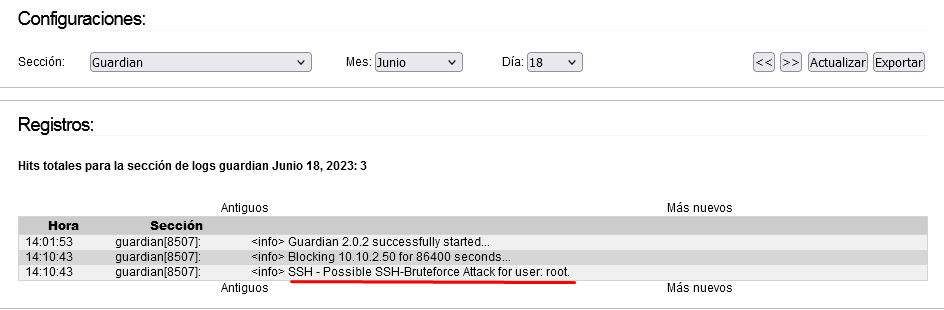

### 🚫 Paso 6: Verificar el Bloqueo en Guardian

Ver en **Servicios > Guardian** cómo ha sido bloqueada la IP atacante:

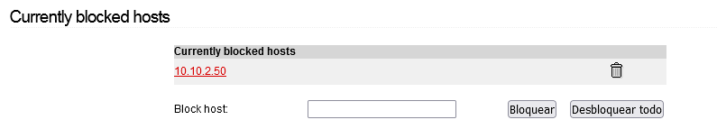

#### ✅ Resultado Esperado:

La IP desde donde se realizó el ataque debe aparecer en la lista de IPs bloqueadas por Guardian. A partir de ese momento todos sus paquetes serán descartados.

### 🧪 Paso 7: Verificar el Bloqueo

Tratar de navegar desde la **máquina bloqueada**.

#### 🚫 Resultado Esperado:

La máquina bloqueada **no tendrá acceso a internet ni a ningún recurso de red**. Todo su tráfico será bloqueado por la regla DROP de Guardian hasta que sea eliminada manualmente.

## 📚 Conclusiones

### 🎓 Lo que hemos aprendido:

* ✅ Diferencia práctica entre IDS (detectar) e IPS (bloquear)

* ✅ Configurar Suricata como motor IDS/IPS en IPFire

* ✅ Activar reglas de la comunidad (emerging threats)

* ✅ Detectar escaneos Nmap con `emerging-scan.rules`

* ✅ Instalar y configurar Guardian para bloqueo automático

* ✅ Simular un ataque de fuerza bruta con ncrack

* ✅ Verificar el bloqueo automático de IPs en Guardian

* ✅ Revisar logs del sistema y del IDS

### 🔄 Flujo del Sistema IDS/IPS + Guardian:

**Ataque detectado por IDS** →
          **Alerta registrada en logs** →
          **Guardian detecta la alerta** →
          **IP bloqueada automáticamente** →
          **Tráfico descartado (DROP)**

### 🎯 Navegación:

← [Práctica 03: VPN con IPFire]([[02 - MODULOS/Prácticas (PoCs)/Firewall/03 - Redes Privadas Virtuales (VPN) con IPFire|03 - Redes Privadas Virtuales (VPN) con IPFire]])

→ [Práctica 05: Proxy Web con IPFire]([[02 - MODULOS/Prácticas (PoCs)/Firewall/05 - Servidor Proxy y Filtrado de Contenidos en IPFire|05 - Servidor Proxy y Filtrado de Contenidos en IPFire]])
