# 🪟 Cortafuegos en Windows

## 📖 ENUNCIADO (DESCRIPCIÓN)

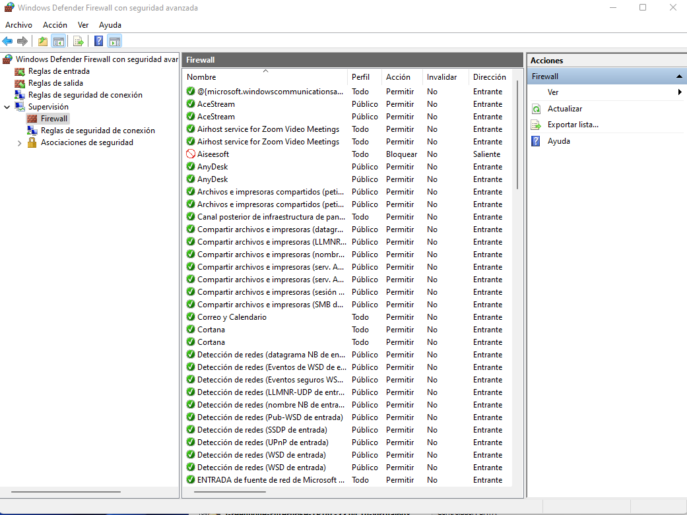

El **Firewall de Windows 10** es una herramienta de seguridad útil que puede ayudar a proteger tu dispositivo de amenazas en línea y asegurar una conexión a Internet más segura.

#### 🎯 Objetivos de la Práctica:

* ✅ Entender las reglas de entrada y salida del Firewall de Windows

* ✅ Controlar conexiones por ámbito de IP local y remota

* ✅ Crear reglas de bloqueo personalizadas

* ✅ Bloquear ataques de fuerza bruta al escritorio remoto

* ✅ Crear reglas de salida para controlar la navegación

### 📋 Reglas de Entrada y Salida

En la sección de **Reglas de entrada** y **Reglas de salida**, tendremos todas y cada una de las reglas que están actualmente dadas de alta. No obstante, algunas reglas pueden estar deshabilitadas, por tanto, no están en uso.

En la parte de la derecha hay una serie de opciones que nos permiten filtrar las reglas y mostrar diferentes datos en las columnas.

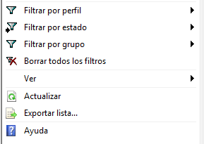

Por ejemplo, si pulsamos en **Filtrar por estado** podemos seleccionar para que muestre sólo aquellas reglas que están habilitadas.

#### 🖥️ Entorno de la Práctica:

| Máquina | Sistema | IP | Rol |
| --- | --- | --- | --- |
| VM7 | Windows 7 | 10.0.0.12 | Servidor RDP (objetivo) |
| Kali | Kali Linux | 10.0.0.13 | Cliente (atacante) |

## 🖥️ Parte 1: Control de Escritorio Remoto por Ámbito

### 🔧 Paso 1: Habilitar Escritorio Remoto en Windows 7

Habilitamos el acceso por **Escritorio Remoto** en la máquina de Windows 7:

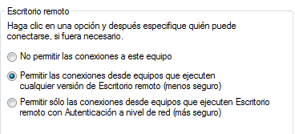

### 🔌 Paso 2: Instalar rdesktop en Kali e Intentar Conexión

Desde Kali Linux, si no está instalado, instalamos el paquete **rdesktop**:

```bash
sudo apt install rdesktop
```

Comprobamos que el escritorio remoto está habilitado y nos podemos conectar:

```bash
rdesktop -u tecnico 10.0.0.12
```

### 🔍 Paso 3: Localizar la Regla de Escritorio Remoto

Una vez comprobado que funciona, abrimos el **Firewall de Windows** y en la zona de **Reglas de Entrada** buscamos la regla que se habrá creado para escritorio remoto:

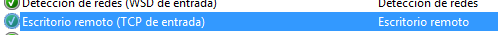

### 🎯 Paso 4: Control por Ámbito de Dirección IP

Hacemos doble clic sobre la regla para entrar en sus propiedades y vamos a la pestaña **Ámbito**.

#### 💡 Tipos de Ámbito Disponibles:

| Ámbito | Controla | Ejemplo de Uso |
| --- | --- | --- |
| Dirección IP Local | La IP que tiene la máquina Windows 7 | Permitir solo cuando Windows tiene una IP concreta |
| Dirección IP Remota | La IP del cliente que se conecta | Permitir conexión solo desde IPs concretas |

#### 🔒 Prueba con Dirección IP Local

**Dirección IP Local:** Se refiere a la IP que toma la VM de Windows 7. Aquí podemos definir una serie de IPs en las que cuando nuestra máquina de Windows 7 tenga una de esas IPs, sí permita la conexión por escritorio remoto.

Como ejemplo vamos a añadir una IP que **NO** sea la que tiene ahora. Mi VM de Windows 7 tiene la `10.0.0.12`, voy a añadir como IP local por ejemplo la `10.0.0.15`:

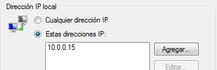

Pulsamos **Aplicar**. Si intentamos conectarnos ahora desde la VM de Kali **no debería dejarnos**.

Sin embargo si también añadimos la IP `10.0.0.12` (que es la nuestra de Windows 7):

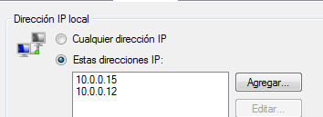

Pulsamos **Aplicar** y ahora nos debería dejar nuevamente conectarnos.

#### 🔒 Prueba con Dirección IP Remota

**Dirección IP Remota:** Con este ámbito controlamos **desde dónde** se va a realizar la conexión. Podemos permitir que sólo una determinada IP de nuestra red se conecte, un determinado rango de IPs, o incluso una IP de internet.

Mi Kali tiene la IP `10.0.0.13`. Vamos a configurar que sólo desde la IP remota `10.0.0.20` admita conexiones:

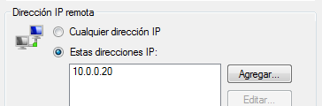

Pulsamos **Aplicar** y nuevamente no podremos acceder desde Kali.

Sin embargo si agregamos el ámbito `10.0.0.0/24` ya nos vuelve a dejar conectar.

### 🌐 Conexión desde el Equipo Anfitrión

Finalmente vamos a permitir que desde el equipo anfitrión se conecte. Redirigimos primero la conexión en el Router del VirtualBox:

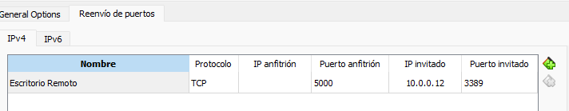

Luego en el ámbito, añadimos el ámbito de nuestra red local:

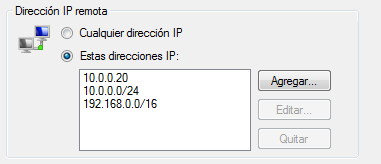

Y realizamos la conexión:

```bash
127.0.0.1:5000
```

O desde cualquier otro equipo de la red conectando a `ip_anfitrion:5000`.

Una vez realizada, comprueba con el comando **netstat** la conexión que has realizado y las IPs que aparecen:

```cmd
netstat -an | findstr 3389
```

#### 🌐 Zerotier - VPN para Acceso Remoto:

Como alternativa para acceder remotamente a equipos sin necesidad de configurar port forwarding, puedes usar **ZeroTier**:

[https://www.zerotier.com](https://www.zerotier.com)

## 🛡️ Parte 2: Crear Nuevas Reglas de Entrada

### 🔍 Escenario: Ataque al Puerto RDP

En la siguiente captura de **currPorts** podemos ver que se está realizando un ataque a nuestro servidor a través del servicio de escritorio remoto. El puerto **3389** está recibiendo continuamente intentos de conexión desde diversas IPs:

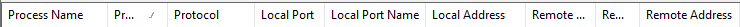

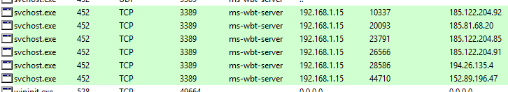

> [!warning] 🎯 Situación:  Nuestra IP legítima desde la que nos conectamos es `185.61.205.63`. El resto de IPs que aparecen son intentos de ataque que debemos bloquear.

### 🚫 Crear Regla de Bloqueo RDP

Teniendo en cuenta que la IP **nuestra** desde la que nos conectamos es `185.61.205.63`, crea las reglas necesarias para bloquear todos los intentos que se están produciendo:

#### 📋 Pasos para Crear la Regla de Bloqueo:

* Pulsamos en Nueva Regla

* Seleccionamos Puerto 3389 TCP

* Elegimos Bloquear la conexión

* La llamaremos Bloquear Esc. Remoto

* Editamos las propiedades de la regla y agregamos las IPs y rangos atacantes en el ámbito

#### 💡 Estrategia de Bloqueo:

* ✅ Crea una regla ALLOW para tu IP legítima (`185.61.205.63`)

* 🚫 Crea una regla BLOCK para el resto de IPs atacantes

## 📤 Parte 3: Reglas de Salida

### 🌐 Regla 1: Bloquear Navegación No Segura (HTTP)

Vamos a crear una regla que bloquee la **navegación no segura** (HTTP puerto 80). Llamaremos a la regla **00 Bloquear navegación no segura**.

#### 📋 Configuración de la Regla:

| Parámetro | Valor |
| --- | --- |
| Tipo | Regla de salida - Puerto |
| Protocolo | TCP |
| Puerto | 80 (HTTP) |
| Acción | Bloquear la conexión |
| Nombre | 00 Bloquear navegación no segura |

Después de agregar la regla, trata de navegar a [http://www.almagro.es/](http://www.almagro.es/)

Deshabilita la regla y vuelve a intentar navegar.

### 🚫 Regla 2: Bloquear Todo el Tráfico de Salida

Ahora vamos a crear una regla que **bloquee todo el tráfico de salida**. Llamaremos a esa regla **00 Todo bloqueado**.

#### 📋 Configuración de la Regla:

| Parámetro | Valor |
| --- | --- |
| Tipo | Regla de salida - Personalizada |
| Programas | Todos los programas |
| Protocolo | Cualquiera |
| Acción | Bloquear la conexión |
| Nombre | 00 Todo bloqueado |

Después de agregar la regla **no debería dejarnos navegar a ningún sitio**.

Tampoco deberíamos poder acceder por escritorio remoto:

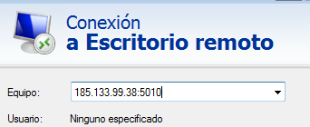

Deshabilita la regla y vuelve a intentar navegar.

> [!warning] 💡 Tip:  El prefijo  "00"  en el nombre de la regla hace que aparezca en la parte superior de la lista, ya que las reglas se ordenan alfabéticamente. Esto facilita encontrar nuestras reglas personalizadas rápidamente.

## 📚 Conclusiones

### 🎓 Lo que hemos aprendido:

* ✅ Navegar por el Firewall de Windows y filtrar reglas

* ✅ Controlar conexiones por ámbito de IP local y remota

* ✅ Diferencia entre IP local (nuestra) e IP remota (del cliente)

* ✅ Crear reglas de bloqueo para ataques al RDP

* ✅ Crear reglas de salida para controlar la navegación

* ✅ Habilitar y deshabilitar reglas para comprobar su efecto

* ✅ Usar netstat para verificar conexiones activas

* ✅ Nombrar reglas con prefijo "00" para mayor visibilidad

### 📋 Resumen de Reglas Creadas:

| Nombre | Tipo | Puerto | Acción |
| --- | --- | --- | --- |
| Bloquear Esc. Remoto | Entrada | 3389 TCP | 🚫 Bloquear IPs atacantes |
| 00 Bloquear navegación no segura | Salida | 80 TCP | 🚫 Bloquear HTTP |
| 00 Todo bloqueado | Salida | Todos | 🚫 Bloquear todo |

### 🎯 Navegación:

← [Práctica 05: Proxy Web con IPFire]([[02 - MODULOS/Prácticas (PoCs)/Firewall/05 - Servidor Proxy y Filtrado de Contenidos en IPFire|05 - Servidor Proxy y Filtrado de Contenidos en IPFire]])

→ [Práctica 06B: Firewall en Linux]([[02 - MODULOS/Prácticas (PoCs)/Firewall/07 - Cortafuegos de Linux (Iptables, NFTables y UFW)|07 - Cortafuegos de Linux]])
