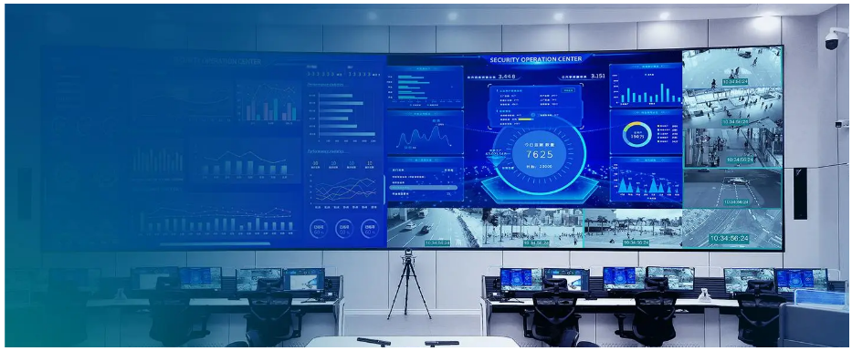
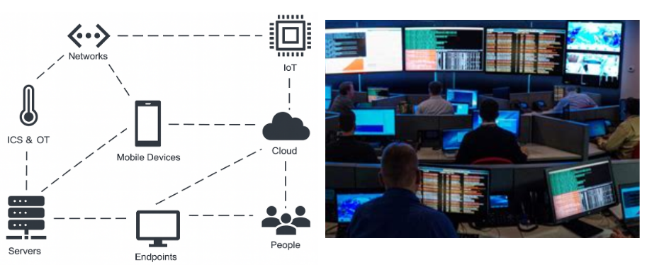
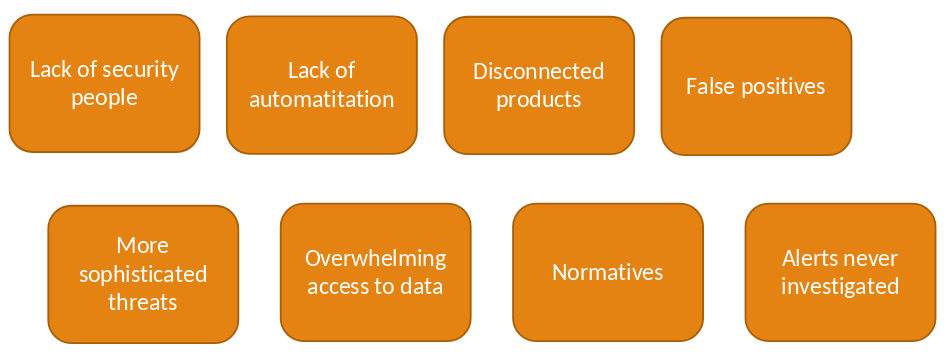
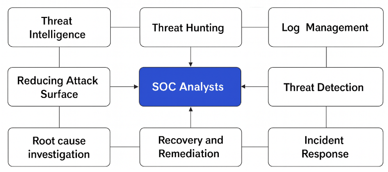
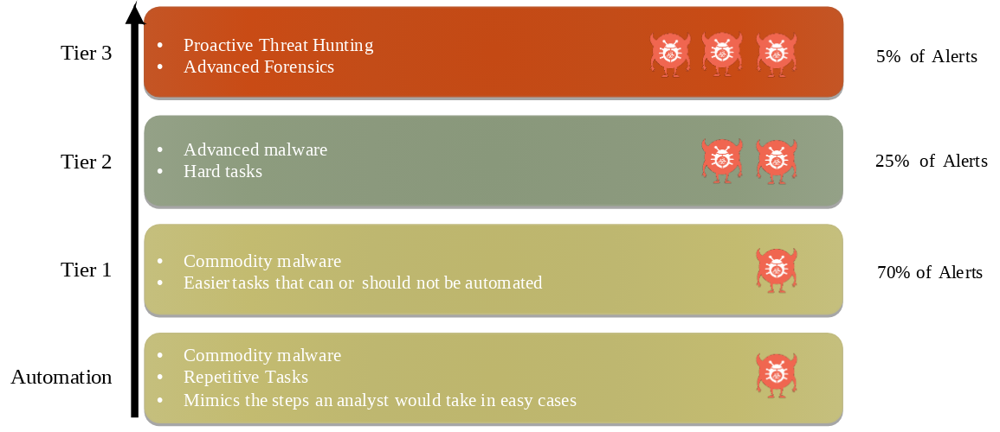
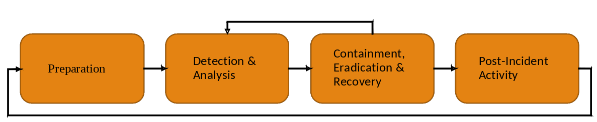
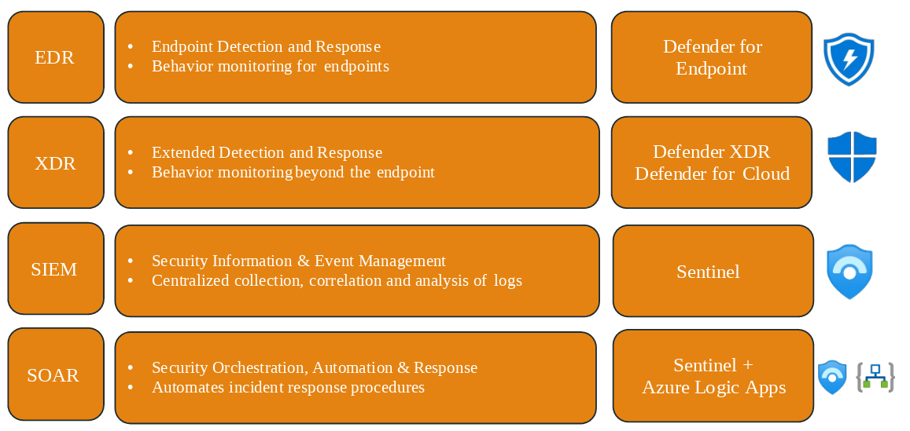
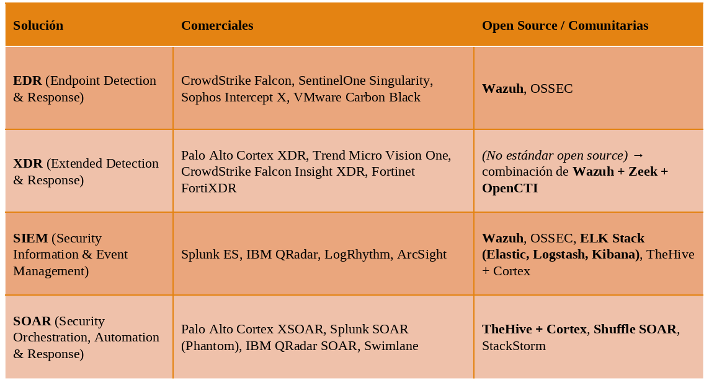
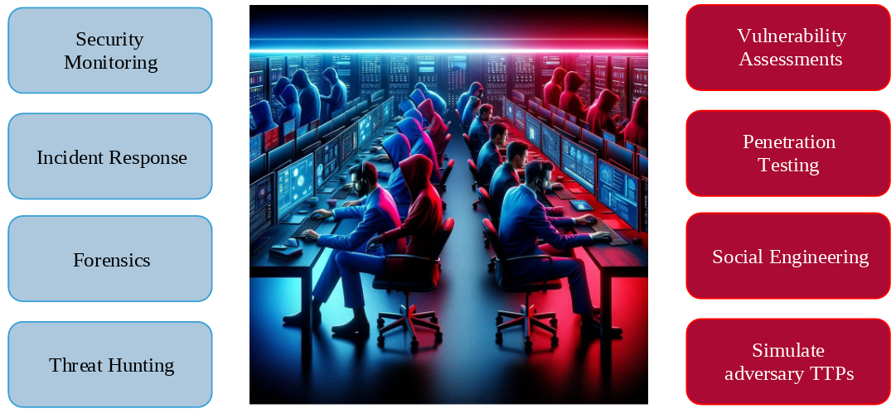
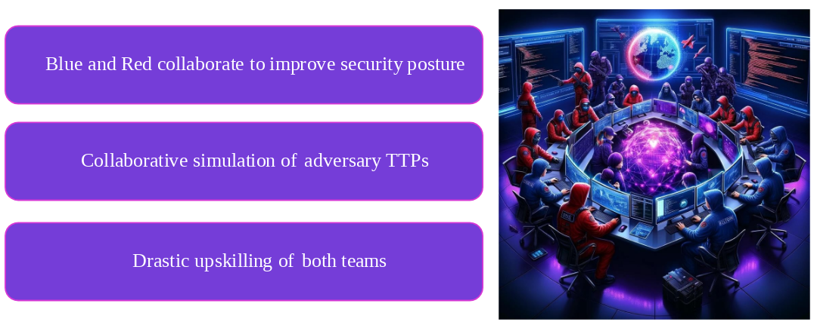

> [[02 - MODULOS/05 - Prácticas (PoCs)|← Volver a Prácticas (PoCs)]] | [[02 - MODULOS/Prácticas (PoCs)/Gestión de Incidentes/00 - Índice del Módulo Gestión de Incidentes|Índice del Módulo]]

---
# Introducción al SOC y Equipos de Seguridad

# Security Operations Center

 

 

## Navegando en un mundo de vectores de ataque infinitos

 

Vivimos en un mundo cada vez más complejo y eso también afecta a la ciberseguridad. Muchas de las entidades del ecosistema —personas, nube, endpoints, servidores, dispositivos móviles, IoT, ICS/OT y redes— se han vuelto más diversas y difíciles de proteger.

 

 

Cada una plantea retos distintos: formación y concienciación en personas, seguridad compartida en la nube, protección de endpoints y servidores, nuevos sistemas operativos en móviles, dispositivos antiguos en ICS/OT, y la expansión del IoT. Además, las redes ya no tienen fronteras claras.

 

Todo esto incrementa la dificultad de proteger los entornos digitales, y aunque hoy contamos con mejores herramientas, la falta de talento y la creciente complejidad hacen que la ciberseguridad sea cada vez más desafiante.

 

## Desafíos de la Ciberseguridad

 

Las organizaciones se enfrentan a varios grandes retos:

 

 

 
* La escasez de profesionales cualificados en ciberseguridad.
 
* El incremento de amenazas cada vez más sofisticadas. Aunque las defensas han mejorado, los adversarios también han evolucionado con tácticas y técnicas mucho más avanzadas.
 
* Falta de procesos de automatización para evaluar las amenazas, a pesar de que los programas cada vez son más avanzados existe una gran cantidad de datos que analizar.
 
* Enormes cantidades de datos a analizar, hasta terabytes / hora.
 
* Productos que no se integran unos con otros para funcionar como uno solo.
 
* Normativas aún no son muy restrictivas.
 
* Hay gran cantidad de alertas que son muy ruidosas pero son falsos positivos.
 
* Y hay una gran cantidad de alertas; según un estudio, el 30% de las alertas nunca llegan a investigarse.
 

 

## ¿Qué es un SOC (Security Operations Center)?

 

Un SOC (Security Operations Center) es el corazón de la defensa cibernética de una organización.

 

 

Su función principal es monitorizar, detectar, investigar y responder a incidentes de seguridad en tiempo real. Los analistas del SOC coordinan tareas como inteligencia de amenazas, gestión de logs, caza de amenazas, detección y respuesta a incidentes, así como recuperación y remediación. En conjunto, todas estas actividades ayudan a reducir la superficie de ataque y a mantener la resiliencia frente a adversarios cada vez más sofisticados.

 

## Modelos de SOC

 

Los SOC modernos se organizan en niveles o **tiers** de especialización, donde cada capa asume un grado mayor de complejidad y criticidad en la gestión de amenazas:

 

 

### Tier 0 – Automatización

 

 
* Maneja tareas repetitivas y malware básico.
 
* Imita pasos de un analista para aumentar eficiencia (aislar equipos, deshabilitar usuarios).
 
* Junto con Tier 1 cubre aprox. **70% de alertas**.
 

 

### Tier 1 – Analistas iniciales

 

 
* Gestionan alertas simples y casos no automatizables.
 
* Escalan alertas de mayor gravedad o complejidad.
 

 

### Tier 2 – Analistas avanzados

 

 
* Se ocupan de malware más sofisticado y tareas más complejas.
 
* Manejan aprox. **25% de alertas**.
 
* Reciben casos escalados desde Tier 1.
 

 

### Tier 3 – Expertos senior

 

 
* Gestionan incidentes críticos (≈5% de alertas).
 
* Realizan **threat hunting proactivo** y **análisis forense avanzado**.
 
* Identifican brechas no detectadas y mejoran defensas a largo plazo.
 

 

## Proceso de Respuesta ante Incidentes

 

La gestión de incidentes en un SOC sigue un ciclo de vida estructurado en fases que garantizan una respuesta ordenada, eficaz y orientada a la mejora continua:

 

 

### Fase 1 – Preparación

 

 
* Definir procesos, roles y métricas.
 
* Alinear expectativas con las partes interesadas.
 

 

### Fase 2 – Detección y Análisis

 

 
* Identificar y clasificar el incidente.
 
* Determinar severidad, impacto y asignar responsables.
 

 

### Fase 3 – Contención, Erradicación y Recuperación

 

 
* Contener el incidente (aislar dispositivos, deshabilitar cuentas).
 
* Eliminar la amenaza y restaurar operaciones.
 
* Posible retroceso a análisis si faltan datos.
 

 

### Fase 4 – Actividades Posteriores al Incidente

 

 
* Lecciones aprendidas.
 
* Mejorar procesos para reducir recurrencia o impacto.
 

 

## Herramientas clave del SOC

 

El SOC se apoya en un ecosistema de herramientas especializadas que, trabajando de forma complementaria, permiten detectar, correlacionar y responder a las amenazas de manera integral:

 

 

### EDR (Endpoint Detection & Response)

 

 
* Monitoriza el comportamiento en endpoints (no solo firmas o hashes).
 
* **Enfoque:** Solo en **endpoints** (ordenadores, portátiles, servidores).
 
* Detecta procesos, archivos y actividades sospechosas.
 
* Microsoft: *Defender for Endpoint*.
 

 

### XDR (Extended Detection & Response)

 

 
* Extiende el concepto EDR a toda la infraestructura TI.
 
* Une datos de endpoints, correo, nube, identidad (AD), redes, etc. para dar **una visión más completa** de los ataques.
 
* Microsoft: *Defender XDR* y *Defender for Cloud*.
 

 

> [!note]
> 
 
> **EDR vigila lo que ocurre dentro de cada dispositivo, mientras que XDR cruza esa información con la del correo, la red, la nube y las identidades para detectar ataques que saltan entre sistemas.**
> 

 

### SIEM (Security Information & Event Management)

 

 
* Recoge, correlaciona y analiza registros de múltiples fuentes.
 
* Centraliza la visibilidad y genera incidentes para el SOC.
 
* Microsoft: *Sentinel* (SIEM nativo en la nube).
 

 

### SOAR (Security Orchestration, Automation & Response)

 

 
* Automatiza procedimientos de respuesta a incidentes.
 
* Imita pasos de un analista para incidentes simples y repetitivos.
 
* Microsoft: *Sentinel + Logic Apps*.
 

 

> [!note]
> 
 
> **El SIEM recoge y correlaciona logs de múltiples fuentes para detectar amenazas y generar alertas, mientras que el SOAR toma esas alertas y automatiza la respuesta ejecutando acciones correctivas sin intervención humana.**
> 

 

### Listado de algunas herramientas

 

 

## Blue Team, Red Team y Purple Team

 

En el ámbito de la ciberseguridad, los equipos se organizan tradicionalmente en dos roles contrapuestos: el Blue Team, encargado de defender, y el Red Team, encargado de atacar de forma simulada para encontrar debilidades.

 

 

### Equipo Azul (Blue Team)

 

Defensa cibernética → monitoreo, respuesta a incidentes, uso de EDR/XDR/SIEM/SOAR, análisis forense y caza de amenazas.

 

### Equipo Rojo (Red Team)

 

Ataque simulado → evaluaciones de vulnerabilidad, pentesting, ingeniería social y simulación de TTPs de adversarios.

 

> [!note]
> 
 
> **Problema:** Históricamente, la separación de ambos equipos fomentaba la competencia en lugar de la colaboración, reduciendo la efectividad global.
> 

 

### Purple Team

 

La falta de colaboración entre Blue Team y Red Team limitaba la efectividad de las defensas, dando lugar al concepto de **Purple Team**, que fusiona ambas perspectivas para crear un ciclo de mejora continua:

 

 

**Equipo Púrpura (Purple Team):** integración azul + rojo → colaboración en simulaciones, desarrollo conjunto de defensas y contramedidas.

 

**Ventaja:** mejora continua, mayor efectividad, aprendizaje mutuo y una cultura de seguridad más sólida.

 

## 📚 Navegación

 
 
 → Siguiente: Cyber Threat Intelligence
 

 
 ↑ Volver al Índice

---

> [[02 - MODULOS/05 - Prácticas (PoCs)|← Volver a Prácticas (PoCs)]] | [[02 - MODULOS/Prácticas (PoCs)/Gestión de Incidentes/00 - Índice del Módulo Gestión de Incidentes|Índice del Módulo]]
