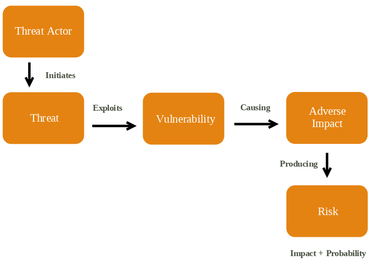
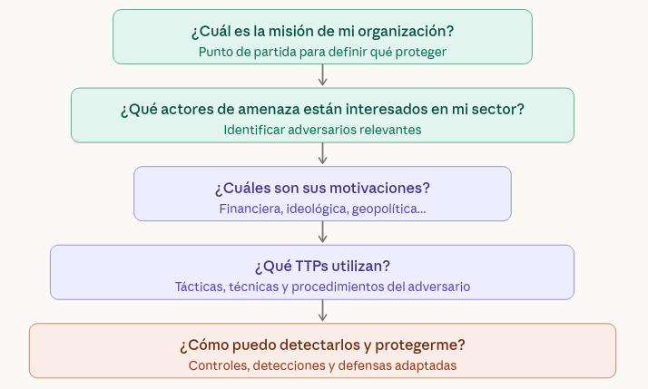
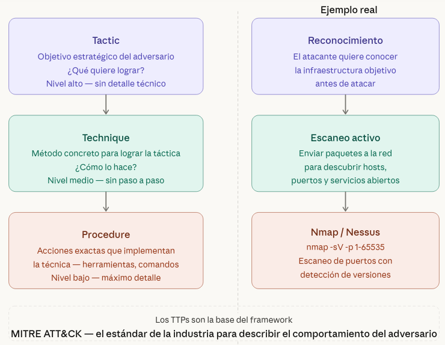
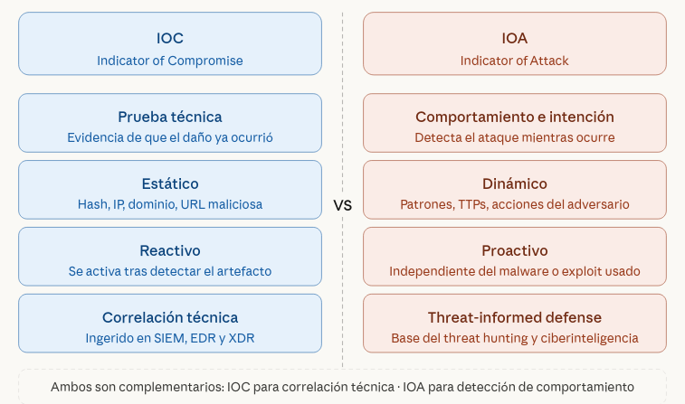
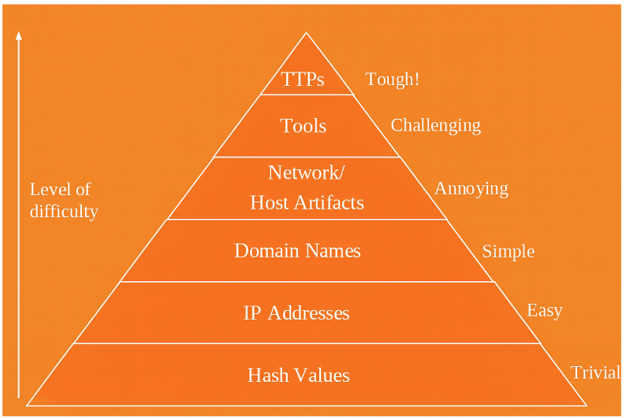
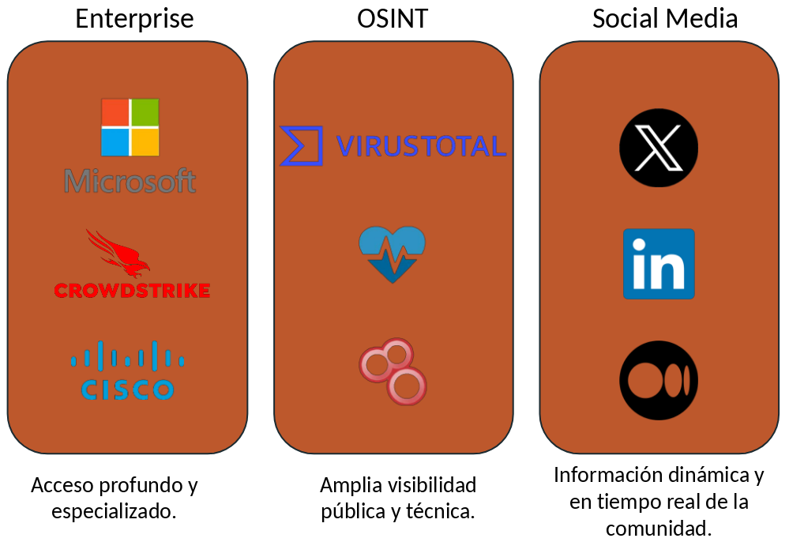

> [[02 - MODULOS/05 - Prácticas (PoCs)|← Volver a Prácticas (PoCs)]] | [[02 - MODULOS/Prácticas (PoCs)/Gestión de Incidentes/00 - Índice del Módulo Gestión de Incidentes|Índice del Módulo]]

---
# Cyber Threat Intelligence (CTI)

# Cyber Threat Intelligence

 

## Introducción

 

### ¿Qué es una Amenaza?

 

**NIST:** Cualquier **circunstancia o evento** con **potencial para impactar negativamente** las operaciones, los activos de una organización o las personas a través de un **sistema de información**, mediante **acceso no autorizado, destrucción, divulgación, modificación de la información y/o denegación de servicio.**

 

### ¿Qué es la Inteligencia de Amenazas Cibernéticas?

 

**CIS:** La Inteligencia de Amenazas Cibernéticas es el **conocimiento sobre los adversarios** y sus **motivaciones**, **intenciones** y **métodos**, que se recopila, analiza y difunde de manera que ayuda al personal de seguridad y de negocio en todos los niveles a proteger los activos críticos de la organización.

 

> [!note]
> 
 
> **Una mejor inteligencia conduce a un mayor rendimiento del SOC.**
> 

 

## ¿Qué es la Caza de Amenazas (Threat Hunting)?

 

La Caza de Amenazas es la práctica de **buscar proactivamente ciberamenazas** que se encuentran sin detectar en tu entorno.

 

Existen dos modelos de Threat Hunting:
 

 
* **Caza basada en Inteligencia:** Aprovecha **IOCs**, valores de hash, direcciones IP, nombres de dominio o artefactos de host.
 
* **Caza basada en Hipótesis:** Caza basada en **IOAs y TTPs** de los adversarios.
 

 

### IOCs (Indicators of Compromise) – Indicadores de Compromiso

 

Evidencias técnicas que indican que un sistema ha sido o está siendo comprometido: hashes de archivos maliciosos, direcciones IP sospechosas, dominios maliciosos, etc. Son **reactivos**, es decir, confirman que algo malo ya ha ocurrido.

 

### IOAs (Indicators of Attack) – Indicadores de Ataque

 

Señales que indican que un ataque está **en curso**, independientemente de si ha tenido éxito o no. Se centran en el comportamiento del atacante: qué acciones está realizando, no qué herramientas usa.

 

### TTPs (Tactics, Techniques and Procedures) – Tácticas, Técnicas y Procedimientos

 

Describen **cómo operan los atacantes**: sus tácticas (objetivos generales), técnicas (métodos para lograrlos) y procedimientos (pasos concretos). Son la base del framework **MITRE ATT&CK**.

 

## Amenazas, Vulnerabilidades y Riesgos

 

El proceso de ataque sería:
 

 

## Defensa Basada en Inteligencia de Amenazas

 

Una defensa eficaz no es genérica, sino que se construye a partir de la inteligencia sobre quién quiere atacarnos, por qué y cómo, permitiendo al SOC priorizar esfuerzos y adaptar sus defensas a los riesgos reales de la organización.

 

### Preguntas clave

 

 

**Valor:** Permite a un SOC enfocar esfuerzos en amenazas relevantes, en lugar de defender de forma genérica.
 

**Resultado:** Mayor eficacia, priorización de recursos y defensas adaptadas a los riesgos reales.

 

## Tácticas, Técnicas y Procedimientos

 

Los **TTPs** (**Tactics, Techniques & Procedures**) representan el lenguaje universal para describir el comportamiento de un adversario, estructurando su forma de actuar en tres niveles de detalle: desde sus objetivos estratégicos hasta las acciones técnicas concretas con las que los ejecuta:

 

### Tactics

 

Las **Tácticas** representan el nivel más alto de abstracción y describen qué quiere lograr el adversario: sus objetivos estratégicos, como obtener acceso inicial, moverse lateralmente por la red o exfiltrar datos. No explican cómo lo hace, solo qué persigue.

 

### Techniques

 

Las **Técnicas** bajan un nivel y describen cómo el adversario alcanza esos objetivos: los métodos concretos que emplea para ejecutar cada táctica. Por ejemplo, para lograr acceso inicial puede usar phishing, explotación de vulnerabilidades públicas o credenciales robadas.

 

### Procedures

 

Los **Procedimientos** son el nivel más granular y detallan exactamente cómo se implementa cada técnica en la práctica: herramientas específicas, comandos utilizados, parámetros configurados. Es el "paso a paso" real del ataque, el que los analistas forenses encuentran en los logs y artefactos del sistema.

 

 

## IOCs e IOAs

 

En ciberinteligencia, no toda la información tiene el mismo valor ni el mismo momento de uso: los **IOCs** nos dicen que algo malo ya ocurrió, mientras que los **IOAs** nos permiten detectar un ataque en curso antes de que cause daño, centrándose en el comportamiento del adversario más que en sus herramientas:

 

### IOC (Indicator of Compromise)

 

Evidencia técnica de que una red o sistema ha sido comprometido.
 

 
* Ejemplos: hashes de archivos maliciosos, dominios/URLs sospechosos, malware conocido.
 
* Uso: ingeridos y correlacionados en SIEM, EDR o XDR.
 

 

### IOA (Indicator of Attack)

 

Se centra en la intención y comportamiento del atacante, independientemente del malware o exploit usado.
 

 
* Relacionado con TTPs (tácticas, técnicas y procedimientos).
 
* Enfoque: entender la finalidad y patrones de ataque.
 

 

 

> [!note]
> 
 
> **IOA** es fundamental en threat-informed defense, mientras que **IOC** sigue siendo crítico para la correlación técnica.
> 

 

## Pirámide del Dolor

 

La **Pyramid of Pain** (*Pirámide del Dolor*) es un modelo de ciberseguridad que muestra **qué tan difícil es para un atacante adaptarse** cuando los defensores detectan y bloquean ciertos tipos de indicadores. Ilustra la relación entre el tipo de indicador que un SOC es capaz de detectar y bloquear, y el nivel de dificultad que eso supone para el adversario.

 

 

En la **base de la pirámide** se encuentran los indicadores más fáciles de detectar pero también los más fáciles de cambiar: hashes de archivos, direcciones IP y dominios. Un atacante puede recompilar su malware para generar un hash distinto, rotar a una nueva IP en minutos o registrar un dominio nuevo con escaso esfuerzo. Detectarlos tiene valor, pero el impacto sobre el adversario es mínimo.

 

En el **nivel intermedio** aparecen los artefactos de red y de host —patrones de tráfico, configuraciones, registros de sistema— y las herramientas utilizadas como Mimikatz, Cobalt Strike o Metasploit. Forzar al atacante a cambiar sus herramientas ya le supone un coste real: pérdida de eficiencia, tiempo de aprendizaje y adaptación operativa.

 

En la **cima de la pirámide** se sitúan las TTPs. Cambiar las tácticas, técnicas y procedimientos implica rediseñar por completo la forma de operar del adversario, algo extremadamente costoso y complejo. Cuando un SOC es capaz de detectar y responder a nivel de TTPs, está causando el máximo dolor posible al atacante.

 

> [!note]
> 
 
> **Cuanto más arriba en la pirámide opera un SOC, más resistente y eficaz es su defensa.**
> 

 

## Fuentes principales de CTI

 

La inteligencia de amenazas no proviene de una única fuente, sino de un ecosistema variado que combina soluciones comerciales especializadas, herramientas públicas de acceso libre y la propia comunidad de profesionales de ciberseguridad, cada una aportando un tipo de visibilidad distinta y complementaria:

 

 

### Empresariales (pagadas)

 

Soluciones como Microsoft Defender Threat Intelligence, CrowdStrike, Cisco, etc. Ofrecen acceso profundo y especializado con soporte y actualizaciones continuas.

 

### OSINT (gratuitas)

 

Herramientas como VirusTotal, Shodan, ATT&CK framework, Pulse Check. Proporcionan amplia visibilidad pública y técnica de forma accesible.

 

### Redes sociales

 

Canales como Twitter/X, LinkedIn, Medium donde la comunidad comparte IOCs, IOAs y TTPs en tiempo real, ofreciendo información dinámica y actualizada.

 

## 📚 Navegación

 
 
 → Siguiente módulo
 

 
 ← Anterior: Introducción al SOC
 

 
 ↑ Volver al Índice

---

> [[02 - MODULOS/05 - Prácticas (PoCs)|← Volver a Prácticas (PoCs)]] | [[02 - MODULOS/Prácticas (PoCs)/Gestión de Incidentes/00 - Índice del Módulo Gestión de Incidentes|Índice del Módulo]]
