> [[02 - MODULOS/05 - Prácticas (PoCs)|← Volver a Prácticas (PoCs)]] | [[02 - MODULOS/Prácticas (PoCs)/Gestión de Incidentes/00 - Índice del Módulo Gestión de Incidentes|Índice del Módulo]]

---
# MITRE ATT&CK Framework

# The MITRE ATT&CK Framework

 

## ¿Qué es MITRE ATT&CK?

 

MITRE ATT&CK (*Adversarial Tactics, Techniques & Common Knowledge*) es un framework de conocimiento abierto que documenta de forma sistemática las **tácticas, técnicas y procedimientos** que los adversarios reales utilizan durante sus ataques. No es una herramienta ni un producto, sino un lenguaje común que permite a toda la industria hablar de amenazas de la misma manera.

 

### Origen

 

Fue desarrollado por MITRE Corporation, una organización estadounidense sin ánimo de lucro financiada por el U.S. Department of Homeland Security. Su origen se remonta a 2013, cuando el equipo de MITRE comenzó a documentar el comportamiento de los atacantes observado en entornos reales, con el objetivo de mejorar la detección dentro de redes corporativas. Lo que empezó como un proyecto interno se convirtió con los años en el estándar de referencia de la industria de la ciberseguridad a nivel mundial.

 

### Propósito

 

Su objetivo principal es proporcionar un conocimiento común y estructurado sobre cómo operan los adversarios, desde sus objetivos estratégicos hasta las acciones técnicas concretas. Este conocimiento permite a los equipos de seguridad construir una **threat-informed defense**: una defensa basada no en suposiciones genéricas, sino en el comportamiento real y documentado de los atacantes.

 

### Acceso

 

El framework es completamente **gratuito y abierto**, accesible en attack.mitre.org. Aunque MITRE ofrece servicios comerciales y herramientas adicionales basadas en el framework, el conocimiento en sí está disponible para cualquier organización, independientemente de su tamaño o presupuesto.

 

### Uso en la práctica

 

ATT&CK está integrado de forma nativa en herramientas como **Microsoft Sentinel**, donde permite mapear la cobertura de detección de un SOC e identificar qué técnicas están cubiertas y cuáles representan puntos ciegos. También es la base de ejercicios de Red Team, threat hunting y evaluación de madurez de seguridad, convirtiéndose en una referencia imprescindible para cualquier analista que trabaje en un SOC moderno.

 

> [!note]
> 
 
> **Acceso:** https://attack.mitre.org/
> 

 

## MITRE ATT&CK vs. Pyramid of Pain

 

Es importante entender dónde encaja ATT&CK dentro de los conceptos que ya conocemos. El framework opera exclusivamente en la cima de la Pirámide del Dolor, documentando TTPs, el nivel donde el adversario tiene más dificultad para adaptarse.

 

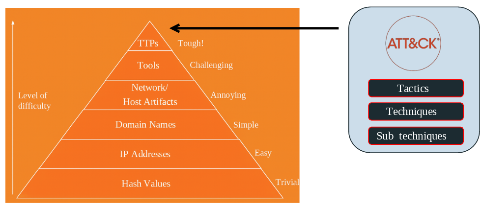

 

> [!note]
> 
 
> **Clave:** ATT&CK proporciona contexto en el nivel más alto de la pirámide (TTPs), donde es más difícil para el adversario adaptarse.
> 

 

ATT&CK documenta exclusivamente el **comportamiento** del adversario: qué objetivos persigue, qué métodos emplea y cómo los ejecuta en la práctica. Todo el contenido del framework gira en torno a este nivel de abstracción, lo que lo hace enormemente estable y duradero como fuente de conocimiento.

 

Por eso, **no encontrarás** en ATT&CK indicadores técnicos volátiles como **hashes** de archivos, **direcciones IP**, **dominios** o **artefactos de red**. Estos datos cambian constantemente: un atacante puede generar un nuevo hash recompilando su malware en minutos, o rotar a una nueva IP en segundos. Incluirlos en el framework lo convertiría en una base de datos de IOCs, que no es su propósito.

 

Las **herramientas sí aparecen** en ATT&CK, pero de **forma secundaria**. Cuando el framework menciona Mimikatz, Cobalt Strike o Metasploit, lo hace para ilustrar cómo se implementa una técnica concreta, no como foco principal. El verdadero valor no está en saber qué herramienta usó el atacante, sino en entender qué técnica estaba ejecutando con ella, porque esa técnica seguirá siendo relevante aunque el atacante cambie de herramienta mañana.

 

### Terminología

 

 
* En CTI → Tactics, Techniques & Procedures (TTPs).
 
* En MITRE → Tactics, Techniques & Sub-techniques (equivalentes a procedimientos).
 

 

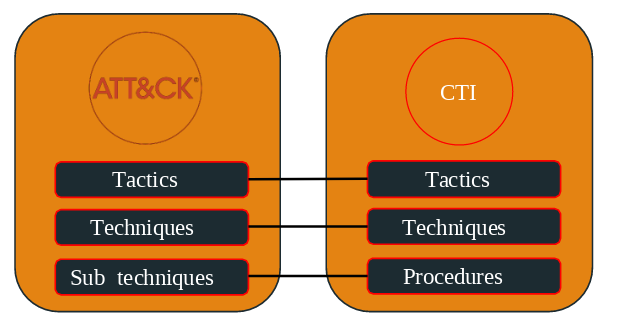

 

## ATT&CK Matrices

 

ATT&CK no es una única matriz universal, sino que se organiza en tres grandes matrices según el entorno donde operan los adversarios, reconociendo que un ataque a una central eléctrica no tiene nada que ver con uno dirigido a un smartphone corporativo.

 

 

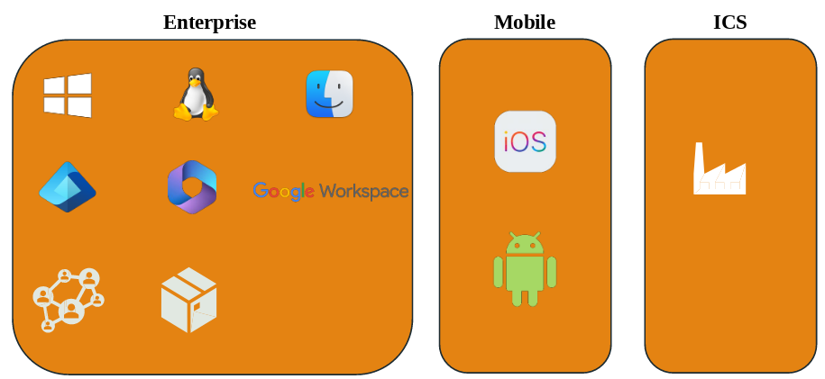

 

### Enterprise

 

Es la matriz más completa y la más utilizada en el día a día de un SOC. Cubre los entornos corporativos tradicionales y se subdivide a su vez según el sistema operativo o plataforma: Windows, Linux y macOS para endpoints y servidores; Azure AD (Entra ID), Office 365 y Google Workspace para identidad y servicios en la nube; y Network y Containers para infraestructura de red y entornos contenerizados. Es el punto de entrada natural para cualquier analista que empiece a trabajar con el framework.

 

### Mobile

 

Cubre los ataques dirigidos a dispositivos móviles, tanto iOS como Android. Documenta técnicas específicas de este entorno como el abuso de permisos de aplicaciones, la interceptación de comunicaciones o el acceso a datos almacenados en el dispositivo. Su relevancia ha crecido enormemente con la proliferación del trabajo desde móvil y las políticas BYOD en las organizaciones.

 

### ICS (Industrial Control Systems)

 

Es una matriz especializada en entornos de tecnología operacional: sistemas SCADA, PLCs y redes industriales presentes en sectores como energía, agua, manufactura o transporte. A diferencia de las otras matrices, ICS maneja una única matriz unificada, reflejo de que estos entornos tienen características muy específicas y que un incidente en ellos puede tener consecuencias físicas en el mundo real.

 

## ATT&CK Tactics

 

Las tácticas representan el **"por qué"** de cada acción del adversario: no describen cómo ataca, sino qué objetivo persigue en cada fase.

 

 

La matriz Enterprise recoge **14 tácticas**, cada una con un nombre, un ID único y una descripción del comportamiento esperado, formando en conjunto una kill chain que refleja el ciclo de vida típico de un ataque real.

 

> [!note]
> 
 
> **Nomenclatura:** Las tácticas usan el prefijo **TA** seguido de 4 dígitos. Ejemplo: `TA0001` → Initial Access
> 

 

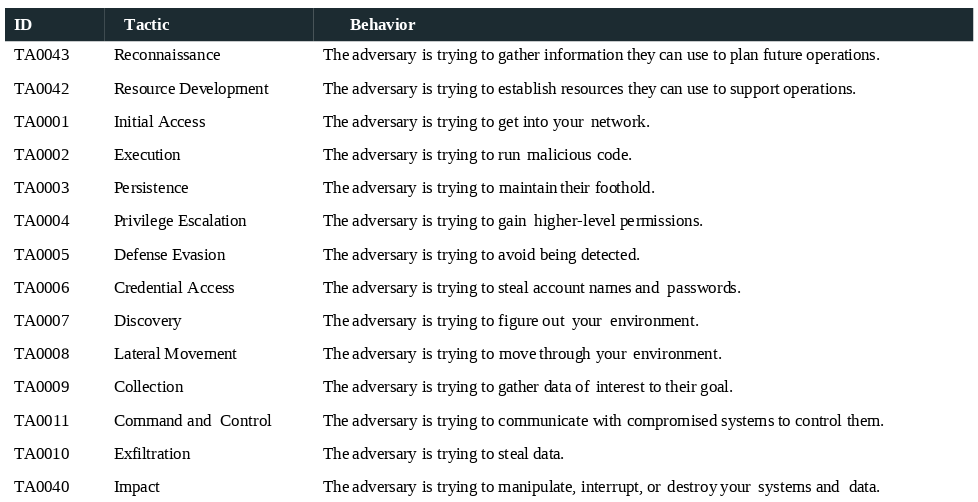

 

### Flujo de actuación

 

El flujo comienza con **Reconnaissance** y **Resource Development**, donde el adversario recopila información y prepara sus recursos antes de atacar. A continuación viene **Initial Access**, el momento en que logra entrar en el entorno objetivo, seguido de **Execution**, donde ejecuta su código malicioso. Una vez dentro, busca **Persistence** para mantenerse en el sistema aunque se reinicie, y **Privilege Escalation** para obtener permisos más elevados.

 

Con acceso privilegiado, el adversario trabaja en **Defense Evasion** para evitar ser detectado, y en **Credential Access** para robar credenciales que le abran más puertas. Después viene la fase de **Discovery**, en la que mapea el entorno interno, seguida de **Lateral Movement** para moverse hacia otros sistemas de mayor valor. Ya en posición, pasa a **Collection** para reunir los datos que le interesan, mantiene comunicación con su infraestructura a través de **Command & Control**, y finalmente ejecuta su objetivo final: **Exfiltration** para extraer datos o **Impact** para causar daño, como cifrar sistemas o interrumpir servicios.

 

## ATT&CK Techniques

 

Si las tácticas responden al *qué* quiere lograr el adversario, las técnicas responden al *cómo* lo consigue. Describen cómo el adversario ejecuta las tácticas.

 

 

ATT&CK documenta actualmente más de **201 técnicas**, cada técnica está asociada a una táctica concreta, y el número sigue creciendo a medida que se documentan nuevos comportamientos observados en ataques reales.

 

> [!note]
> 
 
> **Nomenclatura:** Las técnicas usan el prefijo **T** seguido de 4 dígitos. Ejemplo: `T1566` → Phishing
> 

 

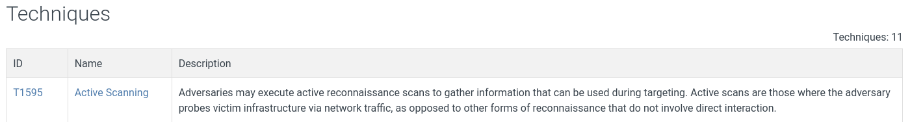

 

### Algunos ejemplos

 

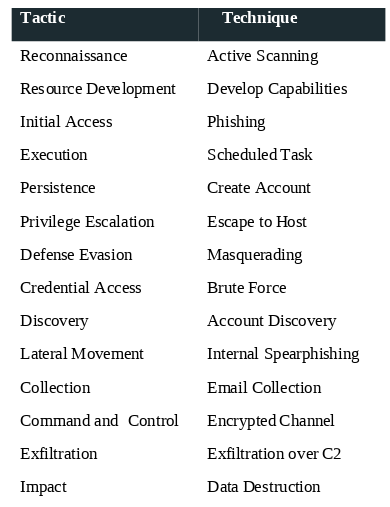

 

> [!note]
> 
 
> **Clave:** Las técnicas ofrecen un nivel más detallado que las tácticas, mostrando cómo se materializa el ataque.
> 

 

## ATT&CK Sub-techniques

 

Las sub-técnicas representan el nivel más granular de ATT&CK, descendiendo un escalón más respecto a las técnicas para describir exactamente cómo se implementa un método de ataque concreto.

 

 

Con más de **424 sub-técnicas** documentadas y en continuo crecimiento, este nivel es el más valioso para el trabajo diario de un analista, ya que permite construir detecciones precisas y controles específicos en lugar de reglas genéricas. Cada sub-técnica hereda la táctica y técnica a la que pertenece, manteniendo siempre la trazabilidad completa dentro del framework.

 

> [!note]
> 
 
> **Nomenclatura:** Las sub-técnicas usan el mismo ID de la técnica padre más un sufijo de 3 dígitos separado por un punto. Ejemplo: `T1566.001` → Phishing: Spearphishing Attachment
> 

 

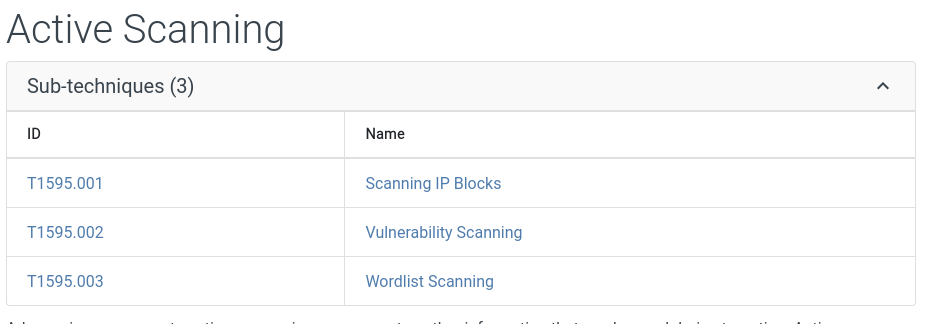

 

### Algunos ejemplos

 

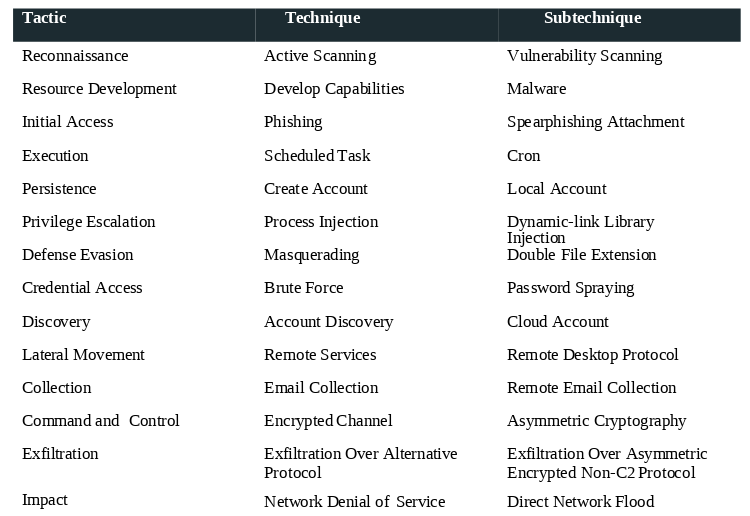

 

> [!note]
> 
 
> **Clave:** Las sub-técnicas ofrecen la visión más granular de ATT&CK, útil para detección precisa y creación de controles específicos.
> 

 

## Tactics, Techniques and Sub-techniques

 

Combinando táctica + técnica + sub-técnica se responde al *por qué* y al *cómo* de la actividad adversaria con distintos niveles de detalle.

 

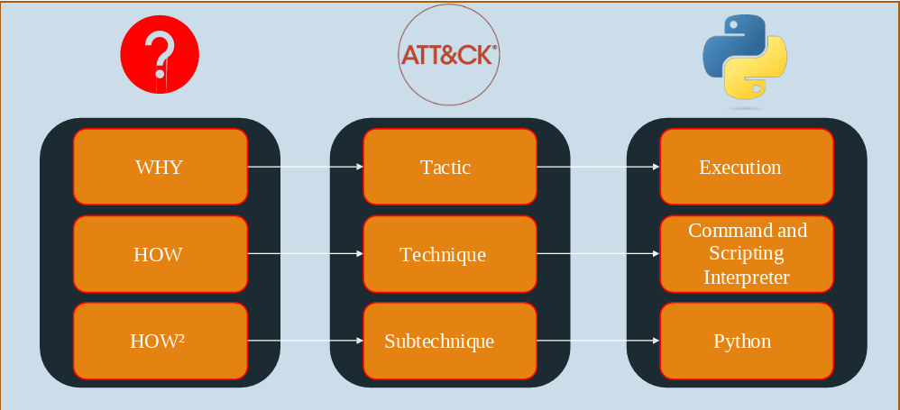

 

 
* **Tácticas** = Why → explican la motivación u objetivo del adversario. Ejemplo: *Execution*
 
* **Técnicas** = How → describen cómo logran el objetivo. Ejemplo: *Command and Scripting Interpreter*
 
* **Sub-técnicas** = How in detail → nivel más granular, cómo exactamente ejecutan la técnica. Ejemplo: *Python*
 

 

## ATT&CK Data Sources

 

Las **Data Sources** son uno de los elementos más prácticos de ATT&CK para un analista de SOC. Representan la telemetría necesaria para detectar los TTPs y orientan sobre qué datos recolectar para identificar tácticas, técnicas y sub-técnicas adversarias.

 

Su importancia real está en dos usos concretos. Primero, permiten identificar **puntos ciegos**: si una técnica requiere logs de autenticación de Active Directory y no los estás recolectando, tienes una brecha de visibilidad que un atacante puede explotar sin ser detectado. Segundo, ayudan a **priorizar la inversión en telemetría**: no todas las fuentes de datos tienen el mismo valor, y ATT&CK te permite saber cuáles cubren más técnicas relevantes para tu entorno.

 

Las Data Sources no se ven a nivel de táctica, sino a nivel de **técnica y sub-técnica**. El camino para encontrarlas es:

 

 
1. Vamos a la sección de tácticas y entramos en **Reconnaissance**.
 
2. Seleccionamos una técnica (por ejemplo `T1595` - Active Scanning).
 
3. Dentro de la ficha de esa técnica, bajamos hasta la sección **"Detection Strategy"** y entramos en la ficha de `DET0830`.
 
4. Ahí veremos las Data Sources (Log Sources) asociadas, por ejemplo: *Network Traffic: Flow y Network Traffic Content*.
 

 

> [!note]
> 
 
> **Nomenclatura:** Las Data Sources tienen su propio ID con el prefijo **DC** seguido de 4 dígitos. Ejemplo: `DC0029` → Network Traffic
> 

 

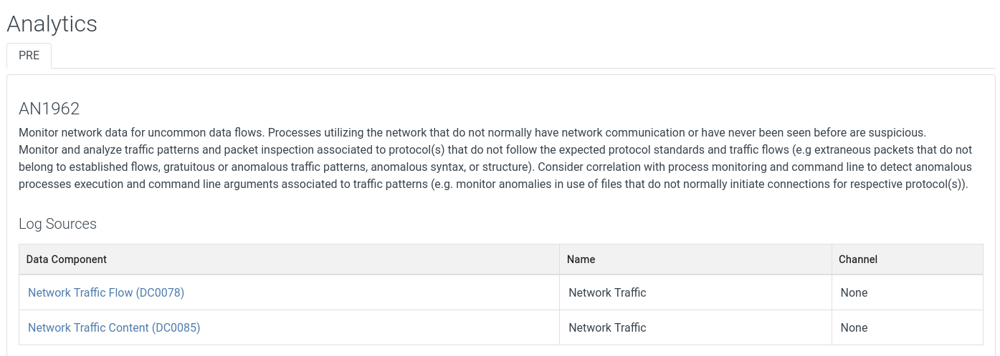

 

> [!note]
> 
 
> **Clave:** Ayudan a mapear qué telemetría es relevante para detectar un comportamiento específico del adversario.
> 

 

## ATT&CK Detections

 

Las detecciones son las estrategias de **alto nivel** para identificar técnicas y sub-técnicas adversarias. Están relacionadas con las fuentes de datos, ya que indican **qué hacer con la telemetría recolectada** para convertirla en una alerta accionable.

 

 

> [!note]
> 
 
> **Nomenclatura:** Las detecciones tienen su propio ID con el prefijo **DET** seguido de 4 dígitos. Además, dentro de cada Detection hay un Analytic ID con el prefijo **AN** seguido de dígitos (ej. `AN0441`), que referencia la lógica de detección concreta traducible en una regla SIEM.
> 

 

### Ejemplo

 

 
* **Táctica:** Privilege Escalation
 
* **Técnica:** Event Triggered Execution (`T1546`)
 
* **Sub-técnica:** Screensaver (`T1546.002`)
 

 

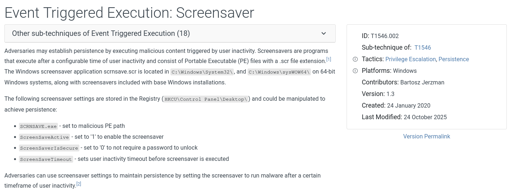

 

 
* **Detection Strategy:** `DET0154` - Analytic ID: `AN0441`
 
* **Fuente de datos:** Visor de eventos de Windows
 
* **Detección:** Crear regla en SIEM → generar alerta al identificar los siguientes eventos:
 

 
 * `WinEventLog:Security - EventCode=4688`
 
 * `WinEventLog:Sysmon - EventCode=13, 14`
 

 
 

 

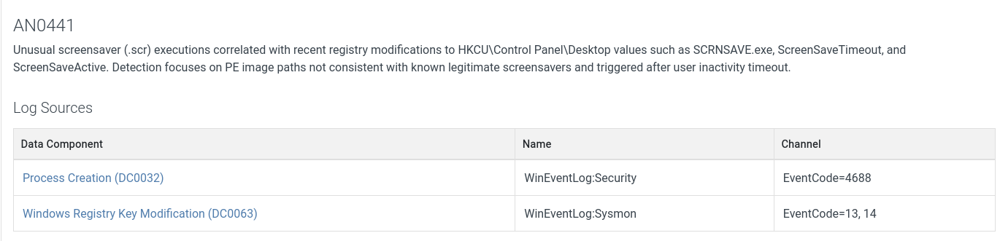

 

## ATT&CK Mitigations

 

Las **mitigaciones** son las configuraciones y controles preventivos que un SOC puede implementar para reducir la superficie de ataque, actuando antes de que el adversario llegue a ejecutar sus TTPs y minimizando así la necesidad de detección reactiva.

 

 

> [!note]
> 
 
> **A veces no es posible implementarlas.**
> 

 

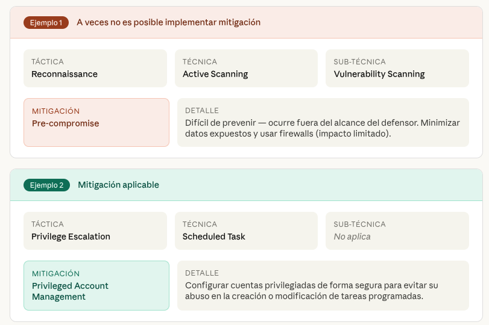

 

> [!note]
> 
 
> **Clave:** siempre que sea posible, **prevenir antes que detectar**.
> 

 

> [!note]
> 
 
> **Nomenclatura:** Las mitigaciones tienen su propio ID con el prefijo **M** seguido de 4 dígitos. Ejemplo: `M1017` → User Training
> 

 

### Ejemplo

 

 
* **Táctica:** Privilege Escalation
 
* **Técnica:** Event Triggered Execution (`T1546`)
 
* **Sub-técnica:** Screensaver (`T1546.002`)
 
* **Mitigaciones:** Use Group Policy to disable screensavers if they are unnecessary. Block.scr files from being executed from non-standard locations.
 

 

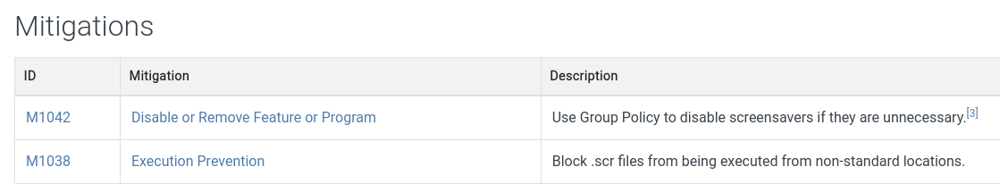

 

## ATT&CK Groups

 

Los grupos son conjuntos de adversarios que comparten **comportamientos, tácticas, técnicas y procedimientos (TTPs)**.

 

 

En ATT&CK, los grupos de amenaza se rastrean bajo un nombre identificable, pero uno de los aspectos que más confunde a los analistas noveles es que **el mismo grupo puede tener nombres completamente distintos según el proveedor** que lo haya descubierto o documentado. No existe un estándar universal de nomenclatura en la industria, por lo que es habitual encontrar referencias cruzadas en las fichas de cada grupo.

 

Un ejemplo representativo es **APT41**, nombre asignado por Mandiant a uno de los grupos más conocidos y estudiados del panorama de amenazas, con gran visibilidad mediática y un uso de TTPs muy representativo para el aprendizaje. Cada vendor aplica su propia convención: **CrowdStrike** identifica a los grupos combinando un animal con el país de origen, como *Fancy Bear* para actores asociados a Rusia. **Microsoft** utiliza fenómenos meteorológicos combinados con el origen geográfico, como *Midnight Blizzard*, también asociado a Rusia.

 

> [!note]
> 
 
> **Nomenclatura:** Los grupos tienen su propio ID con el prefijo **G** seguido de 4 dígitos. Ejemplo: `G0138` → Andariel
> 

 

### Ejemplo práctico

 

 
1. Vamos a CTI y Grupos.
 
2. Entramos en **Andariel** (`G0138`).
 
3. Ahí podremos ver las técnicas usadas, el software y los grupos con los que se les asocia.
 

 

Una vez en el grupo, en la zona de técnicas buscamos el botón **Navigator Layers**, lo desplegamos y elegimos la opción *View*.

 

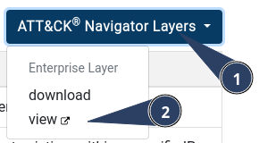

 

Esto abre el MITRE con las TTPs usadas por ese grupo resaltadas. También podemos descargarnos un archivo JSON para cargarlo directamente en la herramienta **ATT&CK Navigator** disponible en attack.mitre.org/resources/attack-navigator.

 

Su utilidad práctica es muy concreta: si sabes que tu organización es un objetivo probable para Andariel, puedes cargar su Navigator Layer y obtener de forma inmediata un mapa visual de qué técnicas debes tener cubiertas. También se pueden combinar varias capas de distintos grupos para identificar qué técnicas se solapan y tienen mayor prioridad de cobertura.

 

## ATT&CK Software

 

La sección de **Software** en ATT&CK representa uno de los pocos casos en los que el framework desciende al nivel de tecnologías específicas, alejándose de su enfoque habitual centrado exclusivamente en TTPs.

 

 

Cada entrada de software documenta una herramienta o malware concreto que los adversarios utilizan en sus operaciones, y siempre aparece vinculado a técnicas, grupos o campañas, nunca de forma aislada. ATT&CK incluye tanto malware comercial, personalizado o de código abierto, como herramientas completamente legítimas que los atacantes reutilizan para sus fines, como PowerShell, PsExec o WMI. Este enfoque refleja una realidad del panorama de amenazas actual, donde los adversarios más sofisticados prefieren apoyarse en herramientas ya presentes en el sistema para pasar desapercibidos, una técnica conocida como *living off the land*.

 

> [!note]
> 
 
> **Nomenclatura:** El software tiene su propio ID con el prefijo **S** seguido de 4 dígitos. Ejemplo: `S0002` → Mimikatz
> 

 

### Ejemplo práctico

 

 
1. Vamos a CTI y Software.
 
2. Entramos en **Mimikatz** (`S0002`).
 
3. Ahí podremos ver en qué técnicas es usado, los grupos y las campañas.
 
4. Dentro de las técnicas tenemos cómo detectarlo y cómo mitigarlo.
 

 

> [!note]
> 
 
> **Clave:** El software en ATT&CK refleja cómo las herramientas concretas apoyan las TTPs y quién las utiliza.
> 

 

## ATT&CK Campaigns

 

Las **campañas** en ATT&CK representan actividad de intrusión desarrollada durante un período de tiempo definido, con objetivos comunes y coordinados. No todo incidente de seguridad, por grave que sea, constituye una campaña: incluso un ataque de ransomware de gran impacto contra una única organización no suele clasificarse como tal. Para ser documentada como campaña en ATT&CK, la operación debe ser de gran escala, organizada y habitualmente dirigida contra múltiples víctimas, siendo típicamente atribuida a actores de estado-nación o grupos criminales altamente organizados.

 

 

Un ejemplo paradigmático es el **ataque a la red eléctrica de Ucrania en 2016**, atribuido al grupo Sandworm. Fue la segunda operación de este tipo tras el incidente de 2015, y empleó múltiples TTPs coordinados para interrumpir infraestructura crítica, generando una atención masiva en la comunidad de ciberseguridad por sus consecuencias en el mundo físico.

 

Otro caso representativo es **Operation CuckooBees**, activa desde 2019 y vinculada a actores como Winnti, APT41 y Barium. Su objetivo fue el espionaje industrial a gran escala, dirigido contra empresas manufactureras de Asia Oriental, Europa Occidental y Norteamérica, con el fin de robar propiedad intelectual, documentos de I+D, código fuente y planos técnicos.

 

> [!note]
> 
 
> **Nomenclatura:** Las campañas tienen su propio ID con el prefijo **C** seguido de 4 dígitos. Ejemplo: `C0034` → 2022 Ukraine Electric Power Attack
> 

 

### Ejemplo práctico

 

 
1. Vamos a CTI y Campañas.
 
2. Entramos en **2022 Ukraine Electric Power Attack** (`C0034`).
 
3. Veremos los grupos, técnicas y software de dicha campaña.
 

 

> [!note]
> 
 
> **Clave:** Las campañas representan operaciones orquestadas y prolongadas, no incidentes aislados.
> 

 

## ATT&CK Relations

 

Un esquema de relación entre los elementos de MITRE ATT&CK sería:

 

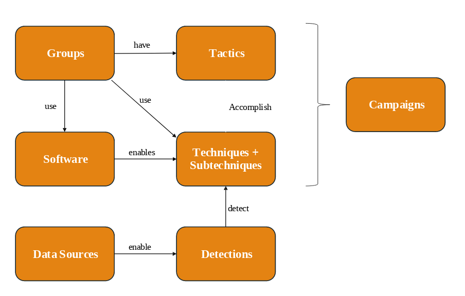

 

### Grupos

 

 
* Tienen **tácticas** (objetivos, motivaciones → responden al *por qué*).
 
* Usan **software** (ej. Mimikatz).
 
* Aplican **técnicas y sub-técnicas** (responden al *cómo*).
 

 

### Campañas

 

 
* Conjuntos más **estructurados y orquestados**.
 
* Pueden involucrar las mismas tácticas, técnicas, sub-técnicas y motivaciones.
 

 

### Defensores

 

 
* **Fuentes de datos** → necesarias para recolectar telemetría.
 
* **Detecciones** → se construyen a partir de fuentes de datos.
 
* **Objetivo:** identificar técnicas y sub-técnicas adversarias.
 

 

> [!note]
> 
 
> **Clave:** Tácticas responden al *por qué*, técnicas y sub-técnicas al *cómo*; campañas son operaciones completas; defensores usan datos y detecciones para enfrentarse a ellas.
> 

 

## Evolution of ATT&CK

 

ATT&CK no es un documento estático, sino un **marco vivo** que evoluciona continuamente para reflejar el panorama real de amenazas. Se actualiza aproximadamente cada seis meses incorporando los últimos TTPs observados y documentados por la comunidad global de inteligencia, lo que lo mantiene como una referencia vigente y no como un catálogo desactualizado.

 

 

La mayoría de las actualizaciones introducen nuevas técnicas y sub-técnicas que reflejan innovaciones recientes en las tácticas de los adversarios. Las tácticas, en cambio, rara vez cambian, ya que los objetivos estratégicos de los atacantes son mucho más estables que los métodos que emplean para conseguirlos.

 

Podemos ver el historial de versiones en la zona de Recursos: https://attack.mitre.org/resources/versions/

 

> [!note]
> 
 
> **Clave:** Mantenerse al día con las actualizaciones es esencial para detectar y defender contra los métodos más recientes de los atacantes.
> 

 

## 📚 Navegación

 
 
 → Siguiente módulo
 

 
 ← Anterior: Cyber Threat Intelligence
 

 
 ↑ Volver al Índice

---

> [[02 - MODULOS/05 - Prácticas (PoCs)|← Volver a Prácticas (PoCs)]] | [[02 - MODULOS/Prácticas (PoCs)/Gestión de Incidentes/00 - Índice del Módulo Gestión de Incidentes|Índice del Módulo]]
