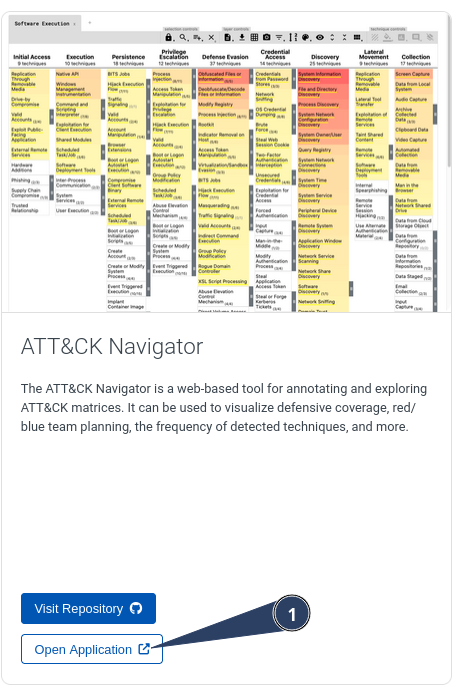
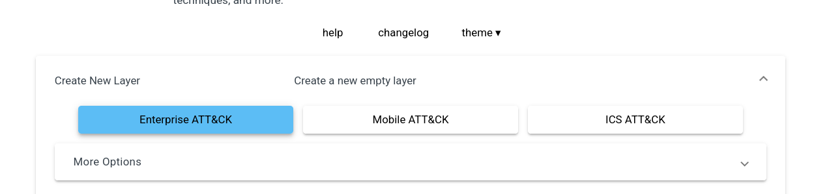
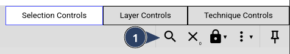
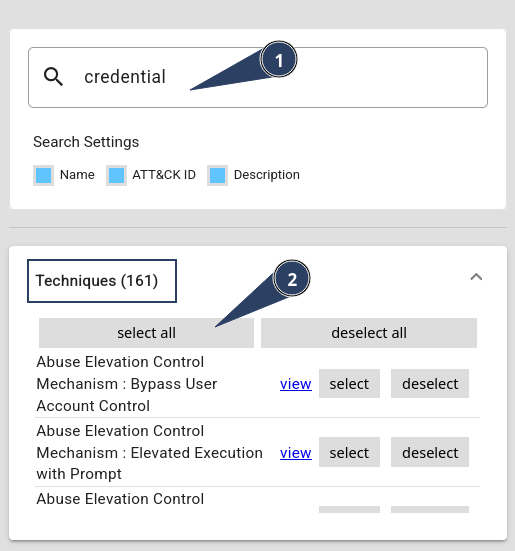
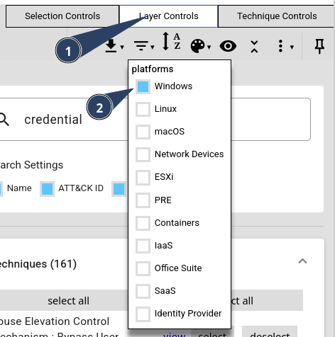
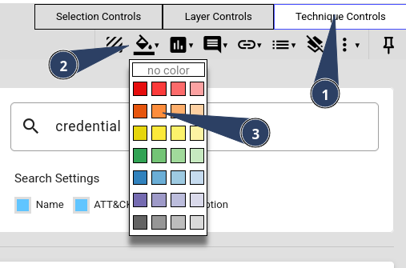
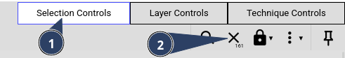
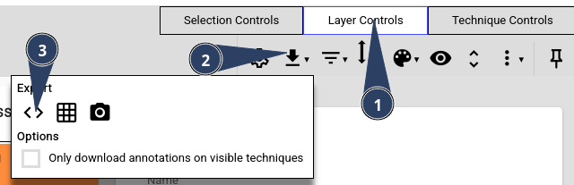
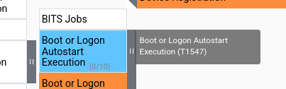
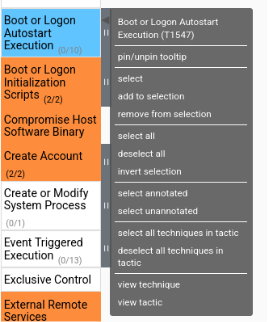

> [[02 - MODULOS/05 - Prácticas (PoCs)|← Volver a Prácticas (PoCs)]] | [[02 - MODULOS/Prácticas (PoCs)/Gestión de Incidentes/00 - Índice del Módulo Gestión de Incidentes|Índice del Módulo]]

---
# ATT&CK Navigator y Mapeo Defensivo

# ATT&CK Navigator

 

## ¿Qué es ATT&CK Navigator?

 

ATT&CK Navigator es una herramienta web de código abierto desarrollada por MITRE que permite visualizar y trabajar con la matriz ATT&CK de forma interactiva. En lugar de navegar por la matriz como una tabla estática, Navigator la convierte en un lienzo dinámico sobre el que un analista puede anotar, colorear, filtrar y superponer información para tomar decisiones defensivas concretas.

 

Su funcionamiento se basa en **capas** (*layers*): archivos JSON que contienen anotaciones sobre la matriz, como qué técnicas usa un grupo concreto, qué técnicas tiene cubiertas un SOC, o qué técnicas detecta una herramienta específica. Estas capas se pueden crear desde cero, importar desde las fichas de grupos, software o campañas de ATT&CK, o combinar varias entre sí.

 

### Usos principales

 

En la práctica, ATT&CK Navigator se utiliza para cuatro grandes propósitos:
 

 
* **Mapeo de cobertura defensiva:** coloreando las técnicas según si están cubiertas, parcialmente cubiertas o sin cobertura, lo que da una imagen inmediata de los puntos ciegos del SOC.
 
* **Perfilado de adversarios:** cargando la capa de un grupo concreto para ver de un vistazo qué técnicas emplea y priorizando las defensas en consecuencia.
 
* **Comparación de actores:** superponiendo las capas de varios grupos para identificar qué técnicas comparten y cuáles merecen mayor atención por su prevalencia.
 
* **Planificación de ejercicios de Red Team:** seleccionando técnicas específicas como objetivo de simulación basándose en los adversarios más relevantes para la organización.
 

 

Está disponible de forma gratuita en attack.mitre.org/resources/attack-navigator y también puede desplegarse localmente.

 

También accedemos a través del menú **Recursos → ATT&CK Data & Tools**:

 

 

Y seleccionamos la aplicación:

 

 

## Uso de Navigator

 

Nada más acceder tenemos que seleccionar si queremos crear un nuevo Layer o abrir alguno existente. Si elegimos crear uno nuevo, posteriormente tenemos que seleccionar el tipo de matriz que vamos a usar.

 

 

Una vez dentro aparecen todas las tácticas, técnicas y sub-técnicas de MITRE. En la parte superior derecha encontramos tres controles principales:

 

## Controles de Selección

 

Permiten **seleccionar técnicas dentro de la matriz de forma masiva o filtrada**. Desde aquí puedes seleccionar todas las técnicas a la vez, invertir una selección existente, o filtrar por plataforma (Windows, Linux, macOS, etc.) para trabajar solo con las técnicas relevantes para tu entorno. Es el punto de partida cuando quieres hacer anotaciones o colorear un conjunto amplio de técnicas de forma eficiente.

 

### Ejemplo práctico

 

Pulsamos en el icono de la lupa y en el cuadro de texto escribimos `credential`. Veremos cómo nos indica que hay 161 técnicas relacionadas; si pulsamos *Select All* nos las selecciona todas.

 

 

 

## Controles de Capa

 

Gestionan la capa activa sobre la que estás trabajando. Desde aquí puedes crear una nueva capa en blanco, abrir una capa existente desde un archivo JSON, exportar la capa actual para compartirla o guardarla, y también gestionar la combinación de varias capas mediante operaciones matemáticas como suma, resta o promedio de puntuaciones. Es la sección clave cuando trabajas con capas de grupos, herramientas o campañas descargadas desde ATT&CK.

 

### Ejemplo práctico

 

Siguiendo con el ejemplo anterior, vamos al menú **Layer Control** y en el filtro de plataformas quitamos todas y solo dejamos las de Windows.

 

 

## Controles de Técnicas

 

Se aplican sobre las técnicas que tengas seleccionadas en ese momento. Desde aquí puedes asignarles un color para categorizarlas visualmente, añadir una puntuación numérica (útil para representar nivel de cobertura o prioridad), agregar comentarios o notas, y marcarlas como deshabilitadas para ocultarlas de la vista sin eliminarlas. Es la sección que usarás más en el día a día para documentar el estado de cobertura del SOC o anotar el resultado de un ejercicio de Red Team.

 

### Ejemplo práctico

 

Siguiendo con el ejemplo, vamos a **Controles de Técnicas**, seleccionamos el bote de pintura y elegimos un color. Todas las técnicas seleccionadas se pintarán de ese color.

 

 

Podemos volver al control de selección y deseleccionar todas:

 

 

Y exportar el contenido desde **Layer Controls** siguiendo la secuencia:

 

 

## Abrir TTPs

 

Cuando usamos Navigator, al acercar el ratón sobre un objeto aparece información sobre él, como el código de técnica, nombre y descripción.

 

 

Para acceder al contenido completo podemos pulsar el botón derecho sobre el objeto y nos saldrá un menú con opciones para abrirlo directamente en la ficha de ATT&CK.

 

 

Desde ahí podemos elegir ver técnica o táctica

 

## 📚 Navegación

 
 
 → Siguiente módulo
 

 
 ← Anterior: MITRE ATT&CK Framework
 

 
 ↑ Volver al Índice

---

> [[02 - MODULOS/05 - Prácticas (PoCs)|← Volver a Prácticas (PoCs)]] | [[02 - MODULOS/Prácticas (PoCs)/Gestión de Incidentes/00 - Índice del Módulo Gestión de Incidentes|Índice del Módulo]]
