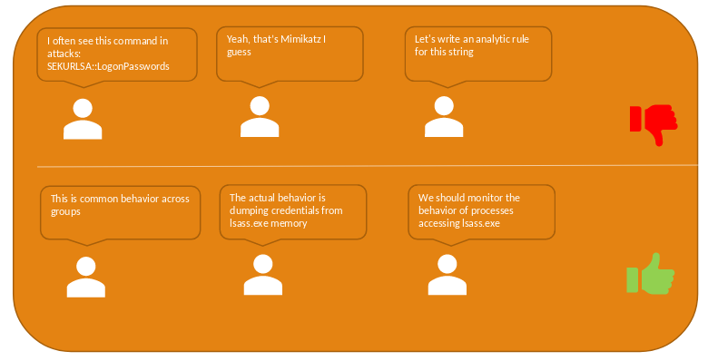
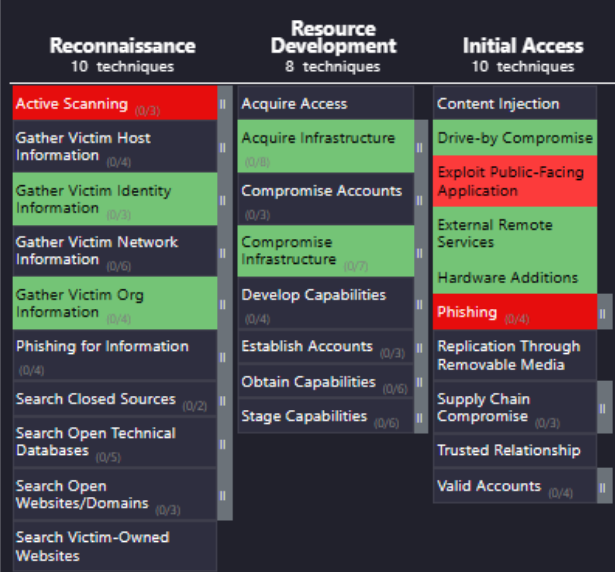
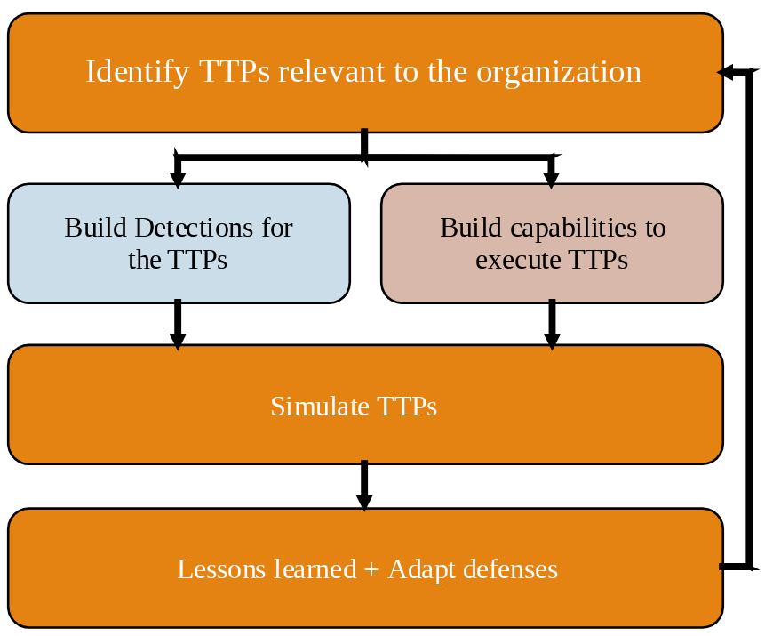

> [[02 - MODULOS/05 - Prácticas (PoCs)|← Volver a Prácticas (PoCs)]] | [[02 - MODULOS/Prácticas (PoCs)/Gestión de Incidentes/00 - Índice del Módulo Gestión de Incidentes|Índice del Módulo]]

---
# Operacionalización de ATT&CK y Purple Team

# Poniendo ATT&CK en práctica

 

## Ventajas de operacionalizar MITRE ATT&CK

 

Uno de los beneficios más inmediatos de operacionalizar ATT&CK en un SOC es la **estandarización del lenguaje** entre equipos. Cuando analistas de SOC, equipos de CTI, Red Team y dirección comparten el mismo vocabulario para describir amenazas, la comunicación se vuelve más precisa, más rápida y menos propensa a malentendidos.

 

Sin este lenguaje común, es habitual que los analistas describan lo que ven en términos muy técnicos y específicos del artefacto observado: *"veo este comando extraño en la URL"* o *"hay un proceso con este hash que no reconozco"*. Este tipo de comunicación es difícil de escalar, difícil de priorizar y casi imposible de correlacionar con inteligencia externa. Con ATT&CK, la misma situación se describe en términos de comportamiento adversario: *"la herramienta X está intentando volcar credenciales de la memoria"*, lo que inmediatamente sitúa el incidente en un contexto táctico reconocible por cualquier miembro del equipo, independientemente de su nivel técnico.

 

Este cambio de enfoque tiene además un impacto directo en la calidad de las detecciones. Una regla construida para detectar un comando específico o un hash concreto dejará de funcionar en cuanto el atacante cambie esa herramienta. Una detección construida sobre el comportamiento —volcado de credenciales desde la memoria del proceso LSASS, por ejemplo— seguirá siendo válida independientemente de qué herramienta use el atacante para conseguirlo. El resultado es una defensa más **sostenible, escalable y efectiva** a largo plazo.

 

> [!note]
> 
 
> **Clave:** enfocarse en el *cómo se comportan los adversarios* en lugar de detalles técnicos aislados.
> 

 

 

## Toma de decisiones informadas

 

El objetivo principal de operacionalizar ATT&CK es permitir **decisiones de seguridad informadas basadas en amenazas reales**, no en suposiciones genéricas.

 

 

### Cómo hacerlo

 

 
* **Evaluar el status quo** → medir la cobertura actual de detecciones y mitigaciones.
 
* **Priorizar TTPs** → identificar cuáles son más relevantes para tu sector y organización.
 
* **Adaptar defensas** → aplicar mitigaciones y construir detecciones específicas.
 

 

### Dos preguntas clave

 

 
* ¿Qué TTPs son más importantes para mi organización? (basado en CTI).
 
* ¿Qué TTPs ya tienen detecciones o mitigaciones implementadas?
 

 

### Beneficios

 

 
* Identificación rápida de **puntos ciegos** en tu estrategia defensiva.
 
* Mejor **priorización** al revisar y ajustar detecciones existentes.
 
* Defensa guiada por **inteligencia**, no por intuición.
 

 

> [!note]
> 
 
> **Clave:** ATT&CK permite alinear detecciones y mitigaciones con TTPs relevantes, logrando una defensa más estratégica y eficaz.
> 

 

## Purple Teaming con MITRE ATT&CK

 

El **Purple Teaming** tiene como propósito unir el conocimiento del **equipo rojo (ataque)** y el **equipo azul (defensa)** para mejorar continuamente las defensas de la organización a través de un proceso cíclico y colaborativo.

 

 

### Proceso cíclico

 

 
* **Identificar TTPs relevantes** para la organización — esfuerzo colaborativo entre ambos equipos.
 
* **Equipo azul:** construye detecciones específicas para esos TTPs.
 
* **Equipo rojo:** desarrolla capacidades para ejecutar y simular esos TTPs.
 
* **Simulación conjunta:** se ejecutan los TTPs y se valida si las detecciones funcionan correctamente.
 

 

### Lecciones aprendidas

 

 
* Ajustar y mejorar detecciones (equipo azul).
 
* Mejorar capacidades de ataque y simulación (equipo rojo).
 
* Adaptar las defensas generales de la organización.
 
* **Repetir el ciclo** — es un proceso continuo de mejora.
 

 

> [!note]
> 
 
> **Clave:** ATT&CK ofrece un lenguaje común y un marco estructurado para que los equipos rojo y azul trabajen juntos de forma más efectiva en un **purple team**.
> 

 

## 📚 Navegación

 
 
 → Siguiente módulo
 

 
 ← Anterior: ATT&CK Navigator
 

 
 ↑ Volver al Índice

---

> [[02 - MODULOS/05 - Prácticas (PoCs)|← Volver a Prácticas (PoCs)]] | [[02 - MODULOS/Prácticas (PoCs)/Gestión de Incidentes/00 - Índice del Módulo Gestión de Incidentes|Índice del Módulo]]
