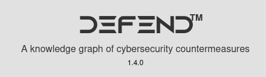
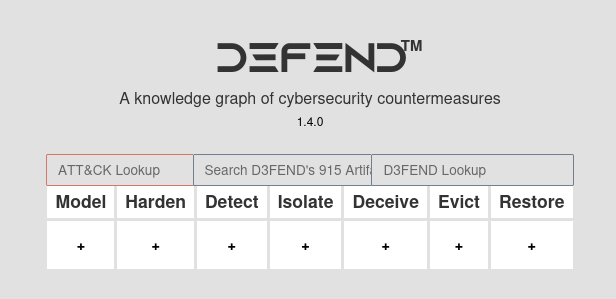
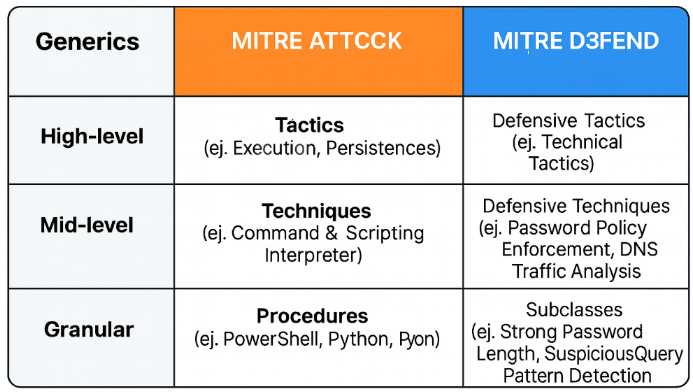

> [[02 - MODULOS/05 - Prácticas (PoCs)|← Volver a Prácticas (PoCs)]] | [[02 - MODULOS/Prácticas (PoCs)/Gestión de Incidentes/00 - Índice del Módulo Gestión de Incidentes|Índice del Módulo]]

---
# MITRE D3FEND - Contramedidas Defensivas

# MITRE D3FEND

 

## ¿Qué es MITRE D3FEND?

 

**MITRE D3FEND** es un framework complementario a ATT&CK pero con un enfoque radicalmente distinto: mientras ATT&CK documenta cómo atacan los adversarios, D3FEND se centra exclusivamente en las **contramedidas defensivas**. Su objetivo es especificar con precisión las capacidades de ciberseguridad que una organización puede implementar, ofreciendo un nivel de detalle en mitigaciones y detecciones que va más allá de lo que ATT&CK proporciona en ese ámbito.

 

Desarrollado con financiación de la **NSA y la Cybersecurity Directorate**, D3FEND nació de la necesidad de tener un lenguaje igualmente riguroso y estructurado para el lado defensor, de la misma forma que ATT&CK lo estableció para describir el comportamiento adversario. Juntos, ambos frameworks forman un ecosistema completo: ATT&CK describe el ataque, D3FEND describe la respuesta.

 

> [!note]
> 
 
> **Acceso:** https://d3fend.mitre.org/
> 

 

 

## La matriz D3FEND

 

Se organiza en una matriz similar a ATT&CK, pero en lugar de tácticas de ataque, tiene **categorías defensivas**. Las columnas principales son: Model, Harden, Detect, Isolate, Deceive, Evict y Restore.

 

 

 
* **Model** → modelado del sistema y gestión del conocimiento.
 
* **Harden** → configuraciones de hardening y reducción de la superficie de ataque.
 
* **Detect** → métodos para identificar actividad maliciosa.
 
* **Isolate** → contención de amenazas.
 
* **Deceive** → uso del engaño (honeypots, señuelos).
 
* **Evict** → expulsión del atacante.
 
* **Restore** → restauración del sistema a un estado seguro.
 

 

### Ejemplo: ATT&CK + D3FEND

 

 
* ATT&CK te dice: el atacante usa **Credential Dumping**.
 
* D3FEND te dice: puedes mitigarlo aplicando **Políticas de Contraseñas**, **Análisis de Memoria** o **Gestión de Cuentas Privilegiadas**.
 

 

## Navegación práctica

 

Para acceder al contenido vamos desplegando las categorías hasta llegar al control concreto. Por ejemplo, desplegamos **Harden** y accedemos a **Strong Password Policy**:

 

> [!note]
> 
 
> https://d3fend.mitre.org/technique/d3f:StrongPasswordPolicy/
> 

 

Una vez en esa categoría podemos ver información relacionada, descargar el archivo para el Navigator e incluso encontrar en la parte inferior enlaces a guías de implementación.

 

Otro ejemplo: vamos a **Detect** y accedemos a **DNS Traffic Analysis**:

 

> [!note]
> 
 
> https://d3fend.mitre.org/technique/d3f:DNSTrafficAnalysis/
> 

 

## TTPs en D3FEND

 

D3FEND también establece equivalencias con los TTPs de ATT&CK, permitiendo trazar directamente qué contramedidas defensivas corresponden a cada técnica adversaria documentada.

 

 

## 📚 Navegación

 
 
 ← Anterior: Poniendo ATT&CK en práctica
 

 
 ↑ Volver al Índice

---

> [[02 - MODULOS/05 - Prácticas (PoCs)|← Volver a Prácticas (PoCs)]] | [[02 - MODULOS/Prácticas (PoCs)/Gestión de Incidentes/00 - Índice del Módulo Gestión de Incidentes|Índice del Módulo]]
