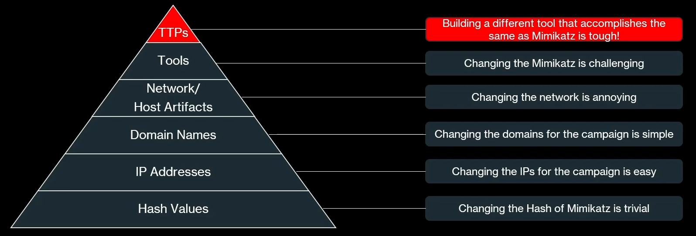

> [[02 - MODULOS/05 - Prácticas (PoCs)|← Volver a Prácticas (PoCs)]] | [[02 - MODULOS/Prácticas (PoCs)/Gestión de Incidentes/00 - Índice del Módulo Gestión de Incidentes|Índice del Módulo]]

---
# Caso de Estudio Real - Mapeo ATT&CK

# Caso de Estudio: APT41

 
 

## 🛡️ Escenario práctico: ¿Qué hacemos frente a APT41?

 

Pon en práctica todo lo aprendido usando MITRE ATT&CK y D3FEND frente a un adversario real.
 

 

Es una mañana típica en el **Centro de Operaciones de Seguridad (SOC)**. Eres parte del equipo: quizás como **analista de ciberinteligencia (CTI)** o como miembro del **equipo de seguridad**.

 

Después de tomar tu café, revisas las noticias de la comunidad de ciberseguridad y encuentras titulares alarmantes:

 "Un grupo de hackers chinos comprometió la red nacional de Asia durante seis meses."
 "APT chino roba secretos comerciales durante años sin ser detectado."
 "Hackers atacan a una empresa de videojuegos en invierno."
 "BASF, Siemens, Henkel y Roche bajo ciberataque."
 "El grupo de hackers chinos APT41 utiliza exploits recientes para atacar empresas en todo el mundo."

 

Claramente, se trata de una **campaña a gran escala** con impactos en infraestructuras críticas y grandes corporaciones internacionales.

 
 ⚠️ **Informe interno del equipo de inteligencia de amenazas:**

 "Según nuestros análisis, existe la posibilidad de que **APT41 / Winnti** apunte también contra nuestra organización."
 

 

Ahora la pregunta clave es: **¿Qué hacemos a partir de este momento?**
 

Este será el punto de partida de nuestro caso práctico, donde deberás analizar, decidir y proponer acciones de respuesta basadas en marcos como **MITRE ATT&CK y D3FEND**.

 

## Campañas y Grupos

 

Utilizando MITRE ATT&CK busca información sobre el grupo **APT41** y marca cuáles de las siguientes campañas pertenecen a ellos.

 
 

¿Cuáles de estas campañas pertenecen a APT41?
 C0010
 C0017
 C0026
 C0040
 Comprobar respuesta
 
 

 

A continuación revisa también la siguiente campaña: **(C0012) Operation CuckooBees**
 

Marca qué grupos participan en esa campaña.

 
 

¿Qué grupos participan en la campaña C0012 Operation CuckooBees?
 APT41
 Strider
 Winnti Group
 WIRTE
 Comprobar respuesta
 
 

 

De las siguientes tácticas o técnicas, indica cuál o cuáles **NO** son usadas en la campaña C0012.

 
 

¿Cuál NO es usada en la campaña C0012?
 T1087.001 - Account Discovery: Local Account
 T1082 - System Information Discovery
 T1033 - System Owner/User Discovery
 T1595.001 - Active Scanning: Scanning IP Blocks
 Comprobar respuesta
 
 

 

Ahora ve al grupo **APT41** y abre **ATT&CK Navigator Layers**. Indica si es verdadero o falso el uso de las siguientes técnicas:

 
 

Reconnaissance → Phishing for Information → Spearphishing Attachment
 Verdadero
 Falso
 Comprobar respuesta
 
 

 
 

Resource Development → Obtain Capabilities → Tool
 Verdadero
 Falso
 Comprobar respuesta
 
 

 
 

Initial Access → Command and Scripting Interpreter → Windows Command Shell
 Verdadero
 Falso
 Comprobar respuesta
 
 

 
 

Credential Access → OS Credential Dumping → LSASS Memory
 Verdadero
 Falso
 Comprobar respuesta
 
 

 

## Tácticas, Técnicas y Sub-técnicas

 

Cerramos el Navigator y volvemos a MITRE. Vamos a analizar la siguiente sub-técnica: **T1003.001**. Una forma sencilla de acceder a una técnica conocida es escribir directamente en la dirección del navegador:

 

> [!note]
> 
 
> https://attack.mitre.org/techniques/T1003/001/
> 

 

En la zona inferior existen diferentes ejemplos de uso de esta sub-técnica. Marca qué herramientas se usan para robar credenciales.

 
 

¿Qué herramientas se usan para robar credenciales en T1003.001?
 Mimikatz
 procdump
 LaZagne
 Comprobar respuesta
 
 

 

## Detection & Mitigation

 

Ahora vamos a echar un vistazo a la zona de **mitigaciones** de esta sub-técnica. Marca cuáles de las siguientes deberíamos aplicar:

 
 

¿Qué mitigaciones corresponden a T1003.001?
 Ensure that local administrator accounts have complex, unique passwords across all systems on the network.
 Consider implementing IT disaster recovery plans that contain procedures for taking regular data backups...
 With Windows 10, Microsoft implemented new protections called Credential Guard to protect the LSA secrets...
 Limit credential overlap across accounts and systems by training users and administrators not to use the same password for multiple accounts.
 Comprobar respuesta
 
 

 

Vamos ahora a ver la zona de **estrategias de detección**. Indica cuál es la ID de la estrategia de detección:

 
 

¿Cuál es la ID de la estrategia de detección?
 DET0423
 DET0363
 DET0512
 Comprobar respuesta
 
 

 

¿Cuál es el **Analytic ID**?

 
 

¿Cuál es el Analytic ID?
 AN2034
 AN9023
 AN1030
 Comprobar respuesta
 
 

 

Finalmente entra en la ID de detección. ¿Cuáles son las **fuentes de datos** para detectar esta sub-técnica?

 
 

¿Qué fuentes de datos permiten detectar T1003.001?
 Registros del visor de eventos: Sysmon
 Registros del visor de eventos: Security
 Registros del firewall de Windows
 Comprobar respuesta
 
 

 

Leyendo el análisis de la detección, nos indica lo siguiente:

 

> [!note]
> 
 
> Un proceso sin privilegios o anómalo intenta abrir un handle con acceso completo (`0x1F0FFF`) al proceso `lsass.exe` e invoca un volcado de memoria, creación de archivos o modificación del registro indicativos de extracción de credenciales.
> 

 

Marca qué **códigos de eventos** deberíamos monitorizar para descubrir esta sub-técnica:

 
 

¿Qué códigos de eventos debemos monitorizar?
 `EventCode=10`
 `EventCode=1`
 `EventCode=11`
 `EventCode=4673`
 `EventCode=13, 14`
 Comprobar respuesta
 
 

 

Este proceso que hemos realizado para esta sub-técnica tendríamos que repetirlo para **todas las tácticas usadas por APT41**.

 

## Conclusión: comportamiento vs. herramientas

 

A continuación, solo para concienciar sobre la importancia de trabajar sobre comportamientos en vez de sobre herramientas:

 

 

 
* **Indicadores frágiles:** Hashes, IPs o dominios pueden cambiarse fácilmente por los atacantes.
 
* **Herramientas:** Aunque modificar Mimikatz es más complejo, sigue siendo posible.
 
* **TTPs:** Cambiar la técnica (ej. Credential Dumping) es mucho más difícil. Nuestras detecciones y mitigaciones se diseñan para el comportamiento, no para la herramienta específica.
 

 
 **Conclusión:** Una defensa informada por inteligencia de amenazas debe centrarse en los TTPs. Esto asegura que, sin importar la herramienta usada, el ataque pueda ser detectado y detenido.
 

 

## 📚 Navegación

 
 
 ↑ Volver al Índice

---

> [[02 - MODULOS/05 - Prácticas (PoCs)|← Volver a Prácticas (PoCs)]] | [[02 - MODULOS/Prácticas (PoCs)/Gestión de Incidentes/00 - Índice del Módulo Gestión de Incidentes|Índice del Módulo]]
