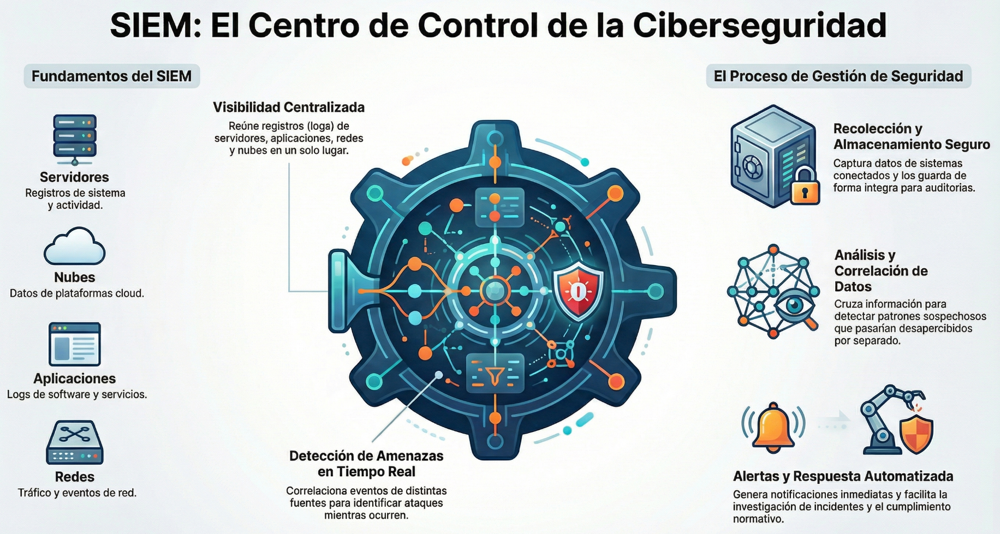
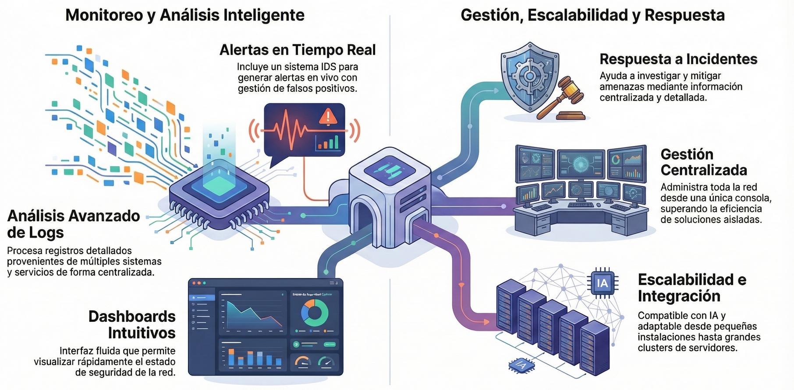
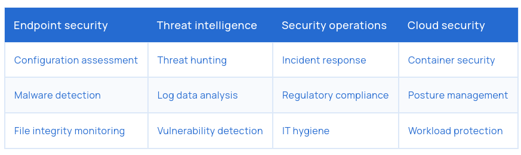
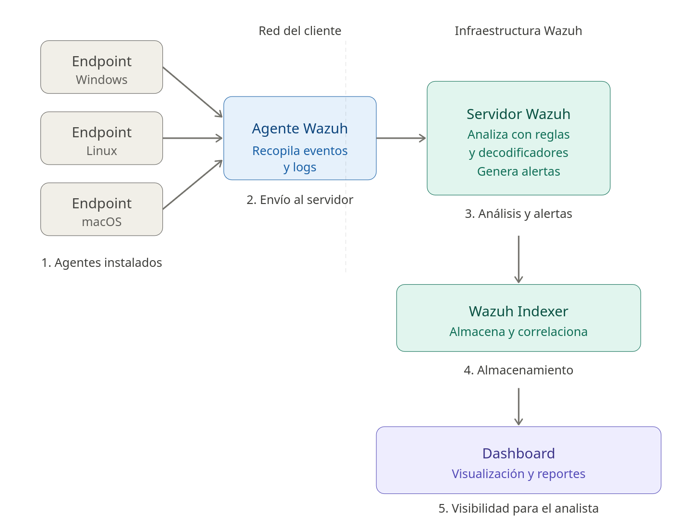
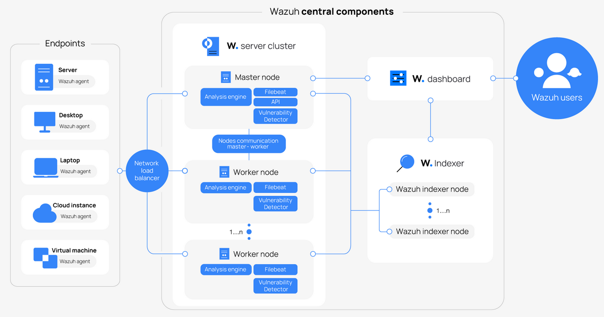

> [[02 - MODULOS/05 - Prácticas (PoCs)|← Volver a Prácticas (PoCs)]] | [[02 - MODULOS/Prácticas (PoCs)/Gestión de Incidentes/00 - Índice del Módulo Gestión de Incidentes|Índice del Módulo]]

---
# Introducción a Wazuh y Arquitectura SIEM

# Introducción a Wazuh

 

 

## ¿Qué es Wazuh?

 

Wazuh es una plataforma **completa y gratuita** de seguridad. A diferencia de otras soluciones del mercado, que suelen ser costosas y con licencias restrictivas, Wazuh es **open source** y accesible para cualquier persona o empresa, lo que facilita su adopción incluso en organizaciones con presupuestos limitados.

 

Una de sus mayores ventajas es que permite **centralizar y unificar recursos de múltiples sistemas**:

 

 
* Puede integrarse con herramientas de código abierto y soluciones comerciales.
 
* Permite proteger cargas de trabajo en **servidores locales**, **máquinas virtuales**, **contenedores** y **entornos en la nube** (Azure, AWS, Google Cloud, entre otros).
 
* Facilita el **monitoreo y gestión de seguridad** de toda la infraestructura TI, sin importar su tamaño.
 

 

## ¿Qué es un SIEM?

 

**SIEM** son las siglas de *Security Information and Event Management* (Gestión de Información y Eventos de Seguridad). Es una **tecnología que centraliza, analiza y gestiona la seguridad de una organización**.

 

 

Wazuh es, esencialmente, una plataforma de **SIEM** que combina:
 

 
* **Gestión de información de seguridad:** Recopilación y almacenamiento centralizado de datos de seguridad.
 
* **Gestión de eventos de seguridad:** Correlación y análisis de eventos generados por diferentes sistemas de la red.
 

 

En otras palabras, Wazuh recolecta y organiza datos de múltiples fuentes —sistemas Linux, Windows, macOS, aplicaciones, redes, servicios en la nube, entre otros— para ayudarnos a **detectar amenazas y vulnerabilidades** en tiempo real.

 

> [!note]
> 
 
> Un SIEM recoge los **registros (logs)** y **eventos** de seguridad de múltiples sistemas, los **correlaciona** y te ayuda a **detectar amenazas en tiempo real**.
> 

 

### Funciones principales

 

 
1. **Recolección de datos:** Recopila logs y eventos de todos los sistemas conectados.
 
2. **Almacenamiento centralizado:** Guarda la información en un único lugar seguro y accesible.
 
3. **Correlación y análisis:** Relaciona datos de diferentes fuentes para detectar patrones sospechosos.
 
4. **Alertas en tiempo real:** Genera notificaciones automáticas ante posibles amenazas.
 
5. **Respuesta y auditoría:** Facilita investigaciones, cumplimiento normativo y acciones correctivas.
 

 

### Ejemplo sencillo

 

Imagina que varios usuarios intentan acceder a un servidor desde ubicaciones extrañas. Cada intento, por sí solo, parece normal, pero el SIEM **correlaciona todos los eventos** y te alerta de que puede ser un **ataque coordinado**.

 

> [!note]
> 
 
> Un SIEM es como el **centro de mando** de tu seguridad: ve todo lo que pasa en tus sistemas, encuentra patrones peligrosos y te ayuda a responder más rápido.
> 

 

## Capacidades clave de Wazuh como SIEM

 

 

 
* **Análisis avanzado de logs:** Permite realizar análisis detallados de registros provenientes de múltiples sistemas y servicios.
 
* **Alertas en tiempo real:** Incluye un sistema IDS para generar alertas en vivo (con posibilidad de ajustar falsos positivos).
 
* **Escalabilidad:** Puede crecer junto con tu infraestructura, desde pequeñas instalaciones hasta grandes **clusters** de servidores.
 
* **Reglas y decodificadores personalizables:** Permiten definir patrones de comportamiento y reglas de seguridad específicas para tu organización.
 
* **Integraciones avanzadas:** Compatible con herramientas de inteligencia artificial, sistemas externos de seguridad y plataformas de gestión de accesos.
 
* **Gestión centralizada:** Ofrece un panel central para administrar toda tu red desde una única consola.
 
* **Paneles (dashboards) intuitivos:** La interfaz es fluida, fácil de usar y permite visualizar rápidamente el estado de la seguridad.
 
* **Respuesta a incidentes:** Ayuda a investigar, mitigar y resolver incidentes con información detallada y centralizada.
 

 

### Casos de uso

 

 

## Arquitectura de Wazuh

 

Wazuh tiene una arquitectura modular y escalable, diseñada para adaptarse a cualquier tipo de organización. Se compone de tres capas principales que trabajan en conjunto:

 

### Agentes (Wazuh Agents)

 

Son **programas instalados en los endpoints**: servidores, estaciones de trabajo, contenedores o dispositivos de red. Su función es **recopilar datos de seguridad y del sistema**:
 

 
* Archivos de registro (logs).
 
* Eventos del sistema operativo (Windows, Linux, macOS).
 
* Información de integridad de archivos (File Integrity Monitoring, FIM).
 
* Alertas de antivirus, firewall, etc.
 

 

> [!note]
> 
 
> Piensa en ellos como "sensores" que monitorean cada dispositivo y envían la información de forma **segura y cifrada** al servidor Wazuh.
> 

 

### Servidor Wazuh (Wazuh Manager)

 

Es el **cerebro del sistema**. Recibe los datos de los agentes y los procesa. Sus funciones clave son:
 

 
* **Análisis y correlación de datos:** Aplica reglas de seguridad para identificar comportamientos sospechosos.
 
* **Generación de alertas:** Notifica en tiempo real sobre amenazas detectadas.
 
* **Gestión de políticas:** Centraliza configuraciones que se distribuyen a los agentes.
 
* **Escalabilidad:** Puede trabajar en modo **cluster**, distribuyendo la carga entre múltiples servidores.
 

 

> [!note]
> 
 
> Aquí es donde ocurren: detección de amenazas, correlación de eventos y respuesta.
> 

 

### Interfaz y Consola Web (Wazuh Dashboard)

 

Basada en **OpenSearch Dashboards** (anteriormente Kibana). Permite **visualizar datos y alertas** en tiempo real mediante gráficos, paneles e informes. Facilita el monitoreo centralizado, la investigación de incidentes y la generación de reportes de seguridad.
 

> [!note]
> 
 
> Es el "panel de control" de todo el sistema.
> 

 

## Flujo de datos simplificado

 

 

 
1. **Los agentes** instalan sensores en endpoints.
 
2. Los **eventos y logs** son enviados al **Servidor Wazuh**.
 
3. El servidor analiza la información usando **reglas y decodificadores**.
 
4. Se generan **alertas y reportes**.
 
5. Los resultados se muestran en el **Dashboard**.
 

 

### Beneficios de esta arquitectura

 

 
* **Escalable:** Se adapta desde pequeñas instalaciones hasta clústeres empresariales.
 
* **Centralizada:** Toda la seguridad en una sola consola.
 
* **Flexible:** Compatible con múltiples sistemas operativos y entornos.
 
* **Segura:** Comunicación cifrada entre agentes y servidor.
 

 

## Integraciones y ecosistema

 

Wazuh no trabaja solo. Se integra con un amplio ecosistema de herramientas y plataformas:
 

 
* Se integra con **plataformas de nube** (AWS, Azure, GCP), antivirus, firewalls y SIEM externos.
 
* Puede conectarse con **herramientas de automatización y respuesta a incidentes (SOAR)** y **sistemas de ticketing**.
 
* Funciona con **APIs RESTful** para personalizar integraciones.
 

 

> [!note]
> 
 
> Más información en: documentation.wazuh.com/current/getting-started/architecture.html
> 

 

 

## 📚 Navegación

 
 
 → Siguiente módulo
 
 
 ↑ Volver al Índice

---

> [[02 - MODULOS/05 - Prácticas (PoCs)|← Volver a Prácticas (PoCs)]] | [[02 - MODULOS/Prácticas (PoCs)/Gestión de Incidentes/00 - Índice del Módulo Gestión de Incidentes|Índice del Módulo]]
