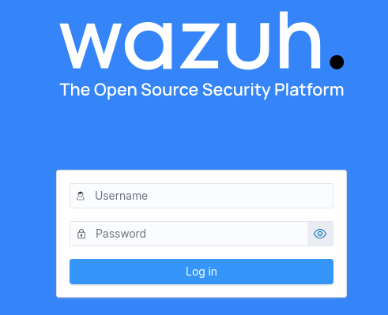
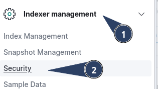
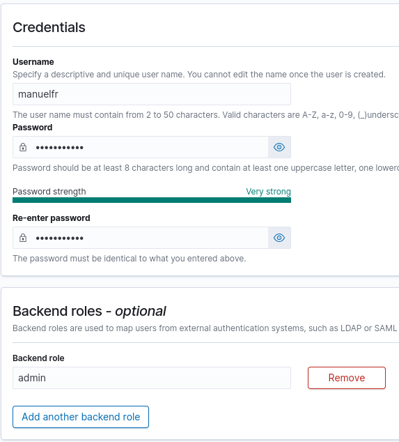
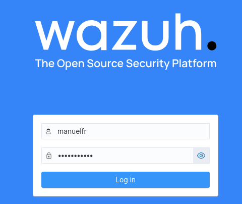
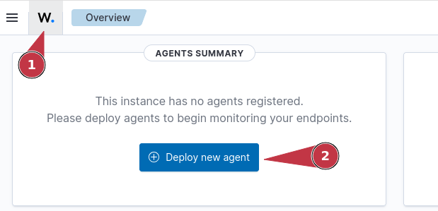
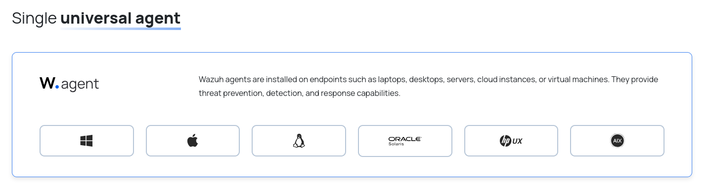
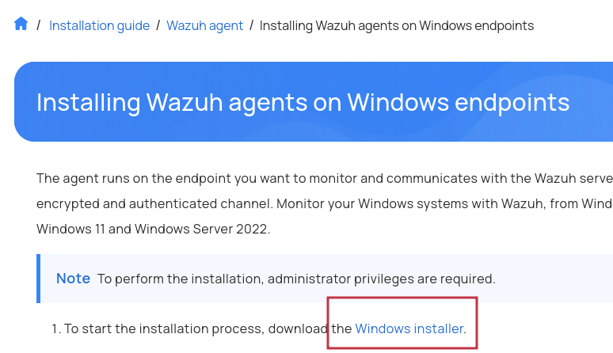
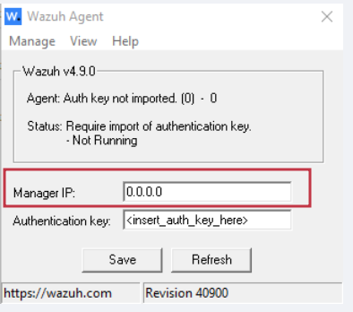
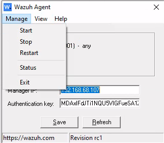
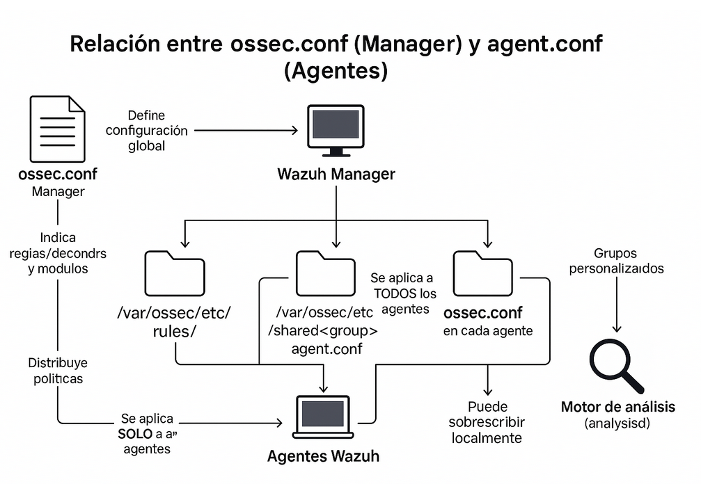

> [[02 - MODULOS/05 - Prácticas (PoCs)|← Volver a Prácticas (PoCs)]] | [[02 - MODULOS/Prácticas (PoCs)/Gestión de Incidentes/00 - Índice del Módulo Gestión de Incidentes|Índice del Módulo]]

---
# Instalación de Wazuh y Despliegue de Agentes

# Instalación de Wazuh

 

## Instalación mediante OVA

 

Este método de instalación es **la forma más sencilla y rápida** de poner en marcha Wazuh sin necesidad de realizar configuraciones complejas en Linux. Está pensado para **estudiantes y entornos de pruebas**, no para producción.

 

### Ventajas de la instalación con OVA

 

 
* Viene **preconfigurado**: sistema operativo, servidor Wazuh, dashboard e índice ya listos para usar.
 
* Ahorra tiempo: solo necesitas importar el archivo OVA en VirtualBox.
 
* Perfecto para aprender y hacer pruebas sin complicaciones.
 

 

### Requisitos

 

 
* **VirtualBox** instalado (Windows, Linux o macOS).
 
* **Archivo OVA de Wazuh** (aprox. 4 GB).
 
* **Memoria RAM (8192 MB) y 4 núcleos de CPU** (ajustar según el rendimiento de tu máquina).
 
* Red en **modo Bridge** para asignar una IP automáticamente vía DHCP.
 

 

### Credenciales por defecto

 
 
 
 
 
 
 
 
 
 
 
 `wazuh-user`
 `wazuh`
 
 
 
 `admin`
 `admin`
 
 
 

| Acceso | Usuario | Contraseña |
| --- | --- | --- |
| Linux (SSH/Consola) | | |
| Dashboard web | | |

 

### Pasos de instalación

 

 
1. **Descarga el archivo OVA** desde la página oficial de Wazuh.
 
2. **Abre VirtualBox** y selecciona **Archivo → Importar servicio virtualizado**.
 
3. **Carga el archivo OVA** y ajusta el nombre de la máquina virtual y carpeta de almacenamiento.
 
4. **Configura la red** en **modo Bridge** para obtener una IP automáticamente.
 
5. **Importa la máquina virtual**. El proceso puede tardar unos minutos.
 
6. **Inicia la VM** y accede con las credenciales indicadas.
 
7. **Obtén la IP del servidor** ejecutando en la consola:
 

 

```bash
$ sudo yum install -y kbd && sudo loadkeys es
$ hostname -I
```

 

 
1. **Accede mediante la dirección:** `https://ip_wazuh`
 

 

## Configurar IP fija

 

Si queremos configurar una IP fija para Wazuh realizamos los siguientes pasos:

 

```bash
$ sudo nano /etc/sysconfig/network-scripts/ifcfg-eth0
```

 

Y añadimos a partir de `NM_CONTROLLED=no` al final del archivo:

 

```
DEVICE=eth0
ONBOOT=yes
BOOTPROTO=none
TYPE=Ethernet
NM_CONTROLLED=no
PREFIX=24
IPADDR=192.168.10.5
GATEWAY=192.168.10.1
DNS1=192.168.10.1
DNS2=8.8.8.8
```

 

```bash
$ sudo systemctl restart network
```

 

## Crear usuarios

 

A través del entorno web iniciamos con las credenciales por defecto: `admin:admin`

 



 

Una vez dentro vamos a gestionar usuarios que tengan acceso al panel. Pulsamos en la zona de opciones:

 


 

Y navegamos a **Index Management → Security**:

 



 

Seleccionamos **Internal Users** para acceder al listado de usuarios y aprovechar este mismo menú para crear nuevos:

 



 

> [!note]
> 
 
> **Nota:** Sería recomendable cambiar las credenciales del usuario admin. Revisar el proceso en la documentación de Wazuh.
> 

 

Una vez creados los usuarios, vamos al menú de opciones y navegamos a **Server Management → Security → Roles Mapping**:

 


 

Pulsamos en **Create Role Mapping** y rellenamos los datos:
 

 
* **Role mapping name:** Ponemos un nombre descriptivo.
 
* **Roles:** Elegimos `administrator`.
 
* **Internal User:** Añadimos los usuarios que hemos creado.
 

 

Guardamos los cambios y reseteamos el servicio desde el terminal de Wazuh:

 

```bash
$ sudo systemctl restart wazuh-dashboard
```

 

Ya podemos iniciar sesión con el nuevo usuario creado con permisos de administrador:

 



 

## Instalación del agente Wazuh en Windows

 

Vamos a instalar el agente Wazuh en sistemas Windows, ya sea Windows Server o Windows Desktop, en cualquier versión (Windows 7, 8, 10, 11). El proceso es sencillo y permite que los equipos Windows comiencen a enviar información al servidor Wazuh para ser monitorizados.

 

### Características del agente Wazuh

 

 
* **Ligero y rápido:** No consume muchos recursos del sistema.
 
* **Compatible** con cualquier versión de Windows.
 
* **Instalación sencilla:** Solo requiere la IP o hostname del servidor Wazuh.
 
* **Comunicación cifrada:** Toda la comunicación agente-servidor está protegida.
 

 

### Métodos de instalación

 

 
1. **Instalación manual (GUI)** — A través del instalador gráfico de Windows.
 
2. **Instalación por línea de comandos (CLI)** — Mediante PowerShell, útil para automatizar.
 
3. Desde el **Dashboard** de Wazuh.
 

 

### Instalación desde el Dashboard

 

 
1. Inicia sesión en el Wazuh Dashboard.
 
2. Ve a **Wazuh Home** y pulsa en **Deploy new agent**.
 

 



 

 
1. Rellena los datos solicitados y sigue las instrucciones para instalarlo.
 

 

### Instalación manual (GUI)

 

 
1. **Descarga el agente Wazuh** desde la página oficial de Wazuh y elige el agente para Windows.
 

 



 



 

 
1. **Ejecutar el instalador:**
 

 
 * Haz doble clic en el archivo descargado.
 
 * Acepta los términos de licencia.
 
 * Completa el asistente de instalación.
 

 
 
2. **Configurar la conexión al servidor:**
 

 
 * Introduce la IP o hostname del servidor Wazuh.
 
 * No es necesario configurar autenticación extra.
 
 * Guarda la configuración.
 

 
 

 



 

 
1. **Iniciar el servicio del agente** desde PowerShell o el Símbolo del sistema:
 

 

```cmd
C:\> net start wazuh
```

 

Si necesitamos reiniciar el servicio en cualquier momento:

 

```cmd
C:\> net stop wazuh
C:\> net start wazuh
```

 

O bien abrimos el **Manage Agent**:

 


 

Y en el menú **Manage** paramos e iniciamos el servicio:

 



 

## Verificación en el Dashboard

 

Una vez instalado el agente, comprobamos que esté funcionando correctamente:
 

 
* Entra en **Servicios de Windows** y busca `Wazuh`. Comprueba que el estado sea **En ejecución**.
 
* Si haces cambios en la configuración (`ossec.conf`), reinicia el servicio desde aquí o desde el manager.
 

 

Posteriormente comprobamos que aparece en el dashboard de Wazuh: inicia sesión, ve a la sección **Endpoints / Agent Summary** y verás tu equipo Windows listado con nombre del host, dirección IP, sistema operativo y estado del agente.

 

> [!note]
> 
 
> Si todo está correcto, el servidor ya está **recibiendo eventos y logs de Windows en tiempo real**.
> 

 

## Archivos importantes

 

### En el Wazuh Manager (servidor)

 
 
 
 
 
 
 
 
 
 `/var/ossec/etc/ossec.conf`
 
 
 
 `/var/ossec/etc/shared/default/agent.conf`
 
 
 
 `/var/ossec/etc/rules/local_rules.xml`
 
 
 
 `/var/ossec/logs/ossec.log`
 
 
 
 `/var/ossec/etc/internal_options.conf`
 
 
 
 

| Archivo / Carpeta | Función |
| --- | --- |
| | Configuración central del Manager |
| | Configuración común para todos los agentes |
| | Reglas personalizadas |
| | Log principal del manager |
| | Ajustes avanzados |

 

### En los agentes (ordenadores Windows)

 
 
 
 
 
 
 
 
 
 `C:\Program Files (x86)\ossec-agent\ossec.conf`
 
 
 
 `C:\Program Files (x86)\ossec-agent\active-response\bin\`
 
 
 
 `C:\Program Files (x86)\ossec-agent\active-response\active-responses.log`
 
 
 
 

| Archivo / Carpeta | Función |
| --- | --- |
| | Configuración individual del agente |
| | Scripts de respuestas activas (bloqueo IP, reinicio servicios, etc.) |
| | Log de respuestas activas |

 

## Gestión centralizada de agentes

 

En la carpeta `/var/ossec/etc/shared/default` tenemos el archivo `agent.conf`. Dentro de este archivo podemos pegar configuraciones que serán comunes a todos los agentes.

 

Una vez guardado el archivo debemos reiniciar el wazuh-manager:

 

```bash
$ sudo systemctl restart wazuh-manager
```

 

Y en los ordenadores con agente, esperamos 10 minutos o ejecutamos desde el terminal:

 

```
net stop wazuhagent
net start wazuhagent
```

 

O reiniciando el servicio desde el manager:

 



 

## 📚 Navegación

 
 
 → Siguiente Módulo
 
 
 ← Anterior: Introducción a Wazuh
 
 
 ↑ Volver al Índice

---

> [[02 - MODULOS/05 - Prácticas (PoCs)|← Volver a Prácticas (PoCs)]] | [[02 - MODULOS/Prácticas (PoCs)/Gestión de Incidentes/00 - Índice del Módulo Gestión de Incidentes|Índice del Módulo]]
