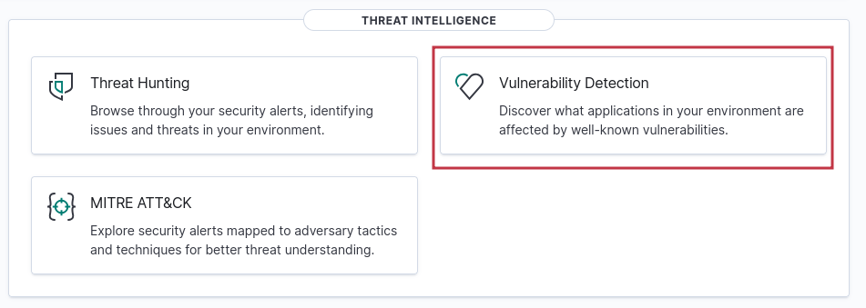
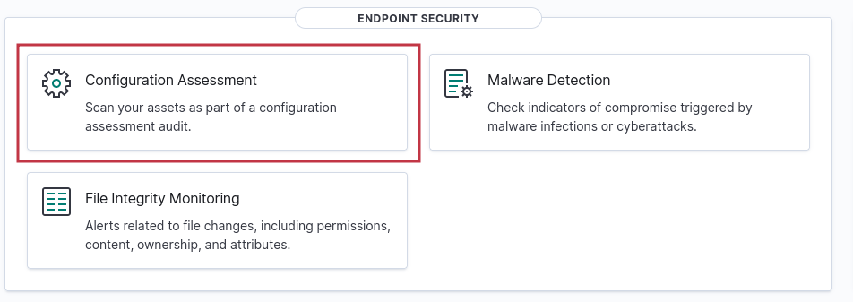
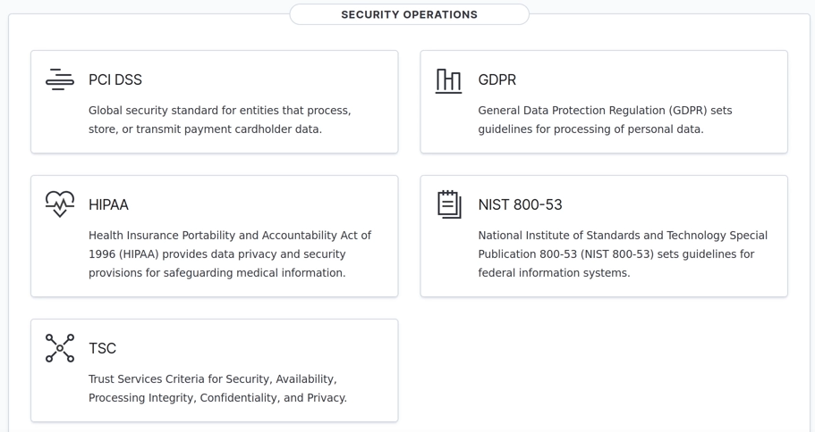

> [[02 - MODULOS/05 - Prácticas (PoCs)|← Volver a Prácticas (PoCs)]] | [[02 - MODULOS/Prácticas (PoCs)/Gestión de Incidentes/00 - Índice del Módulo Gestión de Incidentes|Índice del Módulo]]

---
# Detección de Vulnerabilidades y Evaluación SCA

# Detección de Vulnerabilidades en Wazuh

 


 

## Introducción

 

En este capítulo aprendemos cómo Wazuh detecta vulnerabilidades conocidas (CVE) en **sistemas operativos, aplicaciones, librerías y paquetes instalados**. Esta funcionalidad es fundamental para mantener la infraestructura segura y actualizada.

 

### Conceptos clave

 

 
* **CVE (Common Vulnerabilities and Exposures):** identificador estándar único para cada vulnerabilidad conocida.
 
* **Fuentes oficiales:**
 

 
 * NVD (National Vulnerability Database) — Base de datos mantenida por el gobierno de EE.UU.
 
 * CVE Details — Referencia detallada con historial y parches.
 

 
 
* **Alcance:** Wazuh puede detectar vulnerabilidades en Windows, Linux, macOS, aplicaciones instaladas, librerías y paquetes, equipos de red y contenedores (Docker).
 

 

## Cómo funciona el Vulnerability Detector

 

 
1. **Feeds de vulnerabilidades:** Wazuh descarga y sincroniza bases de datos de vulnerabilidades de diferentes proveedores (Debian, Red Hat, Canonical, Microsoft, NVD, etc.).
 
2. **Agentes Wazuh:** Escanean los endpoints recolectando información de software, hardware, redes y puertos.
 
3. **Comparación:** El servidor Wazuh compara la información del agente con las bases CVE.
 
4. **Alertas:** Si detecta versiones vulnerables, genera alertas con **nivel de severidad** (Bajo, Medio, Alto, Crítico).
 
5. **Acción:** El administrador puede **actualizar** o **desinstalar** el software vulnerable.
 

 

> [!note]
> 
 
> Flujo resumido: **[Agente Wazuh] → [Servidor Wazuh con Feeds CVE] → [Comparación] → [Alerta en Dashboard] → [Acción de actualización/corrección]**
> 

 

### Panel de vulnerabilidades

 

En el Dashboard de Wazuh navega a: `Security events → Vulnerabilities`

 

 
* **Severidad:** Low, Medium, High, Critical.
 
* **CVE ID** (ejemplo: CVE-2025-1234).
 
* Detalle de software afectado, versión y sistema operativo.
 
* Enlaces directos a la base de datos oficial (NVD, vendor).
 

 

> [!note]
> 
 
> Puedes filtrar por agente, CVE, severidad o sistema operativo.
> 

 



 

## Configuración

 

Wazuh ya viene preconfigurado por defecto para detectar vulnerabilidades conocidas (CVE) en los sistemas que monitorea.

 ``

### Servidor Wazuh: # nano /var/ossec/etc/ossec.conf

 

```
<vulnerability-detection>
 <enabled>yes</enabled>
 <index-status>yes</index-status>
 <feed-update-interval>60m</feed-update-interval>
</vulnerability-detection>
```

 

 
* `<enabled>yes</enabled>`: Habilita el módulo.
 
* `<feed-update-interval>`: Define cada cuánto actualizar las bases de datos de CVEs.
 

 

### Syscollector

 

El **Syscollector** es un módulo de Wazuh que se ejecuta en cada agente y tiene como misión hacer un **inventario completo del sistema** en el que está instalado. De forma periódica recorre el endpoint y recopila información sobre el sistema operativo, los paquetes instalados, los puertos abiertos y los procesos en ejecución, enviando todo eso al servidor Wazuh.

 

Su importancia para la detección de vulnerabilidades es clave: sin Syscollector, el servidor no sabría qué software tiene instalado cada máquina y, por tanto, no podría compararlo contra las bases de datos de CVEs. Es el módulo que responde a la pregunta *"¿qué hay en este sistema?"*, mientras que el Vulnerability Detector responde a *"¿qué de lo que hay está en riesgo?"*.

 

```
<ossec_config>
 <wodle name="syscollector">
 <disabled>no</disabled>
 <interval>10m</interval>
 <os>yes</os>
 <packages>yes</packages>
 <ports>yes</ports>
 <processes>yes</processes>
 </wodle>
</ossec_config>
```

 

Cada parámetro controla qué tipo de información recolecta:
 

 
* `<os>`: recoge datos del sistema operativo.
 
* `<packages>`: lista los programas instalados.
 
* `<ports>`: registra los puertos abiertos.
 
* `<processes>`: captura los procesos activos en memoria.
 
* `<interval>`: define cada cuánto tiempo repite el inventario (10 minutos es un valor habitual).
 

 

### Buenas prácticas

 

 
* Mantener **Wazuh y sus feeds actualizados**.
 
* Ejecutar *Scan on Start* para detectar vulnerabilidades al arrancar.
 
* Automatizar parches en sistemas críticos.
 
* Revisar el **JSON de vulnerabilidad** para detalles de la CVE, versión afectada y parches.
 
* Configurar alertas para CVEs **Críticas y Altas**.
 

 

### Ejemplo práctico

 

 
* Crea un usuario administrador en la máquina auditada y revisa Wazuh para encontrar esa acción.
 

 

## Evaluación de Configuración de Seguridad (SCA)

 

La **Security Configuration Assessment (SCA)** en Wazuh es un módulo diseñado para comprobar si los sistemas monitoreados siguen buenas prácticas de seguridad. En lugar de buscar vulnerabilidades de software, SCA analiza **configuraciones incorrectas** que pueden abrir brechas de seguridad.

 

### Puntos clave

 

 
* **Objetivo:** Evaluar configuraciones y políticas de seguridad, detectar errores de configuración y recomendar cambios.
 
* **Fuente de políticas:** Basadas en estándares internacionales como **CIS Benchmarks** (Center for Internet Security).
 
* **Cobertura:**
 

 
 * Windows (Desktop y Server)
 
 * Linux (varias distros)
 
 * Servicios, contenedores, bases de datos y aplicaciones
 

 
 
* **Ejemplos de chequeos:**
 

 
 * Políticas de contraseñas (longitud, caducidad, historial).
 
 * Puertos y servicios abiertos innecesarios.
 
 * Configuración de firewall y antivirus.
 
 * Configuración de SELinux, SSH y permisos críticos.
 

 
 
* **Resultados:**
 

 
 * Clasificación en **Passed**, **Failed**, **Not Applicable** y **Error**.
 
 * Se explican los riesgos y se proporciona remediación (instrucciones o comandos).
 

 
 
* **Personalización:**
 

 
 * Puedes crear o modificar reglas YAML en el directorio de políticas SCA.
 
 * Posible automatización (con precaución).
 

 
 

 

Ruta en el Dashboard: `Security events → Security configuration assessment`

 

Qué verás:
 

 
* Checklist de cada política aplicada al agente.
 
* Resultados: Passed, Failed, Not applicable, Error.
 
* Descripción de la política (tomada del CIS Benchmark).
 
* Guía de remediación (pasos o comandos).
 

 



 

### Ejemplo práctico

 

SCA detecta que la **duración máxima de contraseñas** está en 0 (sin caducidad) y proporciona:
 

 
* **Explicación del riesgo:** Contraseñas sin caducidad facilitan ataques.
 
* **Comando para verificar:** `net accounts` en PowerShell.
 
* **Corrección:** Cambiar política en Local Security Policy o vía comando.
 

 

### Ubicación de archivos de reglas

 

```
/var/ossec/ruleset
```

 

Cada archivo YAML define:
 

 
* **Checks:** Reglas de verificación.
 
* **Remediation:** Pasos para corregir.
 
* **Variables:** Parámetros usados en las reglas.
 

 

## Cumplimiento Normativo en Wazuh

 

Wazuh incorpora módulos y reglas específicas para ayudar a las organizaciones a **cumplir estándares regulatorios de seguridad** a través de análisis de logs, respuesta ante incidentes, monitoreo de configuraciones y alertas en tiempo real.

 



 

### Principales estándares soportados

 

 
1. **PCI DSS:** Normativa creada en 2004 por marcas de tarjetas (Visa, Mastercard, etc.). Protege datos de pago y transacciones. Requiere cifrado, firewalls, control de accesos y gestión de logs.
 
2. **GDPR:** Reglamento europeo de privacidad y protección de datos. Wazuh ayuda a cumplirlo con monitoreo de archivos, configuraciones y vulnerabilidades.
 
3. **HIPAA:** Normativa estadounidense para seguridad y privacidad de información médica. Wazuh permite auditar accesos, integridad de archivos y seguridad de datos de salud.
 
4. **NIST 800-53:** Estándar del Instituto Nacional de Estándares y Tecnología (EE.UU.). Controles de seguridad aplicables globalmente: cifrado, políticas de contraseñas, redes seguras.
 
5. **TSC (Trust Services Criteria):** Framework de auditoría SOC 2 que cubre seguridad, disponibilidad, integridad de procesos, confidencialidad y privacidad.
 

 

### Cómo lo gestiona Wazuh

 

Todas estas normativas utilizan los mismos módulos base: detección de vulnerabilidades, monitoreo de integridad de archivos (FIM), análisis de configuraciones (SCA) y alertas ante eventos críticos. Un mismo hallazgo puede aparecer como incumplimiento en PCI DSS, HIPAA y NIST a la vez.

 

```
/var/ossec/etc/rules
/var/ossec/etc/shared/sca
```

 

> [!note]
> 
 
> **Conclusión:** Wazuh centraliza los controles necesarios para cumplir normativas como PCI DSS, GDPR, HIPAA, NIST 800-53 y TSC. Aunque los objetivos varían, los **mecanismos técnicos son los mismos**: escaneo de vulnerabilidades, control de accesos, monitoreo de red y auditorías de configuración.
> 

 

## Práctica: Cumplimiento PCI DSS

 

**Objetivo:** Provocar un hallazgo de SCA sobre política de contraseñas que Wazuh mapea a PCI-DSS (requisitos de gestión de credenciales).

 

 
1. **En el endpoint Windows (con agente Wazuh instalado):**
 

 
 * Abre *Local Security Policy → Account Policies → Password Policy*.
 
 * Pon `Maximum password age = 0` (sin caducidad). Esto incumple buenas prácticas.
 
 * Aplica los cambios.
 

 
 
2. **Forzar re-escaneo SCA en el agente:**
 

 
 * Reinicia el servicio del agente Wazuh (o espera el intervalo SCA).
 
 * En PowerShell (Admin):
 

 
 

 

```
Restart-Service WazuhSvc
```

 

 
* Desde el dashboard, puedes ir a **Security → Security Configuration Assessment** → botón *"Scan now"* (disponible en Wazuh v4.5+).
 

 

 
1. **Ver el hallazgo y el mapeo a PCI-DSS en el Dashboard:**
 

 
 * Navega a:
 

 
 

 

```
Security → Regulatory compliance → PCI DSS
```

 

Filtra por el agente Windows. Verás las reglas de SCA incumplidas relacionadas con políticas de contraseña y su referencia PCI (p.ej., requisitos del Req 8.*).

 

 
* También puedes verlo en **Security → Security configuration assessment (SCA)**, seleccionando el agente y abriendo el detalle de la regla fallida, donde verás las referencias de cumplimiento normativo.
 

 

## ⚠️ Contenido avanzado

 

Los apartados siguientes requieren conocimientos previos de configuración de Wazuh y edición de archivos YAML. Se recomienda haberlos practicado antes en un entorno de pruebas.

 

## Creación de Políticas SCA Personalizadas Avanzado

 

Vamos a crear una política SCA personalizada para detectar si el proceso `nc.exe` (Netcat) se está ejecutando en Windows.

 

### Paso 1: Crear carpeta para las políticas personalizadas

 

```cmd
New-Item -ItemType Directory -Path "C:\Program Files (x86)\ossec-agent\custom-sca"
```

 

### Paso 2: Crear el archivo YAML de política SCA

 

Crea el archivo `C:\Program Files (x86)\ossec-agent\custom-sca\detect_nc_process.yml`:

 

```
policy:
 id: "custom-detect-nc"
 file: "detect_nc_process.yml"
 name: "Detectar ejecución de nc.exe"
 description: "Comprueba si el proceso Netcat (nc.exe) está ejecutándose en Windows."

requirements:
 - os: Windows

checks:
 - id: 1001
 title: "Verificar que nc.exe NO está en ejecución"
 description: "El proceso Netcat no debe ejecutarse en ningún momento."
 condition: none
 rules:
 - type: process
 name: "nc.exe"
```

 

 
* `condition: none`: Si se encuentra el proceso nc.exe, se considera **FAIL**.
 
* `type: process`: Especifica que verificamos procesos en ejecución.
 
* `name: nc.exe`: Nombre exacto del ejecutable a buscar.
 

 

### Paso 3: Registrar la política en el agente

 

Edita `C:\Program Files (x86)\ossec-agent\ossec.conf` y añade dentro de la sección `<sca>`:

 

```cmd
<sca>
 <policies>
 <policy>C:\Program Files (x86)\ossec-agent\custom-sca\detect_nc_process.yml</policy>
 </policies>
</sca>
```

 

### Paso 4: Reiniciar el agente

 

```
Restart-Service wazuh-agent
```

 

### Paso 5: Verificar en el Dashboard

 

 
1. Ve a **Wazuh Dashboard → Security Configuration Assessment (SCA)**.
 
2. Selecciona el agente Windows.
 
3. Busca la política *"Detectar ejecución de nc.exe"*.
 
4. El resultado será **PASSED** si nc.exe no se ejecuta o **FAILED** si está en memoria.
 

 

### Prueba práctica

 

 
1. Descarga `nc.exe` (Netcat para Windows) y ejecuta desde PowerShell:
 

 

```
.\nc.exe -lvp 4444
```

 

 
1. Reinicia el agente:
 

 

```
Restart-Service wazuh-agent
```

 

 
1. Actualiza el Dashboard — la política debería marcarse como **FAILED**.
 

 

## Despliegue centralizado de políticas SCA Avanzado

 

Puedes distribuir políticas SCA de forma centralizada usando grupos de agentes y la configuración compartida del manager, aplicándolas a cientos de equipos de una sola vez.

 

 
1. **Crea o elige un grupo** en el Dashboard: *Management → Agents → Groups* (por ejemplo: `windows-workstations`) y asigna los agentes Windows.
 
2. **Sube el YAML al área compartida del grupo** en el manager:
 

 

```
/var/ossec/etc/shared/windows-workstations/sca/detect_nc_process.yml
```

 

 
1. **Declara la política en el agent.conf del grupo** (`/var/ossec/etc/shared/windows-workstations/agent.conf`):
 

 

```
<wazuh_modules>
 <sca>
 <enabled>yes</enabled>
 <scan_on_start>yes</scan_on_start>
 <policies>
 <policy>shared/sca/detect_nc_process.yml</policy>
 </policies>
 </sca>
</wazuh_modules>
```

 

 
1. **Reinicia el manager** para publicar los cambios:
 

 

```bash
$ sudo systemctl restart wazuh-manager
```

 

 
1. **(Opcional) Forzar evaluación en los agentes:**
 

 

```
Restart-Service wazuh-agent
```

 

El fichero se replica en Windows bajo: `C:\Program Files (x86)\ossec-agent\shared\sca\detect_nc_process.yml`

 

### Consejos rápidos

 

 
* **Segmenta por grupos** (workstations, servers, VDI…) para poder variar políticas.
 
* **Versiona** tus YAML (por ejemplo `detect_nc_process_v2.yml`) para cambios controlados.
 
* Prueba primero en un **grupo piloto** antes de extenderlo al resto.
 
* Revisa resultados en *Security configuration assessment → Policies*.
 

 

## 📚 Navegación

 
 
 → Siguiente módulo
 
 
 ← Anterior: Instalación de Wazuh
 
 
 ↑ Volver al Índice

---

> [[02 - MODULOS/05 - Prácticas (PoCs)|← Volver a Prácticas (PoCs)]] | [[02 - MODULOS/Prácticas (PoCs)/Gestión de Incidentes/00 - Índice del Módulo Gestión de Incidentes|Índice del Módulo]]
