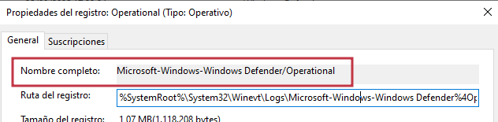
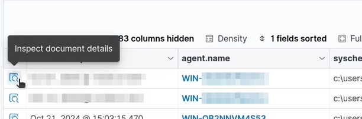

> [[02 - MODULOS/05 - Prácticas (PoCs)|← Volver a Prácticas (PoCs)]] | [[02 - MODULOS/Prácticas (PoCs)/Gestión de Incidentes/00 - Índice del Módulo Gestión de Incidentes|Índice del Módulo]]

---
# Detección de Malware con Wazuh, FIM, YARA y VirusTotal

# Detección de Malware en Wazuh

 


 

## Introducción

 

El malware (software malicioso) es uno de los principales riesgos de seguridad en sistemas informáticos. Puede instalarse sin consentimiento del usuario y ser utilizado para:
 

 
* Cifrar y secuestrar datos (ransomware).
 
* Robar información confidencial como contraseñas o archivos.
 
* Espiar actividades del sistema (spyware).
 
* Mantener acceso persistente a sistemas comprometidos (rootkits).
 

 

La detección de malware es un proceso **constante y proactivo** que requiere herramientas avanzadas para identificar amenazas en tiempo real. **Wazuh** ofrece capacidades de monitoreo, correlación de eventos y respuesta automática ante comportamientos sospechosos.

 

## Tipos de malware más comunes

 

 
* **Virus:** Infectan archivos legítimos y pueden corromper datos.
 
* **Worms:** Se propagan rápidamente por redes explotando vulnerabilidades.
 
* **Troyanos:** Programas maliciosos disfrazados de software legítimo.
 
* **Ransomware:** Cifra datos y exige rescate para liberarlos.
 
* **Spyware:** Recoge información de forma oculta.
 
* **Rootkits:** Permiten acceso privilegiado y dificultan su detección.
 

 

## Capacidades de Wazuh frente al malware

 

Wazuh no es una solución milagrosa, pero es una **poderosa plataforma de monitoreo y detección** que ayuda a reducir riesgos y actuar rápidamente:
 

 
* **Monitoreo de integridad de archivos (FIM):** Supervisa cambios en archivos críticos (creación, modificación, eliminación).
 
* **Reglas de detección y correlación:** Identifica patrones de amenazas a partir de eventos y logs.
 
* **Análisis de comportamiento:** Detecta actividades anómalas que puedan indicar ataques.
 
* **Integración con VirusTotal:** Escaneo avanzado de archivos sospechosos.
 
* **Compatibilidad con YARA:** Reglas personalizadas para detectar malware según firmas y patrones binarios.
 
* **Alertas en tiempo real:** Permite respuestas rápidas y coordinadas ante incidentes.
 
* **Scripts automáticos:** Ejecución de tareas de contención o mitigación de amenazas.
 

 

## Buenas prácticas complementarias

 

 
* Mantener sistemas y software **actualizados**.
 
* Implementar **copias de seguridad seguras y offline**.
 
* Revisar **políticas de seguridad y permisos**.
 
* Monitorizar **logs y eventos de forma constante**.
 

 

## Tipos de malware vs. capacidades de Wazuh

 
 
 
 
 
 
 
 
 
 
 **Virus**
 
 **FIM:**
 
 
 **Worms**
 
 **tráfico y eventos de red**
 
 
 **Troyanos**
 
 **Reglas YARA**
 
 
 **Ransomware**
 
 **FIM**
 
 
 **Spyware**
 
 **procesos activos****VirusTotal**
 
 
 **Rootkits**
 
 **Rootcheck**
 
 
 

| Tipo de malware | Descripción | Cómo ayuda Wazuh a detectarlo |
| --- | --- | --- |
| | Se adjunta a archivos legítimos y puede corromper o destruir datos. | Detecta cambios inesperados en archivos. Correlación de logs para identificar infecciones. |
| | Se propagan rápidamente en redes explotando vulnerabilidades. | Análisis de. Alertas ante conexiones inusuales. |
| | Programas maliciosos disfrazados de software legítimo. | para detectar patrones maliciosos en binarios. Revisión de procesos y servicios sospechosos. |
| | Cifra archivos y exige pago para recuperarlos. | para identificar encriptación masiva de archivos. Alertas en tiempo real de actividad anómala. |
| | Monitorea y roba información de manera oculta. | Monitoreo de. Integración con para escanear archivos sospechosos. |
| | Ocultan su presencia y otorgan acceso privilegiado a atacantes. | Escaneo con de Wazuh. Correlación de eventos y detección de escaladas de privilegios. |

 

## Recolectando logs de Windows Defender

 

Por defecto Wazuh no está configurado para recolectar información de Windows Defender, por lo que vamos a añadirlo al archivo de configuración.

 

### Paso 1: Verificar la ubicación de los logs

 

 
1. En Windows, abre el **Visor de eventos (Event Viewer)**: presiona Win + R, escribe `eventvwr.msc` y presiona Enter.
 
2. Navega a: `Registros de aplicaciones y servicios → Microsoft → Windows → Windows Defender → Operational`
 
3. Aquí verás todos los eventos generados por Windows Defender (detecciones, análisis, actualizaciones).
 

 

Pulsa el botón derecho sobre *Operational* y ve a **Propiedades**. Ahí aparece el nombre completo que deberemos dar a Wazuh.

 



 

### Paso 2: Activar la recolección de eventos en el agente Wazuh

 

 
1. Ubica el archivo de configuración del agente Windows:
 

 

```cmd
C:\Program Files (x86)\ossec-agent\ossec.conf
```

 

O en el servidor:
 

```bash
# nano /var/ossec/etc/shared/default/agent.conf
```

 

 
1. Edita el archivo con permisos de administrador.
 
2. Busca la sección `logfiles` y añade lo siguiente para habilitar la recopilación de logs de Windows Defender:
 

 

```
<localfile>
 <location>Microsoft-Windows-Windows Defender/Operational</location>
 <log_format>eventchannel</log_format>
</localfile>
```

 

 
1. Guarda los cambios y reinicia el servicio Wazuh:
 

 

```bash
# systemctl restart wazuh-manager
```

 

### Comprobar que los eventos llegan al servidor

 

 
* Inicia sesión en el **Dashboard de Wazuh**.
 
* Ve a **Threat Hunting** o **Agent Logs**.
 
* Filtra por el agente correspondiente y verifica eventos de Windows Defender.
 

 

Para comprobar el funcionamiento puedes descargar el anti-malware test file de https://www.eicar.org/

 

```
Invoke-WebRequest -Uri https://secure.eicar.org/eicar.com -OutFile C:/eicar.com
```

 

También se generarán eventos con la desactivación o activación de Windows Defender.

 

### Generar alertas

 

 
* Puedes crear **reglas personalizadas** para detectar actividad sospechosa.
 
* Habilitar **notificaciones en tiempo real** para cualquier detección de malware por Windows Defender.
 

 

### Principales IDs de evento de Windows Defender

 
 
 
 
 
 
 
 
 
 **1000**
 **1001**
 **1002**
 **1003**
 **1116**
 **1117**
 **1118**
 **1119**
 **1120**
 **1121**
 **2000**
 **2001**
 **2003**
 **5007**
 **5010**
 
 

| ID de Evento | Nombre del Evento | Descripción |
| --- | --- | --- |
| | Antivirus started | Windows Defender Antivirus se inició correctamente. |
| | Antivirus shutdown | El servicio de Windows Defender se detuvo. |
| | Antivirus scanning started | Se inició un análisis antivirus. |
| | Antivirus scanning completed | El análisis antivirus finalizó correctamente. |
| | Malware detected | Detección de software malicioso. |
| | Malware remediation success | Eliminación o reparación de malware exitosa. |
| | Malware remediation failure | No se pudo eliminar o reparar la amenaza detectada. |
| | Malware quarantined | El archivo infectado fue puesto en cuarentena. |
| | Malware allowed | La amenaza fue permitida (acción del usuario o política). |
| | Malware cleaned | El archivo infectado fue limpiado. |
| | Signature update started | Se inició la actualización de firmas antivirus. |
| | Signature update completed | La actualización de firmas finalizó con éxito. |
| | Signature update failed | Error al actualizar las firmas antivirus. |
| | Settings changed | Cambios realizados en la configuración de Windows Defender. |
| | Real-time protection enabled/disabled | Activación o desactivación de la protección en tiempo real. |

 

### Cómo usar esta tabla

 

 
* Filtra estos IDs en Wazuh Dashboard para crear reglas y alertas personalizadas.
 
* Ejemplos:
 

 
 * Alerta crítica para **1116** (detección de malware).
 
 * Aviso de mantenimiento para **2003** (fallo en actualización de firmas).
 
 * Auditoría para **5007** (cambio en la configuración de seguridad).
 

 
 

 

## Regla Wazuh para malware detect

 

Podemos crear una regla para el evento **1116** (detección de malware). Para ello editamos el archivo de reglas:

 

```
/var/ossec/etc/rules/local_rules.xml
```

 

```
<rule id="100001" level="12">
 <if_group>eventchannel</if_group>
 <field name="win.system.channel">Microsoft-Windows-Windows Defender/Operational</field>
 <field name="win.system.eventID">1116</field>
 <description>Windows Defender: Malware detectado</description>
 <group>threat,malware,windows_defender,</group>
</rule>
```

 

Reinicia el manager para cargar las reglas:
 

```bash
$ sudo systemctl restart wazuh-manager
```

 

Genera eventos y revisa el Dashboard → **Security Events** filtrando por `windows_defender`.

 

> [!note]
> 
 
> **Tip de prueba segura:** usa el archivo de prueba EICAR para verificar la alerta de detección de malware (1116) sin riesgo real.
> 

 

Las alertas también se pueden ver en el terminal mediante el comando:
 

```bash
# tail -100 /var/ossec/logs/alerts/alerts.log
```

 

## FIM en Windows

 

El **File Integrity Monitoring (FIM)** es una tecnología que permite **detectar cambios en archivos y carpetas críticos del sistema**, ayudando a prevenir accesos no autorizados, infecciones de malware y brechas de seguridad. Con Wazuh podemos **configurar carpetas y archivos a monitorear**, generar alertas en **tiempo real** y tener visibilidad centralizada de toda la actividad.

 

### Qué hace el FIM

 

 
* **Monitorea archivos y carpetas** para detectar: creación, modificación y eliminación de archivos, cambios en permisos, propietario o grupo, y alteraciones en el **hash** del archivo.
 
* Permite **respuesta rápida ante ataques** como ransomware o malware persistente.
 
* Ofrece **alertas en tiempo real** y reportes completos.
 

 

### Configuración básica del FIM en Windows

 

Edita el archivo de configuración del agente:
 

```cmd
C:\Program Files (x86)\ossec-agent\ossec.conf
```

 

Busca el bloque `<syscheck>` e incluye las carpetas que deseas monitorear:

 

```cmd
<syscheck>
 <disabled>no</disabled>
 <frequency>3600</frequency>
 <directories realtime="yes" report_changes="yes" check_all="yes">C:\Users\tecnico\Documents</directories>
 <directories realtime="yes" report_changes="yes" check_all="yes">C:\TestFolder</directories>
</syscheck>
```

 

### Parámetros importantes

 

 
* `realtime="yes"` → Monitoriza cambios al instante.
 
* `report_changes="yes"` → Muestra qué cambió en cada archivo.
 
* `check_all="yes"` → Verifica hash, permisos, propietario y tamaño.
 
* `frequency` → Escaneo completo en segundos (ej: 3600s = 1h).
 

 

### Configuración desde el servidor

 

```bash
# nano /var/ossec/etc/shared/default/agent.conf
```

 

```cmd
<syscheck>
 <disabled>no</disabled>
 <frequency>3600</frequency>
 <directories realtime="yes" report_changes="yes" check_all="yes">C:\testfolder</directories>
</syscheck>
```

 

```bash
# systemctl restart wazuh-manager
```

 

Reinicia también el agente local y crea la carpeta de prueba `C:\testfolder`. Cualquier cambio en esa carpeta generará un evento en **Wazuh Dashboard → Integrity Monitoring**.

 

> [!note]
> 
 
> Si añades **`whodata="yes"`** al FIM se realiza un registro más profundo del cambio.
> 

 

### Generar eventos de prueba

 

 
* Crea una carpeta de prueba (`C:\testfolder`).
 
* Añade, modifica y elimina archivos dentro de ella.
 
* Verifica que el agente capture estos eventos en tiempo real.
 

 

### Visualizar resultados en el Dashboard

 

 
* Entra en **Wazuh Dashboard → Integrity Monitoring**.
 
* Filtra eventos por agente.
 
* Verifica alertas sobre archivos creados, modificados o eliminados.
 
* Observa el hash y detalles de cada cambio.
 

 

### Ver logs manualmente (opcional)

 

```bash
$ tail -n 1000 /var/ossec/logs/alerts/alerts.log
$ grep "syscheck" /var/ossec/logs/alerts/alerts.log
```

 

### Buenas prácticas para FIM

 

 
* Monitorea carpetas críticas como `C:\Windows\System32`, directorios de aplicaciones críticas y carpetas de documentos o configuraciones sensibles.
 
* Usa **escaneo en tiempo real** solo en carpetas sensibles (consume más recursos).
 
* Revisa las alertas con frecuencia y ajusta reglas para reducir falsos positivos.
 
* Implementa **reportes periódicos** de integridad para auditorías.
 

 

### Parámetros clave de <syscheck>

 
 
 
 
 
 
 
 
 
 `<disabled>``<disabled>no</disabled>`
 `<frequency>``<frequency>3600</frequency>`
 `<directories>``<directories realtime="yes">C:\Test</directories>`
 `realtime="yes"``<directories realtime="yes">C:\Docs</directories>`
 `report_changes="yes"``<directories report_changes="yes">...</directories>`
 `check_all="yes"``<directories check_all="yes">...</directories>`
 `<ignore>``<ignore>C:\Windows\Temp</ignore>`
 `<nodiff>``<nodiff>C:\Logs</nodiff>`
 `<auto_ignore>``<auto_ignore>yes</auto_ignore>`
 `<scan_on_start>``<scan_on_start>yes</scan_on_start>`
 
 

| Parámetro | Función | Ejemplo |
| --- | --- | --- |
| | Habilita o deshabilita el módulo FIM. | |
| | Intervalo (en segundos) para un escaneo completo. | |
| | Define carpetas a monitorear. | |
| | Habilita monitoreo en tiempo real. | |
| | Muestra detalles de qué cambió en el archivo. | |
| | Verifica todos los atributos: hash, permisos, propietario, tamaño. | |
| | Excluye carpetas o archivos del monitoreo. | |
| | Evita mostrar diferencias detalladas de cambios. | |
| | Ignora automáticamente archivos que cambian frecuentemente. | |
| | Fuerza un escaneo completo al iniciar el agente. | |

 

## Auditoría de cambios en archivos (Who-data)

 

El módulo **Who-data** de Wazuh extiende las capacidades del FIM, añadiendo información detallada sobre **quién realizó cambios en los archivos, con qué proceso y desde qué contexto**. Esto convierte a Wazuh en una herramienta de **auditoría forense** muy potente.

 

### Qué es Who-data

 

 
* Permite saber **qué usuario modificó un archivo**, **qué proceso lo hizo** y **qué tipo de operación** se realizó (lectura, escritura, eliminación).
 
* Genera eventos de auditoría completos en formato JSON con: usuario (UID/GID), proceso utilizado, tipo de acción (modified, deleted, created), hashes antes y después del cambio (MD5, SHA1, SHA256) y diferencias de contenido (diff).
 
* Funciona en **Windows y Linux**: en Windows está habilitado por defecto desde Windows Vista/Server 2008; en Linux requiere el paquete `auditd`.
 

 

### Configuración básica en Windows

 

No requiere instalación extra. Edita el archivo de configuración del agente y configura las carpetas en `<syscheck>` con:

 

```cmd
<directories check_all="yes" report_changes="yes" whodata="yes">C:\Users\tecnico\Documents</directories>
```

 

Y reinicia el agente.

 

### Beneficios de Who-data

 

 
* Auditoría completa de cambios (usuario, proceso, acción).
 
* Soporte para Windows y Linux.
 
* Integración con FIM, alertas y correlación de eventos.
 
* Ideal para **detección de malware persistente** y **análisis post-incidente**.
 

 



 

### Ajustes avanzados

 

El parámetro `syscheck.wd_delay` se puede modificar en `/var/ossec/etc/internal_options.conf`:
 

 
* Valor recomendado: 5 milisegundos (por defecto).
 
* Reducirlo = Más velocidad, mayor consumo de recursos.
 
* Aumentarlo = Menos consumo, más latencia en eventos.
 

 

> [!note]
> 
 
> Cambiar este valor con precaución; puede sobrecargar agentes en tiempo real.
> 

 

### Configuraciones opcionales de syscheck

 

Las siguientes opciones aplican tanto para Windows como para Linux:

 

#### 1. Nivel de profundidad de monitoreo (level)

 

```cmd
<directories level="3">C:\Users\tecnico\Documents</directories>
```

 

 
* `level="0"` → Solo la carpeta raíz.
 
* `level="3"` → Monitorea hasta 3 niveles de subdirectorios.
 
* Por defecto: 256 niveles.
 

 

#### 2. Prioridad de procesos (process_priority)

 

 
* Valores: -20 (máxima prioridad) a 19 (mínima prioridad).
 
* Ajustar solo en sistemas con **carga elevada o hardware limitado**.
 

 

#### 3. Tipo de almacenamiento (database)

 

```
<database>memory</database>
```

 

 
* `disk` → Guarda en disco (modo por defecto, consume menos memoria).
 
* `memory` → Guarda en RAM (más rápido, mayor uso de recursos).
 

 

#### 4. Sincronización y cola de eventos

 

 
* `sync_interval` → Frecuencia de sincronización.
 
* `max_queue` → Tamaño máximo de la cola de mensajes.
 
* `max_eps` → Límite de eventos por segundo.
 

 

### Ejemplo de configuración avanzada

 

```cmd
<syscheck>
 <disabled>no</disabled>
 <frequency>3600</frequency>
 <directories level="2" realtime="yes" report_changes="yes">C:\TEMP</directories>
 <database>memory</database>
 <process_priority>-5</process_priority>
</syscheck>
```

 

## Monitoreo del Registro de Windows

 

El **Registro de Windows** es una **base de datos centralizada** que almacena configuraciones críticas del sistema operativo, hardware, aplicaciones y entradas de inicio automático. Alteraciones no autorizadas pueden causar **inestabilidad, fallos de aplicaciones** o permitir que malware logre **persistencia** en el sistema.

 

### Monitoreo por defecto en Wazuh

 

El módulo FIM de Wazuh **ya está configurado para auditar las claves críticas del Registro** de Windows. Detecta en tiempo real creación, modificación o eliminación de claves y valores, cambios en configuraciones de inicio automático (Run, RunOnce) y alteraciones sospechosas de software.

 

### Ubicación de claves críticas

 

```
HKEY_LOCAL_MACHINE\Software\Microsoft\Windows\CurrentVersion\Run
HKEY_LOCAL_MACHINE\Software\Microsoft\Windows\CurrentVersion\RunOnce
```

 

Estas claves son especialmente sensibles porque permiten ejecución automática de programas al iniciar Windows (vector común para malware).

 

### Ejemplo práctico de auditoría

 

 
1. Abre el **Editor del Registro** (`regedit`).
 
2. Crea una **nueva clave de prueba** en *Run* o *RunOnce*.
 
3. Asigna un valor simple (ej. `TestKey` con `TestValue`).
 
4. Revisa el **Wazuh Dashboard → Integrity Monitoring**: verás un evento JSON con el usuario que hizo el cambio, la clave modificada, valores antes/después, marca de tiempo exacta y tipo de acción (added, modified, deleted).
 
5. Elimina la clave y confirma que Wazuh genera un evento de **eliminación**.
 

 

### Claves críticas del Registro a monitorear

 
 
 
 
 
 
 
 
 
 `HKLM\Software\Microsoft\Windows\CurrentVersion\Run`
 `HKLM\Software\Microsoft\Windows\CurrentVersion\RunOnce`
 `HKLM\System\CurrentControlSet\Services`
 `HKLM\Security`
 `HKLM\Software\Microsoft\Windows\CurrentVersion\Policies`
 `HKLM\System\CurrentControlSet\Control\Lsa`
 `HKCU\Software\Microsoft\Windows\CurrentVersion\Run`
 
 

| Ruta del Registro | Propósito | Riesgo si es modificada |
| --- | --- | --- |
| | Programas que se ejecutan al iniciar Windows. | Malware puede agregarse aquí para ejecutarse automáticamente. |
| | Programas que se ejecutan una sola vez tras reinicio. | Instaladores maliciosos o scripts de código no autorizado. |
| | Configuración de controladores y servicios de Windows. | Desactivar servicios críticos o agregar controladores maliciosos. |
| | Configuraciones de seguridad del sistema operativo. | Ataques que buscan deshabilitar políticas de seguridad. |
| | Políticas de sistema y control de permisos. | Desactivar protección o habilitar macros maliciosas. |
| | Configuración del subsistema de seguridad (LSA). | Robo de credenciales y ataque a autenticación. |
| | Programas que se inician automáticamente para un usuario específico. | Persistencia de malware a nivel de usuario. |

 

## ⚠️ Contenido avanzado

 

Los apartados siguientes requieren conocimientos previos de configuración de Wazuh, scripting y edición de reglas. Se recomienda practicarlos siempre en entornos de laboratorio aislados.

 

## Regla para local_rules.xml Avanzado

 

Ubicación del archivo en el Manager: `/var/ossec/etc/rules/local_rules.xml`
 

Agrega esta regla para detectar modificaciones en la clave LSA:

 

```
<group name="windows,registry,lsa,">
 <rule id="120100" level="15">
 <if_group>syscheck_registry</if_group>
 <field name="win.registry.key">HKEY_LOCAL_MACHINE\\System\\CurrentControlSet\\Control\\Lsa</field>
 <description>ALERTA CRÍTICA: Modificación en clave LSA (seguridad del sistema)</description>
 <group>critical,windows,lsa,registry,security,</group>
 </rule>
</group>
```

 

```bash
$ sudo systemctl restart wazuh-manager
```

 

Puedes copiar esta plantilla y replicarla para otras claves críticas (Run, Services, KnownDLLs) cambiando solo el campo:
 

```
<field name="win.registry.key">RUTA_DESEADA</field>
```

 

### Qué hace esta regla

 

 
* **Eleva el nivel a 15 (crítico)** → Destaca el evento en el Dashboard.
 
* Se activa solo cuando se modifica esta clave en el registro.
 
* Clasifica el evento en grupos (critical, windows, registry) para fácil filtrado.
 

 

## Listas CDB en Wazuh (detección de malware por hash) Avanzado

 

Las **CDB Lists (Constant Database Lists)** son archivos que contienen **hashes de archivos conocidos** (maliciosos o benignos). Permiten comparar hashes de archivos del sistema con bases de datos conocidas y detectar malware de forma rápida y eficiente.

 

### Funcionamiento

 

 
* Cada archivo tiene un **hash único** (MD5, SHA1, SHA256).
 
* Cuando se descarga o modifica un archivo, Wazuh calcula su hash y lo compara con las listas CDB.
 
* Si el hash coincide, genera una **alerta de malware**.
 

 

### Ejemplo de lista CDB

 

```
44d88612fea8a8f36de82e1278abb02f: EICAR Test File
4d1f1b56f56c3c63d5b4b1bc9e3bb3e3: Mirai Malware Sample
b6240a8cbbf567c8f8789d5dc3f11b8f: Xbash Malware Sample
```

 

Ubicación sugerida: `/var/ossec/etc/lists/malware_hashes`

 

### Beneficios

 
 
 
 
 
 
 
 
 
 
 

| Ventaja | Descripción |
| --- | --- |
| Detección rápida | Compara hashes en milisegundos, bajo consumo de recursos. |
| Amplía protección | Integra datos de VirusTotal y comunidades de seguridad. |
| Mayor control | Permite agregar muestras personalizadas internas. |
| Multiplataforma | Funciona igual en Windows y Linux. |

 

### Configuración básica

 

 
1. **Crear lista CDB personalizada:**
 

 

```bash
$ sudo nano /var/ossec/etc/lists/malware_hashes
```

 

 
1. **Dar permisos:**
 

 

```bash
$ sudo chown wazuh:wazuh /var/ossec/etc/lists/malware_hashes
```

 

 
1. **Declarar la lista en ossec.conf del manager:**
 

 

```
<list name="malware_hashes" type="cdb">
 /var/ossec/etc/lists/malware_hashes
</list>
```

 

 
1. **Crear una regla en local_rules.xml:**
 

 

```
<rule id="120200" level="13">
 <if_group>syscheck_file</if_group>
 <list field="file.hash_md5" lookup="match">malware_hashes</list>
 <description>Malware detectado: hash coincide con base conocida</description>
 <group>malware,threat,hash,</group>
</rule>
```

 

 
1. **Reiniciar Wazuh Manager:**
 

 

```bash
$ sudo systemctl restart wazuh-manager
```

 

### Fuentes para conseguir listas de hashes de malware

 
 
 
 
 
 VirusTotal
 MalwareBazaar
 MalShare
 OTX AlienVault
 Hybrid Analysis
 Any.Run
 
 

| Fuente | Descripción | Formato | Acceso |
| --- | --- | --- | --- |
| | Plataforma popular para analizar archivos/URLs y obtener sus hashes. | MD5, SHA1, SHA256 | Gratuito (cuenta básica) |
| | Proyecto de Abuse.ch con millones de muestras de malware con hashes públicos. | JSON, CSV, texto plano | Gratuito |
| | Base comunitaria con hashes y archivos maliciosos para investigación. | MD5, SHA256 | Registro gratuito |
| | Plataforma de Threat Intelligence con listas de IoCs, hashes e IPs. | API JSON | Gratuito (registro) |
| | Sandbox online que genera reportes de malware y hashes. | JSON, XML, SHA256 | Registro gratuito |
| | Análisis dinámico interactivo con hashes y comportamiento detallado. | SHA256, reportes | Gratuito (limitado) |

 

## Integración con VirusTotal Avanzado

 

**VirusTotal** es una plataforma que permite analizar archivos, URLs e IPs para detectar **malware** utilizando más de **70 motores antivirus**. Wazuh puede integrarse con VirusTotal para escanear automáticamente archivos monitoreados y consultar resultados en tiempo real vía API.

 

### Requisitos previos

 

 
1. Crear cuenta gratuita en VirusTotal.
 
2. Obtener API Key personal (no compartir públicamente).
 
3. Tener Wazuh Manager configurado.
 

 

### Configuración paso a paso

 

Edita `/var/ossec/etc/ossec.conf` en el Wazuh Manager y añade en la sección `integration`:

 

```
<integration>
 <name>virustotal</name>
 <api_key>YOUR_API_KEY_HERE</api_key>
 <group>syscheck</group>
</integration>
```

 

Crea regla en `local_rules.xml`:

 

```
<rule id="120300" level="10">
 <if_group>virustotal</if_group>
 <description>Archivo sospechoso detectado por VirusTotal</description>
 <group>malware,virustotal,threat,</group>
</rule>
```

 

```bash
$ sudo systemctl restart wazuh-manager
```

 

### Prueba en Windows

 

 
1. Monitorea carpeta Downloads.
 
2. Desactiva temporalmente antivirus residente (para pruebas en laboratorio).
 
3. Descarga archivo de prueba:
 

 

```cmd
Invoke-WebRequest -Uri "https://cursosmfr.es/malware/virus_sample" -OutFile "C:\Users\tecnico\Downloads\virus_sample"
```

 

 
1. Wazuh consultará VirusTotal → se genera alerta **CRÍTICA** con enlace al análisis completo.
 

 

### Buenas prácticas

 

 
* Usar **máquinas virtuales aisladas** para pruebas.
 
* No almacenar archivos maliciosos en entornos productivos.
 
* Mantener API Key privada y monitorear consumo (límite en cuentas free).
 
* Integrar VirusTotal con otros módulos (FIM, YARA) para **defensa multicapa**.
 

 

## Detección y eliminación automática de malware con Wazuh + VirusTotal Avanzado

 

Configuraremos Wazuh para **detectar y eliminar automáticamente** archivos maliciosos en Windows usando la integración con VirusTotal. El flujo será: Wazuh monitorea archivos → VirusTotal analiza el hash → si es malicioso, un script Windows lo elimina.

 

### Configuración en Windows

 

 
1. **Instalar Python y PyInstaller:**
 

 

```bash
# Descargar Python 3 desde https://www.python.org/downloads/
# Durante la instalación: "Add Python to PATH"
pip install pyinstaller
```

 

 
1. **Crear script remove.py:**
 

 

```
import os
import sys

def remove_file(file_path):
 try:
 if os.path.exists(file_path):
 os.remove(file_path)
 print(f"Archivo eliminado: {file_path}")
 else:
 print(f"Archivo no encontrado: {file_path}")
 except Exception as e:
 print(f"Error eliminando archivo: {e}")

if __name__ == "__main__":
 if len(sys.argv) > 1:
 remove_file(sys.argv[1])
```

 

 
1. **Convertir a ejecutable:**
 

 

```
pyinstaller --onefile remove.py
```

 

El ejecutable estará en `dist/remove.exe`. Muévelo a:
 

```cmd
C:\Program Files (x86)\ossec-agent\active-response\bin
```

 

 
1. **Configurar Active Response en ossec.conf:**
 

 

```
<active-response>
 <command>remove-threat</command>
 <location>local</location>
</active-response>

<command>
 <name>remove-threat</name>
 <executable>remove.exe</executable>
 <timeout_allowed>no</timeout_allowed>
</command>
```

 

 
1. **Regla en local_rules.xml:**
 

 

```
<rule id="120400" level="12">
 <if_group>virustotal</if_group>
 <description>Archivo malicioso eliminado automáticamente (Windows)</description>
 <group>malware,active-response,</group>
</rule>
```

 

### Buenas prácticas

 

 
* Usar **máquinas virtuales aisladas** para pruebas.
 
* Mantener scripts bajo control de versiones.
 
* Monitorear **falsos positivos** (estos scripts eliminan sin preguntar).
 
* Limitar la API Key de VirusTotal y revisar logs de uso.
 
* Integrar con SIEM y alertas por correo o Slack para respuesta rápida.
 

 

## Detección de malware usando YARA Avanzado

 

**YARA** permite **identificar y clasificar malware** mediante reglas locales. Combinada con **FIM (syscheck)** y **Active Response** de Wazuh, puedes escanear automáticamente cada archivo creado/modificado y generar alertas.

 

### Flujo resumido

 

Syscheck detecta el cambio → Active Response ejecuta script YARA en el endpoint → el script escanea el archivo con reglas locales → envía el resultado al Manager → reglas/decoder generan la alerta en el Dashboard.

 

### Requisitos en Windows

 

 
* **Python 3** instalado (con "Add Python to PATH").
 
* **Microsoft Visual C++ Redistributable** (x64).
 
* **YARA para Windows** (ZIP de la última release oficial).
 
* **PowerShell 7** recomendado.
 

 

> [!note]
> 
 
> **Nota:** Para evitar conflictos, no ejecutes a la vez YARA y VirusTotal API en las mismas rutas durante las pruebas.
> 

 

### Instalación y scripts

 

 
1. Crea la estructura en el agente:
 

 

```cmd
C:\Program Files (x86)\ossec-agent\Active-Response\yara\
C:\Program Files (x86)\ossec-agent\Active-Response\yara\rules\
```

 

 
1. Copia `yara64.exe` a `...\Active-Response\yara\yara64.exe`
 
2. Coloca tus reglas en `...\Active-Response\yara\rules\index.yar`
 

 

### Script de Active Response (PowerShell)

 

Guarda como `C:\Program Files (x86)\ossec-agent\Active-Response\bin\yara-scan.ps1`:

 

```powershell
$payload = Get-Content -Raw
$evt = $payload | ConvertFrom-Json
$file = $evt.parameters.alert.syscheck.path

$yaraExe = "C:\Program Files (x86)\ossec-agent\Active-Response\yara\yara64.exe"
$rules = "C:\Program Files (x86)\ossec-agent\Active-Response\yara\rules\index.yar"

if (Test-Path $file) {
 $result = & "$yaraExe" -r "$rules" "$file" 2>$null
 if ($LASTEXITCODE -eq 0 -and $result) {
 foreach ($line in $result) {
 $parts = $line -split "\s+",2
 if ($parts.Length -ge 2) {
 $ruleName = $parts[0]
 $pathHit = $parts[1]
 Write-Output "YARA_MATCH rule=$ruleName file=$pathHit"
 }
 }
 }
}
```

 

### Active Response en ossec.conf

 

```
<command>
 <name>yara-scan-win</name>
 <executable>yara-scan.ps1</executable>
 <timeout_allowed>no</timeout_allowed>
</command>

<active-response>
 <command>yara-scan-win</command>
 <location>local</location>
 <rules_group>syscheck</rules_group>
</active-response>
```

 

```
net stop wazuh
net start wazuh
```

 

### Manager: decoder + reglas para las salidas de YARA

 

Decoder en `local_decoder.xml`:
 

```
<decoder name="yara_decoder">
 <prematch>^YARA_MATCH</prematch>
 <regex>^YARA_MATCH rule=([^ ]+) file=(.+)$</regex>
 <order>rule,file</order>
</decoder>
```

 

Regla en `local_rules.xml`:
 

```
<group name="yara,malware,">
 <rule id="120500" level="12">
 <decoded_as>yara_decoder</decoded_as>
 <description>YARA: coincidencia de regla '$rule' en '$file'</description>
 <group>malware,yara,threat,</group>
 </rule>
</group>
```

 

```bash
sudo systemctl restart wazuh-manager
```

 

### Buenas prácticas

 

 
* Mantén **actualizadas** las reglas YARA.
 
* Empieza con **rutas acotadas** (ej. Downloads) y amplía gradualmente.
 
* Evita duplicar motores (no uses a la vez YARA + VirusTotal API en las mismas rutas de prueba).
 
* Empieza en **modo solo detección** para reducir falsos positivos antes de activar cuarentena/eliminación.
 

 

## Integración con Sysmon en la detección de fileless malware Avanzado

 

Los ataques **fileless** se ejecutan **en memoria** sin escribir archivos persistentes en disco, lo que dificulta su detección con antivirus tradicionales. **Sysmon** (System Monitor) de Microsoft, junto con Wazuh, permite **registrar eventos detallados** para detectar este tipo de amenazas.

 

### Instalación de Sysmon en Windows

 

 
1. Descarga Sysmon desde Microsoft Sysinternals.
 
2. Descarga un archivo de configuración XML recomendado (ejemplo de SwiftOnSecurity).
 
3. Descomprime Sysmon y ejecuta en PowerShell (Administrador):
 

 

```cmd
cd C:\Users\tecnico\Downloads\sysmon
.\Sysmon64.exe -accepteula -i sysmonconfig.xml
```

 

 
1. Verifica instalación en **Visor de Eventos → Application and Services Logs → Microsoft → Windows → Sysmon → Operational**.
 

 

### Integración con Wazuh Agent

 

Edita `C:\Program Files (x86)\ossec-agent\ossec.conf` y añade:
 

```
<localfile>
 <location>Microsoft-Windows-Sysmon/Operational</location>
 <log_format>eventchannel</log_format>
</localfile>
```

 

```
net stop wazuh
net start wazuh
```

 

### Reglas de Wazuh para Sysmon

 

```bash
sudo curl -o /var/ossec/etc/rules/sysmon_rules.xml \
 https://raw.githubusercontent.com/wazuh/wazuh/master/ruleset/rules/sysmon_rules.xml

$ sudo chmod 660 /var/ossec/etc/rules/sysmon_rules.xml
$ sudo chown root:wazuh /var/ossec/etc/rules/sysmon_rules.xml
$ sudo systemctl restart wazuh-manager
```

 

### Simulación de ataque fileless (ATP Simulator)

 

> [!note]
> 
 
> **Usar siempre en máquinas virtuales o entornos de laboratorio.**
> 

 

```cmd
cd C:\Users\tecnico\Downloads
Invoke-WebRequest -Uri https://github.com/NextronSystems/APTSimulator/archive/master.zip -OutFile APTSimulator.zip
Expand-Archive.\APTSimulator.zip

cd.\APTSimulator-master
.\Start-APTsimulation.ps1
```

 

Selecciona opción **0 (Run all tests)** y observa en tiempo real en Wazuh las alertas generadas.

 

### Eventos clave de Sysmon para fileless malware

 
 
 
 
 
 
 
 
 
 
 
 
 
 
 

| Event ID | Descripción | Uso en detección |
| --- | --- | --- |
| 1 | Process Create | Scripts maliciosos, PowerShell, LOLBins |
| 3 | Network Connection | Conexiones C2, tunneling |
| 7 | Image Loaded | Carga de DLLs sospechosas |
| 8 | Remote Thread | Inyección de código |
| 10 | Process Access | Credential dumping (Mimikatz) |
| 13 | Registry Modification | Persistencia |
| 22 | DNS Query | Detección de tunneling |
| 23 | FileCreateStreamHash | Descargas maliciosas |

 

### Buenas prácticas

 

 
* Usa **configuración de Sysmon optimizada** (como la de SwiftOnSecurity) para reducir ruido.
 
* Genera alertas de alto nivel en Wazuh para PowerShell con codificación base64, conexiones remotas no autorizadas y creación de procesos fuera de rutas normales.
 
* Mantén Sysmon y Wazuh **actualizados**.
 
* Ejecuta simulaciones periódicas (ATP Simulator, Atomic Red Team, CALDERA).
 

 

## 📚 Navegación

 
 
 → Siguiente módulo
 
 
 ← Anterior: Detección de Vulnerabilidades
 
 
 ↑ Volver al Índice

---

> [[02 - MODULOS/05 - Prácticas (PoCs)|← Volver a Prácticas (PoCs)]] | [[02 - MODULOS/Prácticas (PoCs)/Gestión de Incidentes/00 - Índice del Módulo Gestión de Incidentes|Índice del Módulo]]
