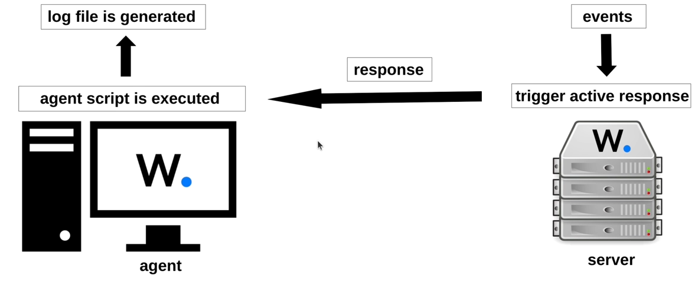
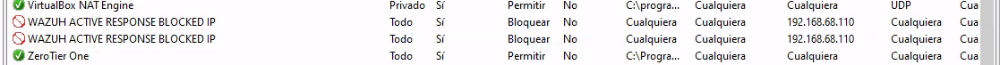

> [[02 - MODULOS/05 - Prácticas (PoCs)|← Volver a Prácticas (PoCs)]] | [[02 - MODULOS/Prácticas (PoCs)/Gestión de Incidentes/00 - Índice del Módulo Gestión de Incidentes|Índice del Módulo]]

---
# Respuesta Automática ante Incidentes (Active Response)

# Respuesta ante Incidentes en Wazuh

 


 

## Introducción a la automatización de respuesta ante incidentes

 

La **respuesta automatizada** permite actuar de forma inmediata ante eventos críticos detectados en la infraestructura, ya sea mediante reglas predefinidas, scripts personalizados o integraciones avanzadas. Esta capacidad es esencial porque los equipos de seguridad reciben miles de alertas diarias, y gestionarlas manualmente no es escalable ni eficiente.

 

Con Wazuh, estas respuestas automáticas pueden incluir:
 

 
* **Contención inmediata:** aislamiento de sistemas comprometidos para evitar propagación de amenazas.
 
* **Bloqueo dinámico de tráfico:** aplicación de reglas de firewall para cortar comunicaciones maliciosas.
 
* **Desactivación de cuentas comprometidas:** impedir escalamiento de privilegios o accesos no autorizados.
 
* **Restricción de accesos:** limitar privilegios o bloquear conexiones desde ubicaciones sospechosas.
 
* **Redirección de tráfico (null route):** envío de tráfico malicioso a rutas inexistentes como medida defensiva.
 

 

Para esto, Wazuh incluye **scripts de respuesta activa predefinidos** tanto para Windows como para Linux, además de la posibilidad de crear scripts personalizados. Estos scripts se ejecutan automáticamente cuando un evento coincide con una regla configurada. Por ejemplo: bloqueo de IPs con `firewall-drop` (Linux) o `netsh` (Windows), reinicio de servicios Wazuh, y redirección de tráfico a rutas nulas.

 

### Flujo de funcionamiento

 

 
1. Los **agentes** envían eventos constantemente al **servidor Wazuh**.
 
2. Si un evento coincide con una **regla que tiene respuesta activa**, se dispara la acción asociada (bloqueo, eliminación, aislamiento, etc.).
 
3. Se genera un registro en el servidor, permitiendo auditar si la respuesta fue ejecutada correctamente.
 

 

Este enfoque brinda **defensa proactiva** y reduce el tiempo de reacción ante incidentes. Puede adaptarse tanto a servidores Linux como a estaciones Windows, reforzando toda la infraestructura desde un único punto central.

 



 

> [!note]
> 
 
> Recursos en: https://github.com/wazuh
> 
> Reglas de referencia: 0580-win-security_rules.xml y 0600-win-wdefender_rules.xml
> 

 

## Bloquear ataques RDP por fuerza bruta

 

En esta sección aprendemos a **detectar y bloquear ataques de fuerza bruta** dirigidos a **RDP (Remote Desktop Protocol)** en sistemas Windows mediante **Wazuh Active Response** y el script `netsh` integrado.

 

### Objetivo

 

 
* Detectar intentos repetidos de login fallidos en RDP.
 
* Automatizar la respuesta bloqueando la **IP del atacante** en el firewall de Windows.
 
* Simular un ataque real utilizando **Hydra** desde Kali Linux.
 

 

### Escenario

 
 
 
 
 
 
 
 
 **Servidor Wazuh**
 **Agente Windows**
 **Kali Linux**
 **Hydra**
 
 

| Componente | Función |
| --- | --- |
| | Centraliza logs, reglas y gestiona Active Response. |
| | Máquina objetivo expuesta con RDP activado. |
| | Máquina atacante para ejecutar Hydra. |
| | Herramienta para fuerza bruta sobre RDP. |

 

### Configuración paso a paso

 

#### 1. Configurar Active Response de forma global en el servidor de Wazuh

 

Edita `/var/ossec/etc/ossec.conf` del servidor y añade en la sección `ossec_config`:

 

```bash
# nano /var/ossec/etc/ossec.conf
```

 

```
<command>
 <name>netsh</name>
 <executable>netsh.exe</executable>
 <timeout_allowed>yes</timeout_allowed>
</command>

<active-response>
 <disabled>no</disabled>
 <command>netsh</command>
 <location>local</location>
 <rules_id>100900</rules_id>
</active-response>
```

 

#### 2. Crear la regla personalizada en el servidor Wazuh

 

```bash
# nano /var/ossec/etc/rules/local_rules.xml
```

 

```
<group name="rdp">
 <rule id="100900" level="12" frequency="3" timeframe="120">
 <if_matched_sid>60122</if_matched_sid>
 <description>Possible RDP attack: 3 failed logins in a short period of time</description>
 </rule>
</group>
```

 

Usa la regla base `60122` (fallos de login en Windows) y se activa tras **3 intentos fallidos en 120 segundos**.

 

```bash
# systemctl restart wazuh-manager
```

 

#### 3. Habilitar RDP y Firewall en Windows

 

 
* Activar Escritorio Remoto.
 
* Asegurarse de que **Windows Firewall** está habilitado y permite RDP.
 
* Puede ser conveniente evitar que la cuenta se bloquee a los 3 intentos.
 

 

#### 4. Lanzar ataque con Hydra desde Kali Linux

 

```bash
$ hydra -l ifct0109 -P wordlist/rockyou.txt rdp://192.168.68.109
$ netexec rdp 192.168.68.109 -u ifct0109 -p wordlist/rockyou.txt --ignore-pw-decoding
```

 

#### 5. Verificar el bloqueo automático

 

En el Dashboard de Wazuh:
 

 
* Se verá una alerta con la **IP atacante** y categoría `brute_force`.
 
* En la zona de Threat Hunting busca: `rule.id:100900`
 
* El script `netsh` añadirá una regla de firewall bloqueando la IP.
 

 



 

En el equipo local puedes revisar el archivo:
 

```cmd
C:\Program Files (x86)\ossec-agent\active-response\active-responses.log
```

 

Donde quedará el registro de los intentos de intrusión.

 

### Resultado esperado

 

 
* La IP atacante queda bloqueada automáticamente tras repetidos intentos fallidos.
 
* Hydra deja de poder conectarse: el firewall rechaza el tráfico.
 
* Queda registro en los logs de Wazuh para auditoría.
 

 

### Puntos clave

 

 
* Active Response permite **automatizar defensa** ante ataques comunes.
 
* Hydra es ideal para **pruebas controladas** de fuerza bruta.
 
* Este mismo método puede adaptarse para **otros servicios**: SSH, bases de datos, etc.
 
* Mantener siempre **firewall activo** y reglas personalizadas revisadas.
 

 

## Aislamiento automático de una máquina Windows tras infección

 

El aislamiento de endpoints comprometidos es una medida esencial en la respuesta a incidentes. Con **Wazuh** podemos automatizar esta acción configurando una Active Response que bloquee toda la comunicación de una máquina Windows cuando se detecte una amenaza crítica, evitando así que el ataque se propague por la red.

 

### Objetivo

 

 
* Detectar una infección en una máquina Windows (ej. malware o comportamiento sospechoso).
 
* Ejecutar automáticamente un **script de firewall** que bloquee toda la comunicación de red de esa máquina.
 
* Permitir que el administrador investigue el incidente de forma segura.
 

 

### Arquitectura y flujo de trabajo

 

 
1. **Wazuh Agent (Windows):** recibe la alerta del manager y ejecuta el script de aislamiento.
 
2. **Scripts personalizados:**
 

 
 * `fw.cmd`: script batch que invoca reglas de firewall de Windows.
 
 * `wfblock.ps1`: script PowerShell que gestiona el bloqueo completo de tráfico.
 

 
 
3. **Wazuh Manager:** analiza las reglas (ej. rules_id 62123) y activa el comando.
 

 

### Paso a paso

 

#### 1. Descargar los scripts al agente Windows

 

Abre **PowerShell como administrador** en el endpoint y ejecuta:

 

```cmd
Invoke-WebRequest -Uri https://cursosmfr.es/ifct0109/wazuh/fw.cmd -OutFile 'C:\Program Files (x86)\ossec-agent\active-response\bin\fw.cmd'

Invoke-WebRequest -Uri https://cursosmfr.es/ifct0109/wazuh/wfblock.ps1 -OutFile 'C:\Program Files (x86)\ossec-agent\active-response\bin\wfblock.ps1'
```

 

Esto guarda ambos scripts en la carpeta `active-response\bin\` del agente, donde residen todos los ejecutables que puede llamar Active Response.

 

#### 2. Configurar agent.conf en el Manager para recibir los logs del Defender

 

```bash
# nano /var/ossec/etc/shared/default/agent.conf
```

 

```
<localfile>
 <location>Microsoft-Windows-Windows Defender/Operational</location>
 <log_format>eventchannel</log_format>
</localfile>
```

 

#### 3. Configurar ossec.conf en el Manager

 

```bash
# nano /var/ossec/etc/ossec.conf
```

 

```
<ossec_config>
 <command>
 <name>windowsfirewall</name>
 <executable>fw.cmd</executable>
 <timeout_allowed>yes</timeout_allowed>
 </command>

 <active-response>
 <disabled>no</disabled>
 <command>windowsfirewall</command>
 <location>local</location>
 <rules_id>62123</rules_id>
 <timeout>60</timeout>
 </active-response>
</ossec_config>
```

 

Claves de la configuración:
 

 
* `<command>`: define el comando `windowsfirewall` que ejecuta `fw.cmd`.
 
* `<active-response>`: indica que se ejecutará localmente en el agente cuando se dispare la regla ID `62123`.
 
* `<timeout>60</timeout>`: tras 60 segundos se eliminará el bloqueo. Déjalo vacío si quieres que sea permanente.
 

 

#### 4. Reiniciar el Manager

 

```bash
# systemctl restart wazuh-manager
```

 

#### 5. Generar el evento de prueba

 

Para simular un archivo malicioso descarga el fichero de prueba EICAR:
 

```
Invoke-WebRequest -Uri https://secure.eicar.org/eicar.com -OutFile C:/eicar.com
```

 

Este archivo de prueba simula malware y debe disparar la alerta `62123`, activando el aislamiento.

 

#### 6. Verificación

 

En el Wazuh Dashboard:
 

 
* Busca la alerta `62123` en **Threat Hunting**.
 
* Comprueba que se ha ejecutado el comando `windowsfirewall`.
 

 

En Windows, el firewall mostrará reglas creadas por el script bloqueando tráfico entrante/saliente. Puedes comprobarlo con:

 

```
netsh advfirewall firewall show rule name=all
```

 

```powershell
Get-NetFirewallRule | Where-Object {$_.DisplayName -like "*Wazuh*"}
```

 

## 📚 Navegación

 
 
 → Siguiente módulo
 
 
 ← Anterior: Detección de Malware
 
 
 ↑ Volver al Índice

---

> [[02 - MODULOS/05 - Prácticas (PoCs)|← Volver a Prácticas (PoCs)]] | [[02 - MODULOS/Prácticas (PoCs)/Gestión de Incidentes/00 - Índice del Módulo Gestión de Incidentes|Índice del Módulo]]
